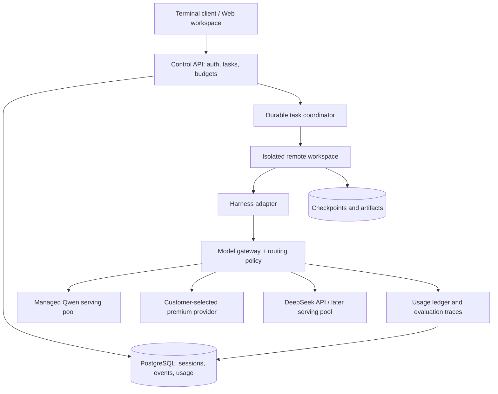

# ADR 0001: Hosted coding agent with managed model routing

Date: 2026-10-25  
Status: Superseded by [ADR 0002](0002-local-first-learning-agent.md); retained as research for a later hosted-agent extension  
Scope: Product direction, harness, remote execution, model serving, routing, personalization

## Decision

Build a remotely hosted coding agent, accessible through a terminal client first and a web workspace next. The customer chooses an approved premium model; TTGL chooses a cheaper coding model and routes eligible work to it. Start by adapting an existing open-source harness through a narrow integration layer. Own the durable session format, workspace lifecycle, model gateway, routing policy, evaluation dataset, and usage ledger.

Use a local harness as the first engineering experiment, with remotely served models. The first customer product executes code remotely. Local execution can remain an explicit development mode. Persistent agents mean durable, resumable work with scheduled or event-driven activation; they do not require an indefinitely running model loop or GPU allocation.

Provisional selections: OpenCode harness and existing client; TypeScript for thin product integration; managed PostgreSQL for authoritative product state; managed object storage for artifacts/checkpoints; managed isolated workspaces; LiteLLM as the provider gateway; Langfuse for traces/evaluations; API-hosted premium models; a benchmark-selected Qwen coding model as the economy tier. Evaluate OpenHands Agent Canvas and Agent Server as a packaged alternative before building a terminal or web interface. Add a Python evaluation/training integration when needed. Begin with API access to DeepSeek; self-host only after workload and economics justify it.

Start with deterministic routing and explicit escalation. Introduce learned routing and customer LoRA adapters only after collected evaluation evidence supports them. These are product-owned extensions, not assumed features supplied by the harness.

### Reuse policy: explicit user preference

Prefer maintained open-source tools and existing managed services, including paid products with free tiers, over custom infrastructure. The boxes in the architecture describe responsibilities, not an instruction to implement each box. Start with existing clients, agent servers, workflow systems, authentication, provider gateways, tracing and billing. Write custom code only for gaps demonstrated by the integration experiment.

| Responsibility | Reuse-first choice | Custom work only if needed |
| --- | --- | --- |
| Agent UI and runtime | OpenCode client/server; compare OpenHands Agent Canvas + SDK/server | Branding, customer task policy and missing integration hooks |
| Provider API adapters, retries, usage export | LiteLLM | Model eligibility, subtask routing and escalation rules |
| Remote execution | E2B managed sandbox candidate [17]; compare current managed offerings | Task lifecycle integration; no custom microVM platform in pilot |
| Long-running jobs | Existing database queue library initially; managed Temporal when required | Task-specific workflow activities and approval rules |
| Traces, datasets, evaluation dashboards | Langfuse [18] plus SWE-bench and project tests | Representative tasks, outcome labels and routing comparisons |
| Identity, database, object storage | Existing managed authentication and storage services | Tenant authorization and product data model |
| Payments and invoicing | Established billing provider; select after current metering/resale review | Reconcile our model/workspace usage ledger to provider invoices |
| Adapter training and serving | Axolotl + vLLM where supported | Authorized data pipeline and promotion criteria |

Free-tier availability, credits, retention, concurrency and commercial terms have not been verified and are not assumed. Prefer a supported paid tier when it lowers total cost or satisfies isolation requirements. Inspect deployment artifacts and licenses, not just README badges. The inspected `daytonaio/daytona` README says that repository became unmaintained in June 2026 and development moved private [19]; do not base a new self-hosted platform on it without a maintained successor. This does not establish the status or capabilities of Daytona's managed service.

## Context and assumptions

- Initial customer: a software team delegating repository tasks that finish as reviewable patches or pull requests.
- First workflow: connect repository → assign issue → inspect progress → review diff and test evidence → approve PR publication.
- The primary outcome is accepted work at a competitive total cost, including retries and sandbox time.
- The customer can select a premium model from a supported catalog, permit or prohibit external providers, and set a task budget. Smart routing is enabled by default with visible policy and an opt-out.
- Small models, premium providers, and model versions must be independently replaceable.
- No traffic volume, GPU contract, customer data policy, latency SLA, or team size has been supplied. Financial examples and delivery estimates below are planning assumptions.
- TTGL currently contains only a README. No existing application constrains the architecture.

## Research basis and limits

Primary repository documentation was read on 2026-10-25. Sources are listed below. Upstream claims are evidence of documented functionality, not TTGL benchmark results. No harness, inference server, or model has been executed during this research.

The environment allowed raw GitHub sources but denied requests to api.github.com, opencode.ai, docs.sglang.io, and huggingface.co. Consequently exact current model cards, provider prices/terms, and the complete latest DeepSeek release catalog could not be independently checked. Do not interpret this ADR as selecting the newest DeepSeek model or verifying its serving compatibility. The current FlashMLA README references DeepSeek-V4.1-Flash; that is a source statement, not a verified model-card finding.

## Alternatives considered

| Choice | What the inspected sources establish | Tradeoff / decision |
| --- | --- | --- |
| OpenCode [1] | Open-source coding agent; provider-independent positioning and client/server architecture; MIT license inspected | First integration candidate. Validate headless operation, remote permissions, stream recovery, provider compatibility and cancellation before committing. Keep an upstream pin and avoid a broad fork. |
| Qwen Code [2] | CLI plus SDK/UI integrations; supports several API protocols and local inference endpoints | Strong comparison candidate for Qwen tool use. It is a harness, distinct from Qwen model weights. Evaluate against OpenCode on identical tasks. |
| Goose [3] | General-purpose agent with CLI, desktop and API; Apache-2.0 indicated in README | Viable if broader workflows become important; terminal coding experience is the initial priority. |
| OpenHands [4] | Current repository describes Agent Canvas; canonical agents, tools and Agent Server live in software-agent-sdk | Evaluate the SDK/server as a cloud-oriented alternative. Do not rely on older descriptions of this repository's structure or assume all enterprise components have the same license. |
| Write our own loop | Maximum control over tool protocol, state and routing | Defer: editing, compaction, cancellation, permissions and recovery are substantial work. Revisit only if adapters cannot meet acceptance tests. |
| LiteLLM [5] | Gateway abstraction over many providers | Candidate provider transport, fallback and accounting integration. TTGL still owns semantic routing, authorization and authoritative billing. Inspect selected edition's license/features. |
| RouteLLM [6] | Routing framework and published general-chat benchmark results | Useful baseline; its reported savings do not establish savings for multi-step coding agents. Train/evaluate on our task distribution. |
| SGLang [7] / vLLM [8] | Production inference frameworks; vLLM documents per-request LoRA on supported models | Benchmark both for the chosen checkpoint. Prefer one engine initially; add a second only for a measured compatibility/performance need. |

## Architecture

GPU serving and code execution are separate pools. Customer code must never run on inference hosts. Model credentials remain at the gateway. Repository credentials are scoped and short-lived; tools receive only the access their task needs.

### Minimal service contracts

- `POST /tasks`: repository/ref, request, premium-model policy, economy-tier permission, budget and idempotency key. Return task ID and initial state.
- `GET /tasks/:id/events`: ordered resumable stream, authenticated by tenant; reconnect from last sequence number.
- `POST /tasks/:id/cancel`: cooperative cancellation, then sandbox termination if needed; retain final patch and usage.
- `POST /tasks/:id/approvals/:approvalId`: authorize one recorded operation against a particular diff or operation digest.
- Internal `HarnessAdapter`: start/resume, submit input, normalize events, intercept model calls, cancel, export checkpoint. Prove support with a pinned harness before building around it.
- Internal `ModelGateway`: normalized messages/tool schemas, eligible model set, route reason, model revision, adapter identity, usage and price version. Preserve provider-specific capabilities through explicit fields.

Schema objects: Tenant, Project, RepositoryConnection, Task, Session, Attempt, Workspace, ToolInvocation, Approval, ModelCall, UsageEntry, Artifact, AdapterVersion and EvalRun. Every tenant-owned object is tenant-scoped in storage and authorization. Avoid logging repository contents or secrets by default.

### Harness and model compatibility

Do not assume an OpenAI-compatible endpoint gives equivalent behavior. Validate streaming, stop handling, tool-call IDs, parallel tools, structured outputs, reasoning fields, context limits, tokenizer/chat template and cancellation. Qwen's README explicitly calls out model-specific tool parsers [9].

Store a canonical conversation and tool-event log outside the harness. Retain the original provider request/response metadata under retention controls. On model switch, provide a validated summary, repository state, outstanding plan, recent tool results and exact tool schemas. Do not attempt to transfer KV caches or opaque provider reasoning state. Finish or cancel a tool operation before switching. Keep a premium model sticky for its subtask when switching would repeatedly destroy context or cache value.

### Remote workspaces and persistence

For the pilot, buy a sandbox service with VM-strength isolation, tenant authorization, snapshots, egress controls and documented cleanup semantics. Select it with a short capability and cost evaluation. If self-hosting becomes necessary, Firecracker is a candidate, but requires KVM and host-level operational work [10]; it is not an application dependency that can simply be launched inside any container.

Use one writable workspace per task. Reuse immutable base images and dependency caches without sharing customer secrets or writable directories. Keep each task on an isolated branch/checkout. Do not mount a host Docker socket or platform credentials. Protect metadata endpoints, restrict outbound destinations and constrain CPU, memory, disk, duration and subprocesses.

Persist event history, base commit, patch, image/dependency identifiers, relevant environment variable names, pending approvals and artifact hashes. Suspend idle workspaces. Resume by restoring a checkpoint or reconstructing the checkout and replaying safe setup operations. Revalidate credentials and external resource state. Filesystem snapshots do not restore network connections or guarantee process continuation.

State machine: queued → provisioning → running → waiting-for-approval / suspended → running → completed / failed / cancelled. Enforce one active worker lease per attempt. Use transactionally recorded transitions and heartbeats. Retry model calls and provisioning with bounded backoff. Tool execution and external writes require operation records and reconciliation: after a crash, inspect whether a PR or other side effect already exists before retrying. Exactly-once external execution is not assumed.

Use a database-backed worker queue initially. Add Temporal [11] when long waits, scheduled agents and multi-service recovery make it valuable. Put nondeterministic model/tool work in activities, not replayed workflow code. Neither Temporal nor a queue makes arbitrary shell commands idempotent.

## Model choices and the DeepSeek inference question

### Economy model

Start the bake-off with Qwen3-Coder-30B-A3B-Instruct and Qwen3-Coder-Next, both explicitly named in the current Qwen repository [9]. Compare a smaller dense coding checkpoint only after verifying its current model card and tool support. Customer adapters may be operationally simpler on a dense model; do not choose one without measuring task quality.

The 30B model has approximately 3B active parameters per token, but still has approximately 30B total parameters. Coder-Next is based on an 80B-total/3B-active architecture. Ignoring runtime overhead, 30B parameters require about 60 GB at BF16, 30 GB at 8-bit or 15 GB at 4-bit; 80B requires about 160/80/40 GB. These decimal arithmetic estimates exclude quantization metadata, KV cache, activations and engine overhead. Active-parameter count does not establish VRAM requirements, GPU count, latency or cost.

Benchmark exact weights, quantization, prompt lengths, concurrency and LoRA configuration. Quantization can change tool correctness and patch quality. A supported model architecture does not guarantee support for every quantized checkpoint or adapter target.

### Premium tier

Offer a small approved catalog of provider-hosted models. The customer's choice governs escalation; do not substitute another paid or external provider silently. Support an explicit premium-only mode. Use one provider integration initially and add others after protocol tests and commercial terms review.

### DeepSeek

Separate model weights, API service, serving engine and kernel libraries. FlashMLA supplies attention kernels; DeepGEMM supplies computation kernels. Neither is a complete gateway, scheduling layer or managed agent service [12,13]. DeepSeek-V3's repository recommends SGLang for that model [14]; this does not verify current V4.1 compatibility.

The FlashMLA README inspected on this date says its 2026-09-30 release dropped Hopper and earlier models including V3/V3.2/V4.0, changed KV-cache formats, and targets newer hardware/model combinations [12]. Therefore installing the latest kernel is unsafe as a generic optimization. Maintain a tested tuple of checkpoint revision, GPU architecture, driver, CUDA, PyTorch, serving-engine version, attention/GEMM kernels, quantization, tool parser and context settings. Pin compatible releases and verify upgrade quality/performance before rollout.

Begin with a DeepSeek API/provider integration if its terms and customer policy permit. Before self-hosting, verify the actual current model card and inference release, available GPUs/interconnect, weight access and licensing, memory capacity, tooling support and end-to-end cost. Do not promise a particular newest inference engine from the sources available here.

## Routing policy

Route at explicit subtask boundaries initially. Keep the harness loop coherent. The router chooses only from models permitted by tenant policy and remaining budget.

1. Apply hard constraints first: data residency/provider permission, model capabilities, context fit, customer premium choice, adapter authorization, budget and availability.
2. Send scoped discovery, summarization and low-risk edits to the economy candidate where benchmark evidence supports it. Planning, ambiguous cross-module changes and repeated failures can start premium immediately.
3. Escalate on malformed tool calls, repeated edit/test failure, lack of progress, context overflow or an explicit user request. Cap retries and total task cost. Self-reported model confidence alone is insufficient.
4. Verify using the repository's relevant tests, type checks and reviewable diff. Treat test commands and results as untrusted until exit status, selected targets and artifacts are checked. Passing tests are useful evidence, not proof of correctness.
5. Log route reason, model/adapter revision, latency, tool validity, tokens, spend and outcome. Show the customer actual model usage and surcharge.

Do not switch models inside a streamed response or unfinished tool invocation. Do not concatenate provider-specific reasoning traces across models. Use canonical summaries and evidence. Failed calls can incur provider charges; reconcile usage rather than counting only successful responses.

Later, train a router using task/subtask features and measured outcomes, with a shadow deployment and randomized evaluation. Optimize accepted-task cost subject to quality, latency and policy constraints. RouteLLM provides a baseline, not a ready-made coding policy [6].

## Customer-specific LoRA and distillation

LoRA is a parameter-efficient adaptation mechanism. Distillation is a training objective/data process. A LoRA trained on a customer's style examples is not automatically a distilled coding agent.

First ship repository instructions, retrieval and reusable tool workflows. Add adapters only when those baselines plateau and enough authorized, representative data exists.

Pipeline: explicit customer opt-in → collect successful trajectories and corrections → secret/PII filtering → deduplicate → customer/repository/time-separated train/eval split → generate permitted teacher examples → execute verification → train a versioned adapter → offline regression and leakage checks → shadow/canary rollout → promotion or rollback. Axolotl is one training-framework candidate [15]; benchmark the chosen base/adapter configuration before production.

Train on useful observable behavior: edits, tool calls, final explanations and verifiable outcomes. Do not depend on access to hidden chain-of-thought. Customer consent does not grant teacher-output training rights: verify each provider's current terms and the model/weight license separately. No cross-customer training by default.

Registry key: tenant + base-weight hash + tokenizer/template revision + adapter version + training provenance. Enforce tenant authorization before selecting an adapter. Include tenant, base model and adapter identity in any prompt/cache partitioning; do not allow cross-tenant cache reuse without a reviewed design. Encrypt artifacts and support deletion/retention for raw traces, datasets, checkpoints and adapters.

vLLM documents per-request LoRA for models implementing its support interface, but explicitly warns about runtime adapter-loading risks [8]. Keep loading administrative and private; serve vetted immutable artifacts from an internal registry. Never accept a caller-supplied adapter filesystem path or arbitrary download URL. Measure adapter hot-set size, loading latency, eviction and throughput loss. Scale beyond a small number of customers only after a multi-adapter load test.

## Pricing and unit economics

Use a platform/workspace allowance plus transparent usage billing. The customer selects a premium model, not an unspecified promise of free premium fallback. Explain economy routing, premium surcharge, retry charges and hard-budget behavior before execution. Reserve budget before expensive steps and stop safely when exhausted. Reject unauthorized escalation rather than silently overspending.

For each attempt:

`cost = economy inference + premium input/output/cache charges + sandbox + storage/network + verification + allocated infrastructure`

`cost per accepted task = total cost of all attempts / accepted tasks`

Self-hosted inference cost must allocate idle capacity: `GPU fleet cost per hour / completed tasks per hour`, with storage, networking and operations added. Token throughput at saturation is insufficient for a latency-sensitive low-utilization service.

Illustrative arithmetic, not prices or measured performance: premium-only costs $1.00/task. An economy attempt costs $0.15 and 30% of tasks then need a full $1.00 premium attempt. Expected inference cost is $0.45/task before verification, extra context, workspace time and failed final outcomes. At 80% escalation it becomes $0.95/task. Routing economics depend on successful delegation and retry cost.

For a surcharge `s`, premium revenue can be `provider charge × (1+s)` plus the disclosed platform fee. A 20% markup gives 16.7% gross margin on that component before other costs. Use versioned price tables, integer/fixed-precision accounting, tenant-scoped ledgers and invoice reconciliation. Verify provider resale and training terms before offering the catalog.

## Validation and release gates

The initial experiment compares harness × model × routing policy, holding repository snapshot, time limit, tool permissions and task budget constant. Start with 30–50 representative tasks for iteration, then a larger untouched holdout for release decisions. Include bug fixes, tests, scoped features, unfamiliar repositories, long contexts, tool errors and dependency/setup failures. Use SWE-bench's evaluation harness for an additional standardized comparison [16], but do not substitute leaderboard results for customer tasks.

Measure task completion and human acceptance, relevant-test execution/pass rate, regressions, tool-call validity, p50/p95 latency, spend per task and per accepted task, escalation rate, restore success and security failures. Separate harness/setup failures from model failures. Run repeated samples where nondeterminism matters. Report uncertainty; do not claim a two-point quality difference is resolved by a tiny sample.

Proposed pilot targets, to calibrate after baseline: routed acceptance within 5 percentage points of premium-only; at least 25% lower cost per accepted task; no cross-tenant access or unauthorized side effects; correct budget enforcement; successful restart/reconnect in every defined fault-injection case. These are acceptance criteria, not results. Start with premium-only if routing fails the quality gate.

Required integration tests: edit and run tests in a remote repository; reconnect after client loss; crash a worker during a tool call; recover without duplicate PRs; cancel running subprocesses; resume after workspace expiry; deny cross-tenant task/adapter access; reject prompt-induced credential exfiltration and metadata access; reconcile streamed/cancelled model usage; enforce provider policy and task budget; roll back a bad adapter.

## Delivery plan

Indicative sequencing for 2–3 experienced engineers; 8–12 weeks to a narrow pilot is an assumption, not a committed estimate. Managed sandboxes and hosted models reduce initial scope. GPU and training work are separate later investments.

| Phase | Deliverable | Exit gate |
| --- | --- | --- |
| 0: 1–2 weeks | Harness bake-off, premium baseline, economy-model trials, task dataset, source/license verification | Select harness with recovery/tool tests; record quality and cost baseline; resolve exact model/engine compatibility |
| 1: 2–3 weeks | Terminal client, task API, remote workspace, streamed events, patch artifacts, premium-only gateway and usage ledger | Assign task remotely, disconnect/reconnect, inspect diff/tests, cancel, enforce spend and tenant boundaries |
| 2: 2–3 weeks | Deterministic economy routing, escalation, diff review and approved PR creation | Meet quality/cost gates on held-out tasks; no duplicate external writes under worker failures |
| 3: 2–4 weeks | Web task workspace, suspend/resume, repository hooks/scheduling, retention and billing hardening | Durable task state survives restarts; approval, cleanup and accounting tests pass; limited customer pilot |
| Later | Self-hosted DeepSeek, learned router, customer LoRA | Each independently improves measured cost/quality enough to justify operational complexity |

Suggested initial repository layout: `apps/api` for thin product integration, `integrations/` for upstream configuration and adapters, `evals/` for tasks/runners and `infra/` for managed-service configuration. Reuse upstream CLI/web clients first. Create dedicated client, gateway, workspace or worker packages only when a demonstrated gap requires them. Pin dependencies and add setup scripts when implementation establishes the actual toolchain. The phase table describes product capabilities; reuse existing implementations to deliver them.

## Consequences and reconsideration triggers

We retain control over the product's durable state, routing and commercial relationship while using upstream agent work. Costs include harness-adapter maintenance, protocol normalization, workspace operations and outcome evaluation. Local and remote mode need distinct permission models.

Switch harness if canonical state export, cancellation, model interception or tool authorization cannot be implemented cleanly. Add Temporal when database-worker recovery becomes too complex. Self-host models only when measured utilization, GPU availability and operational cost beat hosted alternatives within the quality/latency target. Add adapters when authorized data and held-out results justify their training and serving costs. Build a custom agent loop only after measured upstream limitations justify owning it.

## Outstanding decisions

These do not prevent Phase 0: initial language/repository mix; premium-model catalog; residency and retention requirements; customer data/training permissions; GPU budget; expected concurrency and task duration; sandbox supplier; final pricing model. Before commercial launch, exact checkpoint licenses, teacher-output terms and provider resale terms must be verified from current primary documents.

## Sources

All accessed 2026-10-25 through the raw repository files corresponding to these links. Links point to moving upstream branches; freeze release/commit identifiers during Phase 0 before implementation.

1. [OpenCode README](https://github.com/anomalyco/opencode/blob/dev/README.md), [MIT license](https://github.com/anomalyco/opencode/blob/dev/LICENSE).
2. [Qwen Code README](https://github.com/QwenLM/qwen-code/blob/main/README.md).
3. [Goose README](https://github.com/block/goose/blob/main/README.md).
4. [OpenHands current README and SDK boundaries](https://github.com/All-Hands-AI/OpenHands/blob/main/README.md).
5. [LiteLLM README](https://github.com/BerriAI/litellm/blob/main/README.md).
6. [RouteLLM README and benchmark scope](https://github.com/lm-sys/RouteLLM/blob/main/README.md).
7. [SGLang README](https://github.com/sgl-project/sglang/blob/main/README.md).
8. [vLLM LoRA documentation](https://github.com/vllm-project/vllm/blob/main/docs/features/lora.md).
9. [Qwen3-Coder model family, architecture and parser notes](https://github.com/QwenLM/Qwen3-Coder/blob/main/README.md).
10. [Firecracker architecture and KVM requirement](https://github.com/firecracker-microvm/firecracker/blob/main/README.md).
11. [Temporal durable execution](https://github.com/temporalio/temporal/blob/main/README.md).
12. [FlashMLA compatibility notice and kernel scope](https://github.com/deepseek-ai/FlashMLA/blob/main/README.md).
13. [DeepGEMM scope and requirements](https://github.com/deepseek-ai/DeepGEMM/blob/main/README.md).
14. [DeepSeek-V3 serving recommendations and license distinction](https://github.com/deepseek-ai/DeepSeek-V3/blob/main/README.md).
15. [Axolotl training framework](https://github.com/axolotl-ai-cloud/axolotl/blob/main/README.md).
16. [SWE-bench evaluation framework](https://github.com/SWE-bench/SWE-bench/blob/main/README.md).
17. [E2B sandbox SDK and cloud execution](https://github.com/e2b-dev/E2B/blob/main/README.md).
18. [Langfuse cloud/self-hosted observability and evaluation](https://github.com/langfuse/langfuse/blob/main/README.md).
19. [Daytona repository maintenance notice](https://github.com/daytonaio/daytona/blob/main/README.md).
20. [OpenHands Software Agent SDK](https://github.com/OpenHands/software-agent-sdk/blob/main/README.md).
