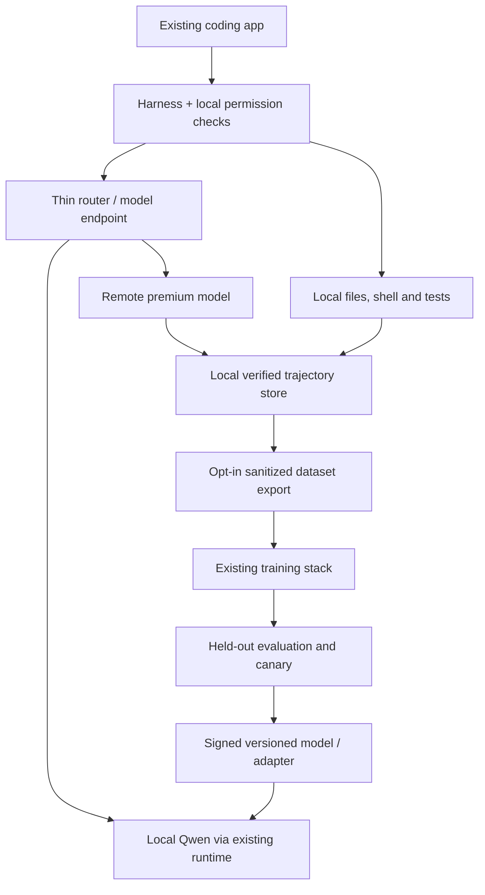

# ADR 0002: Local-first coding app with remote escalation and continual improvement

Date: 2026-10-25  
Status: Proposed; supersedes ADR 0001's hosted-first product direction

## Decision

Build a Claude-like coding app that runs a small Qwen model locally at no software or inference-service charge, routes difficult work to a paid remote model, and improves the local model using verified, authorized teacher outputs. Start with an existing coding client and local inference runtime. Add a thin routing and learning integration rather than writing an agent platform.

The long-term objective is **more accepted work completed locally**, measured at a fixed quality threshold. A lower remote-call rate alone is insufficient: a router that stops escalating can reduce calls while making the product worse.

Use existing software wherever possible, including paid services and free tiers. The first deliverable is a configured upstream coding app demonstrating this loop, not a new desktop shell. Remote persistent agents remain a later extension.

## Product behavior

1. Install the app and a hardware-appropriate Qwen checkpoint. Explain disk/RAM needs before download.
2. Work on a local repository using local tools and model inference by default.
3. Detect work that needs stronger reasoning or has stalled. Route it to the user's selected remote model within a visible spending and data-sharing policy.
4. Execute the returned edits/tools through the same local permission boundary; inspect diffs and run repository checks.
5. Save useful, verified examples locally. With explicit enrollment, contribute permitted sanitized examples to a managed training pipeline or train an individual adapter.
6. Distribute tested, signed local-model updates. Increase local routing only when held-out evaluation shows that the updated model earns it.

“Free local” means no inference API bill. Hardware, electricity, disk space and download bandwidth remain user resources. Offline mode works with downloaded weights and local tools; it cannot escalate or fetch missing dependencies. A local-only setting must prohibit remote model and telemetry transmission.

## Reuse-first stack

| Layer | Initial choice | What we add |
| --- | --- | --- |
| Coding client and tools | OpenCode; compare Qwen Code on the same tasks | Configuration, model policy, minimal routing hooks; reuse upstream UI |
| Local inference | Ollama for the integration prototype; compare llama.cpp server for packaging/control [1,2] | Hardware profiles, pinned model artifacts and tested tool templates |
| Router | Rules first; RouteLLM as a learned-routing baseline | Coding-specific outcome features, quality calibration and escalation policy |
| Remote gateway | LiteLLM if its proxy overhead is justified; direct supported provider adapter for a single-provider prototype | Budget/provider policy and usage reconciliation |
| Teacher | User-selected remote model; investigate DeepSeek-V4.1-Flash | Exact model/API validation, price/terms review and verified output collection |
| Dataset/evaluation | Local artifacts initially; Langfuse for opted-in managed evaluation | Repository tasks, execution evidence and held-out splits |
| Training | Unsloth or Axolotl for LoRA/SFT; TRL for DPO/GRPO experiments [3,4] | Data selection, verifiers, promotion gates and release pipeline |
| Updates | Existing signed application/model distribution tooling | Version compatibility manifest, rollback and rollout policy |

Avoid deploying both Ollama and llama.cpp as independent services initially. Verify the chosen runtime supports the exact Qwen architecture, quantization, tool-call formatting and adapter delivery path. Likewise, use one training stack initially. Existing software support is a prerequisite to selection, not assumed from project names.

The OpenHands platform, E2B, Temporal and a hosted control plane from ADR 0001 are not MVP requirements for this local-first direction.

## Architecture

Remote inference and remote execution are different. In this product, code execution stays local initially. Remote escalation can still transmit code, prompts and tool results; show the relevant disclosure and obey repository/customer restrictions. Model output never bypasses the harness's tool permissions. Keep any hosted product-service credentials off client devices; user-supplied provider keys belong in the OS credential store, not logs or training records.

## Selecting a genuinely local model

Do not select Qwen3-Coder-30B-A3B merely because it activates about 3B parameters per token. It still has about 30B total parameters; Coder-Next has about 80B. Those may suit well-equipped machines but are poor assumptions for an ordinary laptop. See ADR 0001 for source-backed architecture notes and approximate weight-memory arithmetic.

Start with a **verified current small dense Qwen coding-capable checkpoint**, tentatively in the 1.5–7B total-parameter range, not an invented model name. Include an 8B-class option if current supported checkpoints justify it. Check model cards, license, runtime support and tool reliability before pinning the catalog. Code-specialized older checkpoints and newer general Qwen checkpoints should compete on the same tasks.

At 4 bits, raw weights for 3B and 7B models are roughly 1.5 GB and 3.5 GB, respectively, excluding quantization metadata, KV cache and runtime allocations. These figures do not establish performance or device compatibility. Define tested profiles for at least a constrained laptop and a higher-memory machine. CPU-only mode is a functional fallback, with latency measured rather than promised.

Hardware discovery chooses a default, but users can override it. Benchmark prompt ingestion, tool-call validity, sustained generation, context memory, thermal behavior and end-to-end task completion. Smaller context windows plus repository search and summaries may be more usable than allocating a huge KV cache.

## Router design

Follow-up research identified DeepSeek's **DeepInfer** engine and its implemented **DSpark confidence-scheduled verification**. See [ADR 0003](0003-confidence-aware-routing.md) for pinned source analysis and the proposed task-routing adaptation. This resolves the engine-identification gap recorded earlier; exact model-card/API rights and runtime integration still require verification.

Begin without a separate router model. Use explicit features: task category, affected files/modules, context size, required capabilities, repeated failed patches, invalid tool calls, elapsed budget and test feedback. Local discovery can precede premium planning; highly ambiguous tasks can start remote directly.

For a learned router, compare:

- Rules as the cheap, explainable baseline.
- RouteLLM or a small local classifier trained on task/subtask outcomes.
- A small generative model only if classification accuracy justifies its additional latency and memory.

Training labels should come from running local and remote alternatives on representative tasks, not just predicting which prompt looks difficult. Use tenant/repository/time-separated holdouts and account for selection bias: escalation logs alone omit hard tasks the local model failed without escalating. Randomized evaluation on authorized tasks can supply counterfactual comparisons without duplicating user-visible edits.

Optimize `P(accepted result | local model, task, hardware)` against escalation cost, latency and privacy constraints. Use confidence calibration and a reject/escalate option. Calibrate anew after each model or adapter release. Never route a restricted repository remotely just because local confidence is low.

Switch at subtask/tool boundaries; preserve canonical messages, current diff, plan and recent evidence. Do not transfer KV caches or opaque reasoning state between providers. Bound retries. When the remote budget is exhausted, ask the user to fund escalation or continue locally with a clear limitation; do not silently spend more.

## Learning loop: distillation first

Owning app distribution gives us an update channel. It does not by itself provide permission to upload customer code or train on every teacher's output. Where we control the teacher model and its license permits the intended use, self-hosting may simplify output-use rights. Verify rights for the actual weights and API contract; do not infer them from an open-source kernel license. Do this once per teacher integration, then automate provenance checks.

Stage A: capture observable trajectories: task context, relevant repository snapshot, tools, patch, test evidence, user correction and final accepted result. Avoid hidden chain-of-thought. Redact secrets and preserve customer boundaries. A teacher response is a candidate, not a correct label.

Stage B: verify examples through compilation, tests, lint/type checks where meaningful, security checks and review. Filter hallucinated tool calls, incomplete patches and teacher outputs that only pass weakened tests. Split by repository/task family/time before generating near-duplicate examples. Maintain an untouched evaluation set.

Stage C: supervised fine-tuning using LoRA/QLoRA on a stable local base. Begin with broad task adaptation, then optional customer-specific adapters. Train multi-step observable behavior as well as final answers. Mix representative existing capabilities with new examples to limit forgetting. Keep failed local attempts paired with verified successful repairs for later preference training.

Stage D: export the trained result to the deployment runtime. Prove the entire chain: base revision → training adapter → merge or supported adapter loading → quantization/export → local tool-use tests. A LoRA supported by a training framework is not automatically loadable by Ollama or a particular GGUF model. If necessary, distribute a merged, quantized model artifact using an existing exporter; budget for its larger download size.

Stage E: benchmark, sign, canary and release. Keep a compatible previous version installed or recoverable. Device updates require sufficient disk space and user control; do not retrain continually in the background by default.

Two separate offerings are possible: shared models improved from opt-in licensed/sanitized data, and isolated customer adapters trained only on that customer's authorized data. Start with one global base plus local repository instructions/retrieval. Add individual adapters only if their quality gain outweighs fragmented data and deployment costs.

## RLAIF: useful later, not the first training step

RLAIF means AI-generated feedback supplies preference or reward signals. It does not prescribe one algorithm. A practical first experiment is teacher-ranked candidate pairs followed by DPO in TRL. Full online RL can follow if evidence warrants it.

For code with executable correctness checks, prefer verifiable rewards for compilation/tests and actual task success. GRPO or another supported RL method can combine those signals with carefully weighted AI review for maintainability or instruction following. Tests can be incomplete and reward hacking is possible, so keep independent tests and held-out human review. Never let the trainee edit the reward definition or hidden test set.

Compare on the same held-out tasks: base → verified SFT → SFT+DPO → any online RL candidate. Count teacher judgments, candidate generation, training GPUs and validation as costs. An AI judge can share a teacher's blind spots; use execution evidence and independent review rather than treating agreement as truth.

Local inference and local training have different hardware needs. Default training runs as a controlled offline/managed job and distributes artifacts. Optional on-device personalization comes later, on explicitly supported hardware and with resource limits. Do not promise free continuous training on every laptop.

## Evaluation and economics

Track accepted-task rate, local-only accepted-task rate, escalation rate, end-to-end latency by hardware class, invalid tools, regressions, privacy-policy enforcement and total cost per accepted task. A task counted as local must not quietly use a remote planner/judge during normal execution. Report evaluation-only teacher calls separately.

Release gates: no regression beyond an agreed tolerance versus the previous version; improved local-only acceptance on a held-out task mix; acceptable latency/memory on each supported device; successful rollback; correctly enforced remote budget and data policy. Increase local routing only after those gates pass. Keep a premium-only baseline to measure the quality gap.

`amortized task cost = remote inference + hosted product costs + training/evaluation/update cost allocated per task`

For the user, also report local hardware/energy and latency separately from API spend. Central serving savings do not make model downloads, teacher data generation and training free. Early benefit can come from a good local base and routing without any fine-tuning.

## Delivery sequence

1. **Runnable experiment:** existing coding client + one local runtime + verified small Qwen checkpoint + one remote provider. Manual switching, local tool permissions and a small representative task set. No custom desktop UI.
2. **Automatic routing:** a thin endpoint or harness hook, deterministic escalation, spending limits and routing evidence. Validate provider protocols and switch boundaries. Reuse gateway capabilities where available.
3. **Data flywheel:** local trajectory records, opt-in export, verification and untouched holdouts. Establish teacher-output rights and provenance. Show accepted remote repairs can become useful local training examples.
4. **First model update:** existing SFT/LoRA tooling; export to the exact local runtime; quantized-model regression tests; signed rollout and rollback. Measure improvement before expanding collection or adapter count.
5. **Learning research:** learned router, DPO/RLAIF and verifiable-reward RL, each against the simpler baseline. Add customer adapters and remote persistent execution only when demand and measured gains justify them.

Immediate engineering scope is steps 1–2. Distillation is the next experiment; RLAIF is a gated extension. No hosted workspace, custom orchestration platform or GPU cluster is necessary to test the core proposition.

## Research limits and sources

This ADR builds on the primary-source research and bibliography in [ADR 0001](0001-hosted-coding-agent.md), including OpenCode, Qwen Code, RouteLLM, LiteLLM, Qwen model architecture, DeepSeek kernels, Langfuse, Axolotl and evaluation tooling. Additional READMEs below were inspected on 2026-10-25. No software/model benchmark or training run has been performed. Current model cards and DeepSeek-V4.1-Flash API/weight availability, license and serving compatibility remain unverified because relevant documentation domains were denied by the environment's network policy. Do not claim that exact model is integrated yet.

1. [Ollama](https://github.com/ollama/ollama/blob/main/README.md).
2. [llama.cpp](https://github.com/ggml-org/llama.cpp/blob/master/README.md).
3. [Unsloth](https://github.com/unslothai/unsloth/blob/main/README.md).
4. [TRL](https://github.com/huggingface/trl/blob/main/README.md).
