# Codex Usage Optimizer — coding-agent implementation guide
Version 1.0 · 4 November 2026

## 1. Product behavior and scope

Build a local application that observes ordinary coding-agent work and helps the user improve it. Users import historical logs or enable a collector, choose their priority (less context, faster completion, lower modeled API cost, or balanced quality), and review a short evidence-backed suggestion queue. The agent groups and investigates data, matches relevant recipes, prepares a concrete change, and explains its expected effect. Accept/Decline/Later is the central interaction. Accepted changes get bounded trials, independent verification, measured results and rollback.

The 100 recipes are an on-demand expert content pack, not an enormous always-loaded prompt and not 100 guaranteed optimizations. Most need project/tool-specific discovery before a change is ready. Start with deterministic statistics and a few well-tested patch types. Use an LLM for interpretation and proposal drafting; it must cite computed evidence and cannot invent totals.

This focused MVP precedes the older context/memory research framework. No vector database, learned memory policy, model proxy or new coding harness is needed to start. Reuse the earlier harness's isolated verification/accounting for trials where useful. This guide supersedes the initial implementation priority, not the existing research results (none have been run).

## 2. Architecture and stack

Use a local TypeScript application with a small HTTP API and web UI; SQLite for normalized metadata, proposals, decisions and experiment state; filesystem blobs for exact raw/derived logs. A Python reference detector is included only to demonstrate the analysis contract. Production aggregation may use SQLite or read-only DuckDB/Parquet exports from AI Observer. Keep source adapters replaceable and versioned.

```mermaid
flowchart LR
  Sources[ccusage + Codex rollouts + optional observer] --> Import[Read-only import / incremental collector]
  Import --> Store[Normalized events + exact blobs]
  Store --> Stats[Deterministic grouping and metrics]
  Stats --> Agent[Optimizer agent + selected recipes]
  Agent --> Queue[Evidence-backed suggestion queue]
  Queue --> Decision[Accept / Decline / Later]
  Decision --> Trial[Scoped executor + matched trial]
  Trial --> Verify[Quality, diagnostic and accounting checks]
  Verify --> Result[Measured result / rollback]
  Result --> Queue
```

The optimizer can be an ordinary Codex analysis session with read-only bounded queries, or a local LLM adapter if the user wants local analysis. Do not route private raw logs to an external model implicitly. The existing local-LLM requirement for memory reflection applies if that subsystem is used; the MVP need not run memory synthesis. Record optimizer inference/resource overhead separately from target-agent performance. Tag optimizer sessions to avoid recursive self-analysis dominating the dataset.

## 3. Source capabilities and historical import

### ccusage adapter

Import a version-pinned JSON report with its command/config/source provenance. Discover actual installed flags using help; documented examples include `ccusage codex daily` and `ccusage codex session`. Treat schemas as versioned adapters, not a guessed universal JSON shape. ccusage provides aggregate usage and estimated pricing; it is not a complete per-tool profiler. With only aggregate data, show expensive session/project trends and **needs more evidence** for tool-specific recipes.

### Raw Codex rollout adapter

Read authorized copies of `.jsonl` and supported compressed logs from configured session/archive roots. Never execute commands embedded in logs. Stream-parse with bounded line/payload sizes, preserve unknown fields and retain source path/hash/offset. Join tool requests/results by durable IDs; do not correlate solely by timestamp proximity. Handle partial files, ongoing sessions, code-mode nested calls, resumes, fork lineage and missing token/duration fields. Distinguish full tool output from model-facing truncated output. Do not assume the archive has every application/window/URL or exact timing.

### AI Observer adapter

Use its documented historical import/file watching and supported exports/API after validating source/version. Its private storage schema is not an unversioned dependency. Prefer portable exports where available. Test archived sessions and path overrides explicitly rather than assuming automatic discovery. Avoid simultaneous overlapping file imports/live ingestion that double-count the same events. A historical record can be informative without reconstructing an exact model-call graph.

### Optional Langfuse adapter

Use its versioned API/CLI/export for traces and observations. Native integration is useful for new tracing; do not assume installing it backfills all old sessions. Restrict analysis tools to needed read operations. Never configure a cloud destination by default when local-only collection was selected.

Capabilities per source: reported usage grain, cached reads/writes, tool args/results, model-facing text, call timing, request correlation, application metadata, repo revision and verified outcome. Unknown is explicit. Imports run a read-only discovery/preview, then create an immutable source manifest and idempotency keys. Preserve the source bytes and do not edit original logs. Keep raw histories local and out of the downloadable report unless explicitly selected.

## 4. Normalized data and attribution

Tables: sources, import_jobs, sessions, model_calls, tool_calls, content_blobs, tool_versions, config_snapshots, aggregate_windows, detector_findings, proposals, proposal_versions, decisions, trials, trial_runs, verification_results, rollbacks, suppressions, analysis_jobs and ledger_reconciliation.

Each tool call: source/native call ID, session/task/repo IDs, tool/server/operation, sanitized argv or structured arguments, start/end timestamps, explicit duration if recorded, success/exit/timeout, raw stdout/stderr refs, model-facing result ref, bytes, estimated payload tokens, tokenizer/version, completeness and metadata-source confidence. Tool family is derived and versioned; retain the original name. For scripts, group by canonical executable/script plus meaningful option family, not by stripping all arguments indiscriminately. Preserve user-specific scope without exposing secret argument values.

Application context is optional observed metadata, not inferred fact. Browser URL/window title/file path may come from a tool result or explicitly enabled adapter. Redact credentials/query secrets and record capture coverage. No whole-desktop surveillance is necessary for coding traces; adding it is a separate product scope.

Model calls retain reported input, cached read/write detail, output, reasoning subset, request identity, auth/cost basis and inclusion semantics. Use exactly one authoritative grain. Convert cumulative snapshots to deltas, deduplicate repeated usage and avoid parent-inclusive child double counts. Null remains missing. Reconcile ccusage aggregate totals against detailed records and show residuals, parser coverage and conflicting estimates.

Keep these concepts separate: raw command output bytes; text actually presented to the model; tokenizer-estimated result size; provider-reported request tokens; attributed downstream exposure; modeled dollars; actual billed charges. Never assign all input tokens of the next request to its last tool call. A smaller result may be resent, cached, summarized or dropped later. Sum of parallel tool durations is work-time, not elapsed task time.

## 5. Analysis and candidate generation

Run deterministic rollups first: counts, total/median/p95 result size, total/median/p95 duration, failure/retry frequency, repeated content hashes, unchanged reads, verbose-success share, schema footprint where actually observed and coverage. Group by tool/server/operation, command family, project and task category. Show skew and denominators; do not overfit to one outlier.

Each detector returns evidence IDs and eligibility, never a ready-to-apply universal command. Match recipes through a compact index and load 3–10 relevant entries. The LLM examines bounded representative source slices, asks read-only questions, verifies tool options and drafts at most five high-value non-overlapping proposals per review. Missing evidence yields instrumentation suggestions rather than invented diagnostics.

Initial production detector priorities: oversized passing-test output (OPT-001); generated-tree search noise (OPT-022); repeated unchanged reads (OPT-045); repeated identical failure (OPT-062); oversized MCP collections (OPT-031/033). The included reference analyzer implements only OPT-001 and a clearly labeled optional reduction scenario. The other 99 recipes are documented hypotheses; their detectors/adapters are backlog work.

Proactive behavior: analyze after newly completed sessions or a configurable minimum new evidence interval, with no external model call on every tool event. This is application behavior to implement, not an automation installed by this handoff. Stay quiet when nothing material changed. Merge duplicate suggestions by fingerprint (recipe+repo+tool family+config preimage+evidence signature); declining suppresses the same proposal until a material evidence/version change or user-chosen expiry. A rephrased LLM message is not a material change.

## 6. Suggestion content and estimates

Every review-ready card includes: title; repository/task/profile scope; recipe IDs; exact evidence references; observation window and eligible frequency; baseline metric with source/coverage; concrete displayed patch/config/command change and preimage hash; applicable tool/version; expected context/time effects with basis; uncertainty and assumptions; quality/diagnostic risks; trial budget and verification plan; rollback; overlap/conflict group.

Evidence levels: `observed`, `replay_estimate`, `scenario`, `measured_trial`, `unknown`. Never present an assumption interval as a statistical confidence interval. With only baseline payload and frequency, forecast savings is null until a tested transformation or explicit scenario exists. A scenario might be: 30k estimated payload tokens over three calls; assuming a 60% reduction produces 18k fewer payload tokens over those same calls. That is **not** measured model-token/cost savings or a guaranteed future reduction. Include zero in uncertainty when the mechanism is untested.

For measured replay, calculate transformed output on the same raw fixture without paid inference; check semantic/diagnostic invariants and count actual presented output. For command changes that rerun tests, a real isolated execution is needed. Cost/time claims require end-to-end trials; output-only silence may not speed execution at all. Include test repairs, retries, cache differences and optimizer overhead. Forecast future exposure only under explicit usage-rate/time-window assumptions. Do not compound overlapping proposals by summing percentages.

Ranking uses the user's objective with an explainable score: estimated exposure × eligibility × confidence, discounted for risk, implementation effort and overlap. Missing savings cannot be assigned arbitrary precision; rank by observed opportunity and mark unestimated. No opaque universal “efficiency score.” Show quality metrics alongside resource improvements.

## 7. Small review UI

Main views: Overview, Suggestions, Evidence, Experiments and Settings. Overview shows imported window/source coverage, top resource consumers and the selected objective. Suggestions shows a bounded queue, with status/filter/sort and compact evidence rows. Card actions are **Accept & test**, **Decline**, **Later** and **Inspect evidence**. A ready card must have a concrete diff/scope/budget before accepting. Non-ready cards show **Prepare change** or **Collect evidence**, not a misleading apply button.

Accept records proposal version, displayed patch hash, exact scope and trial budget. It does not allow arbitrary global edits, removal of required verification, access-policy changes, future unrelated recommendations or external publication. A trial can adopt the displayed change only if the UI's acceptance choice explicitly includes adoption on passing criteria. Default is review measured result before permanent adoption; the UI must disclose this. Decline records optional reason; Later defers without modifying settings. Review decisions are transactional/idempotent and linked to the current user/session.

Evidence view shows a minimal redacted excerpt, source IDs, raw versus model-facing sizes, timing provenance and missingness. No raw secret or executable log instructions are rendered. Experiment view compares baseline/treatment, task checks, output sizes, latency, model usage, failures and confidence/limitations; offers Adopt/Roll back as applicable. Explain “modeled API cost” for subscriptions. No automatic cash-saving claims.

The included `ui/review.html` is an offline synthetic-data interaction prototype. It records choices in browser state and exports a decision JSON; it performs no settings changes, monitoring, experiments or backend calls. Production replaces this with real evidence and server-enforced authorization/state transitions.

## 8. Executor, trials and rollback

Separate analysis from deterministic application. Start with allowlisted patch types: task-local command/reporter option, wrapper profile, bounded response parameter and project-local tool exposure. Prepare a reversible diff, validate version/help support and repository instructions, snapshot preimages and check for intervening edits. No shell interpolation from logs or model output; structured argv and explicit paths only. Changes outside the displayed scope require a new proposal. Credentials, network/security changes and irreversible deletion are not optimization recipes to auto-apply.

Trial baseline/treatment on the same commit, task inputs, dependencies and environment in isolated workspaces. Use representative passing and failing fixtures for output reducers so preserved exit status and diagnostic visibility are tested. Focused iteration must not remove required final suite/coverage/review. Randomize trial order; record warm/cold conditions and resource contention. Two or three runs diagnose feasibility, not publication-grade causality. Use paired task-level uncertainty for larger studies; show raw counts and inconclusive results honestly.

Trial state is durable: accepted→preflight→running→verification→measured→adopted/rolled_back/inconclusive. Cancellation stops owned processes and retains partial spend/evidence. Rollback restores only matching managed changes; if the user edited the same file, produce a reviewed reverse diff rather than overwriting their work. No repeated blind retries. Report actual failures and validation debt even when payload decreased.

## 9. API and contract outline

Proposed local API: `GET /sources/capabilities`, `POST /imports/preview`, `POST /imports`, `GET /metrics`, `POST /analysis`, `GET /suggestions`, `GET /suggestions/:id/evidence`, `POST /suggestions/:id/prepare`, `POST /suggestions/:id/decision`, `POST /trials`, `GET /trials/:id`, `POST /trials/:id/adopt`, `POST /trials/:id/rollback`. These are product contracts, not existing third-party endpoints. Reject stale proposal versions and invalid transitions. Enforce authentication/CSRF/origin controls for local mutation endpoints; bind locally by default.

Included JSON Schemas define normalized tool-call fixtures, suggestions, decisions and recipes. They are intentionally backend-neutral and include provenance/missingness. Runtime semantic validators enforce capability sufficiency, source refs, nonnegative estimates, compatible scope/preimages, conflict groups and state transitions beyond JSON shape.

## 10. Implementation backlog

| ID | Deliverable | Completion evidence |
|---|---|---|
| U01 | App skeleton, contracts, fixture imports and local storage | No paid calls; invalid schemas and unknown data preserved safely |
| U02 | ccusage JSON adapter and source capability UI | Aggregates reconcile; tool attribution unavailable until detailed source |
| U03 | Raw Codex/AI Observer historical adapter | Streaming, dedup, archives, partial files, missingness and versions tested |
| U04 | New-session collection with low overhead | Normal agent work unchanged; collector failures fail open with visible gaps |
| U05 | Rollups and initial five detectors | Evidence-backed results; no invented timing/tokens |
| U06 | On-demand 100-recipe selection and analysis agent | Bounded source queries; verified options; ≤5 deduplicated suggestions |
| U07 | Estimate engine and evidence card | Observed/scenario/replay/trial distinct; no double counts |
| U08 | Review queue and decision API | Versioned Accept/Decline/Later, stale-preimage rejection |
| U09 | Scoped executor, isolated trials and rollback | Passing/failing diagnostics preserved; unrelated user files untouched |
| U10 | Before/after reports and suppression/learning | Whole-task outcomes/costs; declined fingerprints respected |
| U11 | Optional Langfuse adapter and read-only analysis integration | Actual deployed API compatibility, local endpoint explicit |
| U12 | Expand detectors based on real traces | Add meaningful rules from the 100 recipes only when evidence supports them |

MVP=U01–U10 with a few verified patch types, not 100 autonomous editors. Deliver lockfiles, help/version probes, synthetic report, acceptance evidence and a carefully scoped real pilot only after sources and budgets are configured. No installation, background scheduler, private-log ingestion or configuration mutation is performed by this pack.

## 11. Durable optimization history and saved comparisons (v1.1)

OPTIMIZATION_HISTORY.md is normative for accepted/rejected history, implementation receipts, exposure tagging and before/after evaluation. Acceptance, implementation and evaluation are independent state dimensions. Every accepted change gets a versioned comparison plan and parameterized read-only query, baseline snapshot, verified activation evidence and revisioned results. Compare techniques by stable tool identity with distinct effective profile hashes. Signed outcomes can be worse, mixed or inconclusive; original forecasts remain unchanged. Add U13–U17 and H01–H16. Included SQLite SQL/fixtures demonstrate query semantics without importing user history.
