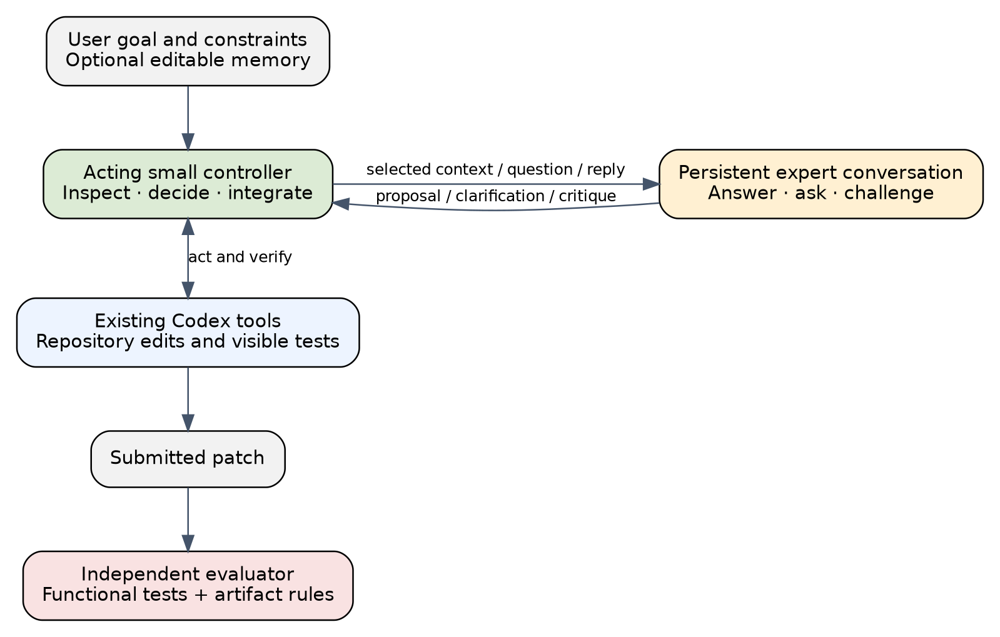

# System and implementation

The central mechanism is a continuing conversation between an acting small
controller and one or more experts. The four personal-agent capabilities below
are useful extensions, not four mandatory components of the hypothesis. The
minimal system can omit personal memory entirely and still test conversational
routing. Expert replies can ask for missing information or challenge the current
plan. The controller can supply evidence, reject a suggestion or request a
revision; both threads persist across the exchange. A bounded conversation is
therefore distinguished from a single request followed by an accepted answer.

## Four connected capabilities

The system state at decision time is
$x_t=(g,m_t,h_t,w_t,b_t)$: the current goal and mandatory constraints $g$, editable
memory $m_t$, observable interaction history $h_t$, workspace state $w_t$ and
remaining resource budget $b_t$. The controller's available actions are local
work, expert consultation, verification, integration, memory proposal and task
completion. This is a partially observed sequential decision problem; an
initial-prompt router observes only a restricted state before any local work.

**Personal understanding.** Memory contains explicit goals, project decisions,
preferences and relevant history with identifiers and provenance. Facts remain
ordinary local data that can be corrected or deleted. Session state, repository
files, a learned adapter and a model's KV cache are different objects. Changing a
deadline must not require fine-tuning a model. Procedural skills may eventually
be represented by a versioned skill file or compatible adapter, but neither is
treated as the authoritative store of user facts.

**Expert collaboration.** The controller first has permission to inspect and
work on the repository. It may ask a bounded expert a question or request a
plan, diagnosis, patch proposal or critique. A request contains the task
contract, selected relevant context, the unresolved question and the expected
form of response. The expert does not automatically receive the user's entire
memory or the controller's full history. Asking and acting are both eligible
choices; a personal agent that succeeds without calling an expert is not a
failed treatment.

**Verification and integration.** The controller retains responsibility for the
submitted patch. It can run visible tests, inspect diffs, reject a suggestion or
ask for clarification. The independent evaluator separately decides whether
the final artifact passes the registered task tests. Visible tests help the
agent, whereas hidden grading tests measure it. Passing a tool call or receiving
a confident expert answer does not establish that the task is solved.

**Learning from experience.** Observable records connect the state available at
a decision to the request, response, verification and outcome. Useful targets
include recognizing an unproductive local search, selecting sufficient context,
question formulation, challenging a flawed proposal and recovering from failed
integration. An ultimately successful trajectory does not make every earlier
decision optimal. Learning therefore uses development-only comparisons and
counterfactual rollouts when feasible, instead of labelling all actions in a
successful run as good.

## Reusing Codex

The experiment uses Codex's existing model/tool execution rather than a new
coding-agent loop. The repository adds a small experimental wrapper in
`src/ttgl/personal.py`: task and condition manifests, expert request boundaries,
continuation of the controller thread, event recording and resource limits.
Single-model and personal conditions use the same coding interface. A separate
module, `src/ttgl/pilot.py`, checks the assigned trial matrix and produces paired
descriptive summaries without inventing missing usage.

The standalone adapter invokes `codex exec --json` and interprets documented
thread, completion and usage events. The expert begins in a separate read-only
session; subsequent exchanges resume that expert thread. Its structured response
is an answer, a request for context or a challenge. The controller continues its
own thread to inspect evidence, answer questions and integrate the response.
The wrapper caps turns, expert calls and elapsed time. A Codex turn can contain
multiple internal model/tool interactions, so a turn cap is not falsely reported
as an exact cap on billable inference requests. Timeout handling terminates the
wrapper's process group and preserves a failure disposition.

In this managed session, the installed standalone CLI identifies itself as
version 0.163.0 but cannot initialize its in-process app server because the
required state location is read-only. We do not bypass that restriction. The
live pilot therefore uses the available Codex collaboration interface with
fresh, explicitly selected models. The reusable CLI adapter is tested with an
injected deterministic backend; those tests verify control flow, not model
quality. The two execution paths are recorded as distinct backends.

The collaboration interface does not expose a reliable itemized token invoice
to this experiment. It also shares a filesystem among agents. Workspaces are
separate copies, and instructions prohibit reading other trials, evaluator
files or external solutions, but this is a soft boundary rather than an OS-level
confidentiality guarantee. Stronger held-out evaluations require separate
containers or machines with an evaluator outside the agent's mount namespace.

## Memory and context controls

All conditions receive the same relevant personal-memory snapshot for a given
task. The expert-only baseline is not deprived of user preferences. In the
personal condition, the controller decides which part of that snapshot to send
to an expert. In a future minimal-disclosure experiment, synthetic canary facts
and explicitly irrelevant preferences permit measuring unnecessary transmission
without using real private user data. That experiment reports disclosure
alongside task success; withholding essential context can reduce quality.

Memory changes have separate categories. Factual edits are user-controlled
state updates. Proposed procedural lessons cite their development evidence and
can be accepted, rejected or reverted. A factual-memory-only control receives
the same updated facts without learned skills, while a generic-skill control
tests whether personalization adds anything over broadly useful instructions.
Deletion and stale-fact correction are evaluated explicitly in longitudinal
tasks. A system that remembers more but cannot forget is not considered a
successful personal-memory implementation.

MCP can expose tools and state services, and A2A can provide remote agent task
interfaces. The communication review in the supporting thesis examines their
versioned capabilities. They do not by themselves learn who should communicate
or prove that a returned artifact is correct. Slack is an optional human-visible
transport, not a requirement for the experiment, and no external Slack messages
are sent by this study.
