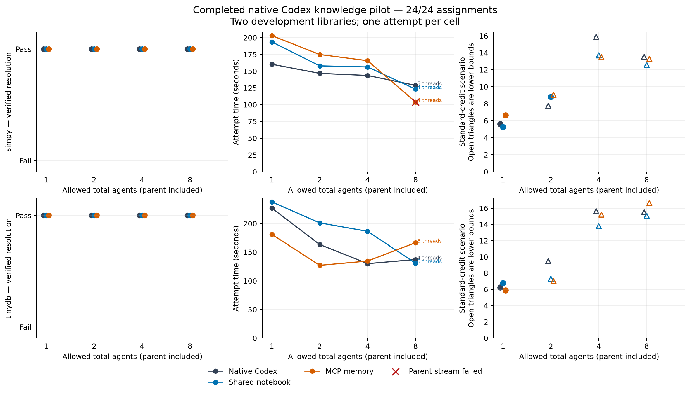

# Investigate how knowledge accumulation and generalization frameworks accelerate effective innovation outcomes.

Rustam Ilgar Eynaliyev  
Latest Advancements in Artificial Intelligence  
Working study, 11 November 2026 · Draft 0.2 — completed development pilot

*Shared knowledge and the scalability of native Codex coding teams*

**Status:** the 24-assignment development pilot is complete. The prospective
draft preceded inference; its proposed broader service/evaluation panel remains
separate from the executed pilot. An [80-assignment reserved-library extension](reserved-extension.md) is frozen; its model results are pending.
Earlier TTGL memory studies are preserved independently. See the
[completed pilot report](pilot-results.md) and [preparation evidence](preparation-results.md).

## Abstract

Coding agents can divide repository work, but additional workers also create
coordination and integration costs. We investigate whether existing shared
knowledge interfaces change the scalability of native Codex teams. An exploratory
pilot crosses two Commit0 library tasks with native execution, a shared notebook
and the official MCP memory server at total-agent limits of one, two, four and
eight. All 24 submitted artifacts pass independent source-only replay. Native
capacity eight reduces mean coding-run time by 31.3% relative to the single
agent, using four or five actual threads; known inference expenditure is already
at least 2.45 times the fully measured single-agent control under published
Standard rates. Added knowledge yields mixed timing results and no observed
completion gain. MCP agents publish 91 observations, but all four read queries
return empty results: these runs do not demonstrate retrieval of peer findings.
Seventeen cells have incomplete stream-usage records, so their cost totals
remain lower bounds. One parent stream fails despite a passing sealed artifact.
Local Graphiti readiness fails and a compatible Cognee dependency graph remains
blocked by confirmed advisory matches; neither receives a coding score. The
pilot identifies availability, adoption and measurement boundaries, not a general
knowledge-driven acceleration effect. Larger reserved workloads and separately
frozen knowledge-use controls remain to be evaluated.

## 1. Introduction

A coding team may investigate several modules concurrently, but a working
repository requires compatible interfaces and a coherent integrated result.
One agent's discovery can save another agent from repeating a failed approach.
Conversely, an unsupported shared claim can mislead several workers, and an old
procedure may become invalid after another agent changes the code. Agent count
therefore measures capacity, not necessarily useful parallel work.

The course theme concerns knowledge accumulation, generalization and effective
innovation outcomes. We study an observable part of that relationship: producing
a verified software implementation. This is useful construction new to the
experimental team, not proof of invention new to the world. Retained experience
is external knowledge; the experiment does not train model weights.

Our research question is: **How does the choice of shared knowledge system
change native Codex teams' completion quality, time and cost as team size grows?**

We focus on supported product integrations rather than inventing an orchestrator.
Codex supplies delegation, worker execution and integration behavior. Existing
OSS systems supply knowledge storage, extraction and retrieval. The experiment
supplies matched tasks, isolated namespaces, recording and independent grading.

## 2. Related research

### 2.1 Knowledge and cumulative innovation

Yaman, Tian and Lindström combine an agent-based model with a human experiment
to examine semantic guidance and social learning in combinatorial discovery
[1]. Their results motivate investigating whether shared experience improves
the use of discoveries. Their semantic manipulation is different from ours:
we keep the coding model fixed and vary its access to external records. A
knowledge service is not equivalent to the model's pretrained semantic ability.

The distinction also matters for generalization. Reusing a command within the
same environment is procedural reuse. Applying an interface constraint in a
different module is a broader transfer case. Generalization to unseen tasks or
repositories requires a separately reserved evaluation and cannot be inferred
from a growing memory store.

### 2.2 Native multi-agent coding

Recent work compares native dynamic concurrency in Codex, Claude Code and Kimi
Code with single-agent execution, including quality, tokens, runtime and
observable coordination failures [2]. A separate study of native teams on web
application tasks compares team execution with higher single-agent reasoning
effort [3]. Both make an important baseline clear: delegation is an intervention
with a cost, not an automatic speedup. Their versions, models and task panels
do not supply a matched control for a new experiment.

The present study does not claim that comparing one and several agents is new.
It asks whether supported knowledge integrations change that relationship.
Single-agent conditions remain necessary to determine whether a knowledge
system benefits teamwork specifically or benefits any agent equally.

### 2.3 Coordination, shared context and team procedures

CAID investigates dependency-aware delegation, isolated workspaces and explicit
integration on repository-scale tasks, including Commit0 and different worker
counts [4]. DeLM coordinates parallel agents through shared verified context
and a task queue [5]. SEPM links task dependencies, shared execution evidence
and reusable procedures across tasks [6]. These are close precedents, not
background to omit when discussing novelty.

The compiler-building case reported by Anthropic demonstrates substantial
parallel shared-repository construction using task claims and progress records
[7]. It is a motivating artifact rather than a controlled estimate of the effect
of memory. We use bounded tasks and matched comparisons to investigate that
effect at smaller team sizes.

### 2.4 Existing knowledge systems and executable benchmarks

Mem0 and Zep/Graphiti organize persistent agent information, with different
extraction and temporal representation choices [8,9]. Their conversational
evaluations do not by themselves establish benefits for coding teams. Cognee
provides an existing self-hosted knowledge engine with a documented MCP
interface [10]. Its behavior and dependencies must be pinned, rather than
treating a product name as an immutable method.

Commit0 supplies library implementation tasks with source skeletons,
specifications and executable tests [11]. It is suitable for studying dependent
work on a substantial artifact. AsynCodeBench adds explicit dependency checks
to repository tasks [12], but its prescribed specialist protocols should not be
described as native Codex team configurations. We reuse benchmark assets while
keeping the execution policy under study explicit.

This is a focused primary-source review, not a systematic review or meta-analysis.
Overlap with shared-memory and team-learning work is substantial. The proposed
contribution is a controlled comparison of existing knowledge integrations in
native Codex teams, including negative outcomes and full inference overhead.

## 3. Research questions and hypotheses

**RQ1 — Outcome:** Does an added knowledge system change the probability of a
complete, independently verified integrated solution?

**RQ2 — Scalability:** Does the knowledge-system effect change with the allowed
number of concurrent agents?

**RQ3 — Efficiency:** Does any benefit justify end-to-end time and total model
inference, including knowledge processing and unsuccessful attempts?

**RQ4 — Mechanism:** Which observable findings are recorded, retrieved, revised
and followed by checked actions? Where do irrelevant or stale records cause
additional work or failures?

H1 predicts that shared experience can reduce repeated investigation and
incompatible assumptions. H2 predicts that this benefit may grow with team size
until retrieval, maintenance or integration overhead dominates. H3 predicts that
some accumulated procedures will help later work within a project, while others
will require revision. Null, adverse and nonmonotonic effects are admissible.

## 4. Experimental design

### 4.1 Factorial comparison

The initial expanded panel below is prospective; Graphiti/Cognee coding cells
were not executed. The completed pilot amendment follows it.

| Knowledge condition | 1 total agent | 2 total agents | 4 total agents | 8 total agents |
| --- | --- | --- | --- | --- |
| Native Codex; no added knowledge service | Planned | Planned | Planned | Planned |
| Codex plus shared project notebook | Planned | Planned | Planned | Planned |
| Codex plus Graphiti MCP | Planned | Planned | Planned | Planned |
| Codex plus Cognee MCP | Planned | Planned | Planned | Planned |

The parent counts toward the total. Limits constrain capacity; actual spawned
agents, active concurrency, nesting, idle intervals and resumed threads are
measured. A run with a limit of eight is not automatically an eight-worker run.
The native controller chooses work allocation. Team members may remain idle when
dependencies preclude useful independent work.

The same model, reasoning effort, task prompt, source snapshot, permissions and
hardware apply across knowledge conditions. Minimal provider-specific usage
guidance is frozen. Model composition, custom supervisors and alternative
orchestration frameworks are outside the main comparison.

The pilot runtime is Codex CLI 0.167.0 with executable/configuration hashes in
each attempt manifest. Parent and workers use `gpt-6.1-sol`, low reasoning.
Positive native delegation and shared-namespace receipts are summarized in the
[preparation evidence](preparation-results.md); actual cap usage is checked per
coding attempt.

**Executed pilot amendment, 11 November.** The locally frozen
[24-cell protocol](../../../experiments/codex-team-knowledge-001/scaling-pilot-protocol-002.json)
crosses SimPy and TinyDB with native Codex, a shared notebook and the official
MCP memory server at all four capacities. It uses Codex CLI 0.167.0 and
`gpt-6.1-sol`, low reasoning, for parent and workers. Generation sources,
configuration and order are hash-pinned. Native orchestration uses a common
restricted container terminal rather than the full default Codex tool profile.
Two- and four-agent delegation and four-agent MCP visibility passed mechanism
checks; actual capacity use in every trial is measured. The earlier standalone
TinyDB feasibility success is excluded from comparative cells. Two repositories
and one attempt per cell warrant descriptive results, not a powered population
test. The proposed broader service comparison remains contingent on readiness.

### 4.2 Knowledge conditions

The native condition retains normal messages, source artifacts and task context.
It is not a no-communication or no-knowledge condition. The notebook condition
adds a project-scoped record of findings, uncertainty, interface agreements and
evidence links using ordinary files. Both service conditions use official,
supported upstream MCP interfaces and a shared team namespace.

Graphiti supports episode ingestion and graph/fact search; its MCP implementation
is documented as experimental [13]. Cognee supports memory operations and
dataset scoping [10]. We validate read-after-write visibility for different
agents before scoring. Mere installation or successful API responses are not
evidence that workers received useful memory.

The main comparison estimates each complete integration, including tool
descriptions and knowledge processing. It does not isolate graph representation
from different retrieved information. A same-facts representation ablation would
be a separate experiment.

The pilot's added MCP condition uses the existing reference
`@modelcontextprotocol/server-memory` 2.1.0. Agents author entities, observations
and relations through its normal tools; it performs no auxiliary extraction
LLM calls. Its shared-store concurrency and persistence passed an eight-process
check. Notebook/MCP guidance is part of the intervention. Native messages,
shared source and self-created notes remain available in every arm. Thus the
pilot tests added scaffolding, not the presence versus absence of communication.

Graphiti/Cognee revision, license and configuration: [PENDING: frozen receipts].
Provider configuration: fully local inference is being investigated at the
user's request; [PENDING: compatible reviewed runtime, models, embeddings and
metering]. Self-hosting storage does not make auxiliary inference free.

No personal Codex memories, previous candidate solutions, reference code or
hidden evaluator outcomes enter live stores. Experimental stores start empty
per task, repetition and condition in the main scaling study. Knowledge can
accumulate throughout that task. Persistence across distinct tasks requires a
separate compatible-source sequence and reset-memory control.

### 4.3 Tasks, development and evaluation

The benchmark assets come from Commit0-Lite. Four libraries were reserved for
development: SimPy, Cookiecutter, TinyDB and Jinja. The pilot uses SimPy and TinyDB,
whose sealed base/reference controls pass their expected gates. Both now have
independently verified single-agent outcomes. The other development candidates
receive no coding score. Partial test results do not replace complete resolution.

The [reservation](../../../experiments/codex-team-knowledge-001/reservation-001.json)
pins the standard 16-library split, four development/twelve evaluation partition,
source commits, specifications and test commands. Harness commit
`1123db33219ee1bfcc735304cb4308663e329aeb` and dataset revision
`944c325cf7899ee75dcf3ec3c42a631a253c7737` are fixed. All 54 pinned Parquet rows
exactly match the captured metadata ([equivalence receipt](../../../experiments/codex-team-knowledge-001/dataset-equivalence-001.json)).
The two executed task sources are MIT licensed. The reviewed runtime uses
Python 3.11.18 rather than the dataset's Python 3.10: these are declared-runtime
Commit0-derived results, not official leaderboard submissions.

The pilot establishes practical duration, budget feasibility and variance. Every
attempt remains visible. A separate evaluation reservation must precede prompt
tuning on its task content. The main evaluation uses a fixed policy, all four
team-size levels and all four knowledge conditions. The pilot has one attempt per cell. With two development libraries, no
minimum-detectable-effect or population-power claim is made. The twelve reserved
libraries have no solver outcomes.

This choice supports within-task knowledge accumulation and cooperative artifact
construction. It does not itself provide a natural sequence of historical
maintenance issues. Claims about cross-task accumulation will be restricted to
an explicitly registered longitudinal extension, if completed.

### 4.4 Budget, order and failure policy

Before inference, register time limits, tool limits, model-response/token controls,
knowledge-processing limits and integration reserves. Distinguish a fixed total
team budget from a fixed allowance per agent. The [frozen pilot protocol and amendments](../../../experiments/codex-team-knowledge-001/scaling-pilot-protocol-005.json)
retain all 24 cells and randomized order. Teams share 30 minutes, 80 terminal
calls and a four-million-observed-token stop threshold; in-flight and compaction
usage can exceed it. Randomize or counterbalance execution order within
matched task/repetition blocks to reduce service-period effects.

Assignments have no automatic retries. The coding provider's request and stream
retry settings are zero. Knowledge systems' own internal recovery calls are
recorded and counted separately; Graphiti's local diagnostic invoked its normal
four-attempt wrapper. Started or uncertain calls consume
their assignment unless an independent audit proves a pre-inference preparation
failure. Transport errors, provider throttling, knowledge failures and candidate
failures remain distinguishable. A missing counter is unknown, not zero.

Security and environment review follows the standing project policy, including
its explicit Codespace exception for incomplete evidence. Confirmed vulnerability
findings block affected candidates. Existing services, credentials and historical
study artifacts are preserved. No scheduled research is enabled.

## 5. Evaluation and analysis

### 5.1 Independent correctness

The incomplete task base must fail and the independent reference must pass the
prescribed acceptance checks before actor inference. The reference and solution
history remain outside actor access. Final candidate code is replayed in a clean
environment with tests restored from trusted assets. Test changes do not redefine
acceptance. Full prescribed-test success is the primary binary outcome; report
test fraction, collection failures and invalid replays separately.

Commit0's public tests support interactive development. Passing them is not
evidence of robustness to unknown tests. [PENDING: additional held-out behavioral
checks, if available and registered; otherwise state this limitation].

### 5.2 Quality, time and cost

For every task and condition report success, elapsed time and all inference.
The pilot timer covers live app-server coding execution through the parent
turn end, including planning, workers, knowledge operations and in-agent checks.
Initial preparation and later independent replay are separate. A failed parent
turn records time to termination, not normal final completion. Complete
deployment latency and local monetary cost are not established by this timer. Report completion
by deadline and expenditure. Do not compare only successful runs, which could
select easier tasks in weaker conditions.

For inference response j, model-rate scenario cost is

\[
C_j = ((I_j-K_j)r^{in}_j + K_jr^{cache}_j + O_jr^{out}_j)/10^6,
\]

where cached input K is a subset of input I. Deduplicate response IDs and validate
cumulative thread-counter deltas. Include parent, workers, compaction,
extraction, consolidation, embeddings, reranking and failed/uncertain requests.
Local-provider requests have measured tokens/runtime where exposed, not an
invented zero cost. Report local compute, measured monetary expenditure and
published-rate scenarios separately. Subscription cash and quota savings remain
unknown unless independently measured.

Cost per verified resolution includes expenditure on unsuccessful attempts and
is undefined when no task resolves. Local service startup and process lifetime
are not finite operation runtime. Queueing, rate limiting and resource contention
are reported separately from interpreted coordination overhead.

### 5.3 Team-size interaction and accumulation

For quality Y, an illustrative interaction contrast for knowledge system k and
team limit n is

\[
\Delta_{k,n}=(Y_{k,n}-Y_{native,n})-(Y_{k,1}-Y_{native,1}).
\]

Positive values would indicate a larger quality benefit for teams than for the
single agent. Report corresponding paired time/cost comparisons without
compressing all outcomes into one arbitrary utility score. Use task-matched
estimates and uncertainty accounting for repository dependence. Repetitions are
not additional independent repositories. A small pilot warrants descriptive
results; it cannot support a broad population claim.

Plot knowledge condition against team size for completion, time and cost.
Within-task cumulative curves show checked progress and knowledge exposure.
Progress trends alone cannot establish learning because tasks become easier or
harder at different stages. Frozen checkpoint comparisons or registered
reset-knowledge interventions are required for stronger accumulation claims.

### 5.4 Observable knowledge use

Retain writes, retrievals, authors, source revisions, supersession, publication
latency and exact returned evidence. Link a finding to subsequent observable
edits, commands and checks. Classify repeated investigations, incompatible
assumptions, stale reads and integration failures with cited trace evidence.
Agent statements that a check passed are not independent verification. A memory
hit establishes exposure, not causality. Any model-based analyst is separate
research inference and is fully accounted for.

## 6. Results: completed development pilot

### 6.1 Execution and coverage

All 24 registered cells finish generation and independent replay, with no repeated
model assignment. All artifacts pass the restored prescribed tests: 140 per
SimPy run and 200 with one prescribed environment skip per TinyDB run. All
artifact-policy checks pass. Native parent status is completed in 23 runs and
failed in one stream-error run whose sealed implementation nevertheless passes.
The latter is retained, not rerun or silently excluded.

Seven cells have complete observed inference accounting. Seventeen have
interrupted/incomplete transports; 98 requests lack final usage. At least
33,076,632 native tokens and 260.226880 Standard-rate credits are observed across
the pilot, not total expenditure or measured subscription charges. A missing
last child notification is reconciled against an exact native response prefix
and a complete transport receipt; the additional 34,872 tokens remain counted.
Original stop receipts and all local protocol amendments are preserved.

### 6.2 Quality, coding time and inference bounds

Each row aggregates two development libraries, one attempt per library. Cost
entries beginning with ≥ are lower bounds, not point estimates.

| Condition | Allowed total agents | Verified / tasks | Mean parent-run seconds | Mean distinct threads | Mean Standard credits |
| --- | ---: | ---: | ---: | ---: | ---: |
| Native Codex | 1 | 2/2 | 193.6 | 1.0 | 5.937 |
| Native Codex | 2 | 2/2 | 155.0 | 2.0 | ≥8.623 |
| Native Codex | 4 | 2/2 | 136.8 | 4.0 | ≥15.759 |
| Native Codex | 8 | 2/2 | 133.0 | 4.5 | ≥14.521 |
| Shared notebook | 1 | 2/2 | 215.7 | 1.0 | 6.022 |
| Shared notebook | 2 | 2/2 | 179.5 | 2.0 | ≥8.063 |
| Shared notebook | 4 | 2/2 | 171.3 | 4.0 | ≥13.740 |
| Shared notebook | 8 | 2/2 | 126.9 | 4.5 | ≥13.832 |
| MCP memory | 1 | 2/2 | 192.1 | 1.0 | 6.281 |
| MCP memory | 2 | 2/2 | 150.9 | 2.0 | ≥8.037 |
| MCP memory | 4 | 2/2 | 150.0 | 4.0 | ≥14.343 |
| MCP memory | 8 | 2/2 | 135.3 | 4.5 | ≥14.957 |

Native capacity eight averages 133.0 seconds versus 193.6 for the single
agent: 31.3% less observed coding time. Its known model-rate expenditure is
already at least 2.45 times the fully measured single-agent control. Unknown
additional expenditure cannot reverse that one-sided cost increase. This does
not establish a population speedup or an actual subscription price difference.

Knowledge timing effects vary by library and capacity. For example, the
notebook is slower than native execution at capacities one, two and four in
the two-task averages, and slightly faster at eight. MCP results are mixed;
its eight-capacity average includes the stream-failed parent. No additional
knowledge condition improves observed completion, which is at a ceiling.

[Full cells and bound definitions](pilot-results.md), [CSV](pilot-cells.csv),
[sanitized results](pilot-results.json), [standalone PDF](figures/pilot-scaling.pdf).

### 6.3 Knowledge use and actual concurrency

MCP agents publish 91 observations across eight runs. Four read queries return
zero entities; there is no observed exact retrieval of peer observation text.
The service is an active publication log here, but exposure-based social reuse
is not demonstrated. Timing differences cannot be attributed to retrieved
knowledge merely because writes occurred. Relations or metadata signals, native
messages, inherited context and shared code are separate possible channels.

The eight-capacity runs use four or five distinct native threads. Native
activity notifications and HTTP overlap are retained separately; neither
distinct-thread counts nor overlapping HTTP requests measure productive GPU
utilization. Server guidance offers the registered slots, and child metadata
reports backend v2. CLI flags alone are not used to infer the running backend.

Exact cross-thread command repetitions and notebook access traces are retained
as exploratory evidence, not automatically labeled wasted work. Some native
message contents are encrypted, limiting semantic attribution. Integration
conflicts, stale advice and causal knowledge-to-action influence were not
independently established from these aggregate counters.

### 6.4 Local-provider admission

The CPU-only local Graphiti configuration completes a real ingestion and search
cycle but fails the predeclared fidelity check. With a Qwen3-0.6B dynamic INT8
provider, it returns an unrelated example-like fact instead of the exact verified
test command and project identity. Two LLM requests use 3,524 local tokens and take
88.3 seconds for the full cycle. An unquantized FP32 request had retained the
command, while other startup attempts terminated before inference. These are
configuration-specific preparation results, not a coding score or a verdict
on stronger local providers. Cognee remains unadmitted because a compatible
dependency graph contains confirmed advisory matches. All failures are retained.

### 6.5 Generalization

**Held-out generalization was not measured.** The twelve reserved libraries
have data/environment preparation only, not model-quality results. The pilot
does not measure accumulation across distinct tasks, changes to model weights,
or innovation new to the world.

## 7. Discussion

These tasks show a native parallelism trade-off: lower observed coding time at
higher minimum model expenditure. They do not show that adding an external
knowledge interface improves verified outcomes. The absence of nonempty MCP
reads is a mechanism finding: making a store available and publishing findings
are insufficient evidence that agents learn from one another through it.

A controlled extension should separate storage availability from a general
knowledge-use protocol, including relevant retrieval before dependent work and
verification after changes. A matched native communication-protocol control
is necessary so that an improvement is not attributed to storage when it comes
from clearer instructions. This is a proposed next comparison, not a result.
Larger reserved workloads are needed because short, familiar libraries and
underused capacity leave limited scope for additional shared experience.

Inference accounting also requires caution. A partial total above a fully
measured control can prove a rate-scenario cost increase. Unknown bounds that
overlap do not identify a ranking. Neither incomplete token logs nor published
API rates establish subscription cash savings.

## 8. Limitations

The study initially covers Python library reconstruction, not all coding work.
Public repositories may be represented in model training data. Native Codex
behavior, defaults and hosted models change, requiring exact version/config
records. Supported memory systems differ in tools, processing, providers and
retrieved content; their end-to-end comparison is not a pure graph-versus-text
experiment. Local providers may constrain extraction quality and throughput.

Condition order, shared hardware and provider queueing can confound latency.
Knowledge influences exploration, so live teams do not accumulate identical
facts. Code and messages remain knowledge channels in every condition. Public
tests permit test-directed implementation. A small number of repositories limits
statistical generalization. Research/implementation costs are distinct from
deployment inference, and first-use net savings are not assumed.

## 9. Conclusion

All 24 development artifacts pass independent prescribed-test replay. Native
capacity eight is faster on average on these two tasks and has at least 2.45
times the single-agent model-rate expenditure, while using only four or five
actual threads. Added knowledge produces mixed timing and no observed quality
gain. MCP findings are published but not retrieved through the observed read
queries. Effective knowledge-driven acceleration and held-out generalization
remain unestablished; they require larger tasks and a separately tested use
protocol rather than an assumption that storage causes learning.

## References

1. Yaman, A., Tian, S., & Lindström, B. (2026). *Semantic knowledge guides innovation and drives cultural evolution*. PNAS. https://doi.org/10.1073/pnas.2530750123
2. Li, H., Li, H., Jiang, Z., & Lou, Y. (2026). *When Sub-Agents Work in Parallel: The Promises and Pitfalls of Dynamic Concurrency in Long-Horizon Coding Tasks*. https://arxiv.org/abs/2610.10263
3. Vals AI (2026). *Do Agent Teams Pay Off? A Case Study on Vibe Code Bench*. https://vals-ai.com/blogs/multi-agent-vibe-code-bench
4. Geng, J., & Neubig, G. (2026). *Effective Strategies for Asynchronous Software Engineering Agents*. https://arxiv.org/abs/2603.21489
5. Mao, Y., et al. (2026). *Decentralized Multi-Agent Systems with Shared Context*. https://arxiv.org/abs/2606.10662
6. Liu, Y., et al. (2026). *SEPM: Self-Evolving Procedural Memory Grounded in Task Graphs for Multi-Agent Collaboration*. https://arxiv.org/abs/2610.14515
7. Carlini, N. (2026). *Building a C compiler with a team of parallel Claudes*. https://www.anthropic.com/research/building-c-compiler
8. Chhikara, P., et al. (2025). *Mem0: Building Production-Ready AI Agents with Scalable Long-Term Memory*. https://arxiv.org/abs/2504.19413
9. Rasmussen, P., et al. (2025). *Zep: A Temporal Knowledge Graph Architecture for Agent Memory*. https://arxiv.org/abs/2501.13956
10. Cognee maintainers. *Cognee MCP: supported memory interface and agent scoping*. https://github.com/topoteretes/cognee/blob/main/cognee-mcp/README.md
11. Zhao, W., et al. (2024/2025). *Commit0: Library Generation from Scratch*. https://arxiv.org/abs/2412.01769
12. Zhang, K., et al. (2026). *AsynCodeBench: Benchmarking Collaboration of Asynchronous Multi-Agent Systems in Software Engineering*. https://arxiv.org/abs/2609.32662
13. Zep maintainers. *Graphiti MCP Server*. https://help.getzep.com/graphiti/getting-started/mcp-server
14. OpenAI. *Subagents*. https://learn.chatgpt.com/docs/agent-configuration/subagents
15. OpenAI. *Codex App Server*. https://learn.chatgpt.com/docs/app-server

## Reproducibility record

Study design: [codex-team-knowledge-study.md](../../research/codex-team-knowledge-study.md).
The [local frozen protocol and amendment chain](../../../experiments/codex-team-knowledge-001/scaling-pilot-protocol-005.json),
[dataset equivalence](../../../experiments/codex-team-knowledge-001/dataset-equivalence-001.json),
[pricing scenario](../../../experiments/codex-team-knowledge-001/pricing-scenario-001.json),
[completed cells](pilot-cells.csv) and [sanitized results](pilot-results.json)
record execution and interpretation. This is local registration, not a claim of
external preregistration. Raw receipt archives are losslessly retained locally.
Private credentials and raw private captures remain outside tracked files.
