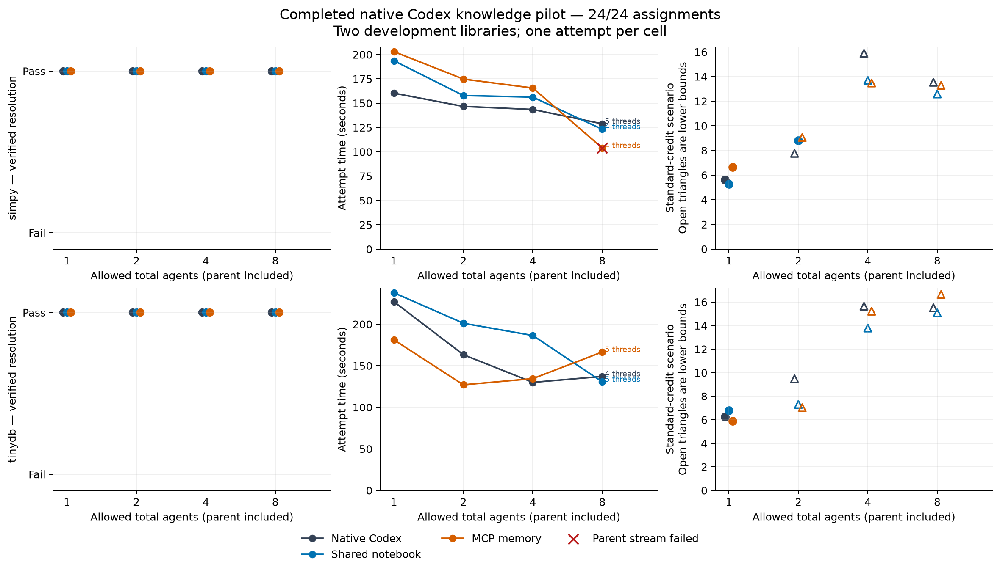

# Completed native Codex knowledge pilot

11 November 2026. **24 fixed assignments on two development libraries; one attempt per cell.** This is not the reserved evaluation or an official Commit0 leaderboard score.

**All 24 submitted artifacts pass independent source-only replay:** SimPy passes 140 prescribed tests per run; TinyDB passes 200 with one environment-prescribed skip. There are 23 normally completed parent turns and one stream-failed parent with a passing sealed artifact.

| Knowledge condition | Allowed total agents | Verified / tasks | Mean parent-run seconds | Mean distinct threads | Mean Standard-credit scenario |
| --- | ---: | ---: | ---: | ---: | ---: |
| Native Codex | 1 | 2/2 | 193.6 | 1.0 | 5.937 |
| Native Codex | 2 | 2/2 | 155.0 | 2.0 | ≥8.623 |
| Native Codex | 4 | 2/2 | 136.8 | 4.0 | ≥15.759 |
| Native Codex | 8 | 2/2 | 133.0 | 4.5 | ≥14.521 |
| Shared notebook | 1 | 2/2 | 215.7 | 1.0 | 6.022 |
| Shared notebook | 2 | 2/2 | 179.5 | 2.0 | ≥8.063 |
| Shared notebook | 4 | 2/2 | 171.3 | 4.0 | ≥13.740 |
| Shared notebook | 8 | 2/2 | 126.9 | 4.5 | ≥13.832 |
| MCP memory | 1 | 2/2 | 192.1 | 1.0 | 6.281 |
| MCP memory | 2 | 2/2 | 150.9 | 2.0 | ≥8.037 |
| MCP memory | 4 | 2/2 | 150.0 | 4.0 | ≥14.343 |
| MCP memory | 8 | 2/2 | 135.3 | 4.5 | ≥14.957 |

Native capacity eight averages 133.0 seconds versus 193.6 for the single agent: **31.3% less time**, using four or five distinct threads. Its known model-rate expenditure is already **at least 2.45×** the fully measured single-agent control. This is an observed two-task trade-off, not a general speedup estimate.

Added knowledge does not improve observed completion, which is at a ceiling. Timing changes are mixed across libraries and capacities; one attempt per cell cannot establish a reliable knowledge-system advantage. Capacity eight is not an eight-worker observation.

MCP agents publish **91 observations** across eight runs. There are **4 read queries, 0 returning entities**, and no exact peer-observation retrieval. The integration works as a publication log here; these trials do not demonstrate social reuse through retrieved observation text. Native messages, inherited context and shared code remain communication channels in every condition.

**Accounting:** seven cells have complete observed inference accounting. Seventeen have interrupted or incomplete transports, so their completed-response totals are lower bounds. Across the pilot, at least 33,076,632 native tokens and 260.226880 Standard-rate credits are observed, with 98 unknown-usage requests. Full cost is unknown. One child has an extra native/captured completion absent from final RPC notification delivery; its exact counter prefix and additional 34,872 tokens are retained. No notification is fabricated and no call is repeated.

A bound above a fully measured control proves a cost increase under the stated scenario; overlapping unknown bounds do not establish a ranking. Subscription cash expense and quota savings are unknown. [Standard credit rates](https://learn.chatgpt.com/docs/pricing) and [separate API token prices](https://developers.openai.com/api/docs/models/gpt-6.1-sol) were checked on 11 November.

**Timing:** the registered timer measures app-server coding execution through the parent turn end, including planning, tools, native worker activity, knowledge operations and in-agent checks. Initial task preparation and later independent replay are separate. The red cross marks time to a failed parent stream, not normal final completion. This is not a complete deployment-latency or local-CPU-cost measurement.

Download the [SVG](figures/pilot-scaling.svg), [PDF](figures/pilot-scaling.pdf), [cell CSV](pilot-cells.csv) or [sanitized results](pilot-results.json).

**Controls and boundaries:** Codex CLI 0.167.0, hosted native backend reported v2, GPT-6.1 Sol low for all agents, shared constrained terminal, isolated task stores, no web or prior candidate history. Total capacity limits are 1/2/4/8; each team gets 30 minutes, 80 terminal calls and a four-million-observed-token stop threshold. In-flight and auxiliary usage can exceed the threshold. The runtime is a declared Python 3.11.18 variant of the dataset environment. Public tests are restored from sealed assets; hidden-test robustness was not measured.

**Exclusions:** Graphiti local-provider diagnostics did not establish ingestion readiness. Cognee’s current compatible full graph includes a confirmed advisory-matched Transformers release. Neither receives a coding score or an invented zero cost. Detailed failed preparations, provider adaptations and unknown usage are in the [preparation record](preparation-results.md). Twelve reserved libraries have no model outcomes; current preparation is not held-out validation.

**Interpretation:** the pilot supports faster native execution with higher minimum model expenditure on these two tasks. It does not establish that added external knowledge accelerates verified innovation, that larger fixed teams degrade, or that graph memory is superior to text. A larger workload and a separately frozen knowledge-use policy are needed to study effective retrieval and generalization.

The prospective paper preceded inference. Local protocol amendments preserve the cancellation accounting stop, verified archive cleanup and late-notification reconciliation without changing generation prompts, order or replay behavior. All raw evidence remains local in verified lossless archives; no model assignment was retried.
