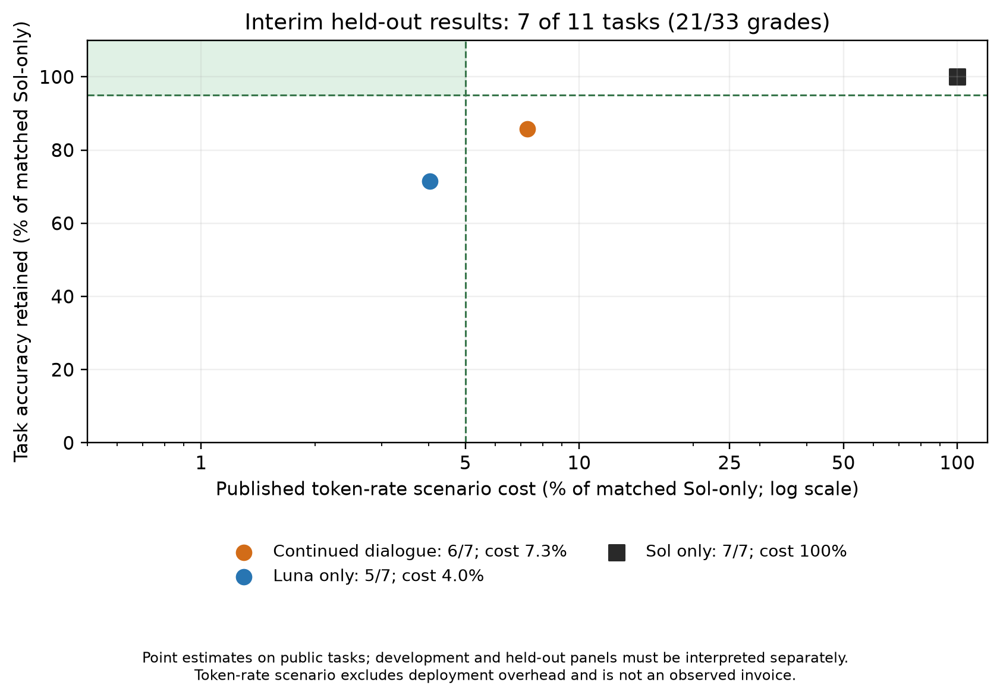

# Fresh metered Luna / Sol routing experiments

The completed live software-engineering panel contains 12 SWE-bench Verified
tasks, six conditions, and 72 officially graded assignments. Three additional
prompt-development studies contain four already observed tasks and three arms
each (36 assignments). All 108 assignments passed an independent audit joining
native reports to exact patch hashes and reconciling event-level model token
deltas with final manifests. Historical published replay records and the earlier
BugsInPy feasibility pilot are separate evidence.

## Original matched panel

| Condition | Resolved | Total model-cost scenario (USD) | Expert requests |
|---|---:|---:|---:|
| Luna alone | 9/12 | 0.070117 | 0 |
| Sol alone | 10/12 | 1.386344 | 0 |
| Pre-task model selection | 11/12 | 0.955308 | 0 |
| One-way expert assistance | 9/12 | 0.110168 | 1 |
| Fresh expert on each request | 8/12 | 0.104738 | 1 |
| Continuing expert conversation available | 9/12 | 0.062689 | 0 |

The pre-task selector achieved the highest observed resolution count, with
31.1% lower model-cost scenario than Sol alone. That is a descriptive result on
this panel, not evidence of population superiority. The continuing-conversation
arm saved 95.5% but retained only 90% of Sol's aggregate accuracy, missing the
joint target. It made no expert requests, so its result does not demonstrate
conversational collaboration. Luna alone saved 94.9% with the same aggregate
resolution count. There is no observed dialogue benefit in the original panel.

## Prompt development with matched independent solving guidance

Each development study gave its standalone controls the same common solving and
verification instructions as the assisted agent. The adaptive and bounded
cheap-first assisted conditions each resolved 4/4 tasks using one expert request
across the panel. Their respective Luna-only controls resolved 2/4 and 3/4; both
Sol-only controls resolved 4/4. Assisted scenario savings relative to their own
Sol control were 87.1% and 89.1%. The compact expert condition saved 95.7% but
resolved 3/4, matching its Luna-only control; it made no expert requests.
Because that condition never invoked an expert, its outcome cannot establish
that expert-context compaction caused either the quality difference or saving.

{width=100%}

The outcome-first, cost-second development selection rule chose bounded
cheap-first before held-out inference. These four cases were already observed
and cannot establish generalization. Across all studies, no assisted arm meets
both the 95% cost-reduction and 95% relative-accuracy point targets. Costs use
the frozen published Codex Standard token-rate scenario, include all measured
controller/expert/integration inference, and exclude setup and grading. They
are not observed invoices or full deployment costs.

## Held-out status and bounded next study

The first independent control case,
`django__django-7530`, passes the recorded fail-to-pass test without a repair;
base and gold native reports both resolve. The archived evaluator therefore
cannot discriminate repair success for that case. Preserve the failed control
gate and resolve its environment disposition before proceeding; do not override
the score or silently substitute an easier case. An explicit pre-inference
disposition now excludes this invalid control under the original reservation's
eligibility rule, without replacement. All eleven remaining readiness checks
passed and the selected policy's 33-assignment held-out run is in progress.
At the 27 October interim checkpoint, seven complete task blocks (21 official
grades) give Sol 7/7, standalone Luna 5/7 and assisted Luna 6/7. All 21 assignments
pass independent patch/report and native token-delta audits. Assisted Luna makes
two consultations on one task, resolves one case missed by Luna and loses none
of Luna's successes. Its total token-rate scenario is USD 0.08409922, versus
0.04639970 for Luna and 1.15456560 for Sol: 92.7% savings with 85.7% relative
accuracy retention. The joint 95/95 target still fails. These incomplete results
are descriptive and do not establish population improvement or noninferiority.
The registered run continues unchanged.

{width=100%}

The observed rescue is `sphinx-10673`. Luna requested help while reporting a
failing regression test; Sol requested exact context, Luna's next message
identified an earlier directive-parser warning path, and Sol advised on dependency handling and
a module-index fixture. The final patch passes official evaluation. Both requests
continue the same expert thread, demonstrating voluntary bidirectional
consultation on a real benchmark episode. The second handoff still references
paths rather than supplying all requested source excerpts, limiting what the
tool-free expert can check. No pre-consultation patch was archived by this old
runner, so this is a paired independent-attempt rescue, not a causal attribution
of the entire improvement to Sol. The next Pro protocol captures that snapshot.

A separate SWE-bench Pro V2 subset is reserved: 12 repository-diverse development
tasks for inexpensive prompt iteration and 24 disjoint validation tasks. The
642-task population is not an automatically scheduled run. Public inputs have
been acquired for all 36 reserved cases. All twelve development tasks are
prepared privately, with first-task controls queued separately. Eighteen adapter,
snapshot and analysis mechanism checks pass, but actual environment
controls, real boundary/metering/replay validation and Pro model inference remain
pending. Use the official maintained harness and pristine grading protocol.
The open-weight replication and subsequent distillation/RL comparisons follow
this proprietary routing study and are not current learning results.

## Verification observability and prospective feedback diagnostic

The first completed held-out failure illustrates a limitation of confidence-led
delegation: assisted Luna reported passing local checks and returned complete
without consulting Sol, while the independent evaluator rejected its patch.
The available journal does not retain full tool outputs, so those local test
counts remain self-reported. The observation supports investigating false
completion; it does not show that the model ignored a visible failing test.

A separate, unrun verification policy now asks for acceptance criteria, checks
that could falsify a candidate, and material coverage gaps before completion.
Its assisted variant permits seeking help for an unsupported correctness property
even after a narrow check passes. Common verification guidance is matched in
standalone controls. The active held-out policy is unchanged.

A prospective Aider Polyglot-derived diagnostic reserves 12 development and
24 validation tasks across six languages, excluding development exercise
families from validation across languages. The maintained Aider harness provides
test-error feedback for repair; this separates handling an observable failure
from anticipating an unseen case. The custom conversational protocol is not an
official Aider leaderboard evaluation. Visible-suite fit, automatic test-gate
detection and model-initiated error recognition must be reported separately.
No model trials from this diagnostic have run. The executable reservation and
the [prospective design](../research/verification-feedback-study.md) retain the
bounded scope and prohibit tuning on validation outcomes.

The next Pro development matrix explicitly contrasts voluntary consultation
with required review, alongside matched standalone controls. Pre-consultation
candidate patches and final patches will receive separate pristine-container
grades after generation. This measures rescue of an observed candidate failure
and distinguishes routing underuse from failure to transfer or integrate useful
expert advice. A separate live context-only required-review check completed
three native calls and demonstrated transfer and integration of an expert-found
edge case; its six post-hoc checks are mechanism evidence, not benchmark quality
or autonomous-routing performance. The larger development/validation comparison
has not started model inference yet.

A later interim checkpoint covers ten complete held-out tasks (30 of 33
assignments), independently audited in `checkpoint-resource-030.json`.
Sol resolves 8/10, Luna 6/10 and assisted Luna 7/10. Assisted Luna retains the
single paired rescue and loses no standalone Luna success. Four consultations
were completed: two on the successful Sphinx10673 episode and two on
Sphinx11510, which fails in all three arms. Total scenario costs are USD
1.56228240 (Sol), 0.06298606 (Luna) and 0.13599578 (assisted). Assisted savings
are 91.2951% and relative accuracy retention is 87.5%; the joint target fails.
This incomplete checkpoint supersedes the earlier seven-task denominator,
without changing the frozen policy or stopping rule. The final task remains
pending. `checkpoint-030-cost-quality.json` retains per-task costs, grades and
source hashes; these are token-rate scenarios, not observed invoices.

### Completed held-out comparison: eleven tasks, 33 assignments

The frozen study is complete. Independent audit joins all 33 grades to exact
patches and reconciles native per-model usage; no context-only expert tool
violations were found. Sol resolves 9/11 (81.8%), Luna 7/11 (63.6%) and assisted
Luna 8/11 (72.7%). Four expert consultations occur across two tasks. Assisted
Luna rescues one standalone Luna failure, loses none of Luna's successes and
closes half the observed two-task Sol–Luna gap. The independently attempted
runs and missing pre-consultation snapshots preclude causal attribution.

Total published-rate scenario costs are USD 1.63011920 for Sol, 0.06591400 for
Luna and 0.13945384 for assisted Luna. Assisted savings are 91.4452%, with
88.8889% relative accuracy retention. Both joint-target components fail. Luna
alone saves 95.9565% but retains only 77.7778% of Sol accuracy. Assistance costs
USD 0.07353984 more than Luna for one additional resolved case on this panel.
These are full assigned-task controller/expert/integration model-inference
scenarios, not observed invoices or full deployment costs. Eleven public
historical tasks do not establish population noninferiority or reliable routing.

The [complete results](../../results/delegation-heldout-001/analysis-002/README.md)
and `target-95-95.json` supersede all interim denominators. Of twelve originally
reserved cases, one invalid independent control was excluded before inference,
without replacement; all eleven scored cases remain in this denominator.
The prospective Pro comparison remains unscored: its initial no-op control
stopped during environment construction before any actor or model invocation.
