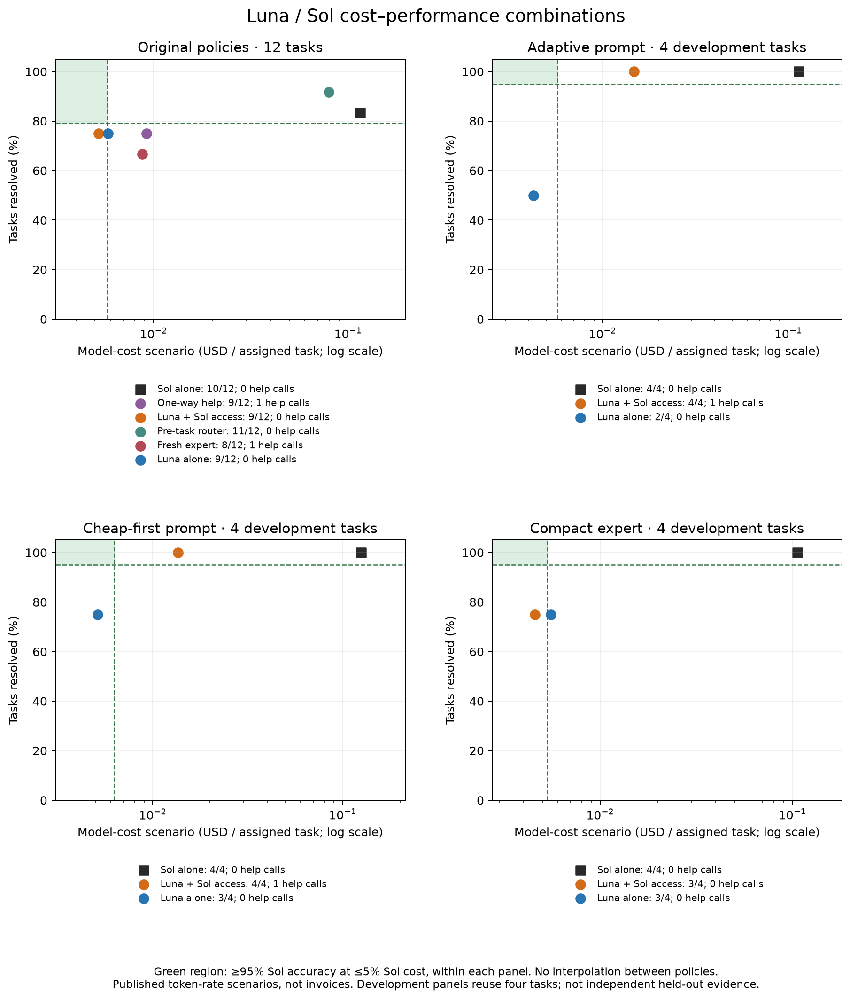
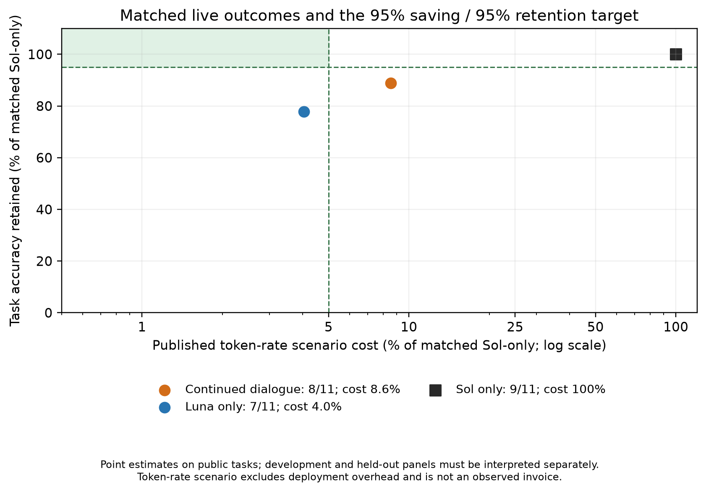

# Fresh metered Luna / Sol routing experiments

Current Pro evidence includes the first NodeBB episode and the sequential
router-development checkpoint in the final sections below.
Older prospective Pro matrix passages describe earlier designs; latest steering
defers standalone comparisons and full evaluation in favor of router development.

The completed live software-engineering panel contains 12 SWE-bench Verified
tasks, six conditions, and 72 officially graded assignments. Three additional
prompt-development studies contain four already observed tasks and three arms
each (36 assignments). A separate held-out panel adds eleven tasks and 33 assignments. All 141
assignments passed independent audits joining
native reports to exact patch hashes and reconciling event-level model token
deltas with final manifests. Historical published replay records and the earlier
BugsInPy feasibility pilot are separate evidence.

## Original matched panel

| Condition | Resolved | Total model-cost scenario (USD) | Expert requests |
|---|---:|---:|---:|
| Luna alone | 9/12 | 0.070117 | 0 |
| Sol alone | 10/12 | 1.386344 | 0 |
| Pre-task model selection | 11/12 | 0.955308 | 0 |
| One-way expert assistance | 9/12 | 0.110168 | 1 |
| Fresh expert on each request | 8/12 | 0.104738 | 1 |
| Continuing expert conversation available | 9/12 | 0.062689 | 0 |

The pre-task selector achieved the highest observed resolution count, with
31.1% lower model-cost scenario than Sol alone. That is a descriptive result on
this panel, not evidence of population superiority. The continuing-conversation
arm saved 95.5% but retained only 90% of Sol's aggregate accuracy, missing the
joint target. It made no expert requests, so its result does not demonstrate
conversational collaboration. Luna alone saved 94.9% with the same aggregate
resolution count. There is no observed dialogue benefit in the original panel.

## Prompt development with matched independent solving guidance

Each development study gave its standalone controls the same common solving and
verification instructions as the assisted agent. The adaptive and bounded
cheap-first assisted conditions each resolved 4/4 tasks using one expert request
across the panel. Their respective Luna-only controls resolved 2/4 and 3/4; both
Sol-only controls resolved 4/4. Assisted scenario savings relative to their own
Sol control were 87.1% and 89.1%. The compact expert condition saved 95.7% but
resolved 3/4, matching its Luna-only control; it made no expert requests.
Because that condition never invoked an expert, its outcome cannot establish
that expert-context compaction caused either the quality difference or saving.

{width=100%}

The outcome-first, cost-second development selection rule chose bounded
cheap-first before held-out inference. These four cases were already observed
and cannot establish generalization. Across all studies, no assisted arm meets
both the 95% cost-reduction and 95% relative-accuracy point targets. Costs use
the frozen published Codex Standard token-rate scenario, include all measured
controller/expert/integration inference, and exclude setup and grading. They
are not observed invoices or full deployment costs.

## Completed held-out comparison: eleven tasks, 33 assignments

The frozen study is complete. Independent audit joins all 33 grades to exact
patches and reconciles native per-model usage; no context-only expert tool
violations were found. Sol resolves 9/11 (81.8%), Luna 7/11 (63.6%) and assisted
Luna 8/11 (72.7%). Four expert consultations occur across two tasks. Assisted
Luna rescues one standalone Luna failure, loses none of Luna's successes and
closes half the observed two-task Sol–Luna gap. The independently attempted
runs and missing pre-consultation snapshots preclude causal attribution.

Total published-rate scenario costs are USD 1.63011920 for Sol, 0.06591400 for
Luna and 0.13945384 for assisted Luna. Assisted savings are 91.4452%, with
88.8889% relative accuracy retention. Both joint-target components fail. Luna
alone saves 95.9565% but retains only 77.7778% of Sol accuracy. Assistance costs
USD 0.07353984 more than Luna for one additional resolved case on this panel.
These are full assigned-task controller/expert/integration model-inference
scenarios, not observed invoices or full deployment costs. Eleven public
historical tasks do not establish population noninferiority or reliable routing.

The [complete results](../../results/delegation-heldout-001/analysis-002/README.md)
and `target-95-95.json` supersede all interim denominators. Of twelve originally
reserved cases, one invalid independent control was excluded before inference,
without replacement; all eleven scored cases remain in this denominator.

The invalid independent control was `django__django-7530`: its recorded
fail-to-pass test passed on both base and gold versions. It was excluded under
the original reservation's eligibility rule before inference, without replacement.
All eleven eligible cases completed; no scored outcome was removed. The archived
seven- and ten-task checkpoints remain reproducible historical snapshots rather
than additional independent experiments or current denominators.

The observed rescue is `sphinx-10673`. Luna requested help while reporting a
failing regression test; Sol requested exact context, Luna's next message
identified an earlier directive-parser warning path, and Sol advised on dependency handling and
a module-index fixture. The final patch passes official evaluation. Both requests
continue the same expert thread, demonstrating voluntary bidirectional
consultation on a real benchmark episode. The second handoff still references
paths rather than supplying all requested source excerpts, limiting what the
tool-free expert can check. No pre-consultation patch was archived by this old
runner, so this is a paired independent-attempt rescue, not a causal attribution
of the entire improvement to Sol. The next Pro protocol captures that snapshot.

Two further consultations on `sphinx-11510` did not yield a passing patch;
all three arms fail that task. The remaining Sol-only success missed by both
Luna variants is `scikit-learn-25747`, where assisted Luna requested no expert.
These cases distinguish successful help-seeking, unsuccessful collaboration
and missed escalation; they do not establish calibrated failure detection.

## Bounded next study

SWE-bench Pro V2 is reserved as twelve repository-diverse development tasks and
24 disjoint validation tasks, with no automatic 642-task launch. Public inputs
are acquired for all 36 cases; all twelve development tasks are prepared
privately. The matched development arms are Luna, Sol, voluntary consultation
and required review, with common v3 verification guidance. Required review is
a diagnostic control, not autonomous routing.

Thirty-four framework, handoff and accounting checks pass. A real Harbor fixture
also verifies public setup, zero actor network attachments with failed peer
reachability, and restored verifier reachability on this Docker host. Those are
setup results, not Pro task quality or a universal egress proof. The actual-task
empty/reference controls and actor-boundary/metering/patch-replay gates remain
pending behind the registered resource reserve. No Pro model trial has started.
Use the maintained Harbor integration and official pristine grading protocol.
Open-weight replication and subsequent distillation/RL follow this proprietary
comparison; they remain prospective.

## Verification observability and prospective feedback diagnostic

The first completed held-out failure illustrates a limitation of confidence-led
delegation: assisted Luna reported passing local checks and returned complete
without consulting Sol, while the independent evaluator rejected its patch.
The available journal does not retain full tool outputs, so those local test
counts remain self-reported. The observation supports investigating false
completion; it does not show that the model ignored a visible failing test.

A separate, unrun verification policy now asks for acceptance criteria, checks
that could falsify a candidate, and material coverage gaps before completion.
Its assisted variant permits seeking help for an unsupported correctness property
even after a narrow check passes. Common verification guidance is matched in
standalone controls. This candidate was not used in the completed held-out panel.

A prospective Aider Polyglot-derived diagnostic reserves 12 development and
24 validation tasks across six languages, excluding development exercise
families from validation across languages. The maintained Aider harness provides
test-error feedback for repair; this separates handling an observable failure
from anticipating an unseen case. The custom conversational protocol is not an
official Aider leaderboard evaluation. Visible-suite fit, automatic test-gate
detection and model-initiated error recognition must be reported separately.
No model trials from this diagnostic have run. The executable reservation and
the [prospective design](../research/verification-feedback-study.md) retain the
bounded scope and prohibit tuning on validation outcomes.

The next Pro development matrix explicitly contrasts voluntary consultation
with required review, alongside matched standalone controls. Pre-consultation
candidate patches and final patches will receive separate pristine-container
grades after generation. This measures rescue of an observed candidate failure
and distinguishes routing underuse from failure to transfer or integrate useful
expert advice. A separate live context-only required-review check completed
three native calls and demonstrated transfer and integration of an expert-found
edge case; its six post-hoc checks are mechanism evidence, not benchmark quality
or autonomous-routing performance. The larger development/validation comparison
has not started model inference yet.

## First voluntary Pro router episode

Exactly one new voluntary router assignment ran on the first reserved NodeBB
SWE-bench Pro development task. Initial official grading and independent pristine
replay both pass: **1/1**, with one Luna controller invocation and **zero Sol
requests**. Completed setup008 (including two earlier expert consultations) was
reused after auditing 60 pinned artifacts, source bindings, sealed patches and
cumulative-thread metering. No setup model call was repeated. A fresh model-free
actor isolation probe passed before the scored call. See the
[episode audit](../../results/router-development-010-analysis/README.md).

Measured input is 333,186 tokens including 301,184 cached; output is 2,402 tokens
including reasoning. The frozen published-rate inference scenario is
**USD 0.00741304 per assigned and resolved task**. Request elapsed time is
39.73 seconds; the actor phase including harness work is 54.15 seconds, and
initial generation start through fresh grading is 203.51 seconds. These measure
different work; none is pure model inference latency. Historical setup has a
separate scenario cost of USD 0.03098282; no new setup inference occurred.
Actual cash expense, subscription-quota saving, matched-Sol saving and relative
accuracy retention remain unknown. Hardware, orchestration and grading expenses
are not included in this model-inference scenario.

The 12 visible shell requests show a lint correction and successful final ESLint
and diff checks, but no endpoint test execution. Luna explicitly acknowledged
incomplete runtime verification before choosing complete. Since the independent
final grade passes, this is an acknowledged verification gap on a successful
episode, not an observed false-success claim or missed escalation. No functional
failure opportunities were observed during solving. Failure-detection recall,
expert handoff and integration quality are therefore not measurable here. Tool
syntax and lint corrections are not distinct semantic repair strategies.

The default 2–3 checked independent attempts applies before asking Sol, not a
requirement to invent more changes after every candidate. The next v5 addition
emphasizes discriminating behavioral checks and a useful response to a material
verification gap. It was prepared at this checkpoint and subsequently activated in the separate
series below, with no demonstrated causal improvement and
no mandatory expert review. Handoffs still carry relevant source, candidate,
attempts, exact outcomes, lessons, ruled-out hypotheses and remaining questions.

One selected public development task establishes neither generalization nor the
joint 95/95 target. An illustrative iid exact-binomial 95% interval after one
success spans 2.5%–100%; this does not make the selected task a representative
population sample. All 24 validation cases remain untouched. No second router
assignment or standalone comparison was launched. The 141 Verified assignments
and historical 500-task replay remain separate evidence. The contribution remains
replication and controlled extension of related work, not architectural novelty.

## Sequential router development and generality constraint

Three separately registered selected development tasks completed sequentially,
with their own empty/reference controls and fresh actor boundaries. Setup008
transport/metering was audited and reused, with zero new setup calls. Target
quality was not reused. Standalone comparisons and validation remain deferred.

| Episode | Prompt | Initial/fresh | Sol requests | Pre-handoff | Model-rate scenario USD |
|---|---|---|---|---|---|
| Ansible012 | v5 | 1/1 | 0 | not applicable | 0.00551832 |
| Element014 | v5 | 1/1 | 0 | not applicable | 0.01017514 |
| Tutanota016 | v6 | 1/1 | 1 completed | 1 | 0.12839738 |

Ansible runs three relevant repository tests and a corrected traversal/root
reproducer. Element's old-contract tests fail and type checking exits137; Luna
acknowledges incomplete behavioral verification but does not create a new-contract
check. Its passing grades do not establish false completion or missed escalation.
This mechanism motivates v6, frozen before Tutanota, rather than a task-specific fix.

Tutanota repairs syntax/type failures, voluntarily consults Sol after bounded
local work, integrates changes and adds focused raw-byte/key-isolation tests.
Test execution remains blocked by compilation exit137 and native dependency DNS
failure, and the final response explicitly states incomplete behavioral coverage.
Its pre-consultation and final sealed patches both pass pristine grading. This
is successful consultation followed by passing integration, not an observed rescue,
proof advice was necessary, or evidence of standalone Sol capability. The handoff
contains detailed candidate/check/uncertainty summaries but omits some relevant
source; Sol explicitly limits its conclusion about missing branch side effects.
No additional prompt revision is activated from this one passing consultation.

The [episode exports and series summary](../../results/router-iterations-20261031/README.md)
join grades, exact patches and validated cumulative-thread token deltas. All
router/expert/integration inference totals USD0.14409084 in the frozen published-rate
scenario, USD0.04803028 per assigned/resolved case. Historical setupUSD0.03098282
is separately disclosed, not repeated. Actual invoice/quota expense, matched-Sol
saving and retention, and full deployment cost remain unknown. Per-episode
latencies include different work and are retained separately rather than treated
as pure inference speed.

The router must be general-purpose. Episodes diagnose mechanisms; task identifiers,
expected fixes and hidden-test conventions must not enter the prompt. V6 asks
for evidence of current requirements, distinguishes contradiction from obsolete
or unavailable evidence, and uses verification appropriate to the task. Noncoding
tasks do not require code edits or test suites. The
[generality rule](../research/router-generality.md) and activation record state
transfer hypotheses, risks and falsification criteria. Transfer requires a
separately registered diverse task set with policy frozen beforehand.

Three passing adaptive development cases do not establish causal prompt improvement,
failure-detection recall, population accuracy or95/95. They are not pooled with
the earlier NodeBB episode,141 Verified assignments or historical500-task replay.
All24 validation tasks remain untouched; standalone comparisons remain deferred.
