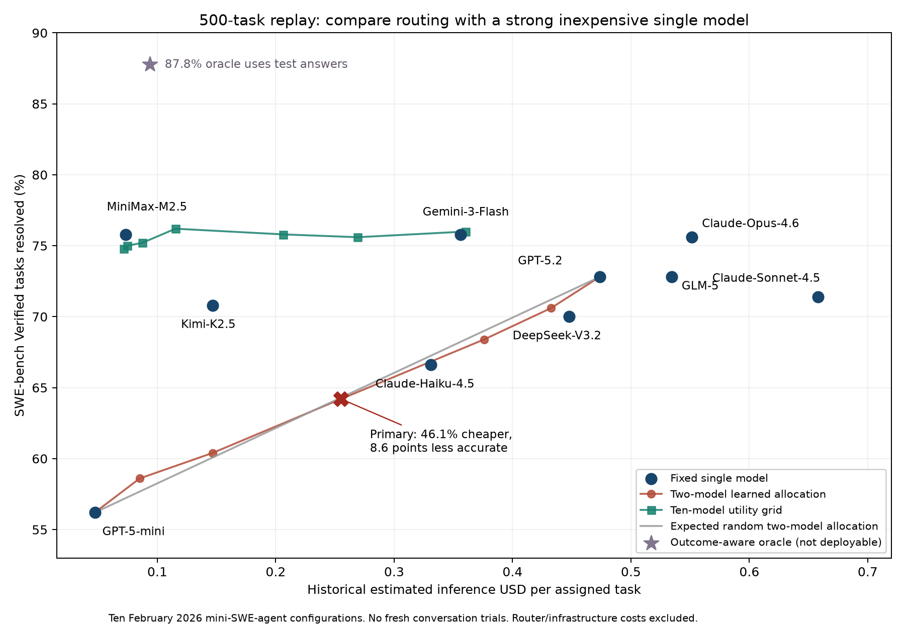

# Status and scope {.unnumbered}

This is a research paper and master's-thesis core, with a reproducible engineering
pilot, a completed 500-task SWE-bench Verified routing replay, and a prospective
confirmatory conversation protocol. Its central contribution is an
empirical replication and conversational-routing extension, **not a claim to have
invented small agents that consult larger models**. The broader earlier thesis
contains supporting reviews of open-model portfolios, prices, distillation,
browser benchmarks and deployment. Those materials do not change the active
protocol in this paper.

The empirical section distinguishes live model trials from software tests and
unexecuted experiments. An opaque hosted model called Luna is a practical
controller proxy, not evidence of a particular parameter count, open weights or
local-device feasibility. Sol is the pilot expert. User consent covers these
Codex agent experiments. The separately authorized one-80-GB-GPU Runpod budget
of US$100 has not been spent on this work.

Author, university, supervisor and submission declarations remain for the author
to complete. No institutional approval or model-training result is implied by
this manuscript. Historical estimated inference savings are reported separately
from unmeasured conversation benefits, current bills and subscription usage.

# Abstract {.unnumbered}

Can a small acting model reduce the total cost of agentic software engineering
by conversing with larger experts while retaining nearly the same task success?
The proposed mechanism is continuing, bounded dialogue: the controller works
locally, selects context, asks for assistance, answers clarification questions,
challenges proposals and integrates a verified result. This is broader than
initial model selection and more specific than an unconstrained agent swarm.
Learned routing, selective cloud delegation and multi-agent interaction already
have substantial prior art; this work is a replication and controlled extension.

We implement a thin experiment layer over Codex with persistent controller and
expert threads, bounded exchanges, independent grading and explicit missing-cost
handling. A live historical-bug pilot compares a single Luna agent, a single Sol
agent, task-only prompt routing and optional conversational assistance on four
issues from two repositories. Functional regression success is respectively
3/4, 4/4, 4/4 and 3/4. All optional controllers chose zero expert calls, so this
matrix does not estimate the value of an actual conversation. A separate required
two-round clarification-and-integration check passes its 30 regression tests.
Strict artifact-policy outcomes are reported separately because several workers
added assertions inside existing test files.

An additional experiment fits cross-validated pre-task routers on 5,000 published
agent outcomes: ten models on all 500 SWE-bench Verified tasks using mini-SWE-agent
2.0.0. The primary half-budget router achieves 64.2% success at US$0.2551 per task,
versus GPT-5.2's 72.8% at US$0.4736. Estimated inference cost falls 46.1%, but the
8.6-point quality loss fails the three-point tolerance. A ten-model portfolio
operating point reaches 76.2% at US$0.1154; inexpensive MiniMax-M2.5 alone reaches
75.8% at US$0.0733. The latter comparison prevents attributing the benefits of
model choice to routing. These historical outcome replays are not new model
inference or live conversations.

The confirmatory protocol compares conversation with single-model execution,
pre-call routing and one-way assistance under matched information and resource
budgets. The proposed gate combines a three-percentage-point quality tolerance
with lower measured total cost; a 25% saving is the practical target. Personal
memory, learned collaboration skills and multi-agent communication are optional
ablations and extensions. The pilot exposes no complete billing ledger and is
not powered for noninferiority. It therefore establishes execution feasibility,
not conversational cost savings, local-model capability or learning improvement.
The standard-benchmark replay supplies a reproducible negative primary result
and identifies a stronger low-cost standalone control for the next experiment.

**Keywords:** conversational routing; small language models; software-engineering
agents; bidirectional collaboration; cost–quality tradeoffs; replication.

# Motivation and research questions

The immediate research goal is a small acting controller that combines its own
work with outside expertise through conversation. A personal agent that remains
responsible to its user is one motivating application. A user should be able to inspect and
change what the agent remembers, retain control of project goals and decide
which information external services receive. The compact model need not solve
every problem independently. Its useful role can include understanding the
task, doing inexpensive work, asking a precise question, evaluating the answer
and incorporating a tested change.

These responsibilities are more demanding than choosing a model from an initial
prompt. They also create overhead and new failure modes. The controller may
misdiagnose a problem, omit crucial context, accept an incorrect suggestion or
spend more on coordination than direct expert execution. Personal memory may be
stale, irrelevant or less useful than a generic project guide. Learning can
reinforce a mistaken delegation habit. These possibilities motivate controlled
experiments rather than an assumption that a multi-model system is better.

The research questions are:

1. Can an acting small controller with bounded expert dialogue lower total cost
   while retaining accepted software-task success relative to a single expert
   given the same information, tools and resource envelope?
2. Does consultation after observing the repository and test feedback add value
   beyond a task-only router selecting one model before work begins?
3. Does persistent bidirectional dialogue add value beyond one-way assistance
   or reset expert calls under the same total budget? Which effects come from
   selective context sharing, verification or optional personal memory?
4. Can development experience improve the controller's decisions about when to
   ask, what to send and how to recover on later, disjoint tasks?
5. At which measured total-cost operating points is the resulting system useful,
   and which privacy, latency and local-access tradeoffs remain?

The core hypothesis is materially lower total cost with only a prespecified small
loss of task performance. Conversation may also improve performance, but that is
a separate claim. The first live pilot addresses feasibility and a restricted
version of the first two questions. The remaining questions require the registered ablations and
longitudinal data. A null finding is informative: if the same-context expert
remains better or the controller cannot exploit assistance, the proposed
complexity is not justified in that setting.

The project's guiding sentiment is “Believe in me who believes in you.” It is a
motivation for persistent investigation, not a substitute for falsifiable claims.

# Prior art and the conversational-routing question

## Review scope and novelty verdict

The broad architecture has already been demonstrated. A small model that acts, decides when to consult larger models, incorporates their responses, and learns a cost-sensitive collaboration policy is not a new invention. Most directly, **EdgeWise** evaluates a local small-model solver with selective cloud delegation on software-engineering and terminal tasks, and trains its delegation decisions with reinforcement learning [@shi2026edgewise]. **Router-R1** previously learned multi-round model invocation and aggregation with a three-billion-parameter controller [@zhang2025routerr1]. **Uno-Orchestra** jointly learns decomposition and worker selection across a heterogeneous model pool [@cui2026unoorchestra]. Calling the proposed system the first thinking router, the first small agent helped by large models, or the first agent to learn when to delegate would therefore be incorrect.

The primary question for *We have to combine — A conversation is all you need: Using Small LMs as Conversational Routers for Agentic Software Engineering* is empirical: **can a small acting agent use bounded, bidirectional conversations with larger experts to reduce total cost while keeping verified task quality within a prespecified acceptable loss, and does conversation add value over one-way delegation?** Expert clarification questions, the small agent's challenges, revisions and subsequent verification form the treatment of interest. This is a replication and extension of selective collaboration, with a controlled communication ablation and fuller cost accounting. Editable personal memory and persistent user goals are optional extensions, rather than prerequisites for the main claim. The contribution rests on reproducible evidence and controls; neither conversation nor its combination with a small controller should be presented as a first invention. The targeted review cannot establish universal priority.

The search combined title/abstract searches on arXiv for personal agents, delegation, small/large-model collaboration and developer skills with backward references and official repositories. Versioned primary texts were inspected for methods, evaluation conditions and limitations; the accompanying source register records URLs, retrieval dates, hashes and failed accesses. This is a targeted review through 26 October 2026, not a PRISMA systematic review or an exhaustive patent search. Several closest studies are recent preprints. Their reported results are evidence to examine and reproduce, not measurements performed by this project.

## Established components and optional personal capabilities

The earlier four-capability personal-agent design remains a useful map of related work. The main experiment isolates conversational expert assistance; memory and experience learning can be added as separate interventions after this comparison is established.

| Proposed capability | Closest established work | What still needs a controlled test here |
|---|---|---|
| Editable goals, project history and preferences | MemGPT, Letta, A-MEM; personalized coding skills; personal-agent memory benchmarks | Whether the correct person's memory improves executable work beyond generic procedural guidance, and whether revisions are respected |
| Small agent acts and selectively asks experts | Router-R1; EdgeWise; Uno-Orchestra | Whether delegation remains useful after equalizing personal context, tools, budgets and expert access |
| Tests, critique, constraint checking and integration | ReAct-style tool loops, Reflexion, coding harnesses; EdgeWise task-solving loop | Whether explicit acceptance and recovery procedures prevent harmful expert overrides without excessive cost |
| Learns collaboration from experience | Router-R1 RL, EdgeWise delegation RL, ReMA, Memento, Agent Lightning | Whether learning improves unseen personal/project tasks, and how much training or experience cost must be amortized |

The position paper *Small Language Models are the Future of Agentic AI* already argues for heterogeneous systems and describes an LLM-to-SLM conversion procedure [@belcak2025smallagents]. This supports the motivation to democratize agent capability, but a position statement and replacement case studies do not establish the proposed system's measured advantage.

The meaningful unit of evaluation is the whole agent system. A controller can be a smaller model without being a local model; an agent can preserve memory without updating weights; and a model can be trained to delegate without learning useful personal preferences. These are separate interventions. In particular, a Codex Luna/Astra/Sol pilot can test an orchestration mechanism using existing agents, but model names and service tiers do not establish parameter counts, desktop feasibility or open-weight deployability.

## From query routing to an acting small agent

RouteLLM provides a strong reusable example of preference-based selection between weak and strong models; it is a useful one-shot routing baseline [@ong2024routellm]. It does not exhaust the relevant prior art. Router-R1 treats routing as a sequential process: its controller interleaves internal deliberation with model calls and incorporates responses into an evolving context. The inspected version trains Qwen2.5-3B-Instruct and Llama-3.2-3B-Instruct with PPO in veRL, allows at most four routing steps, and uses 14,000 training questions split between Natural Questions and HotpotQA. Evaluation covers seven general and multi-hop QA datasets, with 500 sampled items per dataset except the smaller Bamboogle set. Its six-worker pool spans several model families and sizes [@zhang2025routerr1, Sections 3–4].

Router-R1 is particularly close to the proposed “personal model as the brain.” The controller is itself a solver and synthesizer; the workers contribute complementary information. Its reward includes format correctness, exact-match task outcome and a cost term. However, the main experiments set the cost coefficient to zero; separate experiments vary it and report the resulting quality–cost trade-off. The cost construction uses candidate output tokens and a model-dependent price function. It should not be read as a measurement of every infrastructure and training expense. Its QA setting also does not establish repository repair, executable verification, persistent personal memory or user-goal management. Reusing the released implementation is more appropriate than inventing another generic multi-round router. The inspected official repository has an Apache-2.0 license and links released models and data.

MasRouter adds a different relevant dimension: it selects collaboration mode, agent roles and language models using a cascaded controller, rather than selecting only the model for an isolated query [@yue2025masrouter]. Its main pool includes GPT-4o-mini, Claude 3.5 Haiku, Gemini 1.5 Flash and Llama 3.1 70B, with DeepSeek-V3 used for inductive evaluation. Its five datasets include HumanEval and MBPP. These are useful coding tasks, but they do not constitute a persistent personalized repository agent. Its reported cost reductions compare specific pools and system configurations; they cannot be transferred to a new model generation or converted into a universal savings rate. The official code is Apache-2.0.

Uno-Orchestra makes the novelty boundary still narrower. It uses a Qwen2.5-7B-Instruct orchestrator, selectively decomposes tasks and chooses admissible model–primitive combinations, and trains from worker-grounded trajectories. Its main pool contains nine commercial workers; its 13-benchmark suite includes code, SWE-bench Verified, terminal tasks and tool use [@cui2026unoorchestra, Sections 4–6 and Appendix A]. Consequently, neither heterogeneous expert selection nor learned decomposition is a new contribution here. Its macro-average and dollars-per-query aggregate over different task domains under its own rollout harness. They are not a same-task comparison with the proposed study. Moreover, the paper's linked author repository returned HTTP 404 during this review. A separately discoverable repository with the same title was not established as an author-verified replacement. This limits immediate reproducibility; it does not negate the paper as prior art.

## EdgeWise: the closest software-engineering precedent

EdgeWise directly studies the proposed small-first operating pattern. The local SLM continuously interacts with the environment and delegates selected steps to a stronger cloud model. It compares an external-judge policy with self-delegation learned inside the small model, investigates which steps benefit from assistance, and evaluates five ways of supplying context to the cloud model [@shi2026edgewise, Section 3]. Full history, the previous step, recent history, history without the small model's analysis, and selected relevant steps are already explicit ablations. Selective context transfer therefore cannot itself be presented as an unexplored idea.

The self-delegation method uses SFT to teach the action format, then RL to improve task solving and delegation. Delegated expert tokens are excluded from the small policy's loss. Its trajectory reward combines correctness with a successful-trajectory bonus that decreases with the number of cloud calls; the paper explicitly distinguishes this regularizer from directly optimizing monetary cost. A critic supplies additional credit on delegation tokens. This is closely related to the requested learning of when local work is sufficient and when an expert is necessary. Critic agreement is a training signal, however, not an independent proof that a particular call caused task success.

The reported training scale also matters. Section 4.1 uses Qwen3.5-9B, SWE-smith tasks, 2,000 SFT examples, and RL with Kimi-K3 on **40 A100 80 GB GPUs for 175 steps**, batch size eight and 16 rollouts per example. The current authorization of one 80 GB GPU and US$100 does not fund a faithful reproduction of this training configuration. It can support a smaller feasibility experiment if its scope and stopping rule are explicit. A prompted Codex delegation experiment is an architecture probe, not a reproduction of EdgeWise's trained checkpoint.

The main evaluation uses Terminus2 with an 80-turn cap on Terminal-Bench 2.1 and SWE-ReBench-03. Table 1 compares Qwen3.5-9B plus either GPT-5.5 at xhigh reasoning effort or Claude Opus 4.8 through Bedrock against large-model-only and several routing baselines. For the GPT-5.5 SWE-ReBench comparison, reported pass@1 changes from **56.36% to 58.18%**, and pass@3 from **63.64% to 66.36%**; the corresponding reported API-cost reductions are **51.22% and 52.68%**. The Opus comparison illustrates the trade-off more clearly: pass@1 falls from **60.00% to 57.27%**, while the reported API cost falls by **62.68%**. These are within-paper comparisons on the stated benchmark configuration, not evidence that every quality target is preserved. The inspected text does not establish a noninferiority margin and confidence interval for that claim.

Crucially, EdgeWise counts cloud input/output-token API cost and includes the external judge where used, but **excludes local SLM computation** from its main cost comparison [@shi2026edgewise, Section 4.2]. Training, local hardware and idle capacity are not recovered by quoting its headline savings. The inspected text also does not make the task denominator of its dollar column sufficiently explicit for this review to convert those values into a new per-task price. The present thesis should report measured dollars per assigned task and per resolved task from its own event ledger, including failures, retries and local costs, and separately report amortized training cost. EdgeWise's reported lower API bill remains useful evidence under its stated accounting boundary.

The practical deployment uses a DGX Spark with vLLM 0.19.1 and BF16, rather than an arbitrary consumer laptop. Appendix G.2 describes approximately 78.7 GB of reserved unified memory, including a substantial KV-cache allocation. It demonstrates one edge workstation configuration; it does not establish that the exact deployment is freely runnable on every desktop. The project page linked from the paper was blocked by the current environment's proxy, and searches did not verify an official code/checkpoint release or its license. The project should therefore reuse the method as cited prior art while tracking implementation availability, rather than claiming that a released EdgeWise package has been integrated.

## Conversation is a treatment to measure, not a novelty shortcut

Router-R1 already incorporates expert responses across multiple routing rounds, Uno-Orchestra learns sequential orchestration, and EdgeWise alternates local and cloud contributions within a continuing task [@zhang2025routerr1; @cui2026unoorchestra; @shi2026edgewise]. These precedents make conversational assistance plausible, but they do not by themselves isolate the benefit of a persistent expert clarification channel. The inspected methods establish multi-round invocation and response integration; this review did not establish a matched experiment that disables only expert-initiated clarification and challenge–revision exchanges while retaining the same models, task state, tools and inference budget. That bounded observation identifies a useful ablation, not proof that such an experiment has never been performed or that dialogue is new.

Operationally, the conversational condition lets the expert ask for missing evidence, lets the small agent answer or challenge a proposal, and lets the same expert revise its response before the small agent verifies and integrates it. The comparison should include a single delegated response and a repeated-call control with equivalent opportunities to spend compute. Otherwise, any improvement may reflect more tokens, attempts or preserved context rather than reciprocal communication. Log message direction, clarification requests, supplied evidence, revision events and accepted artifacts. Neither a long transcript nor a higher message count establishes useful collaboration; quality and total cost remain the outcomes.

EdgeWise's cloud-API savings provide prior evidence for the economic hypothesis under its accounting boundary. They do not establish that additional dialogue reduces total expense, because context retransmission, model switching, local inference, verification and unsuccessful conversations can consume the savings. The central test therefore combines a prespecified quality noninferiority criterion with measured total cost per assigned and resolved task. The title's “a conversation is all you need” expresses the proposed coordination interface; working tools, an execution harness and independent acceptance checks remain necessary parts of the system.

## Personal memory is established, and its benefit is not automatic

MemGPT's management of external memory and Letta's persistent state already support long-lived agents [@packer2024memgpt; @ttgllettacode2026]. A-MEM studies dynamically linked and evolving memories [@xu2025amem]. These systems motivate editable application memory instead of retraining for every changed fact. They do not imply that remembering more will improve every decision. Facts, preferences, active goals and reusable procedures should have distinct provenance and update rules; temporary task instructions should not silently become permanent user preferences.

A directly relevant coding study, *Do Personalized Skills Help Coding Agents?*, uses Codex with GPT-5.5 to generate skills, execute coding tasks, simulate the developer and score completion [@huang2026personalskills]. After reconstructability filtering, it retains 206 sessions from 13 developers, dividing them into 164 evolution sessions and 42 test sessions per split. It repeats the experiment with five split seeds and caps each replay at six developer-agent turns. The comparison includes no skill, the correct developer's skill, a random other developer's skill, and a generic skill pooled across evolution histories. The evaluation is therefore unusually close to the proposed use of Codex and personal histories.

Table 1 reports mean completion scores of **65.02** without a skill, **65.99** with personalized skills, **65.94** with another developer's skill and **68.80** with generic skills, on its 100-point LLM-judged rubric. These are not executable test pass rates. The simulator and scorer share the GPT-5.5 family with the coding agent, so correlated judgments and replay realism remain relevant limitations. Nevertheless, the result directly challenges the assumption that personalization must help: the study finds small, inconsistent personal gains and more consistent generic-skill gains. A correct-user versus no-memory comparison alone would fail to isolate useful personalization. If personalization is added, that extension should include generic and shuffled-user memory controls, use executable acceptance checks where possible, and evaluate changed or conflicting preferences rather than only static recall.

MemPABench provides another recent caution [@li2026mempabench]. Its on-policy environment uses four grounded simulated users, 14 interaction preferences and 99 sessions over four months, with event-driven preference changes. It measures decisions to clarify, confirm or act, rather than only recalling a personal fact. The reported limited gains and inappropriate generalization of file-based preferences motivate measuring delivered behavior separately from retrieved memory. This is adjacent interaction-preference evidence, not software-engineering accuracy evidence.

The nanoMuse report independently establishes that an open personal agent with readable memory files, user-chosen models, cross-device continuity and persistent operation is also an existing product direction [@liu2026nanomuse]. Its GitHub repository identifies GPL-3.0, while the paper labels size and cost as estimates and describes evaluation components still on its roadmap. It is relevant architectural prior art, not proof of a measured cost–quality advantage over frontier coding agents.

## Learning collaboration without reinventing an RL stack

“Learning from experience” covers several different treatments. Reflexion updates textual episodic feedback without changing model weights [@shinn2023reflexion]. Memento combines planning, execution and memory-based adaptation; its case-selection policy and episodic memory are not equivalent to fine-tuning the underlying LLM [@zhou2025memento]. The inspected official Memento implementation is MIT-licensed and describes a planner–executor loop with MCP tools. These are practical baselines for the question of whether new verified experience improves later collaboration before attempting parameter updates.

ReMA already learns collaboration between a high-level strategic agent and a lower-level reasoning agent using multi-agent RL [@wan2025rema]. Its primary results concern reasoning and judging tasks rather than a user-owned persistent coding system. GPTSwarm already optimizes agent prompts and graph connectivity [@zhuge2024gptswarm]. Thus, many-to-many communication, learned role allocation and evolving collaboration graphs are established research directions. A swarm extension should examine explicit questions about stability, useful specialization and cross-agent credit assignment; observing different role names or more messages is not evidence of emergent competence.

For later weight training, Agent Lightning v1.0 is a reusable MIT-licensed framework specifically intended to retain real harness tools, context and control flow during RL [@he2026agentlightning]. Its primary text reports a mini-SWE-agent pipeline using SWE-smith-derived data and Qwen3.5-9B. The framework addresses request/response capture, sample construction, token alignment, advantage calculation and backend scheduling. Those are substantial reasons to reuse it rather than build a custom RL engine. The current repository and license were inspected at a pinned commit; this review did not run its GPU training pipeline.

In the proposed study, executable test rewards, AI-generated critiques and monetary penalties should remain identifiable components. A test-derived correctness signal is not RLAIF merely because an AI produced the patch. An AI critic's preferred delegation decision may be wrong and should be assessed against controlled counterfactual branches on development tasks when affordable. In a later learning extension, keep the expert frozen while first training the controller policy, mask expert-produced tokens from that policy's objective where the selected algorithm requires it, and compare with an equally experienced single-model control. Otherwise, extra training or extra expert inference can be mistaken for a special benefit of collaboration.

## What a credible extension would establish

DecisionBench is an instructive evaluation precedent [@gao2026decisionbench]. It fixes a peer pool, delegation interface and information channels, and measures process outcomes in addition to final quality. Its headline study covers GAIA, tau-bench and BFCL multi-turn, with 11 models and five conditions; its released code also contains an appendix-only SWE-Bench Pro adapter. Across 23,375 task rows, its reported changes in routing fidelity do not translate into a clear mean quality improvement. Selecting a seemingly appropriate expert is therefore insufficient: the full system must actually solve more tasks or solve them with less measured expense. The official Hugging Face code/data repositories were reachable, although this review did not establish an explicit software license for redistribution.

The defensible experiment keeps the same software tasks, initial repository states, task context, tools and acceptance checks across small-only, large-only, task-router, one-way delegation and bidirectional small-controller–expert conditions. A matched large-controller condition tests whether the smaller controller contributes beyond simply adding an extra reasoning stage. Budget-matched repeated calls separate the effect of conversation from additional inference. Record local attempts, help requests, clarification and revision events, context bytes/tokens disclosed, expert artifacts accepted or rejected, verification failures, recovery steps, latency and full resource use. If personal memory is added, compare correct-user, generic and shuffled-user memory independently of architecture. An optional history-conditioned policy can later be compared with its frozen counterpart on a new time-ordered evaluation block; it should not repeatedly learn from the final test panel.

This design supports a precise contribution statement: **a reproducible evaluation of whether small agents acting as conversational routers can reduce total software-engineering task cost with minimal quality loss, and whether bidirectional clarification, challenge and revision improve on one-way delegation under comparable budgets.** It extends established selective-collaboration research rather than claiming a first architecture. A negative result is informative if one-way delegation, an existing router or a single larger model already achieves the same frontier. Personalization and learning remain separately testable extensions. A successful small Codex pilot can justify larger runs; it cannot establish open-model local deployment, RL improvement, long-term learning or a statistically stable dollar-cost frontier without the corresponding measurements.

# System and implementation

The central mechanism is a continuing conversation between an acting small
controller and one or more experts. The four personal-agent capabilities below
are useful extensions, not four mandatory components of the hypothesis. The
minimal system can omit personal memory entirely and still test conversational
routing. Expert replies can ask for missing information or challenge the current
plan. The controller can supply evidence, reject a suggestion or request a
revision; both threads persist across the exchange. A bounded conversation is
therefore distinguished from a single request followed by an accepted answer.


## Four connected capabilities

The system state at decision time is
$x_t=(g,m_t,h_t,w_t,b_t)$: the current goal and mandatory constraints $g$, editable
memory $m_t$, observable interaction history $h_t$, workspace state $w_t$ and
remaining resource budget $b_t$. The controller's available actions are local
work, expert consultation, verification, integration, memory proposal and task
completion. This is a partially observed sequential decision problem; an
initial-prompt router observes only a restricted state before any local work.

**Personal understanding.** Memory contains explicit goals, project decisions,
preferences and relevant history with identifiers and provenance. Facts remain
ordinary local data that can be corrected or deleted. Session state, repository
files, a learned adapter and a model's KV cache are different objects. Changing a
deadline must not require fine-tuning a model. Procedural skills may eventually
be represented by a versioned skill file or compatible adapter, but neither is
treated as the authoritative store of user facts.

**Expert collaboration.** The controller first has permission to inspect and
work on the repository. It may ask a bounded expert a question or request a
plan, diagnosis, patch proposal or critique. A request contains the task
contract, selected relevant context, the unresolved question and the expected
form of response. The expert does not automatically receive the user's entire
memory or the controller's full history. Asking and acting are both eligible
choices; a personal agent that succeeds without calling an expert is not a
failed treatment.

**Verification and integration.** The controller retains responsibility for the
submitted patch. It can run visible tests, inspect diffs, reject a suggestion or
ask for clarification. The independent evaluator separately decides whether
the final artifact passes the registered task tests. Visible tests help the
agent, whereas hidden grading tests measure it. Passing a tool call or receiving
a confident expert answer does not establish that the task is solved.

**Learning from experience.** Observable records connect the state available at
a decision to the request, response, verification and outcome. Useful targets
include recognizing an unproductive local search, selecting sufficient context,
question formulation, challenging a flawed proposal and recovering from failed
integration. An ultimately successful trajectory does not make every earlier
decision optimal. Learning therefore uses development-only comparisons and
counterfactual rollouts when feasible, instead of labelling all actions in a
successful run as good.

## Reusing Codex

The experiment uses Codex's existing model/tool execution rather than a new
coding-agent loop. The repository adds a small experimental wrapper in
`src/ttgl/personal.py`: task and condition manifests, expert request boundaries,
continuation of the controller thread, event recording and resource limits.
Single-model and personal conditions use the same coding interface. A separate
module, `src/ttgl/pilot.py`, checks the assigned trial matrix and produces paired
descriptive summaries without inventing missing usage.

The standalone adapter invokes `codex exec --json` and interprets documented
thread, completion and usage events. The expert begins in a separate read-only
session; subsequent exchanges resume that expert thread. Its structured response
is an answer, a request for context or a challenge. The controller continues its
own thread to inspect evidence, answer questions and integrate the response.
The wrapper caps turns, expert calls and elapsed time. A Codex turn can contain
multiple internal model/tool interactions, so a turn cap is not falsely reported
as an exact cap on billable inference requests. Timeout handling terminates the
wrapper's process group and preserves a failure disposition.

In this managed session, the installed standalone CLI identifies itself as
version 0.163.0 but cannot initialize its in-process app server because the
required state location is read-only. We do not bypass that restriction. The
live pilot therefore uses the available Codex collaboration interface with
fresh, explicitly selected models. The reusable CLI adapter is tested with an
injected deterministic backend; those tests verify control flow, not model
quality. The two execution paths are recorded as distinct backends.

The collaboration interface does not expose a reliable itemized token invoice
to this experiment. It also shares a filesystem among agents. Workspaces are
separate copies, and instructions prohibit reading other trials, evaluator
files or external solutions, but this is a soft boundary rather than an OS-level
confidentiality guarantee. Stronger held-out evaluations require separate
containers or machines with an evaluator outside the agent's mount namespace.

## Memory and context controls

All conditions receive the same relevant personal-memory snapshot for a given
task. The expert-only baseline is not deprived of user preferences. In the
personal condition, the controller decides which part of that snapshot to send
to an expert. In a future minimal-disclosure experiment, synthetic canary facts
and explicitly irrelevant preferences permit measuring unnecessary transmission
without using real private user data. That experiment reports disclosure
alongside task success; withholding essential context can reduce quality.

Memory changes have separate categories. Factual edits are user-controlled
state updates. Proposed procedural lessons cite their development evidence and
can be accepted, rejected or reverted. A factual-memory-only control receives
the same updated facts without learned skills, while a generic-skill control
tests whether personalization adds anything over broadly useful instructions.
Deletion and stale-fact correction are evaluated explicitly in longitudinal
tasks. A system that remembers more but cannot forget is not considered a
successful personal-memory implementation.

MCP can expose tools and state services, and A2A can provide remote agent task
interfaces. The communication review in the supporting thesis examines their
versioned capabilities. They do not by themselves learn who should communicate
or prove that a returned artifact is correct. Slack is an optional human-visible
transport, not a requirement for the experiment, and no external Slack messages
are sent by this study.

# Experimental design

## Conditions and estimands

The unit of analysis is an assigned repository issue, not an individual model
call. Every registered issue is assigned to every primary condition. Each run
starts from a clean copy of the same buggy revision and receives the same issue
description, relevant memory, editable source boundaries and visible tools.
The primary conditions are:

| Condition | Behavior | What it estimates |
|---|---|---|
| S: single controller | Luna acts and verifies without model assistance | Controller's independent capability |
| L: single expert | Sol acts and verifies throughout | Same-context strong-agent reference |
| R: pre-call routing | A task-only Luna decision selects S or L, then a fresh selected agent acts | Initial allocation without adaptive collaboration |
| C: conversational routing | Luna acts, exchanges up to two expert turns with Sol, then verifies and integrates | Added effect of adaptive expert conversation |

R is a prompt-based routing baseline. It is **not** a reproduction of RouteLLM,
Router-R1, MasRouter or EdgeWise. Those methods require their own eligible model
pairs, learned parameters, training data and runtime assumptions. Reusing a
router calibrated for a different pair without validation would not establish
its performance on Luna and Sol. Native implementations, where available and
licensed, enter a larger study as separately named arms.

The C-versus-L contrast tests the complete product architecture. C-versus-S
tests whether access to help is useful. C-versus-R tests adaptive consultation
against initial selection. None alone identifies the value of personalization,
because all primary conditions share the same memory. That value requires the
memory and skill ablations below. Sol may be replaced by Astra or an open-weight
expert only as a separately versioned comparison; outcomes are not pooled under
the vague label “large model.”

## Engineering pilot

The pilot uses genuine historical Python bugs from the public BugsInPy corpus [@ttglbugsinpy2026].
A deterministic feasibility screen checks candidate bugs in the registered
order before any candidate-agent outcomes are observed. A usable task must have
a buggy revision that fails its regression check and an official fixed revision
that passes it under the recorded environment. Every compatibility exclusion is
retained. If a harness adaptation is necessary, its exact change and rationale
are recorded; the pilot does not inherit the official BugsInPy leaderboard's
meaning merely by using its bugs.

Task descriptions can be derived from the behavior exercised by an upstream
regression test when a self-contained issue statement is unavailable. This is
recorded as a derived task prompt, not presented as an untouched benchmark
instance. Reference patches and grading fixtures are kept outside the worker
copy, with the shared-filesystem limitation stated above. Small historical fixes
provide a useful execution check but may have a ceiling effect and may already
be present in model training data.

The task list, source revisions, prompts, constraints, baseline checks, grading
commands and analysis design are frozen before the live trials. Model settings,
fresh-session identifiers, selected routes, expert requests and submitted patches
are archived. The same task cannot be silently rerun until it passes. An
infrastructure retry is separately identified and preserves the first attempt.
Completed and failed assignments remain in the denominator. The feasibility
screen is independent of the models being compared.

In the personal condition, expert responses contain only the context provided
by the controller and their resulting proposal. The pilot limits assistance to
the registered number of consultations. A controller may choose zero calls.
Baselines receive the same task time envelope; the personal condition's budget
includes its expert waiting and integration time. These are wall-time controls,
not claims of equal token consumption. Model reasoning-effort settings are
recorded, and the unobserved internal compute differences remain a limitation.

The pilot is developmental. Its issues, outputs and human observations are
excluded from later training/calibration/test claims that require unseen
examples. It establishes that the architecture can be executed and independently
graded, and identifies measurement or orchestration failures. It cannot prove
noninferiority, cost superiority, architectural novelty, long-horizon learning
or a benefit for open-weight local models.

## Confirmatory software-engineering study

The proposed primary evaluation uses a pinned release of SWE-bench Verified,
with the official evaluator and recorded image digests [@jimenez2024swebench; @swebenchverified2024]. Development data come
from disjoint issues and bug clusters; a repository-unseen analysis additionally
excludes all development data from its registered repositories. Public benchmark
exposure and opaque model training data remain contamination risks, so a
prospective private or newly released issue replication is desirable.

For each task, accepted success is functional resolution **and** satisfaction of
feasible prespecified mandatory constraints. Resolution and constraint adherence
are also reported separately. A requirement such as preserving a public API or
avoiding new runtime dependencies must be machine-checkable or independently
reviewed under a frozen rubric. Requirements are screened for consistency with
the task before outcomes are observed. Hidden constraints that the agent was
never told are not introduced after submission.

The proposed primary gate is C-versus-L quality noninferiority with a margin of
three absolute percentage points, followed by superiority in mean total cost per
assigned task. A 25% reduction is the proposed practical target; both its point
estimate and uncertainty must be reported. These thresholds are prospective
design choices and are not fitted to pilot outcomes. The margin is an explicit engineering tolerance, not a universal
customer preference. It must be approved in the protocol freeze before held-out
execution. A failed noninferiority test is inconclusive about equivalence. A
claim of improved quality is a separate, multiplicity-controlled test, not an
alternative success criterion chosen after seeing results.

Three recorded repetitions per task are planned for the fully funded study.
Repeated seeds remain nested within tasks. Paired task-weighted effects and
repository-clustered uncertainty are reported with a conditional-on-repositories
sensitivity analysis. Sample-size planning uses development-only discordance,
variance and cost observations. The full matrix is not assumed to fit the
US$100 Runpod pilot allocation. A dated resource plan must include failed runs,
container evaluation, model loading, artifact storage and cleanup before that
study starts.

## Ablations needed to explain an effect

The essential conversational ablation is **one-way assistance versus continuing
two-way dialogue**. In the former, an expert returns a bounded proposal and does
not ask clarification questions; in the latter it can ask, challenge and revise
in the same thread. Match the expert pool, permitted context and total budget,
and report actual turns rather than forcing a conversation on every easy task.
A third version resets expert state between requests, separating retained
conversation from simply spending more inference. This contrast is a testable
extension, not a universal claim of priority over all prior multi-agent work.

Memory, cooperation and learning are different interventions. The follow-up
matrix therefore includes no personal memory, correct matched personal memory,
generic project guidance and shuffled-user guidance. Shuffled material uses
synthetic profiles and is an experimental control, never a product behavior.
The generic-skill baseline is especially important because prior personalization
research reports that pooled skills can outperform personalized skills.

Within the cooperative condition, compare task-only expert selection with
small-first consultation, full permitted context with selected context, and
expert-only completion with controller integration. Verification ablations can
remove additional controller critique while preserving the independent final
grader. They cannot give one condition access to hidden tests. A manager-only
condition tests coordination without local work; it is not the flagship
personal-agent treatment.

Expert competence and extra inference are potential confounds. Use the same
expert backend across conditions, retain router/manager overhead, and include a
large-controller-with-the-same-expert option when studying controller size.
An equal-total-budget single-expert condition tests whether extra thinking by
one model explains an apparent multi-agent advantage. Expanded expert portfolios
are added after the dyadic comparison, with pool size and expertise held fixed
within each contrast.

## Learning collaboration without reinventing distillation

Classical sequence or logit distillation is background and an optional component,
not the central experiment. The learning question concerns the personal agent's
collaboration policy. Start with frozen weights and versioned procedural skills;
compare no update, factual-memory-only update, generic skill update and
personalized skill update. The development curriculum presents tasks in a fixed
order and evaluates later disjoint tasks at frozen checkpoints. Evaluation
feedback never modifies a policy during its final test.

For a weight-learning replication, use a maintained agent-training framework
such as Agent Lightning rather than building a new RL trainer. Pin its release,
instrumentation boundary and training data. The initial compatible open model
and runtime must be validated independently; the hosted Luna pilot provides no
access to Luna weights and does not train that model. A Runpod key alone cannot
make hosted-model fine-tuning available.

A transparent reward decomposition is
$r=Y_{\mathrm{accepted}}-\lambda C-\mu V-\nu B$, where $C$ is measured resource
cost, $V$ counts registered constraint violations and $B$ penalizes budget
violations. Coefficients are selected on development data and frozen. If only
call counts are available, the objective is labelled a call-count penalty,
not a monetary-cost objective. Task tests provide executable feedback; this is
not automatically RLAIF. AI feedback requires a declared judge, rubric, blind
human audit and reward-hacking checks. It may supplement task tests, not replace
independent functional evaluation by assertion.

Credit assignment should compare continuing locally, asking with different
context packages and choosing different experts from the *same predecision
state*. Those extra rollouts incur acquisition cost. Future expert replies and
hidden grader results cannot enter the features available to an earlier
delegation decision. Evaluate held-out accepted success, unnecessary and missed
delegations, context sufficiency, recovery success and full amortized cost. A
falling expert-call count is valuable only when quality and constraints remain
satisfied. No monotonic learning curve is assumed.

## Persistent many-to-many extension

A swarm adds persistent worker memories, task ownership and communication
topology to the decision problem. It is a separate extension, since improved
group performance can otherwise be attributed to more models or more inference.
Begin with fixed roles and durable task identifiers. Compare a star centered on
the personal agent with a bounded peer graph and a learned communication graph,
under equal total token, tool and time caps and the same expert pool.

Measure accepted team output, duplicate work, lost handoffs, stale-memory errors,
message volume, context disclosure and recovery after an agent restart. Role
specialization must improve held-out performance and transfer across goals to
count as useful emergence. A visually interesting conversation pattern is not
evidence. Learning can use centralized training with decentralized execution,
but rewards and credit attribution must be specified. This extension remains
prospective and does not delay or inflate the claims of the core dyadic study.

# Measurement and economic analysis

## What counts as saving money

The main hypothesis concerns the whole system, not merely the number of calls
to a strong model. For assigned task $i$, define

$$C_i=C_{S,i}+C_{L,i}+C_{\mathrm{router},i}+C_{\mathrm{tools},i}
       +C_{\mathrm{handoff},i}+C_{\mathrm{retry},i}.$$

For API services, each component uses observed billable input, cached input,
output and separately billed reasoning/tool categories at a dated endpoint price.
For rented inference, include occupied instance time, startup, model loading,
storage and cleanup. Local hardware has both a marginal-cost scenario and a
fully allocated scenario including energy and amortization. Training and
experience-acquisition costs are separately amortized over a stated task horizon.
Do not add a token-price estimate to an instance bill when they represent the
same inference expense.

Cost per assigned task is $\sum_i C_i/N$. Cost per resolved task is
$\sum_i C_i/\sum_i Y_i$, so failed attempts remain in the numerator. If there are
no successes, the latter ratio is undefined, not zero. The proposed cost ratio
is $\bar C_C/\bar C_L$ after the quality gate. Savings are $1-\bar C_C/\bar C_L$.
Unknown cost components prevent a full-cost claim. Counting only paid cloud
tokens supports a narrower API-bill claim, which must be labelled accordingly.

Conversation can save expensive model work but add repeated context, latency
and cache misses. A resumed conversation preserves logical state, not a
guaranteed physical KV cache. Switching models or adapters can require prompt
reprocessing. Record actual cache usage where the provider exposes it, and
measure cold versus warm service conditions in open-model deployment. LoRA
adapters are tied to compatible base models; arbitrary cross-model adapter
sharing is not assumed.

Report an empirical quality–cost frontier at development-selected operating
points. Changing the price sensitivity, maximum expert turns or escalation
threshold creates different policies. The final test cannot choose the best
threshold retrospectively. Decision quality includes false local confidence,
unnecessary consultations, unresolved requests, useful expert replies rejected
and harmful replies accepted. A correlation between expert calls and failure is
not causal evidence that experts hurt: difficult tasks may trigger those calls.

## Published price and accuracy context

The supporting source audit contains an independently reconciled historical
SWE-bench Verified comparison using mini-SWE-agent 2.0.0, 500 assigned issues per
submission, dated 17 February 2026 [@ttglhistoricalleaderboard2026]. These are third-party reported inference
costs, not invoices, full infrastructure expenses or current-model prices.
They must not be mixed with this four-task pilot to rank the architectures.

| Historical model | Resolution | Reported USD / assigned task | Derived USD / resolved task |
|---|---:|---:|---:|
| MiniMax M2.5 high, open weights | 75.8% | 0.0733 | 0.0967 |
| Claude Opus 4.6, closed | 75.6% | 0.5515 | 0.7295 |
| GLM 5 high, open weights | 72.8% | 0.5344 | 0.7341 |
| GPT-5.2 high, closed | 72.8% | 0.4736 | 0.6505 |
| Claude Sonnet 4.5 high, closed | 71.4% | 0.6579 | 0.9214 |
| Kimi K2.5 high, open weights | 70.8% | 0.1466 | 0.2070 |

The exact source revision, 3,000 per-instance cost records and arithmetic are
registered in the supporting `task-economics-sources.json`,
`task-price-checks.json` and `task-price-comparisons.csv`. The price per resolved
task includes spending on unsuccessful assignments. Matching a named scaffold
and benchmark improves comparability but does not erase differences in model
settings, serving or submission procedures. These historical figures establish
that open-weight and closed systems can occupy different cost–quality points;
they do not identify the present best model.

The 25 October 2026 model catalog separately records recent Qwen, DeepSeek, GLM,
Kimi and closed-provider releases, licenses and price-source limitations. For
example, a current compact Qwen checkpoint is a candidate for an eventual
open-model controller replication, whereas very large sparse DeepSeek models
do not become deployable on one 80-GB GPU merely because their active parameter
count is small. Current inference frameworks and model compatibility require a
real preflight. Model selection is frozen per experiment, rather than silently
substituting the newest release mid-run.

# Live engineering-pilot results

## Execution and independent grading

The pilot completed **16 assigned model runs**: four conditions on four bugs from
two repositories. Three bugs are from tqdm and one from PySnooper; some concern
related Boolean/initialization behavior. These are four assignments, not four
independent repository clusters. All eight pre-model evaluator controls passed:
each buggy version failed and each official fixed version passed its selected
regression module. A later integrity check confirmed the recorded source and
test hashes before grading the submissions.

All workers used fresh conversations, explicitly requested medium reasoning
effort and the same pinned Python test environment. The primary matrix used
Luna and Sol through Codex's collaboration interface. No Runpod GPU was created.
No model was trained. The frozen protocol hash is recorded in every grading
report, and the individual submissions, test output, JUnit records and analysis
inputs are archived. Reported model self-checks are not substituted for the
independent grading below.

| Condition | Functional regression success | Accepted under frozen artifact rule | Expert consultations |
|---|---:|---:|---:|
| Single Luna | 3/4 | 3/4 | 0 |
| Single Sol | 4/4 | 4/4 | Not applicable: Sol is the sole worker |
| Task-only prompt router | 4/4 | 2/4 | Router selected Luna for every task |
| Optional conversational Luna controller | 3/4 | 0/4 | 0 |

The two columns answer different questions. The frozen grader rejects **any
change to an existing test file**, including adding assertions, while allowing
new test files. All four conversational workers and two routed workers edited
an original test file. Those submissions therefore fail the artifact policy
even where the independent regression tests pass. The policy is stricter than
the ordinary meaning of “do not weaken tests,” and the personal-worker prompt
said “preserve existing tests; adding tests allowed.” This wording leaves room
for additive changes. The resulting acceptance difference is a protocol and
instruction-adherence issue, not evidence that all those patches are incorrect.
The rule was not changed after outcomes, and both endpoints are preserved.

There were two functional failures in the matrix. The Luna-only PySnooper patch
applied representation again to a custom formatter's returned string, adding
unwanted quotes; the independent custom-representation tests caught it. The
optional-conversation tqdm Boolean patch returned false when neither iterable
nor total was supplied, while the registered regression requires a TypeError.
Its added local test instead endorsed the altered behavior. These cases show
why an agent's passing self-tests cannot replace independent acceptance tests.

Every task-only routing decision selected Luna. Its 4/4 functional score versus
the separate Luna-only 3/4 run is not evidence that the router identified a
better backend: it chose the same backend on every issue. These are different
stochastic sessions with slightly different role instructions. Likewise, the
optional conversational controllers all chose zero consultations, so their
outcomes do not estimate the value of an actual dialogue. No held-out labels
were used to revise or rerun those submissions.

## Forced bidirectional mechanism check

Because no optional controller exercised the expert channel, a separate
engineering check required a two-turn expert exchange on the original PySnooper
base. This was planned after observing the lack of consultations and is not a
fifth performance condition or an independent held-out issue.

Luna inspected the code and sent selected context to a fresh Sol expert. The
expert was instructed to ask one clarification question before proposing a
solution. It asked whether custom representation should apply to watched and
expanded values or only ordinary frame locals. Luna investigated the rendering
paths, answered that the task concerned ordinary locals and asked the same
expert thread for a proposal. Sol supplied a design preserving the existing
representation-shortening and error-handling path. Luna implemented and tested
the patch. The independent selected module passed **30/30 tests**, with no
artifact-policy violation. The visible dialogue is archived verbatim as reported
by the controller.

The first collector invocation used a relative JUnit output path; pytest passed
but the collector looked in the wrong directory and recorded zero tests. The
original record is retained. Regrading the unchanged patch with an absolute
output path recovered the 30 passing checks. This was an evaluator-output-path
correction, not another model attempt. The two reports have the same patch hash.

This establishes that live clarification, reply, proposal and integration can
be performed through the existing harness. It does not show that the mandatory
conversation was necessary, cheaper, naturally selected or superior to a
single-model solution.

## What the pilot cannot estimate

The interface exposed neither a complete token ledger nor billed dollar costs.
These fields are stored as null, including cost per assigned and resolved task.
Root-observed start/completion timestamps are delayed batch envelopes containing
scheduling and orchestration; they are not reported as comparable model latency.
No quantitative savings claim can be drawn from these measurements.

Four historical bugs, two repositories, one attempt per condition, soft
filesystem isolation, potentially contaminated tasks, task-order effects and
opaque hosted model versions prevent a frontier or statistical noninferiority
claim. There is no trained existing-router comparison, no open-weight local
model result, no learned communication policy and no evidence of longitudinal
improvement. The matrix is useful evidence about feasibility and failure modes,
and the dialogue check validates a mechanism. The principal economic hypothesis
remains untested.

# Industry-standard benchmark: a 500-task routing replay

## Data and interpretation

We executed a new routing analysis on **all 500 SWE-bench Verified tasks**, using
the ten complete public submissions dated 17 February 2026 in the official
SWE-bench experiments repository [@ttglsweexperiments2026]. Each submission uses
mini-SWE-agent 2.0.0 and supplies per-instance resolution, estimated inference
cost and API-call counts. This gives 5,000 recorded model–task outcomes, not
5,000 independent tasks. Costs and accuracies reconcile to every submission's
published metadata. The source revision is
`40f164d5b8f1d249bf95a6df8b74b577fd8e519d`; task text comes from the official task
repository at `3d07b464b7b311a0cbfb5ed5b2d8a3b96f84a33d`.
Canonical task identifiers join the records. We did not independently establish
that this later task-text snapshot is byte-identical to every original model
prompt used in February.

These are **new router fits and outcome replays of previously executed agents**.
We did not rerun those ten models, infer unseen patches, or observe their current
prices. Their historical outcomes are held fixed while we select among them.
This experiment measures the cost–quality opportunities and limits of pre-task
selection in this portfolio. It does not identify the effect of bidirectional
communication, distillation, local inference or Codex subscription consumption.
Same-harness-version comparisons still differ in model-specific settings,
reasoning effort, service behavior and potentially execution conditions.

The protocol and model grid were frozen before fitting. Aggregate source
accuracies and prices had already been inspected during dataset selection, so
this is exploratory secondary analysis, **not prospective preregistration**.
All scripts, source hashes, folds, numerical task records and results are
archived under `experiments/swe-replay-001` and `results/swe-replay-001`.

## Routing method and leakage controls

Five task folds use seed 1729. For each held-out fold, training uses only the
other 400 tasks. Word unigram/bigram TF–IDF, logarithmic issue length and a
repository indicator feed per-model logistic success predictors and ridge
regressors of log-transformed task cost. The vectorizer and transformations are
fit only on that fold's training data. Test patches, reference solutions,
trajectories, actual held-out cost and held-out outcomes are excluded from
decision features. An instance identifier is used only for deterministic ties.

The primary policy allocates GPT-5.2 to half the tasks and GPT-5-mini to the
remainder, ranked by predicted success gain per predicted incremental dollar.
Allocation takes place within each held-out fold. A global ranking over
cross-fitted predictions could otherwise let a task's label influence competing
tasks' scores through their training folds. The within-fold quota avoids that
indirect selection path. This is a batch allocation policy, not a validated
online arrival-by-arrival budget controller.

Fixed single-model policies, random allocation, length and predicted-gain
baselines, a declared allocation grid, and a ten-model expected-utility grid
are also evaluated. Utility is predicted success minus a fixed coefficient
times predicted task cost. A separate subgroup uses models tagged open by the
source metadata; that tag is not our license audit or evidence that the models
run on a desktop. A label-and-cost-informed oracle is deliberately marked
nondeployable. Its apparent performance is an upper bound conditional on these
recorded attempts, never a usable router result.

## Primary result: savings with an unacceptable quality loss

| Policy | Resolved | Success | Estimated inference USD/task | USD/resolved task | Saving vs GPT-5.2 |
|---|---:|---:|---:|---:|---:|
| GPT-5-mini alone | 281/500 | 56.2% | 0.0472 | 0.0840 | 90.0% |
| GPT-5.2 alone | 364/500 | 72.8% | 0.4736 | 0.6505 | Reference |
| Expected random 50% mixture | 322.5 expected | 64.5% | 0.2604 | 0.4037 | 45.0% |
| Primary learned 50% router | 321/500 | 64.2% | 0.2551 | 0.3974 | 46.1% |

The primary router's estimated inference total is **US$127.5667**, compared with
**US$236.7835** for the GPT-5.2 reference on the same 500 tasks. Its 46.1% saving
comes with an **8.6 percentage-point** resolution loss. The paired task-bootstrap
95% interval for the quality difference is approximately **−11.6 to −5.6 points**;
the estimated saving interval is **40.8% to 51.4%**. Repository-cluster sensitivity
also fails the quality gate. The proposed three-point noninferiority margin is
not supported. This is a negative result for the primary joint target, despite
a substantial cost reduction.

The learned router also does not demonstrate a useful accuracy improvement over
the expected random half-mixture: its paired difference is −0.3 points with a
task-bootstrap 95% interval from −2.4 to +1.9 points. The corresponding cost
ratio is 0.980, with interval 0.884 to 1.076. A cheaper policy is not useful evidence for
the central hypothesis when its success falls outside the declared tolerance.
The paired outcomes include 262 issues both models solve, 19 solved only by
GPT-5-mini, 102 only by GPT-5.2, and 117 by neither. The existence of complementary
successes does not imply that pre-task features can reliably identify them.

The primary router's break-even additional overhead is about US$0.2184 per task;
only US$0.1000 per task remains if a 25% inference-plus-overhead saving is the
target. Adding a hypothetical US$0.05 overhead per task lowers its saving to
35.6%, without repairing the observed quality loss. These overhead values are
sensitivity assumptions, not measured router or environment bills.

## Portfolio comparison: a strong cheap single model is essential

All rows below use all 500 recorded assignments. The costs include failed
attempts. They are historical upstream estimates, not current provider quotes.

| Published model | Success | Estimated inference USD/task | USD/resolved task |
|---|---:|---:|---:|
| GPT-5-mini | 56.2% | 0.0472 | 0.0840 |
| GPT-5.2, high | 72.8% | 0.4736 | 0.6505 |
| DeepSeek-V3.2, high | 70.0% | 0.4478 | 0.6398 |
| Kimi-K2.5, high | 70.8% | 0.1466 | 0.2070 |
| MiniMax-M2.5, high | 75.8% | 0.0733 | 0.0967 |
| GLM-5, high | 72.8% | 0.5344 | 0.7341 |
| Gemini-3-Flash, high | 75.8% | 0.3560 | 0.4696 |
| Claude-Haiku-4.5, high | 66.6% | 0.3309 | 0.4969 |
| Claude-Sonnet-4.5, high | 71.4% | 0.6579 | 0.9214 |
| Claude-Opus-4.6 | 75.6% | 0.5515 | 0.7295 |

MiniMax-M2.5 alone resolves **379/500** at **US$0.0733 per assigned task**. Its
historical estimated inference cost is 84.5% below the GPT-5.2 reference, with
a three-point higher observed success rate. This is evidence about **model
choice in the archived comparison**, not a routing effect and not a local-small-
model result. Model size cannot be inferred from price or the word "mini".

For illustration within the prespecified exploratory grid, the ten-model
utility policy at coefficient 0.25 resolves **381/500 (76.2%)** at **US$0.1154 per
task**. Compared with GPT-5.2, that appears attractive: 75.6% lower estimated
inference cost and 3.4 points more success. Compared with MiniMax alone, however,
it adds only two resolved issues while costing approximately **57.4% more**.
The quality-difference interval is −0.8 to +1.6 points, while the cost-ratio
interval is 1.398 to 1.762. These additional paired comparisons are explicitly
labelled exploratory and conditional on the fitted policies.
This operating point is not declared a winner after searching the grid. The
whole grid and comparisons with the inexpensive standalone model are retained.
Attributing all of the difference versus an expensive reference to intelligent
routing would be misleading.

The recorded ten-model oracle resolves 87.8%, while the two-model oracle
resolves 76.6%. These bounds suggest potential complementarity, but the oracles
use the answers and realized costs. They do not demonstrate that an available
router, personal agent or conversation policy can achieve those figures.



## Statistical and economic limits

Intervals use 2,000 paired resamples and condition on the fitted cross-fold
policies and the recorded outcomes; they do not refit the router inside every
bootstrap sample. A repository-cluster sensitivity analysis uses only twelve
clusters. Training and test folds can share repositories, so repository-unseen
generalization is not established. One recorded attempt per model and task
cannot estimate repeated-inference variance. Grid comparisons are exploratory
and do not support a familywise claim from choosing their best point.

Upstream numerical costs are preserved rather than replaced by current prices.
They are not independently audited invoices. Two unresolved Gemini entries
report zero cost despite one API call each; these values are not proof of free
inference. Neither the primary policy nor the illustrated portfolio selects
those entries. Their effect on other policies is recorded in the supplementary
cost-source checks. Router fitting took roughly two CPU seconds in
this run, but no electricity, machine allocation or test-execution dollar rate
was measured. Total operational cost and Codex subscription-credit savings
remain unknown. No new model-inference purchase was needed for this replay.

The implications for the conversational study are concrete. First, retain a
strong low-cost standalone model in the comparison. Second, ask whether runtime
evidence and conversation improve the weak pre-task selection result. Third,
measure all controller, expert, verification and failed-attempt usage before
claiming savings. The replay supplies a reproducible benchmark finding and
better controls; the causal bidirectional-conversation experiment still needs
fresh metered execution.

# Discussion and limits

The literature makes the central hypothesis plausible without making it new or
settled. EdgeWise reports substantial cloud-API savings with small changes in
software-task performance under particular conditions, but its accounting
excludes the local SLM. Router-R1 and related work already make the router an
active participant that reasons across model responses. The present study must
therefore establish its value through reproducible comparisons, complete cost
measurement and a precise intervention, rather than the assertion that models
have never conversed before.

The proposed distinction is continuing expert dialogue: an expert can ask for
missing evidence, challenge an interpretation and revise a proposal while the
small controller continues working. That may prevent context omissions and
uncritical acceptance. It may also waste time, encourage circular conversation
or amplify a shared mistake. Compare it directly with one-way assistance and
reset expert sessions under equal budgets. A bidirectional API alone is not a
scientific contribution; the empirical finding, including a negative result,
is the contribution.

The complete SWE-bench Verified replay sharpens this requirement. The primary
pre-task router saves estimated inference dollars but loses too much quality,
and a strong inexpensive standalone model undercuts the apparent advantage of
several portfolio operating points. A conversational agent must therefore beat
credible cheap standalone alternatives, not merely reduce calls to a costly
reference. The replay is a standard-benchmark result, while its historical
single-attempt data and unmeasured deployment expenses restrict its claims.

The pilot's lack of optional consultations is a useful design lesson. Easy
tasks can show that a controller avoids unnecessary expert work, but cannot
evaluate its capacity to obtain help. The next development sample should span
observed difficulty and failure modes before the final test is frozen. It must
not select final tasks merely because they make conversation look useful. A
registered development-stratified sampling rule, followed by an untouched test
sample, can ensure both easy and difficult assignments without selecting on
final-treatment outcomes.

The artifact-policy problem also matters. In a product, adding a good test to an
existing file is usually desirable. In a controlled repair benchmark, altering
the tests used for evaluation can invalidate success. The next protocol should
make that distinction explicit: immutable evaluator tests are outside the
worker, while permitted public-test additions are reviewed or applied under a
declared patch policy. The current frozen results remain intact. Reinterpreting
them as proof that conversational agents cannot follow constraints would be
unwarranted given the prompt ambiguity and tiny sample.

Personalization and long-term learning remain optional, separable questions.
Editable memory has practical value as a user interface, but it does not
automatically improve task success. Existing developer-skill research motivates
generic and shuffled-user controls. RL can improve decisions without providing
an economical training path at small scale. Training cost, privacy boundaries,
feedback reliability and retained local capability must be measured. The
current code uses no model-weight update, and the live Codex experiment has no
access to the hosted models' weights.

More agents can supply complementary expertise, but also introduce duplicate
work and harder credit assignment. The minimal dyadic design should establish
when conversation helps before a many-to-many experiment claims emergent roles
or self-improvement. Existing graph and multi-agent learning frameworks should
be reused for that extension. The long-term ambition remains affordable,
user-controlled AI; that social objective is not demonstrated by a four-task
hosted-model pilot.

# Reproducibility and next execution

The repository contains the full protocol and adapted benchmark provenance,
separate task workspaces, immutable grader source, regression reports, submitted
patches, nullable-cost records, dialogue transcript and analysis code. It also
contains a tested restore command that verifies downloaded archive hashes and
replays all buggy/fixed controls before creating new worker copies. It refuses
to overwrite existing destinations. The original source and evaluator trees
are checked against their manifest before grading.

From a prepared research environment, the recorded analysis can be reproduced
without any model calls:

```bash
python scripts/analyze_codex_pilot.py --output-dir results/my-pilot-analysis
python -m pytest -q
```

On a fresh compatible workspace, restore the historical benchmark fixtures:

```bash
python scripts/restore_codex_pilot.py --install-env
python scripts/restore_codex_pilot.py --verify-only
```

The analysis command requires the research dependencies in
`requirements-research.lock`. Restore uses its separately pinned CPython 3.8.20
environment and legacy test dependencies, and downloads the exact registered
public archives. The study is deliberately an adapted BugsInPy subset; the
restore process does not claim to recreate every original benchmark environment.
Do not execute new models in the recorded solved worker copies.

For a normal machine with a writable, authenticated Codex installation, the
reusable adapter accepts a task manifest and a new output directory:

```bash
python -m ttgl.personal --task task.json --condition personal \
  --small-model gpt-6-luna --large-model gpt-6.1-sol \
  --max-expert-calls 2 --timeout-seconds 240 \
  --output-dir artifacts/new-conversation
```

The runbook documents the exact supported arguments, structured responses,
resumed threads, failure disposition and grading boundary. Completion means
the controller finished; it does not automatically mean the issue was resolved.
A unit-tested fake backend verifies the control flow without pretending to be
an LLM. The installed standalone CLI's read-only-state failure in the present
managed session remains a known runtime limitation. The actual live trials used
the collaboration tool instead and do not establish CLI service readiness.

The next performance experiment requires a larger frozen task sample, strong
worker/evaluator isolation, unambiguous artifact rules, a native one-way
assistance comparator and observable billing. It can use existing hosted Codex
agents if their usage can be recorded, or compatible open models through an
existing serving stack. A faithful reproduction of prior large-scale training
requires additional resources; it is not silently charged to the existing
US$100 Runpod allocation. No new credential is needed to reproduce the recorded
analysis. Credentials and connectivity are still required for future paid GPU
or provider runs.

The new `scripts/run_swe_bench.py` bridge implements six frozen conditions,
mandatory native model-and-metering preflight, clean source checkouts, official
prediction export and grade import. One-way proposals and reset-expert
conversations are now software-tested arms. `scripts/collect_codex_usage.py`
uses the official app-server's per-thread estimate route without new inference.
The [handover](../research/HANDOVER.md) specifies the suitable writable host,
official evaluator controls, worker dependency/isolation prerequisites,
reproduction commands and pending work. Source-code readiness is distinct from
successful live metering or a completed causal comparison.

Fastest Jira and Confluence synchronization remain unavailable in the current
tool set. Local task records and an import CSV preserve progress; they are not
remote issue keys or evidence of publication. The intended Confluence destination
remains the FASTEST space at fastestswarm.atlassian.net.

# Conclusion

Small-model-led collaboration is established prior art, including learned
delegation for software engineering. The defensible hypothesis is whether
continuing, bounded conversation achieves materially lower **total** cost while
retaining a prespecified level of task success, beyond single-model execution,
initial routing and one-way assistance. Personal memory and learned skills can
be tested as additional interventions.

The present work implements and tests the orchestration and measurement code,
executes a four-condition historical-bug pilot, demonstrates one live two-round
clarification exchange, and analyzes all 500 SWE-bench Verified tasks across ten
published model runs. The primary replay router reduces estimated inference
cost by 46.1% but loses 8.6 quality points; it fails the joint target. Portfolio
results also show why an inexpensive strong standalone model is essential as a
control. These are useful empirical findings without establishing live
conversational savings or performance noninferiority. The next comparisons test
that remaining causal claim with observable subscription or inference usage.

# References {.unnumbered}

::: {#refs}
:::
