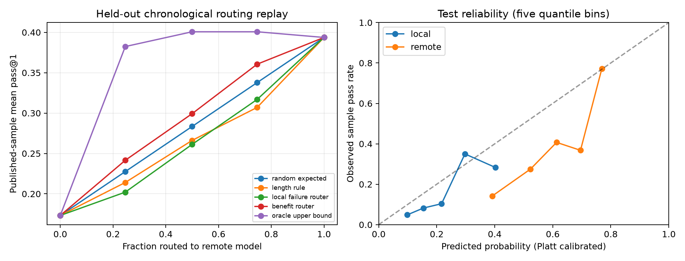

# Results: confidence-aware coding-model routing

Study date: 2026-10-25. Run: `results/routing-pilot-001`. Status: routing replay completed; GPU student training and fresh inference pending access. The fixed analysis protocol and its pre-outcome amendment were recorded before aggregate comparisons. This is an internally frozen protocol, not an externally registered preregistration.

## Abstract

We evaluated whether a lightweight prompt-based router can allocate a fixed remote-model budget effectively on executable programming tasks. Published LiveCodeBench results supplied paired outcomes for Qwen2.5-Coder-Instruct-7B and DeepSeek-V3 on 713 tasks with ten samples per model/task. Contests were grouped and split chronologically into 429 training, 142 calibration and 142 test tasks. A calibrated expected-benefit router selected the remote model on half of test tasks. Its empirical pass@1 was **29.93%**, compared with **28.35%** for analytically expected random routing at equal remote exposure. The paired contest-bootstrap difference was **+1.58 percentage points (95% CI −1.58 to +4.44)**. The primary improvement hypothesis was not supported by this run. Remote-only pass@1 was **39.37%**; the half-budget router did not demonstrate noninferiority within five percentage points. These are retrospective routing results, not new language-model generations, laptop benchmarks or evidence of successful distillation.

## Experimental execution

- Source: official LiveCodeBench submissions at commit `6ca212e9c2039373f6e5069d37ffa9db66e23736`, with byte-level SHA-256 verification.
- Corpus: 713 aligned tasks, 188 contest groups, 14,260 published sample outcomes across the two models. All ten grades per model/task are retained, including invalid/empty extracted programs graded as failures.
- Training: 429 tasks, 116 contests, 2023-05-07 through 2024-03-23.
- Calibration: 142 tasks, 38 contests, 2024-03-30 through 2024-07-06.
- Test: 142 tasks, 34 contests, 2024-07-13 through 2024-10-05.
- Features: statement-only TF-IDF unigrams/bigrams and log character length. No grades, reference/generated code, evaluation feedback, official difficulty, platform, date or ID are model features. IDs break score ties only.
- Predictors: fixed regularized logistic regressions for each model's per-draw success, trained with soft Bernoulli task targets; separate Platt calibration using the calibration split.
- Primary policy: rank calibrated remote-minus-local success probability, choose exactly 71 of 142 test tasks for remote inference. This is batch allocation, not a streaming or post-local-failure cascade.
- Statistics: 2,000 paired contest-cluster bootstrap draws, seed 1729, fixed fitted policies and test decisions. Confidence intervals are conditional on the existing model fits and published samples.
- Compute: CPU-only cloud environment, four-core CPU quota and 32 GiB cgroup memory; no GPU. The recorded routing-analysis wall time is about 0.83 seconds, excluding data acquisition, dependency installation and tests. It is not model inference latency or a production latency measurement.

## Primary and baseline results

All figures below are empirical pass@1: the mean of each task's ten published correctness grades, averaged equally across tasks. They are not pass@10 or percentages of tasks solved by at least one sample.

| Policy | Remote fraction | Pass@1 | Conditional 95% CI |
| --- | ---: | ---: | ---: |
| Qwen only | 0% | 17.32% | 12.37–22.64% |
| Expected random | 50% | 28.35% | 23.43–33.24% |
| Prompt-length rule | 50% | 26.62% | 20.16–32.95% |
| Predicted local-failure router | 50% | 26.13% | 19.43–32.50% |
| Expected-benefit router | 50% | 29.93% | 23.94–35.52% |
| DeepSeek only | 100% | 39.37% | 32.66–46.06% |
| Outcome-informed oracle, nondeployable | 50% | 40.07% | 33.56–46.59% |

The oracle uses observed test outcomes to choose tasks and is a diagnostic upper bound only. Its result must not be offered as an attainable router score. A seeded random realization and all 0/25/50/75/100% budget results are retained in `policies.csv`; the analytical random expectation is the primary comparator.

The primary benefit-minus-random contrast is +1.58 points with an interval spanning zero. This is inconclusive evidence of a gain, not proof that the methods are equivalent. The exploratory benefit-minus-remote contrast is −9.44 points (two-sided 95% CI −13.88 to −5.82). Its one-sided 95% lower bound is −13.31 points, below the −5-point noninferiority margin. No substitute budget or model was selected after these results to manufacture a positive primary finding.

## Calibration and exploratory interpretation

The local predictor's sample-level Brier score improved from 0.2074 uncalibrated to 0.1367 after Platt calibration. The remote predictor improved from 0.2969 to 0.2496, but remained substantially overconfident: its average prediction was approximately 59.82% against 39.37% observed correctness on test. Ten-bin ECE was 0.0678 local and 0.2045 remote. These are descriptive results; no calibrator was refit on test data.

Remote mean correctness declined from approximately 69.11% in training to 62.96% in calibration and 39.37% in test. This temporal distribution shift is consistent with poor future calibration; the replay does not identify its causal source. Public-task contamination, task difficulty mix and historical generation settings are plausible confounds, not established explanations.

Remote mean performance exceeded local mean performance on 48 test tasks, local exceeded remote on three, and means were equal on 91. The local-failure policy can spend remote calls on problems both models fail. Expected benefit explicitly accounts for that possibility, although its observed advantage over random was not statistically resolved here.

An exploratory difficulty breakdown illustrates the objective: the benefit router delegated 80.56% of benchmark-labelled easy tasks, versus 34.48% of hard tasks. Remote-only pass@1 was 90.0% on easy tasks and approximately 6.03% on hard tasks. Difficulty was not a model input. Maximizing expected solved work therefore need not mean delegating the hardest tasks. A product that prioritizes difficult requests or particular customer groups needs a different utility/constraint specification and a separately evaluated policy.

## Cost interpretation

Half-budget routing uses 50% fewer remote model selections than remote-only. Under an illustrative per-call model where a local call costs 10% of a remote call, normalized pre-call cost is `0.5 × 0.1 + 0.5 = 0.55`, or 45% below remote-only. This is **scenario arithmetic**, not measured dollar savings; it also accompanies the observed quality loss. Longer prompts/output, local electricity, verification, training and device latency can alter actual costs.

The complete sensitivity table uses local/remote cost ratios 0, 0.01, 0.05, 0.10 and 0.25, and separately labels a hypothetical post-local-escalation cost. That latter scenario was not executed. Every matched-budget policy has identical assumed cost under the simple pre-call model, so the primary contrast measures allocation quality.

## Training and prospective inference status

Implemented: deterministic train-only selection of verified teacher solutions; hashed provenance; LoRA SFT using Transformers, TRL and PEFT; immutable model-revision resolution; complete-solution length checks; completion-only loss; separate internal loss-monitoring data; new-run directories and explicit failure/completion manifests. The initial data preparation selected **334 demonstrations from 429 training tasks**, excluding 95 tasks with no nonempty verified teacher solution. Verification here means upstream published grades, not a new execution of those programs.

No pretrained Qwen weights have been trained for this study yet. There is no measured baseline-versus-adapter accuracy, no measured token-level distillation result, and no RLAIF result. A separate CPU integration test **passed** using a tiny randomly initialized Qwen-architecture model: two actual optimizer steps, prompt-loss masking, nonzero LoRA parameter updates, export and adapter reload with matching logits. This validates software compatibility, not pretrained-Qwen quality. GPU operation and prospective code evaluation require a Runpod connection, model access and the official benchmark test fixtures.

The user selected one 80 GB Runpod GPU with a total US$100 ceiling. No GPU has been provisioned and no Runpod charge has been incurred by this work. The secure `RUNPOD_API_KEY` requirement and relevant network additions are saved as an environment draft, not proof of runtime access. Current checkpoint/API rights and exact compatibility still need verification before the first external training run.

## Threats to validity and next experiment

1. Historical published outputs do not establish that tasks were unseen during model training. Chronological router splits reduce router leakage but cannot remove upstream model contamination.
2. We control router fitting and analysis, not original inference configurations, model revisions or test implementation. The run reuses correctness labels and does not rerun source programs. Upstream labels measure the model, extraction and test environment together. Audit found missing-library errors on training tasks; those failures were retained, and no outcome-driven exclusions were made.
3. The test set has only 34 independent contest clusters. Confidence intervals exclude model-fit and original sample-generation uncertainty. The interval half-width around the primary effect is roughly three points; effects of the observed 1.6-point scale are unresolved with this design. A formal prospective power calculation is needed for the next study.
4. Lightweight bag-of-words predictors may miss algorithmic difficulty. A richer embedding router is a future predeclared comparison, not an outcome-driven replacement for this primary result.
5. Batch budget ranking differs from online request arrival, and code-problem pass@1 differs from repository-agent completion, user acceptance and device latency.
6. Outcome-guided oracle selection is optimistic by design. Subgroup analyses, calibration comparisons and the noninferiority question are exploratory.
7. Published problem/code artifacts have upstream licensing and provenance distinct from runtime package licenses. Preserve the source notices and check redistribution/training requirements before broader distribution.

The next empirical arm is base Qwen 1.5B versus the same model with verified-teacher SFT, evaluated with identical prompts, decoding settings, untouched tasks and the official test harness. Compare a frozen router and a newly calibrated router separately to attribute gains to student training versus routing changes. Same-family logit distillation and DPO/RLAIF remain later controlled comparisons; top-k API log probabilities and incompatible tokenizers do not provide full-vocabulary KL targets.

## Reproducibility and publication state

Machine-readable results: `results/routing-pilot-001/summary.json`, `policies.csv`, `predictions.csv`, `subgroups.csv` and `run-manifest.json`. Protocol hashes: `docs/research/protocol-freeze.json`. Source retrieval and fresh-run instructions are in the repository README. An independent audit recomputes the headline contrasts and checks data/code provenance.

Fastest Jira and Confluence are requested publication destinations. Their MCP connection remains unavailable in this session. Task state is preserved in `docs/research/task-state.json`; its local IDs are not Jira keys. No ticket or Confluence page is claimed to have been created.
