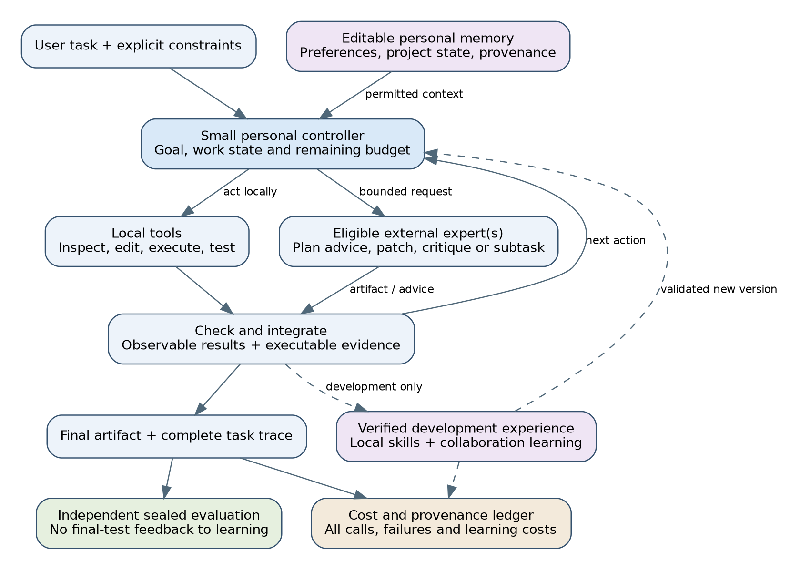

# Manuscript status {.unnumbered}

This document is a master's thesis manuscript in artificial intelligence, prepared before the proposed software-engineering and browser-task evaluations. Its research questions, background, system design, experimental protocol, analysis plan and limitations are written in advance. **The empirical results, result-dependent discussion and empirical conclusion are intentionally not written.** No claim that the proposed personal agent or model portfolio improves accuracy, reduces measured cost or benefits from adaptation is made. The central objective is an affordable, user-controlled personal agent that learns to work independently and to collaborate with external experts. Portfolio routing supplies an enabling mechanism; fixed two-model routing remains a restricted baseline and integration pilot.

A historical programming-problem replay and software-validation artifacts exist in the accompanying repository. They are development material for a different task distribution, and their measurements are not presented as evidence for this thesis's hypotheses. Each prospective domain study requires its own frozen model catalog, evaluation records and analysis. Published third-party benchmark accuracy and task-cost observations are background evidence. Illustrative token-cost calculations are explicitly labelled scenarios, not measured task prices or experiment results.

The source and pricing review has a cutoff of **25 October 2026**. A model catalog is a dated snapshot, not a promise that every listed model is deployable on the available hardware or that a floating API alias will remain unchanged. Secondary price observations require vendor confirmation before purchasing inference. The existing US$100 Runpod authorization funds a bounded feasibility pilot; it does not fund the entire proposed confirmatory matrix or additional closed-provider API spending.

Author, institution, degree wording, supervisor, institutional declarations and submission date are to be completed by the author. The manuscript does not invent those details or represent that an institution has approved the research.

# Abstract {.unnumbered}

An open model ecosystem can support personal AI in two complementary ways: by providing external expertise when a compact model cannot complete a task, and by supplying verified experience from which that personal model can learn. The resulting system need not treat the small model as merely a cheap substitute. It can maintain the user's goals, preferences and ongoing work, consult larger specialists, verify their proposals and integrate the results. Its usefulness depends on the quality of that cooperation as well as the capability retained for independent local use.

This thesis proposes a study of a small personal controller combined with a versioned portfolio of open-weight experts for agentic software engineering, with browser interaction as a transfer domain. The fixed-model cooperation study compares hierarchical assistance with local-only, large-model-only and flat-routing controls under shared personal context, tools and resource limits. A separate longitudinal study measures standalone student performance, collaboration quality and verified local completion across cumulative usage and distillation rounds. Distillation targets observable actions, expert requests, context selection, verified repairs and integration behavior. Router recalibration, personal memory and generator adaptation are separated experimentally.

The economic account includes dollars per assigned and successful task, teacher-data acquisition, verification, adaptation, model loading and state handoff. Local accessibility is assessed through measured memory, latency, offline functionality and artifact portability rather than assuming that a small checkpoint runs acceptably on every device. Reduced external-model use is a useful outcome only when task quality is maintained; improved cooperation may remain valuable when difficult tasks still require external expertise. New model releases and customer adapters enter through versioned development evaluations.

The intended contribution is a reproducible account of how the open ecosystem can strengthen a personal model over time, where compact-model capacity limits persist, and when cooperation produces benefits beyond giving a large model the same personal information. Democratization is the motivating objective; the proposed experiments measure technical access and capability proxies rather than claiming societal impact. The manuscript contains literature synthesis, architecture, experimental designs and attributable background evidence. It reports no TTGL outcomes for the proposed cooperative or longitudinal studies.

**Keywords:** personal AI; local agents; small language models; cooperative agents; model portfolios; verified distillation; continual adaptation; open-weight models.

# Acknowledgement {.unnumbered}

The project's guiding sentiment is: “Believe in me who believes in you.”

# Introduction

## Motivation: personal capability from an open ecosystem

The motivating objective is to democratize AI: make useful assistance affordable, adaptable and controllable by the person using it. This requires more than a low token tariff. A personal agent should retain relevant preferences and work context, operate within the user's permissions, remain useful on accessible hardware, and preserve value when an external service is unavailable or replaced. These properties are research objectives, not claims that an existing small model already provides them to every user.

The open model ecosystem offers complementary sources of capability. Larger models and domain specialists can solve demanding problems, while compact models can provide responsive local behavior and potentially learn a person's recurring workflows. The proposed system combines them through a small personal controller. It can inspect a task, use local tools, request bounded help from eligible experts, check their outputs and integrate the result into the user's work. The personal model need not reproduce every expert's knowledge in its own parameters to benefit from that knowledge.

This makes **We Gotta Combine!** a hypothesis about cooperation and learning, not only model selection. Routing decides which expert is appropriate. The personal controller also decides what help to request, which context is necessary, how to assess an answer and how to continue after it arrives. A large model can advise on a plan as well as produce a patch, while the controller retains the task contract and personal context. If the controller's competence becomes the bottleneck, the system needs an explicit route to stronger planning or broader delegation.

Verified interactions can then become learning material. Some teach skills that the compact model can later perform independently; others teach it to collaborate more effectively. Both can improve the assistant. Fewer large-model calls is not by itself evidence of learning: the system could simply tolerate more failures or encounter easier tasks. Conversely, a controller that uses the same number of expert calls but solves substantially harder work may have improved. Independent capability, cooperative performance and external dependence must therefore be measured separately.

## The research problem

The first problem is whether a compact personal controller and larger experts can work better together than simpler systems with the same information and resources. Giving only the controller access to user preferences would create an unfair comparison. The large-model baseline must receive the same permitted memory, task contract, tool access and opportunity to retrieve relevant context. Any resulting advantage can then be investigated as an effect of decomposition, delegation, verification or integration rather than an information advantage hidden inside the architecture.

The second problem is how experience changes that relationship. A useful learning loop observes work, identifies trustworthy demonstrations, trains or adapts the student, recalibrates its decisions and evaluates the next version on untouched tasks. Training only on teacher answers ignores the control skills needed to obtain and use those answers. Training only on requests already escalated can also bias the data toward tasks that are too difficult for the small model. The study records the acquisition policy and verification yield, uses a controlled learning curriculum before closed-loop adaptation, and tests whether gains survive changes in task distribution.

A third problem is the cost of making personalization persistent. Current facts, user corrections and project state belong in editable memory, where they can be retrieved, updated and deleted. Repeated behavioral patterns may justify an adapter or full-model adaptation. A separate adapter for every model and user can become expensive to train and maintain, while full fine-tuning may exceed a desktop's memory. The experiment distinguishes memory, routing adaptation and changes to model weights; it does not assume that every personal detail should become a parameter update.

The surrounding expert pool is also a decision variable. Specialists may differ across frontend/backend coding, programming language, browser interaction and visual grounding. Small models can run remotely, and local hardware can support different sizes. Pool membership and execution location are chosen using development evidence and customer constraints. Newly released models enter a versioned evaluation process; the personal agent's identity and memory need not be replaced whenever its expert provider changes.

## Scope and terminology

A **personal controller** is a model-driven agent with access to a permitted user-state store, task state and bounded tools. The controller does not itself define security permissions: the harness enforces them. An **expert** is a model configuration invoked for a declared role such as plan advice, code generation, critique, visual interpretation or a bounded subtask. Its result returns through a recorded interface. A **portfolio router** selects eligible experts; it is one component of the controller rather than the complete cooperative system.

A **model configuration** identifies the checkpoint or service revision, tokenizer and template, precision, inference settings, runtime, endpoint and compatible adapter. A **learning round** produces a versioned student and policy from a declared cumulative development exposure. A **local-only completion** requires successful work with no external model assistance during the attempt, including remote planning, judging or embedding calls. Ordinary local tools and tests remain available. Past training on permitted teacher outputs does not make every future local attempt externally assisted.

“Open-weight” describes available weights under a published license. Source-code openness, redistribution rights, API output-training terms and inference location are recorded separately. A free local product tier does not eliminate energy, hardware or training cost. The mission of democratization is operationalized through capability, cost, memory requirements, offline operation, user control and portability. A benchmark study cannot demonstrate universal accessibility or broad social impact merely by improving one score.

Agentic software engineering is the main experimental setting. Functional resolution requires the pinned benchmark's execution checks. Study 1's accepted-task success additionally requires the prespecified feasible mandatory user constraints; both components are reported separately, with subjective personalization quality as a secondary outcome. Browser use is a transfer domain with its own environment and success definition. Frontend implementation, browser navigation and desktop operation are distinct workloads. A Python-heavy repository benchmark cannot establish performance across all languages or all forms of frontend work.

## Research questions

The thesis addresses six linked questions:

1. **Cooperative capability:** Does a small personal controller with external experts improve task outcomes or the quality–cost tradeoff compared with a large-model agent given the same personal context, and compared with flat routing?
2. **Learning from use:** Across fixed cumulative exposure rounds, which verified demonstrations improve independent student skills, and which improve delegation, context selection, verification and integration?
3. **Personal independence:** How much useful work can be completed locally at a maintained quality level, how does external-model burden change, and what hardware and lifecycle cost are required?
4. **Specialist complementarity:** When do additional experts, different model sizes and domain-specific choices improve the system enough to justify their acquisition and serving cost?
5. **Personalization mechanisms:** What is supplied by editable memory, router adaptation, per-base customer adapters or full fine-tuning, and how do those effects generalize to unseen tasks and users?
6. **Operational evolution:** How do handoff granularity, cache reuse, model release updates and workload shift affect the reliability and economics of the cooperative system?

The research program has an enabling portfolio study, a fixed-model cooperation study and a separate longitudinal learning study. Their contrasts and evidence requirements are named explicitly. Success in a routing baseline does not establish cooperative superiority; success after one fine-tune does not establish progressive independence over many rounds. Each confirmatory scope must be frozen and resourced before its final outcomes are observed.

## Intended contribution and limits

The contribution is the controlled evaluation of a personal agent that draws on open expertise while retaining and developing useful capability for its owner. Existing software supplies model serving, agent tools, memory interfaces, training and benchmarks. Custom work is confined to missing control, measurement and integration behavior. The experiment compares cooperation patterns and learning interventions without claiming to invent the underlying routing, memory or distillation methods.

The combined capability of all experts is an optimistic opportunity bound. A real controller can choose the wrong expert, omit decisive context, misunderstand a correct answer or fail to recognize an error. A small model may learn common workflows while retaining limits on novel reasoning or long-horizon planning. Increased usage may produce redundant or biased data rather than continual improvement. Negative transfer and plateaus are possible results, and the study must preserve them rather than select the best-looking checkpoint after testing.

The existing TTGL repository contains a historical coding-problem replay, data checks, teacher-example preparation and a training/inference scaffold. It does not yet supply measured evidence for this cooperative or longitudinal system. The approved US$100, single-80-GB Runpod allocation supports bounded feasibility work. A full controlled program, multiple adaptation rounds and device measurements require a costed execution plan and the necessary access; the manuscript does not claim that they have occurred.

## Organization

The foundations and agent-learning evidence chapters review the methods and their limits. System design and the personal-controller chapter specify cooperation, followed by the longitudinal learning protocol. The model catalog, historical accuracy and task-economics chapters supply dated context. Browser evaluation and adaptation/switching provide domain and deployment details. The portfolio study and repository procedures remain reusable controls. The analysis and reproducibility chapters define reporting and completion boundaries. Empirical results and result-dependent conclusions remain unwritten.

# Foundations and related work

## Review scope and evidence quality

This chapter develops the conceptual basis for a personal agent that collaborates with open-model experts and learns from verified use and identifies the claims that the proposed experiment can test. Its scope is deliberately broader than model routing alone. A useful system must choose a model, obtain a usable solution through an interaction interface, verify that solution, and account for the resources consumed by both successful and unsuccessful attempts. The relevant literature therefore spans selective prediction, learning to defer, LLM routing, agent-computer interfaces, code evaluation, knowledge distillation and parameter-efficient adaptation.

The review is a focused narrative synthesis, not a systematic review or meta-analysis. Source discovery combined exact-title lookup, author-maintained repositories and backward citation following. The review cutoff and retrieval date are 25 October 2026. Exact-title lookup targets included “RouteLLM: Learning to Route LLMs with Preference Data”, “FrugalGPT”, “Consistent Estimators for Learning to Defer to an Expert”, “On Calibration of Modern Neural Networks”, “Distilling the Knowledge in a Neural Network”, “Dynamic Speculation Lookahead”, “SWE-agent” and “SWE-bench”. The bibliography records the corresponding titles, stable paper identifiers and software revisions, allowing another reviewer to reconstruct the selected corpus. No broad scholarly-index search or database hit-count screening was conducted.

Inclusion required a source to define a relevant method, benchmark or implementation, with identifiable authorship and primary provenance. Foundational papers were retained even when their experimental domain preceded LLMs; contemporary papers and software were included when they changed the available routing, training or evaluation choices. Exclusions covered untraceable claims, advertising or leaderboard rank without evaluation context, duplicate descriptions of the same artifact, and material unrelated to the study's decision or validity questions. These rules bound a purposive review rather than guarantee exhaustive coverage. The research gap is consequently a motivated empirical question, not a claim that no related system has ever been studied.

Evidence quality varies across sources. Relevant definitions, methods and discussion were inspected in primary full texts for sixteen works: calibration, SelectiveNet, learning to defer, FrugalGPT, RouteLLM, speculative decoding, dynamic speculation, distillation, LoRA, QLoRA, DPO, Constitutional AI, DeepSeek-R1, SWE-agent, SWE-bench and SWE-bench Pro. This is targeted section-level reading, not a claim that every proof, appendix and empirical table was independently audited. DeepInfer's confidence head and scheduling code were inspected at a pinned revision, and its claims remain implementation evidence. Other benchmark and SDK references rely on official repository documentation; their bibliographic notes identify this narrower evidence. The review does not treat authors' reported improvements as a replication or as predicted thesis outcomes.

The agent-learning chapter additionally examines SWE-Gym, SWE-smith, DAgger and AgentTuning, including evidence of gains, regressions and saturation. The personal-controller chapter reviews ReAct, MemGPT and HuggingGPT alongside current memory-software documentation. These sources motivate observable collaboration and learning mechanisms without establishing small-controller superiority.

The expanded portfolio and adaptation chapters add targeted primary-text reviews of RouterBench, GraphRouter, BEST-Route, LLMRouter, S-LoRA, Punica and activated LoRA. The browser chapter reviews official benchmark, model and integration documentation with explicit source-scope notes. Their separate registers preserve inspected versions and hashes; a documentation citation is not represented as a full-paper review.

Fast-moving software requires a second form of provenance. A paper's method, a repository's current code and a hosted product's current behavior need not coincide. This chapter separates paper citations from versioned software-documentation citations. SWE-bench, mini-SWE-agent and SWE-bench Pro documentation were inspected on 25 October 2026; their relevant revisions are recorded in the bibliography. Descriptions below establish the documented scope of these systems, not independent performance measurements. This pre-results manuscript makes no claim about the proposed system's measured accuracy, cost or training benefit.

## From code generation to software engineering

A code-generation task usually supplies a specification and asks for a function or program that satisfies a collection of tests. HumanEval made executable functional correctness a practical evaluation target, while subsequent work such as EvalPlus strengthened the tests used to assess generated functions [@chen2021humaneval; @liu2023evalplus]. These settings isolate an important capability, but successful synthesis of a self-contained function is only one component of software development.

A repository-level software-engineering task supplies an issue and a codebase at a particular revision. The system must identify relevant files, understand interfaces, modify implementation code, preserve existing behavior and produce a patch that survives evaluation. SWE-bench operationalizes this setting through real repository issues and corresponding evaluation machinery [@jimenez2024swebench]. BigCodeBench occupies a complementary position by emphasizing diverse library calls and complex instructions within function-level problems [@zhuo2024bigcodebench]. LiveCodeBench provides temporally organized programming tasks useful for contamination-aware coding evaluation [@jain2024livecodebench]. None of these benchmark categories should be substituted for another without narrowing the claim accordingly.

An LLM and an agent are also distinct experimental objects. An LLM maps context to a distribution over outputs. An agent couples that model to tools, state, stopping rules, retrieval, execution and feedback. A model's repository-task performance is therefore conditional on an agent-computer interface and its resource limits. SWE-agent directly studies that interface, and its current maintainers recommend the simpler mini-SWE-agent as the successor for ongoing use [@yang2024sweagent; @minisweagent2026]. OpenHands supplies a further example of separating agents, tools, conversations, workspaces and server interfaces within a reusable SDK [@wang2025openhands]. These systems support the methodological choice to reuse a maintained harness rather than invent a new one merely to demonstrate routing.

The appropriate primary comparison is thus a dual-model agent against single-model agents using the same harness, repository snapshot, available tools and evaluation rules. Comparing a tool-using dual system against a single bare prompt would confound routing with access to feedback and execution. A no-tools LLM can remain an informative secondary ablation, provided it is labelled as a different interface condition. Likewise, a benchmark score obtained with one vendor's proprietary agent should not be treated as the score of its underlying model under the thesis harness.

## Selective prediction and learning to defer

Selective prediction studies a predictor that may abstain rather than produce an answer for every input. Its central quantities are coverage, the fraction of inputs accepted, and selective risk, the error rate among accepted inputs. SelectiveNet integrates prediction and rejection within a learned system [@geifman2019selectivenet]. This perspective helps distinguish a useful local model from a merely overconfident one: increasing local coverage is desirable only if the accepted local work maintains adequate quality.

An assistant with a remote model is more accurately viewed as a learning-to-defer system because abstention invokes another decision-maker. Learning-to-defer formulations explicitly model the expert alternative rather than assume that rejection is costless [@mozannar2020defer]. Here the remote model is an imperfect expert. It may solve a problem that defeats the local model, fail alongside it, or occasionally damage a solution the local model would have produced correctly. The experimental target must represent all of these cases.

Let $X$ denote information available when a routing decision is made, and let $Y_s,Y_l\in\{0,1\}$ denote acceptance of a solution generated by the small and large systems under specified protocols. The local-success probability is $p_s(x)=P(Y_s=1\mid X=x)$. A policy that delegates whenever $p_s(x)$ is low assumes that local failure predicts useful remote intervention. A more directly aligned quantity is

$$g(x)=\mathbb{E}[Y_l-Y_s\mid X=x].$$

This expected benefit can be positive, zero or negative. It differs from local uncertainty because a difficult problem can defeat both systems. When cost varies across tasks, delegation can instead depend on expected benefit relative to incremental cost, with explicit constraints on latency, budget and permitted destinations. This formulation is a decision rule to be evaluated; it does not establish that a cheaply estimated $g(x)$ will generalize.

Paired model outcomes on the same task provide useful training information, but their interpretation depends on the execution design. If models receive different tools, feedback or stopping budgets, the outcome difference describes different systems rather than model substitution alone. Repeated stochastic samples provide an estimate of each system's task success distribution, not interchangeable independent tasks. Model sampling seeds also need not pair meaningfully across different providers. The experiment should preserve task-level pairing while recording the conditions that generated each outcome.

Operational logging introduces selective labels: a deployed router observes the remote outcome mainly on tasks it already chose to escalate. Training solely on those logs can reinforce its original selection bias. Controlled paired data, offline shadow evaluations or carefully budgeted exploration can provide information about counterfactual choices. Such exploration must be distinguished from extra user-visible attempts, and its cost belongs in the system's accounting.

## Calibration, discrimination and distribution shift

Confidence is useful only after its target has been defined. Next-token probability expresses the model's distribution over a token; it is not automatically the probability that a completed patch resolves a repository issue. Natural-language statements of confidence introduce additional sensitivity to wording and prompting. A learned correctness predictor must instead be evaluated against the outcome it purports to estimate, such as benchmark resolution, successful local completion or beneficial remote delegation.

Calibration describes agreement between probabilities and observed frequencies. Guo et al. examine calibration in modern neural networks and motivate held-out calibration procedures such as temperature scaling [@guo2017calibration]. The general lesson applies to routing even though the original classification setting differs from software engineering: a score that orders examples well need not provide reliable probabilities, and a base-rate predictor can be reasonably calibrated while offering little discrimination. Ranking, calibration and final decision quality therefore require separate measurements.

For correctness predictors, reliability diagrams, Brier scores and carefully specified calibration-error summaries are useful complements to discrimination measures. Expected calibration error depends on binning and sample size; a single number can conceal poor behavior in a rare but consequential task stratum. AUROC evaluates a ranking over binary outcomes, while precision-recall can be more informative under severe class imbalance. Neither substitutes for the system-level question of how much accepted work is obtained for a given resource budget. Risk-coverage, resolution-cost and regret curves connect prediction quality to actual routing behavior.

Calibration and decision thresholds must be fitted on data disjoint from final evaluation. Selecting a threshold on the test set to achieve an attractive cost or quality point is part of training, even if model parameters remain fixed. A fixed threshold chosen on calibration data should be evaluated with its realized test exposure; an exact-budget allocation over a scored batch should be described as batch selection. These are different deployment settings.

The local/remote setting adds several sources of distribution shift. New repositories may use different languages, dependencies and issue conventions. Model updates change capability and output style. Quantization, context truncation, retrieval and tool limits can alter success even when the checkpoint name is unchanged. Distilling the student changes the relationship the router is intended to predict. Consequently, a later improvement in the composite system must be decomposed into student changes and router recalibration. A frozen-router comparison and a separately recalibrated-router comparison answer different causal questions.

## Budget-aware routing and cascades

FrugalGPT formulates a budget-constrained cascade whose scorer evaluates a query and generated answer; it learns a sequence of APIs and acceptance thresholds. RouteLLM instead predicts preference for the stronger model before generation, using pairwise preference data and a tunable selection threshold [@chen2024frugalgpt; @ong2024routellm]. Its full paper distinguishes reward scoring after generation from routing before generation and evaluates performance recovered relative to the strong/weak gap. These works establish useful baselines and software components. They do not establish that conversational preferences transfer directly to executable repository correctness. The label, task distribution, candidate model pair and feature budget all matter.

The distinction also limits which published metrics transfer unchanged. RouteLLM uses strong-model call share as a cost proxy and normalizes performance by the gap between its candidate models. In an agent loop, individual calls have different token counts and one task can require many calls; a small or negative baseline performance gap also makes normalized recovery difficult to interpret. The thesis therefore retains direct resolution and monetary-cost measurements, while using call share and normalized summaries only with their assumptions stated. FrugalGPT's answer-dependent scorer provides a closer conceptual baseline for verification-triggered escalation, but its query-answering experiments do not establish the cost of repository execution and repair loops.

A prompt-only router acts before generation and pays for one selected model. A cascade first runs a cheaper model, observes its output or execution feedback, and then decides whether to invoke a stronger model. The cascade obtains richer evidence but incurs the cost of the initial attempt even when it escalates. It can also lengthen the remote request by including failed edits, tool traces and summaries. Describing both designs as the same remote-call fraction would hide a meaningful cost difference.

The relevant quantity is total cost per task and per accepted task. For API models, input, cached input, output and provider-specific reasoning charges can differ. For self-hosted models, GPU allocation, idle time, memory requirements, batching and operational overhead determine cost. The local device also consumes electricity and user time even when it generates no cloud invoice. Training, teacher-data generation and artifact distribution add fixed or amortized costs that can dominate at small deployment scale. These terms motivate a price ledger and measured token accounting rather than translating a call-count reduction into an asserted monetary saving.

Fair model comparison requires more than a list of prices. Two systems at the same monetary budget can process different token volumes or make different numbers of tool calls. A model with a low output-token price may generate longer answers or require more repair attempts. Cache behavior depends on request patterns and provider semantics, and idle self-hosted capacity can reverse an apparent advantage measured at full utilization. The proposed study should therefore report both the observed resolution-cost frontier and sensitivity to clearly labelled deployment assumptions.

An oracle router that selects the better observed outcome for each task is useful for measuring remaining opportunity. It is not a deployable competitor and is especially optimistic when selection uses noisy estimates from a finite number of samples. Random routing at matched exposure or matched expected cost remains essential: it reveals whether the learned allocation adds value beyond simply mixing two systems. A simple interpretable rule provides another baseline against which extra routing complexity must justify itself.

## Speculative decoding as inspiration, with different guarantees

Speculative decoding uses a cheaper draft process to propose tokens that a target model verifies [@leviathan2023speculative]. Dynamic speculation changes the amount of proposed work instead of using a fixed draft length. The DISCO paper specifies a learned classifier using top draft probabilities, entropy and token position to decide when drafting should stop [@mamou2024dynamic]. The related Hugging Face/Intel implementation article also describes a draft-confidence stopping rule. These are related mechanisms with different predictors, not one interchangeable confidence algorithm. Both allocate computation according to the chance that cheap speculative work will be useful.

DeepInfer supplies a more recent implementation of this idea. Its documented DSpark path includes a learned confidence head for draft-token acceptance, cumulative estimates for surviving prefixes, runtime cost curves and confidence-scheduled verification. The scheduler allocates a verification budget across requests and records acceptance and confidence-error statistics [@deepinfer2026]. The inspected source also imposes dependencies on which historical estimates may influence scheduling. These details make the method more specific than a generic instruction to trust a small model when its confidence is high.

The analogy to task routing is productive at the level of resource allocation: estimate useful work, compare expected benefit with cost, and check predictions against outcomes. The acceptance event and its guarantees are different. Token verification can be part of a sampling procedure designed to preserve the target distribution. Accepting an entire locally generated patch after incomplete tests does not preserve the distribution of patches the remote model would have generated, and it does not guarantee semantic correctness. A remote reviewer is itself fallible.

Dependence is also different. A speculative token prefix has a particular sequential structure, whereas software subtasks may share files, assumptions and hidden failure causes. Multiplying marginal confidence scores for several edits does not generally produce a valid probability that their combined patch succeeds. A router may instead predict final task utility directly or use explicitly conditional transition estimates. Either approach requires empirical calibration on the actual decision granularity.

The thesis therefore treats confidence-aware speculative scheduling as a design inspiration, not as a theorem guaranteeing accurate task routing. Token-level speculative acceleration and task-level model selection should be evaluated as separate interventions if both are implemented. The former concerns inference efficiency under a particular serving engine and hardware configuration; the latter concerns which system should perform software-engineering work. Their gains cannot be added without measuring their interaction and overhead.

## Distillation and progressive local capability

Knowledge distillation transfers behavior from a teacher to a student [@hinton2015distillation]. In this application the desired effect is increased local task success, enabling the routing policy to rely less often on remote inference at a fixed quality requirement. A reduction in remote usage alone is insufficient evidence of distillation: it could be caused by changing a threshold or accepting more local failures. Student improvement must be established independently on untouched tasks before evaluating the composite system.

Sequence distillation and token-distribution distillation impose different data requirements. Sequence distillation trains on teacher-generated responses, patches or observable tool trajectories. It can proceed without access to teacher logits and is compatible with different teacher/student tokenizers, provided the examples are represented correctly for the student. Token-level distillation typically compares teacher and student predictive distributions, often using a temperature-scaled divergence combined with supervised loss. That comparison requires a meaningful correspondence between token events. A DeepSeek tokenizer and a Qwen tokenizer cannot be assumed aligned merely because both process the same source text. Sparse top-token API outputs also do not automatically supply a full-vocabulary teacher distribution.

Verification changes the training distribution. Selecting teacher outputs that pass tests can improve the reliability of demonstrations, but it favors tasks for which the teacher and available tests succeed. It may omit difficult requests and retain solutions that exploit weaknesses in the test suite. A verification pipeline should therefore preserve selection counts and reasons, separate training verifiers from final evaluation, and maintain an explicit account of the examples that were never eligible. Teacher-generated code should not be treated as correct solely because it came from the larger model.

The inspected DeepSeek-R1 paper describes rule-based accuracy rewards, rejection-filtered training data and SFT-based distillation of smaller models. Its discussion provides a concrete reason to include supervised distillation as a strong baseline before adding more complex reinforcement-learning stages [@deepseek2025r1]. Those observations arise from the authors' particular models, data and compute regime. They do not establish that distillation always dominates direct reinforcement learning, that a small customer dataset is sufficient, or that improvement on reasoning questions implies improved repository repair.

The software-engineering setting raises a further transfer issue. A final patch may omit the process needed to discover it: repository search, diagnosis, testing and revision. If the student is intended to run an agent loop, final-answer imitation and trajectory imitation should be distinguished. Observable tool actions and concise task-state summaries can be legitimate training targets; the design does not require access to a provider's private reasoning trace. Repository instructions and retrieval remain lower-cost personalization baselines that should be evaluated before attributing benefits to model training.

## Parameter-efficient adaptation and AI feedback

LoRA represents weight updates with low-rank trainable components while retaining a frozen base model [@hu2021lora]. QLoRA combines a quantized frozen base with parameter-efficient adaptation to reduce training memory [@dettmers2023qlora]. These techniques address how parameters are updated; they do not specify which demonstrations are trustworthy or whether the student improves. They also do not remove the memory and compute required for forward passes, optimizer state, activations and evaluation.

The deployment artifact is part of the treatment. An adapter trained in one framework may need merging or conversion before it can be used by the selected local runtime. Quantization can alter outputs, tool formatting and task success. A fair evaluation must include the actual artifact intended for the user's hardware rather than report only unquantized server performance. Base checkpoint, tokenizer, chat template, adapter revision and export procedure should therefore be recorded together.

Direct Preference Optimization learns from preferred and rejected responses relative to a reference policy, providing an alternative to explicitly fitting and optimizing a separate reward model [@rafailov2023dpo]. Reinforcement learning from AI feedback identifies the source of feedback, not one particular algorithm. AI-generated rankings, executable-test preferences and human review are distinct label sources even when supplied to the same optimizer. Constitutional AI combines supervised critique/revision with preference-model training and reinforcement learning; its reported setup retains human helpfulness labels while using AI feedback for harmlessness [@bai2022constitutional]. This distinction prevents the mistaken inference that the original method removes every human supervisory input. DeepSeekMath and DeepSeek-R1 motivate verifiable objectives for reasoning tasks [@shao2024deepseekmath; @deepseek2025r1]. None of these sources establishes that an AI judge reliably substitutes for independent code execution.

For this thesis, the controlled sequence is a frozen student, verified-teacher SFT, and only then an optional preference-learning extension with a specified label source. Equalizing base model, data splits, example/token budgets and evaluation conditions helps distinguish the benefit of better supervision from additional compute. If online reinforcement learning is added, candidate-generation and verification costs must be included. Reward hacking, incomplete tests, correlated teacher/judge errors and catastrophic forgetting remain threats requiring separate measurements.

Personal or customer-specific adapters add fragmentation: small datasets may not support robust calibration, and each base/adapter combination needs deployment and rollback management. Training consent, teacher-output rights and artifact licenses are separate from owning the application distribution channel. These considerations motivate an opt-in, versioned data pipeline and a comparison with simpler retrieval/instruction personalization. They are implementation conditions for the study, not evidence that every customer requires an individual adapter.

## Benchmark validity, contamination and harness effects

Executable evaluation is stronger than relying solely on an LLM judge, but its interpretation remains bounded by the tests. EvalPlus demonstrates why test coverage and benchmark revisions matter for code-generation assessment [@liu2023evalplus]. The same principle applies to repository repair: a passing patch may satisfy the selected tests while introducing untested regressions, and a failing run can reflect an environment defect rather than reasoning failure. Infrastructure, extraction, tool-protocol and solution failures should be recorded separately without using post-hoc exclusions to improve a model's score.

SWE-bench Verified is documented as a subset of 500 problems that software engineers confirmed were solvable [@swebenchverified2024]. That validation improves the evaluation target but does not make every current model comparison contamination-free or every hidden test complete. The inspected SWE-bench documentation also warns that evaluation results are cached by run identifier and instance identifier, rather than changed patch content. Reusing identifiers across treatments can therefore silently reuse an earlier result. Unique run identities, patch hashes and current-run artifact checks are necessary to establish that the intended experiment actually executed.

SWE-bench Pro extends the repository-task setting toward longer-horizon work [@deng2025swebenchpro]. Its currently inspected V2 documentation specifies a changed public set of 642 tasks across 11 repositories, a locked agent phase and regrading of the captured patch in a fresh sandbox [@swebenchpro2026]. The documented changes from V1 include task instructions, tests, reference patches and images. Consequently, scores from those releases cannot be merged as though they were measurements on one unchanged benchmark. Reference solutions and verifier fixtures must also remain outside the agent's accessible task context.

Public benchmark age and model release date do not identify a model's training exposure with certainty. Time-windowed collections such as LiveCodeBench improve experimental control, but their contamination properties depend on the model checkpoint and the task's prior availability [@jain2024livecodebench]. Repository-level splits can limit direct transfer of conventions and solutions between router training and testing; temporal splits answer a different generalization question. Both require deduplication and documented grouping rules. Foundation-model pretraining contamination may remain unobservable and should be reported as a residual limitation rather than dismissed by a dataset title.

Finally, published leaderboard accuracy is a system-level observation. Model revision, scaffold, retrieval, tool budgets, test split, number of attempts and reasoning settings can all differ. A pricing table can summarize current offerings, but plotting an incomparable headline score against an unrelated API price does not establish an accuracy-cost frontier. The thesis should distinguish contextual published claims from controlled same-harness measurements and should avoid ranking systems whose evaluation conditions cannot be aligned.

## Synthesis and research contribution

The literature already supplies routing frameworks, deferral objectives, calibrated predictors, agent harnesses, executable benchmarks and efficient adaptation methods. The defensible contribution is their controlled evaluation in a particular setting: whether a compact personal agent can use complementary expertise effectively, improve through verified experience and retain useful capability for its owner at an affordable resource cost. Portfolio allocation remains an enabling comparison against fixed and domain-based alternatives; deeper cooperation requires matched-context controls and actual interactions.

Three interactions deserve direct empirical treatment. First, confidence and task difficulty need not identify remote benefit; many candidate models can fail on the same difficult tasks. Second, richer feedback can improve decisions while eliminating savings through local attempts, verification or duplicated context. Third, student adaptation changes both capability and calibration, so apparent improvement in the composite system must be separated into model and routing effects. The experiment's ablations, accounting and statistical plan should correspond to those interactions rather than merely compare the final product with an unspecified LLM baseline.

| Literature strand | What it supplies | What the thesis must establish |
| --- | --- | --- |
| Selective prediction and deferral | Coverage/risk concepts and an imperfect-expert formulation | Local acceptance and useful delegation on repository tasks |
| FrugalGPT and RouteLLM | Routing/cascade methods and reusable baselines | Transfer from existing labels and tasks to executable software-engineering outcomes |
| Multi-model routing and shared-adapter serving | Candidate-pool methods and maintained deployment tools | Complementarity, model admission and per-customer lifecycle economics |
| Browser and visual benchmarks | Reusable interaction contracts and task evaluators | Domain-specific selection without conflating navigation and frontend coding |
| Calibration research | Methods to relate scores to frequencies | Reliability under repository shift and model adaptation |
| Speculative inference | Confidence-guided allocation of verification compute | A valid task-level policy without importing token-level guarantees |
| Distillation and LoRA | Transfer objectives and efficient parameter updates | Held-out student improvement after deployment conversion |
| Preference and verifiable-feedback learning | Alternative supervision and optimization mechanisms | Gains beyond SFT after counting extra data and compute |
| SWE benchmarks and agent interfaces | Reproducible tasks, tools and evaluation protocols | Comparable model/hybrid results under one frozen interface |

This contribution is conditional and falsifiable. A router that does not outperform a matched-cost baseline, a portfolio policy that violates the quality requirement, or an adapted student that fails to improve is an informative outcome. No such outcome is asserted in this chapter. The proposed methods, source limitations and decision criteria provide the basis on which later measured evidence can support or reject the thesis's claims.

# Evidence for learning a personal coding agent

## From borrowing capability to learning how to act

The democratization objective requires more than sending inexpensive tasks to an existing small model. A personal model should become more capable at operating its tools, preserving the user's objective, deciding when an expert is needed, and integrating expert work. Two improvements are possible: independent completion of tasks that previously required help, and better collaboration on tasks that remain beyond the local model's standalone capacity. Fewer expert calls is therefore meaningful only alongside maintained quality and a declared task distribution. A local coordinator that asks a more useful question and obtains a better joint result may improve without reducing the number of consultations.

The relevant training object is an **agent trajectory**: the task, permitted environment observations, model-generated actions, tool responses and final disposition. A final successful patch alone omits the decisions that produced it. Code-completion fine-tuning can improve a component of an agent, but it does not by itself establish better repository exploration, error recovery, tool selection or expert coordination. The four primary works reviewed here connect these questions to executable training environments, trajectory learning and distribution shift. Relevant methods, results and limitations were inspected in versioned full texts; official repository documentation supplies implementation evidence. Their source hashes and review scope are preserved in `agent-learning-sources.json`.

## SWE-Gym: evidence for gains and for limits

SWE-Gym provides 2,438 executable training tasks drawn from real software issues and evaluates trajectory-based learning with OpenHands and MoatlessTools [@pan2025swegym]. Its general-purpose OpenHands experiment collected 491 successful trajectories from GPT-4o and Claude 3.5 Sonnet and fine-tuned Qwen2.5-Coder-Instruct models. Table 3 reports that the 7B model's SWE-bench Verified resolution increased from **1.8% to 10.6%** with OpenHands CodeActAgent 2.1. The trajectories averaged roughly 19 turns and 19,000 tokens; this is not ordinary single-answer code supervision.

That is historical evidence that agent training can improve a relatively small model under a specified scaffold. It is not an estimate for current Qwen models, ordinary desktop hardware, a different harness, or the proposed local coordinator. The teachers in that experiment were closed APIs; the thesis's intended open-weight teacher pool requires its own comparison. Reported aggregate gains also do not guarantee improvement on each task class.

The same paper provides an important counterexample to automatic self-improvement. In its general-purpose 32B experiment, mixing 868 successful on-policy trajectories with the original teacher trajectories reduced SWE-bench Lite resolution from **15.3% to 8.7%**. Under the more constrained MoatlessTools workflow, iterative rejection-sampling fine-tuning improved the 7B model from **7.0% to 9.0% to 10.0%** across the initial state and two iterations, while the 32B model moved from **19.0% to 19.7% to 19.7%**. The authors report negligible further improvement after two iterations. Those settings differ, so their figures must not be combined into one learning curve.

These observations motivate a longitudinal experiment with explicit failure and plateau outcomes. More usage does not ensure more useful supervision, and successful self-generated trajectories can reinforce a narrow distribution. The paper also caps repeated successes per task to reduce bias toward easily solved examples. The proposed study should preserve collection and filtering counts, sample failure states and task strata deliberately, and measure the cost of unsuccessful trajectory collection.

## SWE-smith: reuse executable data construction

SWE-smith reverses a costly data-construction pattern: it first establishes a working repository environment, then synthesizes faults and retains candidates that break previously passing tests [@yang2025swesmith]. Its methods include language-model modifications, procedural transformations, combined bugs and transformations based on historical pull requests. This provides a reusable way to obtain many agent-training opportunities from an environment whose dependencies and tests are already understood.

The paper's training study uses successful expert trajectories, examines the effect of generation strategy, and limits repeated examples from the same instance. Its ablations show that different ways of creating apparently valid tasks do not yield equally useful training data. The problem statement matters as well as the patch: an instruction that gives away a failing test or localizes the exact defect can make the learning problem unlike a later user request. A generated task should not be considered realistic simply because it has a test-based reward.

The current official toolkit supplies environment construction, trajectory generation, evaluation and conversion to supervised fine-tuning data. Its training guide explicitly centers SWE-agent and says that other scaffolds require adaptation of expert-trajectory generation and prediction interfaces. The thesis can reuse its environments and evaluators without claiming that an existing SWE-agent trajectory is automatically suitable for mini-SWE-agent or for a local coordinator with expert-consultation actions. Conversion must preserve the observation/action contract and be validated on excluded development tasks.

SWE-smith's MIT toolkit license also does not resolve the licenses of every underlying repository or teacher output. Training provenance must follow the actual material. Its Linux/Docker environment-building requirements concern research infrastructure; they do not require end users to train or serve their personal model on the same machine. Neither its large public dataset nor a historical multi-GPU training recipe establishes what fits in the initial US$100 pilot.

## Learner-state distribution and corrective teaching

DAgger analyzes a central difficulty of imitation learning: a policy trained on expert demonstrations can visit different states when its own mistakes affect subsequent observations [@ross2011dagger]. The method iteratively gathers states under the learner or a mixture policy, queries expert behavior on those states, and aggregates the resulting data. Its no-regret analysis applies under stated assumptions about the policy-learning problem. It is not a theorem that repeatedly fine-tuning a language model on successful answers produces monotonic improvement.

The analogy to coding agents is concrete. A teacher starting from a clean repository may never encounter the broken imports, misleading hypotheses, partial patches or exhausted budgets produced by the student. Training only on clean expert successes can therefore omit recovery behavior. A bounded corrective-data treatment can preserve a student's actual permitted state, ask an eligible expert for a continuation, verify that continuation, and train on the resulting observable actions. Collection must retain failures and the cost of expert intervention; an expert language model is itself fallible.

For a personal coordinator, this idea extends to collaboration. It can learn to decompose a task, select relevant context for an expert, express a constrained subproblem, assess the returned artifact and integrate it with the user's goal. Those are proposed actions in the new cooperative system. The cited coding papers do not establish that such a coordinator will outperform a strong expert directly, or that every handoff should be imitated. The experiment must distinguish learning better local problem solving from learning better use of external expertise.

## Retaining general competence

AgentTuning trains Llama 2 chat models on a mixture of filtered agent-interaction trajectories and general instruction data [@zeng2023agenttuning]. Its agent-only ablation improves some training-domain behavior but performs poorly on held-out agent and general tasks. The authors also note that, at the 7B and 13B scales, held-out gains from mixed training were close to those from general data alone; the stronger generalization result was observed at 70B. This is evidence for testing retention and capacity limits, not for assuming that a small model acquires broad agent competence merely by adding more narrow traces.

The proposed training mixture should therefore include a declared retention set alongside customer-relevant coding examples. Mixture ratios, replay selection and total optimization work are selected on development data. Evaluation measures unrelated coding tasks, tool-protocol reliability and any promised general assistant behavior. Customer-specific improvement that damages basic instruction following or a different project should remain visible. Distillation rounds also need rollback criteria based on development evidence; a deployment rollback is not permission to hide an unfavorable research checkpoint.

AgentTuning's published data include explanatory text, but the proposed system does not depend on access to private internal reasoning. Observable requests, plans explicitly supplied as artifacts, tool actions, outputs and verification decisions can form the training record. Model messages and environment observations have different roles: the target policy learns its own actions, while tool outputs provide context. The data converter must inspect role boundaries, truncation and loss masks rather than teaching the model to fabricate tool observations.

## A reusable learning stack and its evidence boundary

The implementation should connect maintained components: SWE-Gym or SWE-smith for eligible training environments and verification; the frozen agent harness for collection; established training libraries for supervised or parameter-efficient adaptation; and the existing local inference runtime for the exported student. OpenHands provides another established agent framework [@wang2025openhands], but changing the scaffold between a baseline and its trained variant would change the experimental treatment. SWE-Gym's reproduction guide explicitly warns that its historical OpenHands fork differs from newer releases. An old training recipe is a source of implementation ideas, not an automatic compatibility certificate for current models.

The first learning treatment is verified trajectory supervision. Sequence-based training does not require full teacher logits and can accommodate different teacher and student tokenizers after correct serialization. Full-distribution distillation, preference learning and online reinforcement learning remain separate interventions with additional alignment, verification and compute requirements. Unit-test feedback is executable verification; it is not relabeled AI feedback merely because a model produced the code. Best-of-many sampling and learned verifiers can improve an assisted system while increasing inference cost, so their effects cannot be attributed to standalone student learning.

The literature supports a plausible research path, with visible limits. Executable environments can generate training opportunities; successful trajectories can improve agent behavior; learner-state coverage and retention can matter; and iterative training can plateau or regress. It does not establish eventual independence from large models or universal desktop accessibility. The longitudinal study must measure both independent local capability and the quality of the local model's collaboration with its experts, together with the data, training and hardware resources required to obtain those gains.

# Personal-agent system design and formalization

## Personal controller and expert collaboration

The personal agent maintains the user's task contract, relevant memory, work state and remaining budget. Its compact controller can execute local tools, consult an eligible expert, delegate a bounded subtask, inspect or challenge a proposal, verify an artifact and integrate it. A model-selection score supplies one decision inside this loop. The user's persistent agent identity need not move to whichever external model supplies a difficult answer.

The controller does not need to invent every high-level plan alone. It can request a planning proposal or a critical review, compare it with the task contract and test the proposed changes. A stronger model can take over a bounded phase when the local controller cannot reliably coordinate it. This prevents “small model as brain” from becoming an assumption that a small planner must always supervise capabilities it cannot assess. The experiment measures that bottleneck and compares reversed roles.

Memory and learned parameters have different update cycles. Editable facts, project state, user corrections and explicit preferences enter a versioned store with provenance. Learned adapters capture stable behavior only after development evidence supports adaptation. A remote expert receives the relevant permitted task packet; it does not automatically receive all memory. The integration contract records requested output, constraints, tests, budget and the expert's result. Both the large-only control and the cooperative condition receive the same permitted personal information in the causal study.

The design uses two complementary feedback loops. The execution loop checks and integrates help during a task. The learning loop collects verified development traces, adapts the student or policy, and evaluates a new version before deployment. Teacher consultation, independent local success and customer correction can all supply data under declared provenance rules. No final evaluation outcome is fed into that learning loop.

## Design principles

The system follows a reuse-first principle. Existing software supplies the agent loop, repository tools, local inference, provider API adaptation, training and benchmark execution. Custom components are introduced only for the research question: recording the decision state, applying a routing policy, measuring costs and joining outcomes to immutable task identifiers. This separation helps avoid comparing an extensively engineered personal agent against an artificially weak baseline. The personal-controller chapter specifies the shared-context cooperative controls.

The proposed repository-level harness is mini-SWE-agent, subject to a pinned-version integration check. Its command-oriented interface allows the same repository interaction pattern to be used with multiple model providers. Ollama or llama.cpp is a candidate local deployment runtime; the actual supported model architecture, quantization, chat template and tool behavior must be verified together. AgentLab/BrowserGym is the browser-domain scaffold candidate. Managed endpoints or vLLM can supply remote configurations, including small models and compatible customer adapters. Transformers, PEFT and TRL provide the student-training stack. Choosing these components is a design decision, not a claim that all combinations have passed compatibility tests.

The experiment separates four concerns: the policy determines which model to use; the model proposes an action; the harness determines whether and how that action may execute; and the evaluator assesses the final artifact in an independent environment. A model switch does not grant new tool permissions. Tests used by the agent for development are distinguished from hidden benchmark checks used for final scoring.

{width=95%}

## Portfolio subroutine: registry, state and eligible actions

The model registry records each candidate's domain and modality support, checkpoint or service revision, license, tokenizer/template, precision, inference settings, endpoint, measured resource requirements and compatible adapter identity. It distinguishes capabilities documented by a provider from capabilities verified in the common harness. A customer preference for a provider, an offline-only mode or a device memory limit changes the eligible set before the router scores it.

Let task $i$ describe an issue or browser objective in a pinned environment. At decision step $t$, the observable state is

$$
s_{it}=(x_i,h_{it},w_{it},b_{it},d_i,m_{t-1},e),
$$

where $x_i$ contains permitted task context, $h_{it}$ is interaction history, $w_{it}$ is the observable workspace or browser state, $b_{it}$ is remaining budget, $d_i$ records deployment and customer constraints, $m_{t-1}$ identifies the current configuration, and $e$ identifies the frozen portfolio epoch. The router receives a declared feature function $\phi(s_{it})$. It cannot access hidden evaluation tests, reference patches, future tool results or eventual success labels.

The eligible model configurations are $\mathcal M_e(s)\subseteq\{m_1,\ldots,m_K\}$. The action set contains those configurations and a stop action. Verification may be an explicit action in a secondary sequential experiment and carries its own resource cost. The enabling flat-routing treatment selects one model configuration for the complete attempt. The cooperative treatment instead keeps the personal controller active while experts provide bounded contributions; an expert call does not necessarily replace the controller. Parallel voting, multiple simultaneous agents and weight merging are separate interventions, not necessary features of this portfolio.

Within the routing subroutine, a policy $\pi(m\mid s,\lambda)$ chooses an eligible configuration subject to permissions, context capacity and budget. It records whether a candidate was excluded by capability, price, memory, availability or customer policy. No candidate fitting the remaining constraints yields a recorded unresolved or budget-exhausted outcome. An undocumented fallback must not silently change the experimental condition.

## Expected utility and customer price sensitivity

For configuration $m$, let $p_m(s)$ be the probability of successful task completion under a bounded continuation, $c_m(s)$ its expected remaining economic cost, and $\ell_m(s)$ its expected remaining latency. The quality definition belongs to the domain evaluator. A simple proposed decision rule is

$$
m^*(s)=\operatorname*{arg\,max}_{m\in\mathcal M_e(s)}
\left[\widehat p_m(s)-\lambda\widehat c_m(s)
-\eta\widehat\ell_m(s)-\widehat\kappa(m_{t-1},m,s)\right].
$$

Here $\lambda$ expresses the cost penalty, $\eta$ expresses latency preference, and $\kappa$ expresses any additional handoff penalty in the same utility units. Monetary and time components of handoff are included either in $c_m,\ell_m$ or in $\kappa$, never twice. Quality loss from summarization or state transfer should be reflected in continuation success estimates. These are quantities to measure and calibrate; the notation is not evidence that they are known accurately.

The product can expose a price-per-task budget or an accepted quality target rather than an uninterpretable numerical $\lambda$. Development data map that preference to a calibrated policy. Both an expected-spend target and a hard attempt cap are recorded: an expectation alone is not a guarantee about any individual bill. Higher price sensitivity may favor a hosted small model, a local model or an inexpensive specialist, depending on the complete costs. Neither size nor location fixes the choice.

The earlier two-model rule is a special case. With candidates $L$ and $R$ and equal nonfinancial constraints, choosing $R$ requires its expected success improvement over $L$ to justify its incremental cost. A local-failure score $1-\widehat p_L$ is an informative comparator, but it does not identify which of several alternatives can help. For a larger pool, success and cost estimates must be assessed per candidate and on the tasks where the policy selects it.

Task features can include permitted issue/context embeddings, programming languages, frontend/backend indicators, browser modality and resource availability. These labels can overlap, and a task can require several capabilities. A domain label is a useful low-cost baseline rather than a reason to assume one model is universally best for that domain. Features requiring a model call or repository analysis incur acquisition cost.

Calibration is an empirical relationship between predictions and outcomes. Verbal confidence, token likelihood and self-evaluation are candidate features, not correctness guarantees. Outcome-informed selection over all candidates measures diagnostic headroom; it does not demonstrate that the deployed router reaches the union of their capabilities. New models acquire development evidence and a versioned router/calibration update before joining a test epoch. This does not require retraining every generator, and retraining the router alone does not prove that a new candidate is useful.

## Sequential delegation and state continuity

A sequential handoff differs from task-level selection. It first pays for work by one configuration, observes permitted evidence and then decides whether another should continue. If the first attempt changes files, the continuation receives a well-defined state: base commit, current patch, task objective, executed commands, outcomes and remaining budget. A browser handoff additionally preserves the authenticated session, tabs, navigation state and side-effect record through the shared browser environment; session state is distinct from a model cache. Unfinished tools are completed or cancelled before switching. The system does not attempt to transfer incompatible key–value caches or opaque provider reasoning representations.

All work before handoff remains part of the portfolio's cost. A continuation can require extra context and have different success probability from a fresh attempt. The study distinguishes $p_m(x)$ from $p_m(s_{it})$ after another configuration has acted. Substituting an archived standalone outcome for that continuation would erase a central system effect. Flat-routing controls retain a model for an entire attempt. In the cooperative system, the personal controller can retain its own context while an expert handles a separate bounded request. Transferring control of an ongoing phase is a different intervention, with a minimum net-benefit margin tested before unrestricted per-call switching. The adaptation and switching chapter defines cache and adapter compatibility boundaries.

For paired comparisons, every experimental condition starts from the same immutable repository snapshot. Workspaces, generated files and cached agent conclusions are isolated by task, seed and condition. Dependency caches may be shared only when they do not expose solutions or mutable task state. Replaying a tool event is not equivalent to re-executing it: external side effects, generated dependencies and process state require explicit treatment.

## Confidence-scheduled verification as an analogy

DeepInfer provides a concrete implementation example of using learned confidence estimates to allocate inference computation. Its DSpark mechanism predicts draft-token acceptance and schedules verification using acceptance estimates and runtime cost information. This motivates a general design principle: spend computation where it is predicted to produce useful progress, and compare predicted benefit with observed behavior.

The analogy has limits. Token-level speculative decoding involves a particular relationship between a draft distribution and target verification. A task router that accepts a local patch does not inherit that algorithm's distribution-preservation properties. Repository tests are incomplete, remote reviews can be wrong, and task failure events are correlated. Multiplying arbitrary subtask confidence scores as if they were independent is unjustified. The proposed system uses direct task/continuation outcome labels and reports uncertainty rather than importing a token-level guarantee.

## Student learning mechanisms

The adaptation study begins with sequence distillation. For training task $i$, a teacher generates an observable solution or trajectory, which is retained only if it passes the declared verification procedure. The student is trained on the resulting target sequence $y_i^T$:

$$
\mathcal{L}_{\mathrm{SFT}}(\theta)
=-\sum_i\sum_{t\in\mathcal{T}_i}
\log p_\theta(y^T_{it}\mid x_i,y^T_{i,<t}),
$$

where $\mathcal{T}_i$ contains completion tokens included in the loss. Prompt tokens are masked. LoRA changes which parameters are optimized; it does not determine whether the targets are correct or representative. Complete examples that exceed the declared context limit are explicitly handled instead of silently truncating a solution and treating the remainder as valid supervision.

Verification filtering creates selection effects. Tasks with no verified teacher solution disappear from the training set, while the evaluation corpus must retain its prespecified eligibility rules. A student may consequently receive a distribution biased toward tasks the teacher already solves. Counts, task classes and exclusion reasons are recorded. A token- and compute-matched adaptation control is needed to distinguish teacher-data quality from the mere effect of extra training.

A token-distribution arm has a different objective. With aligned teacher/student tokenization, an example formulation is

$$
\mathcal{L}_{\mathrm{KD}}
=\alpha\mathcal{L}_{\mathrm{SFT}}
 +(1-\alpha)\tau^2\sum_t
 D_{\mathrm{KL}}\!\left(p_T^\tau(\cdot\mid c_t)\,\Vert\,
 p_\theta^\tau(\cdot\mid c_t)\right).
$$

Temperature $\tau$, mixture coefficient $\alpha$, context $c_t$, vocabulary mapping and teacher precision must be specified. Different Qwen and DeepSeek tokenizers cannot be assumed to share token events. A same-family teacher/student pair is a practical controlled case, but still requires exact vocabulary, special-token and template checks. A provider's limited top-$k$ log probabilities are not the full teacher distribution; treating the omitted probability mass as zero changes the objective and requires its own method and ablation.

RLAIF describes the use of AI-generated feedback. It is distinct from using executable tests as a verifiable reward. DPO on teacher-ranked pairs is one possible preference-learning arm; DPO on pass/fail pairs is verifier-based preference learning. Online reinforcement learning adds generation and reward-computation costs and is a separate extension. The experiment does not relabel ordinary supervised fine-tuning as RLAIF.

## Adaptation, memory and control as separate interventions

An adapted portfolio member changes the distribution of errors on which the router was trained. The experiment evaluates both a frozen router with the adapted student and a newly calibrated router fitted without final-test labels. This forms a factorial distinction between student capability and routing adaptation. Otherwise, an apparent gain in inexpensive-model coverage could be attributed incorrectly to the generator when it arose from changed allocation. A customer may share verified examples across compatible training pipelines while retaining a separate adapter artifact for each selected base revision.

Model/adapter releases are immutable artifacts with hashes, base revision, tokenizer revision and training provenance. The exact deployed artifact—including quantization or adapter merging—is reevaluated. Training-time loss alone is not a software-engineering outcome, and improvements before export do not guarantee the same behavior in a local runtime.

## Cost model

For model call $j$, API expense is recorded using the provider's billed categories:

$$
C^{\mathrm{API}}_j
=\frac{r_u n_u+r_c n_c+r_o n_o+r_w n_w}{10^6}+f_j,
$$

where $n_u,n_c,n_o,n_w$ represent uncached input, cached input, output and any separately billed cache-write units, with their respective rates. A category is omitted or reformulated when a provider bills differently. Reasoning/thinking tokens are included according to the actual invoice definition; they must not be counted twice as both visible output and an independent category. Tool, search, batch, regional and context-tier charges are stored explicitly when applicable.

The complete task cost includes all model calls, routing, verification, execution and relevant allocations:

$$
C_i=\sum_{j\in i}C_j^{\mathrm{model}}
 +C_i^{\mathrm{router}}+C_i^{\mathrm{sandbox}}
 +C_i^{\mathrm{verification}}+C_i^{\mathrm{storage/network}}
 +C_i^{\mathrm{allocated}}.
$$

For self-hosted models, GPU rental is charged for provisioned time, including loading, idle periods and shutdown delay. Local operation is reported under two accounting views: marginal cash expenditure and total economic cost including energy and hardware allocation. A zero API rate is therefore not represented as zero total cost. Cost per resolved issue has the total cost of all assigned attempts, including failures, in its numerator and the number of resolved issues in its denominator. Under repeated sampling, the numerator and denominator use the same registered aggregation. Zero resolved issues makes this ratio undefined; unsuccessful runs cannot be removed from the invoice.

Distillation adds an amortization question. If training and data generation cost $C_{\mathrm{adapt}}$ and the adapted system saves an expected $s$ per task at an acceptable quality level, an illustrative break-even task count is $N=C_{\mathrm{adapt}}/s$ for $s>0$. No break-even claim is valid when quality is not maintained or the estimated saving is nonpositive. Estimates must be accompanied by workload assumptions and uncertainty rather than presented as a guaranteed product margin.

## Evidence record

Every run records task and repository identifiers, base commit, dataset/harness revisions, container image digest, condition, model/adapter revision, decoding settings, seed where supported, resource limits, prompts/tool traces under the retention policy, output patch, evaluator logs and billed usage. Cached and uncached scenarios are identified separately. A run manifest links these records through hashes and identifies whether a stage was prepared, started, completed, failed or unrun.

This evidence structure serves both scientific reproducibility and task continuity. Jira tickets can index work and Confluence can host the manuscript, but neither substitutes for run manifests and versioned artifacts. If external tools are unavailable, local state records remain explicitly pending synchronization and must not invent issue keys, page IDs or completed runs.

## Learning toward accessible personal capability

The open expert pool is both a source of help and a potential teacher. The longitudinal experiment separates a student's increasing standalone capability from its ability to select, question, verify and integrate expert contributions. Code completion alone does not train all of those agent decisions. Observable collaboration traces must preserve causal action order and the boundary between student actions and tool or expert observations.

A stable personal memory, a changed router and a trained student can each improve a product while producing different scientific explanations. Their versions and training inputs are recorded independently. Deployment can favor one compact local model plus occasional external assistance even when a larger cloud portfolio achieves the best absolute benchmark score. The decision depends on measured task usefulness, device feasibility, user constraints and total cost.

# The personal model as a cooperative controller

## A personal agent that can use stronger expertise

The intended system gives the user a persistent personal agent, with a small model operating near their data and tools. That model can maintain the task contract, consult personal context, perform routine actions, ask stronger models for bounded assistance, and integrate the resulting artifacts. Its usefulness need not depend on reproducing every capability of a much larger model. It can improve the overall system by choosing useful questions, supplying relevant context, preserving user constraints and testing proposed work.

This extends whole-task routing into **cooperative control**. A router chooses which configuration should attempt a task; a controller can decide what assistance is needed during the task and how to use it. The scientific question is whether this additional coordination produces better accepted outcomes within a declared resource budget. The small model may instead become a bottleneck through poor decomposition, inadequate context or mistaken rejection of a correct expert answer. Cooperation is therefore an intervention to evaluate, not a guaranteed consequence of adding models.

The democratization objective has two complementary outcomes. The personal model may solve more work independently, and it may become more effective at obtaining and using outside expertise. A user could receive better results from the same expert budget even if the number of large-model calls does not decrease. Both outcomes matter; increased local traffic alone does not establish improved capability or user benefit.

## Foundations and an existing memory layer

ReAct establishes a useful interaction pattern in which an agent alternates model decisions with actions and environmental observations [@yao2023react]. Its evidence concerns the evaluated prompting and decision-making tasks, not small personalized coding controllers. HuggingGPT explicitly organizes a language-model controller around task planning, model selection, execution and response integration [@shen2023hugginggpt]. Its stated limitations include dependence on the controller's planning capability, multiple-call latency and unstable instruction following. These limitations directly motivate a controller-bottleneck control in this study.

MemGPT separates information in the active prompt from external persistent memory and uses function calls to move information between them [@packer2024memgpt]. That separation is valuable here: a user's current project, explicit preferences, previous decisions and unfinished work should remain inspectable state rather than requiring a weight update whenever a fact changes. The paper's conversation and document-analysis experiments do not establish that memory management alone improves repository repair.

Current software must be distinguished from those papers. The inspected Letta migration README states that its older V1 API server is retired on an archive branch and points active development to **Letta Code**. The pinned Apache-2.0 Letta Code repository documents Git-backed memory blocks, local and cloud agent-state backends, provider configuration and model switching [@ttgllettacode2026]. This is a maintained integration candidate to evaluate before creating a new memory subsystem. A local state backend does not prove local model inference, and the documented shared-memory repositories can be cloud-hosted. The selected runtime must demonstrate the required storage location, model interface and retrieval behavior; the old Python API is not assumed to be the current integration path.

The minimum research implementation should retain the common mini-SWE-agent or browser harness and add a bounded expert-call interface. A compatible existing memory layer supplies versioned personal context. Existing model transport, routing and training libraries supply the other components. Adopting an entire alternative agent product for only one condition would obscure which part of the system caused an improvement.

## Responsibilities and the cooperation loop

The proposed division of responsibilities is explicit:

| Component | Responsibility | Observable artifact |
| -------------------------- | ------------------------------------- | ----------------------------------- |
| Personal state store | Goals, explicit preferences, project facts, decisions and pending work | Versioned records with provenance and correction history |
| Small controller | Interpret the task, select context, act, request assistance and integrate work | Task contract, tool actions, expert requests and final artifact |
| Larger expert | Solve a bounded subproblem, propose a plan, generate a patch or review evidence | Typed answer, patch, plan or critique with stated assumptions |
| Harness and verifier | Enforce execution limits, preserve state and run permitted checks | Tool outputs, resource ledger and independent evaluation |
| Learning pipeline | Convert eligible experience into training and calibration data | Base-specific datasets, adapters and evaluation manifests |

The loop begins with a task contract: the requested outcome, relevant user constraints, permitted tools, completion checks and spending limit. The controller retrieves only the context relevant to that contract, then chooses a local action or an expert request. For example, it may inspect a failing test locally, ask an expert for a candidate cause or patch, execute the proposed change, and compare its behavior with the contract. The result returned to the user is the checked artifact and a concise explanation appropriate to that user.

An expert request contains a concrete objective, relevant files or observations, interfaces, visible failures, required output format, constraints and remaining budget. A request can ask for competing explanations or a testable plan without asking the provider to reveal hidden internal reasoning. The controller learns from observable actions, outputs and consequences. Expert answers remain proposals until the harness applies them and the relevant checks run.

The expert can assist planning as well as implementation. If the small controller cannot construct a useful decomposition, it can request a bounded plan and execute its steps locally. A declared failure trigger can transfer the complete remaining attempt to a stronger model. Tool completion, workspace snapshots, browser state and remaining limits must be preserved at that boundary. The small model's role as personal interface does not require it to approve every technical conclusion unaided.

A local controller is also not an automatic privacy boundary. An expert request transmits whatever context it includes. Data-release rules are enforced by the application, independently of a model's claim that a summary is safe. Private memory is not sent by default, and removal of decisive context can reduce expert performance. The study measures that tradeoff separately from the equal-context scientific comparison.

## Which forms of cooperation to test

The first design is a **small controller with a strong expert tool**. The controller retains goals and task state while issuing bounded expert requests. This is the closest implementation of a personal model that learns how to use a larger model. Initially, one frozen expert is sufficient to test the mechanism; multiple specialist experts extend the portfolio after the interface and cost accounting work.

The reverse arrangement is a necessary alternative: a **large planner with a small executor**. The larger model develops a plan, while the small model performs constrained tool steps, checks progress and returns exceptions. This can help when planning is the small model's limiting capability. It may incur more expensive planning or repair calls, and the plan can become stale as the environment changes. Its performance cannot be inferred from either model's standalone score.

A third arrangement uses **bounded review and revision**. The small controller produces or integrates a candidate, obtains a targeted expert critique when a registered trigger fires, and revises against executable evidence. Critique is fallible; agreement between models is not an independent correctness proof. The protocol limits review rounds, logs disagreement and provides an explicit fallback rather than allowing endless debate. Routine tasks need not pay for review merely because the system has two models.

Direct fusion of hidden states, cross-model attention or arbitrary KV-cache transfer is outside the first implementation. Such methods couple architectures and serving stacks and require their own training and compatibility study. Structured task state and artifacts are sufficient for the initial cooperative architecture. Within-base adapter techniques can later provide more efficient specialization, subject to the cache boundaries already specified in the adaptation chapter.

## Personal state and learned behavior

Personalization has several timescales. Immediate facts, explicit corrections and active project state belong in editable memory or retrieval. Stable conventions and recurring skills may justify a compatible customer adapter after enough authorized examples accumulate. Core permissions and spending caps belong in deterministic application configuration. Treating all three as model weights would make correction, inspection and deletion harder and would blur what an experiment changed.

The controller's training targets can include deciding when to ask for help, describing the subproblem, selecting useful context, following a plan, using tools, detecting a failed check, incorporating an expert patch and producing a user-appropriate final artifact. These are collaboration skills, distinct from copying a teacher's final answer. Examples should preserve the actual request, permitted observation, action, expert response and verification outcome. Tool observations serve as context rather than targets that the student is rewarded for inventing.

A successful final task does not prove that every delegation or intermediate action was necessary. Credit assignment therefore requires ablations or additional supervision: compare alternative requests on development tasks, label unsupported assumptions, preserve unsuccessful attempts, and record the cost of obtaining better demonstrations. Teacher-produced plans should not become “correct” labels solely because a larger model wrote them. Preferences expressed in outputs must also agree with the explicit user contract.

The separate longitudinal study tests whether the student gains standalone capability, collaboration skill or both. It freezes the acquisition process for its causal comparison and distinguishes generator training from router recalibration and memory changes. A system can benefit from improved context selection without compressing the expert's full knowledge into the student. Conversely, an improved student can be underused by a stale controller or can become overconfident about its new abilities.

## A controlled collaboration experiment

The first cooperation study uses the same study-unadapted small checkpoint $S_0$ wherever a small model appears. No customer-specific or study-trajectory adapter is unique to the cooperative arm. It freezes all model weights, personal-memory snapshots, expert configurations and policy rules; trained personal controllers belong to Study 2 or a separately named adaptation arm. It collects no training updates during test execution. Its core arms are:

| Arm | Controller and assistance | Purpose |
| ---------------- | ----------------------------------------------- | ----------------------------------------- |
| S | Small model with tools and personal context | Personal local-agent capability |
| B | Strong model with the same tools and personal context | Main strong-agent comparator |
| F | Frozen whole-task selector between S and B | Benefit of selection without cooperation |
| C | Small controller with the same strong model as an expert tool | Main cooperation intervention |
| R | Strong planner with small executor | Secondary test of controller-role choice |

Every arm receives the same initial task state, shared personal-memory snapshot, initial retrieval results, available memory/tool interfaces and registered spending, wall-time and action caps. The small controller may adaptively select which parts of that context to send to its expert; that is part of the intervention and its acquisition and transmission costs are counted. B is not deprived of the user's preferences to manufacture an apparent advantage for C. For this equal-context comparison, profiles must be public, synthetic or explicitly shareable with both model configurations. A privacy-constrained deployment is a separate condition with its changed information boundary disclosed.

The primary endpoint is **accepted task success**: benchmark resolution together with all prespecified, objectively testable mandatory user constraints. Constraint fixtures are set before model outcomes and checked for feasibility under the task's acceptance procedure; tasks without added constraints reduce to the standard resolution endpoint. Functional resolution and constraint adherence are also reported separately. Subjective style or helpfulness is a secondary blinded human-rating outcome and cannot silently change the binary primary label.

The single confirmatory comparison is C versus B. Let $A_C$ and $A_B$ be their accepted-task success probabilities under the frozen resource caps. The superiority claim requires a paired one-sided 95% lower confidence bound for $A_C-A_B$ above zero. The task/repository dependence scheme and repeated-attempt aggregation follow the software-engineering analysis plan. A power assessment based on development data precedes the final run. Failure to establish superiority is not retrospectively converted into a different noninferiority-plus-cost success criterion.

Identical caps do not imply identical realized expenditure. Actual dollars per assigned task, dollars per success, latency and resource use are reported alongside the primary contrast. If C succeeds more often while spending more within the cap, the supported result is greater success under that allowed budget, not economic dominance or an automatic reduction in user cost. Matched-spend curves, other caps, role reversals and additional experts are prespecified exploratory comparisons unless separately registered. The multi-expert extension also retains F and per-domain fixed choices, so model diversity is not mistaken for evidence about cooperative control.

## Failure analysis and implementation scope

Diagnostics identify failures in task interpretation, memory retrieval, decomposition, expert selection, request context, expert output, verification and integration. This makes a small-controller bottleneck visible. Useful measures include expert requests per attempt, requests that lead to a successful correction, rejected correct proposals, accepted incorrect proposals, repeated work, state-handoff failures, constraint violations and time spent waiting for experts. No single model-agreement or verbal-confidence score substitutes for these outcomes.

The minimum useful implementation is one local-capable controller, one expert endpoint, versioned personal context, the existing coding harness, typed expert requests, complete cost traces and independent grading. Browser interaction and several experts reuse the same contract only after domain compatibility is demonstrated. Learning is then added as a separate intervention. This sequence tests whether cooperation helps before attributing improvements to adaptation, and whether adaptation improves the partnership before claiming that the small model can eventually replace most external work. All of these outcomes remain unmeasured.

# Learning through use: local capability and expert collaboration

## Purpose and relation to the cooperative system

The personal model should become more useful as its user works with it. That can mean solving more coding tasks independently, collaborating more effectively with external experts, or both. These outcomes are distinct. A student may learn to write correct patches locally while its delegation policy remains weak; another may learn better questions, context selection and verification without acquiring all of an expert's coding capability. This chapter specifies a longitudinal learning study within the broader cooperative-agent research. It does not make eliminating expert use the sole definition of success.

The experiment asks how far a fixed small base can improve through verified experience at a stated acquisition and training cost. The open model portfolio supplies eligible teachers and collaborators. Its membership, checkpoint revisions and inference settings are frozen during a learning experiment so that improvements cannot be attributed silently to a newly released expert. Portfolio refresh is a separate experiment. Personal preferences and task context remain part of the controller's declared input; an external expert need not reproduce the user's preferences if the controller supplies a bounded, appropriate request and validates the returned contribution.

“Democratizing AI” is the motivating objective, not a measured social outcome. The study operationalizes relevant technical properties: independently useful local performance, understandable dependence on external resources, affordable lifecycle cost, workable device requirements, and the user's ability to retain permitted model artifacts and data. A public benchmark cannot establish universal accessibility or benefits for every user. Device, language, task and data-availability boundaries remain explicit.

## Learning rounds and a common exposure stream

The primary longitudinal student is one compatible **4B-class checkpoint**, selected before acquisition and held fixed as the base across rounds. The current Qwen4B candidate is subject to the existing loading, training and deployment checks. A 2B-class student and a 9B-class student are exploratory capacity comparisons. They do not replace the primary student because their final-test outcomes happen to be better. Adapter rank, precision, training recipe and deployed quantization are frozen using development checks.

The proposed rounds are $r=0,1,2,3$, at **0, 250, 1,000 and 4,000 cumulative eligible development task arrivals**. These are acquisition targets, not promises that the US$100 pilot funds them. An arrival is a distinct registered task instance from the eligible usage distribution; repeated teacher samples do not count as additional user tasks. Near-duplicate clusters and template families are tracked. Each round records all arrivals, teacher requests, verified demonstrations, rejected demonstrations and retained training tokens. Scheduling by arrivals rather than successful demonstrations avoids disguising a changed verification yield as additional usage.

An initial controlled track shares the same arrival stream and acquisition policy across learning conditions. The acquisition policy is frozen using the base student's development behavior and includes a prespecified stratified random component—proposed as 20% of acquisition-eligible arrivals—to sample beyond the tasks it would ordinarily delegate. The exact fraction and teacher-query cap are locked before paid collection. This reduces, without eliminating, the hard-task and popularity bias of teacher-only logs. It does not infer outcomes for models that were never queried.

A secondary closed-loop track allows the updated controller to change which new tasks receive expert help. This better represents deployment but changes the training distribution as well as the student. It therefore reports actual selection probabilities, acquisition expenditure and verification yield, using the same exogenous task-arrival stream where feasible. Its gains cannot be attributed to the optimizer alone. Missing counterfactual labels remain missing; online exploration is separately budgeted and cannot expose final-test tasks to training.

## What is distilled from an agent trajectory

Agentic learning needs more than a final patch. An eligible record contains the task and permitted initial context, observable assistant actions, tool requests and observations, code changes, termination disposition and independent development verification. A collaboration record additionally contains the selected expert, the context sent, the bounded question or subtask, the response, the controller's verification and the integration decision. These are externally observable actions and outputs, not assumed access to private reasoning traces.

The training contract distinguishes two targets. **Local skill transfer** teaches repository investigation, editing, test use, error recovery and completion. **Collaboration learning** teaches when to ask an expert, what information to send, how to challenge or verify its contribution, and how to integrate that contribution into the user's task. The second target can improve a cooperative system even if large-model call count does not decrease. Expert responses are not automatically treated as instructions to the controller; their use remains subject to the task contract and available checks.

Sequence distillation is the initial method because it works with observable text/action traces across teacher and student tokenizers. Full teacher logits are not required. Token-distribution distillation remains a separate experiment requiring the vocabulary and alignment checks already specified. SFT, preference optimization, verifier rewards and AI-feedback learning keep their distinct labels. A successful unit test is an executable check, not by itself RLAIF.

Only the declared assistant/action targets contribute to the supervised loss. Tool observations and expert responses can provide preceding context without becoming fabricated student actions. At a delegation decision, the target cannot condition on the expert's future answer. Long traces preserve their causal order and action boundaries; truncation must not leave an action trained against a different workspace state. The development verifier may filter a complete attempt, but hidden grading output is not inserted into the model-visible trajectory. Invalid action formats, unverifiable environments and incomplete provenance receive recorded exclusion reasons.

A verified final outcome does not prove that every intermediate step was necessary or that the expert selection was optimal. The corpus preserves unsuccessful and repaired attempts for diagnostics; preference or decision labels require a separately defined comparison rather than labeling every action in a successful trace “correct.” Teacher diversity is logged by model and task stratum. Local successes and permitted human corrections can also contribute to development data, under the same provenance and verification rules, so the student is not trained only on its hardest failures.

## Controls that separate capability, allocation and collaboration

Let $S_0$ be the frozen student, $S_r$ the adapted student at round $r$, $\pi_0$ the frozen external task-allocation rule, and $\pi_r$ a rule recalibrated on that round's separate development outcomes. The task-level study evaluates the following conditions with the same frozen teacher pool:

| Condition | What it isolates |
| ---------------------------------------- | ---------------------------------------------------------- |
| $S_0$ alone and $S_r$ alone | Independent coding capability under the same local harness |
| $(S_0,\pi_0)$ | Frozen system baseline |
| $(S_0,\pi_r^{0})$ | Routing-only update with the base student |
| $(S_r,\pi_0)$ | Adapted student with a frozen allocation rule |
| $(S_r,\pi_r^{r})$ | Adapted student with a separately recalibrated rule |
| Fixed strong reference $H=S^\star$ | Quality reference selected on development data |

The superscripts indicate that recalibration uses the relevant student's outcomes. Applying an adapted-student router to the base student is not the routing-only control. All conditions receive the same task information and personal context within the registered interface. This factorial isolates task-level allocation from student changes; it does not by itself identify the effects of a learned controller that makes new in-task expert requests.

The cooperative variant therefore adds actual continuation runs. Compare local-skill-only training with collaboration-trace training, and with their registered mixture, while holding the expert pool, available personal context and total data/compute accounting constant. The controller's expert calls, context payloads, verification behavior and integration failures are measured directly. The broader cooperative-agent protocol supplies matched-context large-agent and orchestration baselines. Independent standalone trajectories cannot be spliced together to estimate these interactive treatments.

Training cadence requires its own controls. An incremental condition continues from the previous student using new examples plus a fixed replay rule; a restart condition begins from the same original base on the accumulated corpus. An additional one-shot condition trains only at the final milestone. Comparisons report unique tasks, per-example exposure, target tokens, optimizer steps and actual compute. Equal-data and equal-compute comparisons are explicitly separate when both cannot be matched. In particular, repeated restart training must not receive an unreported cumulative compute advantage. A final one-shot control can match the incremental condition's total target-token exposures and training budget to test the benefit of update order and cadence. Optimizer-state and learning-rate reset policies are declared.

## Independent evaluation and sealed tests

Router fitting, calibration, model selection, teacher-data acquisition and student training use development partitions disjoint from the final task and repository groups specified elsewhere. Customer-specific evaluation additionally distinguishes new tasks from familiar customers and new customers. Synthetic task generation cannot consult final reference patches or hidden tests, and benchmark solutions encountered during development are excluded from claims of unseen performance.

There are two evaluation streams. A **sealed common panel** compares all frozen round checkpoints on the same tasks, after acquisition, training recipes, checkpoints and analysis choices are locked. It is executed once as an evaluation campaign, with its results unavailable during the learning rounds. A **prospective monitoring stream** uses fresh future-task panels to characterize operational change. Once a monitoring panel informs training or thresholds, it is development history and never becomes the sealed final test. This prevents a learning curve from becoming a mechanism for tuning repeatedly against benchmark answers.

The adequately funded software-engineering study retains three independently recorded attempts per task/condition, averages within task, and uses paired repository-aware uncertainty. The condition order is balanced so changing endpoint load or cache warmth does not systematically favor later checkpoints. Hardware, runtime and exported model format are held constant for the primary student comparison. A cloud GPU emulation is reported separately from actual desktop measurements. Earlier-round estimates describe the learning trajectory; the prespecified final round, not the best-looking checkpoint, supplies the endpoint claim.

## Local autonomy, quality and external dependence

Let $r$ index learning rounds and $k$ index the three repeated attempts per task. Let $Y_{irk}$ indicate verified success and $L_{irk}$ indicate that the attempt used only the designated local student and permitted local decision models. Define **verified local completion coverage**, estimating the expected success of one local-only attempt over the assigned task distribution, as

$$
V_r=\frac{1}{n}\sum_{i=1}^{n}\left[\frac{1}{3}\sum_{k=1}^{3}Y_{irk}L_{irk}\right].
$$

The denominator is every assigned eligible task, not only those the router retained locally. Any external model assistance for planning, generation, embeddings, judging or verification during the attempt makes $L_{irk}=0$. A remote teacher's patch subsequently edited by the local student is therefore assisted work. Local tool execution and local routing are permitted. Independent out-of-band benchmark grading does not supply assistance to the agent. The report also gives conditional local success and local assignment share, since coverage alone cannot explain how a policy changed.

Strict **offline execution** is a separate measurement: it requires that the task's operational tools and dependencies also function without external services after declared preparation. Local-model reasoning with a remote execution sandbox is not advertised as full offline operation. A small remote model can reduce large-model demand while leaving local autonomy unchanged. Accordingly, the ledger distinguishes local inference, small remote inference, larger expert inference and other remote infrastructure.

Large-model reliance is reported as the mean within-task fraction of repeated attempts receiving any large-expert assistance, calls and billed tokens by category, self-hosted expert GPU time, and expert expenditure. This estimates expected single-attempt exposure; “any assistance across all three attempts” is a different statistic and is labelled separately if reported. Cost and local-coverage aggregation use the same task/replicate weights. “Large” is an explicit set of frozen configurations, not a shifting parameter threshold that makes the metric improve. Task success, latency and all costs are reported jointly. An increased local coverage rate can coexist with more costly expert continuations on remaining tasks, so reduced burden is measured rather than inferred.

For collaboration learning, report expert-request relevance under a declared rubric, context volume, avoided duplicate work, verification failures, integration errors and final task value. These diagnostics require blinded or executable assessment where possible. More expert calls may be rational when they produce substantially better outcomes at acceptable cost. No claim of progressive independence is made for such a result; it is evidence about improved cooperation.

## Longitudinal hypotheses and interpretation

Within the **local-capability arm**, one final-round confirmatory chain is proposed. First, standalone $S_3$ must improve task-resolution probability over $S_0$, with a lower one-sided 95% paired confidence bound above zero. Second, the adapted routed condition must preserve overall quality relative to $H=S^\star$, the frozen strongest eligible teacher configuration selected on the development model-selection partition: its lower one-sided 95% bound for the success difference must exceed the proposed $-0.05$ margin. Third, $V_3$ must exceed verified local coverage of $(S_0,\pi_3^{0})$, with a lower one-sided 95% paired bound above zero. The fixed order prevents allocation changes alone from being called student improvement, and prevents low-quality local acceptance from being called useful independence.

The quality tolerance remains an engineering choice to accept before freezing and revisit for power planning if changed. All endpoint estimates and intervals are reported whether or not a preceding gate passes. Other rounds, sizes, cadence choices and collaborations are prespecified exploratory comparisons unless separately registered. This chain belongs to the local-capability study; the cooperative-system study has its own declared primary question and multiplicity boundary. A failure of the local-independence chain does not establish that expert collaboration has no benefit.

Teacher-burden reduction and lifecycle savings are explicit secondary outcomes with uncertainty. They are required evidence for a broader narrative of reduced dependence and greater affordability, even when they are not additional confirmatory tests. The report cannot assert democratization merely because one endpoint passes. Conversely, a more capable local student or more effective collaborator can be a useful narrower outcome before its training expenditure amortizes.

## Device feasibility, costs and stopping boundaries

Device profiles should include declared 8, 16 and 32 GiB system-memory classes where test hardware is available, with processor, accelerator, usable memory and thermal conditions specified. These are target profiles, not assertions that every candidate fits. Report model and adapter download size, peak memory, startup time, task latency, energy where measurable, quantization effects and supported offline tools. Full fine-tuning on a desktop is optional; cloud training followed by local deployment is a distinct supported scenario. A portable weight file alone does not establish an accessible working agent.

The lifecycle account includes all teacher requests, rejected examples, environment execution, verification, training, calibration, export and distribution. Report cumulative study expenditure separately from recurring deployment cost per assigned task and per success. An amortization horizon is an explicit workload assumption. Equal teacher inference savings may have different value for a frequent user and a user who rarely invokes the system; local energy and hardware costs remain visible.

The approved US$100 Runpod resource is a bounded integration pilot, not funding for the proposed four-round acquisition and evaluation. Live throughput and resource prices determine a separately costed plan. If the registered final milestone cannot be reached, the final-round experiment remains incomplete; an earlier favorable round is not substituted. Budget stopping, safety rollback and compatibility failure are documented independently of outcome selection.

Learning can plateau, regress or specialize too narrowly. The report therefore includes forgetting checks on predeclared general coding and tool-use tasks, repository/language slices, verification yield and data diversity. Saturation over the tested data and compute range is a measured plateau, not proof of a model's ultimate capability ceiling. Deployment promotion requires its declared quality and resource checks, with the preceding artifact retained for rollback. Repeated use creates an opportunity to learn; this experiment determines when that opportunity becomes reliable personal capability or better collaboration.

# Model and price landscape

This chapter freezes the **model-selection evidence on 25 October 2026**. It contains published vendor claims and a dated price catalog, not results from the TTGL experiment. “Latest” means the latest relevant release found in the inspected official repositories and model cards; this is not a claim of exhaustive market coverage. The accompanying [model catalog](model-catalog.csv) records exact identifiers, model revisions, licenses, service names, units, and evidence status. [The source register](market-sources.json) preserves retrieval timestamps, content hashes, revision-pinned URLs, selected source excerpts, and unsuccessful pricing requests.

## Candidate selection

The current Qwen release catalog lists Qwen3.8-27B, released on 14 August 2026, and Qwen3.8-2.4T-A95B, released on 12 August. Its most recent sub-10B dense releases are **Qwen3.5-0.8B, 2B, 4B, and 9B**, released on 2 March. Consequently, the initial development shortlist includes **Qwen3.5-4B**, **Qwen3.5-9B** for a capacity comparison, and **Qwen3.8-27B** as a potential self-hosted teacher or portfolio member. These roles are hypotheses to test, not evidence that one fixed size pair is optimal. Calling a small local checkpoint “Qwen3.8” would misidentify the verified release. Qwen2.5 remains useful for reproducing the existing implementation, but it is a historical baseline rather than a current-generation claim.[^market-qwen]

The ten candidates below form the initial software-engineering market register. They cover local inference, remotely hosted open weights, inexpensive closed APIs, and premium closed APIs. The browser-domain chapter adds modality-specific evidence and candidate roles. This is neither a fixed two-model architecture nor a final best-model ranking: several small or large configurations may be eligible, and pool membership is selected on development data. Candidate status does not imply that TTGL already supports the model or that an account can access it.

| Candidate | Proposed role | Parameters: total / active | Weight access and license |
|---|---|---|---|
| Qwen3.5-4B | Primary local student | 4B / dense | Open weights, Apache-2.0 |
| Qwen3.5-9B | Local capacity ablation | 9B / dense | Open weights, Apache-2.0 |
| Qwen3.8-27B | Self-hosted teacher or remote baseline | 27B / dense | Open weights, Apache-2.0 |
| DeepSeek-V4.1-Flash-1017 | Remote teacher candidate | Base family: 552B backbone; 8B prefill / 16B decode active | Open weights, MIT |
| GLM-5.3-Flash | Low-price remote baseline | 320B / 18B | Open weights, MIT |
| Kimi K3 | Remote frontier reference | 2.8T / 104B | Open weights, custom Kimi K3 License |
| GPT-6.1 Sol | Premium closed baseline | Undisclosed | Closed weights |
| GPT-6 Luna | Inexpensive closed baseline | Undisclosed | Closed weights |
| Claude Sonnet 5.5 | Premium closed baseline | Undisclosed | Closed weights |
| Claude Opus 5.5 | Higher-price closed reference | Undisclosed | Closed weights |

The official OpenAI and Anthropic SDK model catalogs identify the closed-model API names `gpt-6.1-sol`, `gpt-6-luna`, `claude-sonnet-5-5`, and `claude-opus-5-5`. An SDK entry establishes an identifier, not an immutable weight revision, capability guarantee, or account entitlement. Freeze the returned serving revision and all provider settings at execution; do not silently roll an alias forward midway through a comparison.[^market-sdk]

Open weights and open-source software are different properties. The Qwen licenses above were checked in the individual weight repositories. GLM-5.3-Flash weights use MIT even though its umbrella GLM-5 code repository uses Apache-2.0. Kimi K3 applies its custom license to both code and weights: among other provisions, it requires a separate commercial agreement for a model-as-a-service business above the specified aggregate revenue threshold and branding for certain very large services. The exact license includes exceptions and definitions; it must be read for the intended deployment. A permissive harness or SDK license does not license the model, and a model-weight license does not establish hosted-API output-training rights.[^market-licenses]

The parameter distinction materially changes feasibility. GLM's 18B active parameters do not mean only 18B weights need storage. Even an idealized 4-bit representation of its 320B total parameters requires approximately 160 GB before scales, activations, KV cache, and runtime overhead. Kimi's 2.8T parameters require approximately 1.4 TB at that idealized precision. DeepSeek's base card specifies a 552B backbone and separately describes 196B Engram conditional memory; the inspected wording does not establish an unambiguous combined total, so this chapter does not add them. The backbone alone is already too large for full residency on one 80 GB GPU. Qwen3.8-27B has approximately 54 GB of raw BF16 weights, making a memory-profiled single-GPU inference trial plausible; that arithmetic is not proof of long-context or training feasibility.[^market-large]

## Price comparison and what it measures

**All direct-API rates in the following table are provisional secondary observations, not vendor-verified quotes.** They come from one revision-pinned LiteLLM community catalog snapshot. Direct OpenAI, Anthropic, DeepSeek, Nebius, and Z.ai pricing pages were requested and returned proxy `403` errors, including a later recheck after model-card access succeeded. Successful Hugging Face retrieval therefore does not establish access to those billing sources. The exact failures are recorded rather than replaced with guessed prices.[^market-prices]

Rates are **USD per one million text tokens**, in the order **uncached input / cache-read input / output**, for the catalog's ordinary base tier. They exclude cache creation, long-context multipliers, batch discounts, priority or fast modes, regional adjustments, tool charges, taxes, and subscription conditions. Missing cache prices are unknown, not zero.

| Model / priced service | Input | Cache read | Output | Qualification |
|----------------------------|---------:|------------:|---------:|-------------------------------------|
| Qwen3.5-4B / local | — | — | — | No API token bill; hardware, energy, and training still cost money |
| Qwen3.5-9B / local | — | — | — | Same accounting boundary |
| Qwen3.8-27B / Nebius Token Factory | $0.45 | Unknown | $3.00 | Third-party service; not a Runpod rental quote |
| DeepSeek-V4.1-Flash / Tencent Cloud | $0.30 | $0.006 | $1.20 | Alias-to-1017 mapping unverified; not direct DeepSeek pricing |
| GLM-5.3-Flash / Z.ai | $0.15 | $0.03 | $0.50 | Base catalog rate |
| Kimi K3 / Moonshot | $3.00 | $0.30 | $15.00 | Base catalog rate |
| GPT-6.1 Sol / OpenAI | $2.00 | $0.10 | $10.00 | Standard tier, input at most 272K tokens |
| GPT-6 Luna / OpenAI | $0.10 | $0.01 | $0.50 | Standard tier, input at most 272K tokens |
| Claude Sonnet 5.5 / Anthropic | $2.00 | $0.10 | $10.00 | Standard text tier; separate cache-write charges |
| Claude Opus 5.5 / Anthropic | $4.00 | $0.20 | $20.00 | Standard text tier; separate cache-write charges |

An independently retrieved **primary GitHub Copilot pricing file** lists the same four closed-model base input, cache-read, and output rates. This corroborates those numbers for the Copilot channel only; it does not certify the direct-provider API contract. Its service plan, credit accounting, and model availability are separate. Neither source establishes a free API tier or the price of an available 80 GB Runpod instance.[^market-copilot]

This price table motivates inclusion of an inexpensive closed baseline: a portfolio system must compete with an already cheap API, not only a premium teacher. It does not establish cost effectiveness. A task may use many model calls, cached and uncached context, reasoning tokens, failed tools, and retries. The experiment must compute total inference and tool cost per attempted task, total cost per resolved issue, and wall-clock latency from actual traces. Local cost should be reported both as marginal energy plus incremental infrastructure and under an explicit amortized hardware scenario. Report distillation/training expenditure separately and amortize it over declared future workload sizes; a “free local” product tier is a billing choice, not zero economic cost.

## Published accuracy evidence: contextual, not a leaderboard

Published scores establish that candidate models have been evaluated on relevant tasks. They cannot supply the missing TTGL comparison. Every score below is a **vendor-reported claim** from a primary artifact; none has been reproduced here, and none is a TTGL outcome. A blank latest-model score means insufficient inspected evidence, not zero capability.

| Model | Published claim | Harness and limits disclosed by that source |
|---|---|---|
| Qwen3.5-4B | LiveCodeBench v6: 55.8 | Coding-problem benchmark, not repository-level SWE; exact task count and harness not stated in the inspected card |
| Qwen3.5-9B | LiveCodeBench v6: 65.6 | Same qualification; quantized local deployment must be measured separately |
| Qwen3.8-27B | DeepSWE v1.1: 42.2; SWE-bench Pro: 61.7 | Claude Code; temperature 1.0, top-p 0.95, 256K context; Pro uses vendor-corrected tasks, not an unchanged official task set |
| DeepSeek-V4.1-Flash-1017 | DeepSWE v1.1: 77.0 | Mini-SWE-V2; task count, exact harness commit, and benchmark-specific sampling budget not stated in the inspected update card |
| GLM-5.3-Flash | DeepSWE v1.1: 63.4 | mini-swe-agent, temperature 0.95, top-p 1.0, 400K context, six-hour timeout; task count and exact harness commit unspecified |
| Kimi K3 | DeepSWE v1.1: 67.3 | README footnote attributes this to mini-SWE-agent; main-table 67.5 uses Kimi Code; task count and exact harness commit unspecified |
| Four latest closed candidates above | Not established by inspected SDK/pricing sources | Catalog presence and prices provide no SWE accuracy evidence |

The Qwen figures come from its exact model cards, the GLM figure from a pinned official chart plus its model-card evaluation footnote, and the Kimi and DeepSeek figures from their official release artifacts.[^market-accuracy] These are different benchmark families and operating points. LiveCodeBench is not SWE-bench Verified; SWE-bench Pro is not DeepSWE; corrected tasks are not the original evaluation set. Even the DeepSWE rows differ in context, timeout, harness, and version details. The table is deliberately **not sorted by score**, and no price–accuracy Pareto frontier is inferred from it.

The parent DeepSeek-V4.1-Flash card illustrates why harness control matters: it reports DeepSWE v1.1 scores ranging from 65.5 with OpenCode to 74.2 with mini-SWE for the same model, under a described eight samples per task, one-million-token context, and 500-step setting. The newer 1017 card reports 77.0 with Mini-SWE-V2; this cannot be treated as a clean model-only improvement over the older number. It also compares older closed releases, including GPT-5.6 Sol and Opus 5; those scores must not be reassigned to GPT-6.1 Sol or Opus 5.5.[^market-deepseek-base]

For the thesis, “software-engineering accuracy” should mean issue resolution by the benchmark's official executable evaluator. Compare always-local, always-remote, and routed systems on the **same held-out issues, harness revision, tools, prompts, retry policy, step limit, context policy, and task timeout**. A direct single completion without tools is a separate model-only task condition; it must not be presented as equivalent to an agent using shell access and tests. The closed and open models require this same evaluation before any capability or price–accuracy ranking is defensible.

## Runtime readiness and the first bounded study

The verified releases are **research candidates, not deployment-ready TTGL configurations**. The existing Qwen2.5 training stack's Transformers 4.56.2 / TRL 0.23.1 pins do not establish support for Qwen3.5's hybrid architecture or Qwen3.8. The Qwen3.5-4B card recommends current frameworks, illustrates Transformers installed from `main` with serving support, SGLang from its Git repository, and vLLM with a nightly-wheel index. It specifies `qwen3` reasoning parsing and `qwen3_coder` tool parsing, and offers a language-model-only serving mode. It does **not** give a stable numeric minimum version that this chapter can certify. The Qwen3.8-27B card likewise recommends current SGLang, vLLM, or TokenSpeed recipes without specifying a numeric minimum in the inspected text.[^market-runtime]

Resolve compatible released versions or immutable commits in a new lockfile; verify loading, tool calls, loss masking, one optimizer step, adapter save/reload, and evaluation on an excluded smoke-test task before a paid run. Serving support is not proof of fine-tuning or TRL compatibility. Keep model revision, tokenizer/template revision, quantizer, engine build, precision, reasoning-effort setting, and maximum context in the run manifest. For local Qwen, evaluate the same quantized deployment that the product intends to ship.

DeepInfer is valuable related work, but its current README targets **NVIDIA SM100 or Ascend 950**, requires Linux, GCC at least 13, Python 3.12, and CUDA 13 or CANN 9.2, and states that a complete service still needs KV-cache management, disaggregation, and load balancing. Its example benchmarks use four SM100 GPUs for prefill and 64 for decode. This is not the first experiment's single A100/H100-class 80 GB deployment. Its default checkpoint is exactly DeepSeek-V4.1-Flash-1017. Use the model through a suitable remote service for the bounded pilot if exact revision and API behavior can be established; use a manageable Qwen teacher for direct access to full logits.[^market-deepinfer]

With a US$100 total GPU budget, the ten-model catalog is a selection space rather than a commitment to an exhaustive training matrix. For the smallest integration pilot, prioritize one small candidate, one reference model and the restricted two-model combination. That pilot verifies infrastructure; the expanded portfolio claim requires at least three eligible configurations under the ensemble protocol and a separately costed experiment. Add the 9B capacity ablation only after a costed smoke run establishes feasibility. An inexpensive closed API is a useful later comparator, subject to a separate authorized API budget; the Runpod approval does not cover that spending. Keep broad frontier comparisons descriptive until funded comparable evaluations exist. Teacher API text or top-k log probabilities must not be described as full logits; exact-token distillation additionally requires tokenizer compatibility or an explicitly validated alignment method. All TTGL held-out software-engineering and browser accuracy, portfolio calibration, savings, and adaptation gains remain unmeasured. The task-economics chapter provides attributable historical dollars per task and separate current-rate arithmetic scenarios; neither fills that empirical gap.

[^market-qwen]: Qwen official [release catalog](https://github.com/QwenLM/Qwen3.8/blob/2ea10dc725823bf7c3e21ce8557cbe15245132ae/README.md). Individual weight-card revisions and licenses are recorded in `model-catalog.csv` and `market-sources.json`.

[^market-sdk]: OpenAI [SDK model identifiers](https://github.com/openai/openai-python/blob/5d72315876ffd8b72b958623ef4db26da3fb1e61/src/openai/types/shared/chat_model.py); Anthropic [SDK model identifiers](https://github.com/anthropics/anthropic-sdk-python/blob/202db72c87d7c6eaa72129c67ce67fd343a3a20c/src/anthropic/types/model.py). Retrieved 25 October 2026.

[^market-licenses]: Qwen [4B weight license](https://huggingface.co/Qwen/Qwen3.5-4B/blob/851bf6e806efd8d0a36b00ddf55e13ccb7b8cd0a/LICENSE), [9B weight license](https://huggingface.co/Qwen/Qwen3.5-9B/blob/c202236235762e1c871ad0ccb60c8ee5ba337b9a/LICENSE), and [27B weight license](https://huggingface.co/Qwen/Qwen3.8-27B/blob/1d4bf0f2ff6012fd82039f2fa52739d0dd7c60c0/LICENSE); [GLM-5.3-Flash weight license](https://huggingface.co/zai-org/GLM-5.3-Flash/blob/46a050bec13002ad29ee795c16e61cf4fa3c4a9c/LICENSE); [Kimi K3 license](https://github.com/MoonshotAI/Kimi-K3/blob/3cb39dfd32e51c3328e2e4b4af21341247d06c43/LICENSE); [DeepSeek-1017 license statement](https://huggingface.co/deepseek-ai/DeepSeek-V4.1-Flash-1017/blob/1bae0e1088993b9b82de08f59de5be5a34e42170/README.md#license).

[^market-large]: [GLM official model table](https://github.com/zai-org/GLM-5/blob/83c03d317378f86f0a012f7c4cd48b6243c7e69b/README.md); [Kimi K3 architecture](https://github.com/MoonshotAI/Kimi-K3/blob/3cb39dfd32e51c3328e2e4b4af21341247d06c43/README.md); [DeepSeek base family architecture](https://huggingface.co/deepseek-ai/DeepSeek-V4.1-Flash/blob/314113f8a7dadb388215396ba5fbee2c610a04d6/README.md).

[^market-prices]: Secondary source: [LiteLLM price catalog, commit dddbaa8](https://github.com/BerriAI/litellm/blob/dddbaa803d6e9fcc862ea7a5412f771cb1ae040e/model_prices_and_context_window.json), retrieved 25 October 2026. Exact catalog keys, raw selected entries, and the catalog's cited upstream URLs are preserved in `market-sources.json`. Upstream direct API rates remain unverified.

[^market-copilot]: Primary source for its own service channel: [GitHub Copilot model prices](https://github.com/github/docs/blob/02c25d16369fe27f9bdb28d1201f6b452f0d21dd/data/tables/copilot/models-and-pricing.yml), retrieved 25 October 2026. This is not a direct-provider API quote.

[^market-accuracy]: Qwen model cards: [4B](https://huggingface.co/Qwen/Qwen3.5-4B/blob/851bf6e806efd8d0a36b00ddf55e13ccb7b8cd0a/README.md), [9B](https://huggingface.co/Qwen/Qwen3.5-9B/blob/c202236235762e1c871ad0ccb60c8ee5ba337b9a/README.md), [27B](https://huggingface.co/Qwen/Qwen3.8-27B/blob/1d4bf0f2ff6012fd82039f2fa52739d0dd7c60c0/README.md); [GLM official benchmark chart](https://github.com/zai-org/GLM-5/blob/83c03d317378f86f0a012f7c4cd48b6243c7e69b/resources/bench_53.png) and [evaluation settings](https://huggingface.co/zai-org/GLM-5.3-Flash/blob/46a050bec13002ad29ee795c16e61cf4fa3c4a9c/README.md); [Kimi README footnotes](https://github.com/MoonshotAI/Kimi-K3/blob/3cb39dfd32e51c3328e2e4b4af21341247d06c43/README.md); [DeepSeek-1017 model card](https://huggingface.co/deepseek-ai/DeepSeek-V4.1-Flash-1017/blob/1bae0e1088993b9b82de08f59de5be5a34e42170/README.md).

[^market-deepseek-base]: [DeepSeek-V4.1-Flash base release card](https://huggingface.co/deepseek-ai/DeepSeek-V4.1-Flash/blob/314113f8a7dadb388215396ba5fbee2c610a04d6/README.md), especially “Performance across agent scaffolds”; this is separate from the 1017 update card.

[^market-runtime]: [Qwen3.5-4B serving instructions](https://huggingface.co/Qwen/Qwen3.5-4B/blob/851bf6e806efd8d0a36b00ddf55e13ccb7b8cd0a/README.md) and [Qwen3.8-27B serving instructions](https://huggingface.co/Qwen/Qwen3.8-27B/blob/1d4bf0f2ff6012fd82039f2fa52739d0dd7c60c0/README.md). Framework recommendations are vendor documentation, not a completed TTGL compatibility test.

[^market-deepinfer]: [DeepInfer README](https://github.com/deepseek-ai/DeepInfer), retrieved 25 October 2026; content hash and retrieved source URL in `market-sources.json`. Hardware and complete-service limitations are explicitly documented by the project.

# Published open- and closed-weight software-engineering accuracy

A follow-up search on 25 October 2026 inspected the official SWE-bench site's complete published leaderboard and the complete, non-truncated file tree of its submission repository. The published board contained 180 Verified, 84 Lite, 24 Test, 22 Multimodal, and 13 Multilingual entries. No identities matching **GPT-6.1 Sol, Claude Sonnet 5.5, Claude Opus 5.5, or Gemini 3.1 Pro** appeared in the inspected leaderboard or submission paths. This documents a limitation of the inspected evidence, not proof that no evaluation exists anywhere. In particular, the Gemini 3 Pro entry identifies `gemini-3-pro-preview`; its score cannot be relabeled as Gemini 3.1 Pro.[^accuracy-board]

The benchmark does provide an attributable **historical comparison of open and closed models** using the same named harness release. The following records are dated **17 February 2026**, use **mini-SWE-agent 2.0.0**, and specify **one attempt per issue on SWE-bench Verified**. Each selected leaderboard entry contains 500 per-instance outcomes; summing its published resolution flags reproduces the reported numerator and percentage. This consistency check verifies transcription of published records; it is not a new model experiment or independent rerun of the benchmark.

| Historical model | Weight access | Reasoning effort | Resolved / 500 | Resolution rate |
|------------------------------|---------------|------------------|----------------:|--------------------:|
| Claude Opus 4.6 | Closed | Unspecified | 378 / 500 | 75.6% |
| GPT-5.2 | Closed | High | 364 / 500 | 72.8% |
| Claude Sonnet 4.5 (`20250929`) | Closed | High | 357 / 500 | 71.4% |
| GLM-5 | Open | High | 364 / 500 | 72.8% |
| Kimi K2.5 | Open | High | 354 / 500 | 70.8% |
| MiniMax M2.5 | Open | High | 379 / 500 | 75.8% |

These are primary **benchmark-published submission records**, with per-instance details and linked trajectories, rather than scores copied from a competing vendor's comparison chart. Weight-access classifications and reasoning settings are those of the benchmark records. The selected records have `checked: null`; that must not be rewritten as an independently audited result. Shared task set and harness version improve comparability, but the inspected metadata does not establish identical sampling, context, tool budgets, serving revisions, or reasoning settings. Therefore this is historical descriptive evidence, not a causal ranking of model families, proof of equivalence, or evidence that an open model beats a current closed model. The single-issue difference between two records is not a statistical significance claim.[^accuracy-submissions]

The comparison supports a concrete research motivation: the benchmark's older open-weight and closed-weight systems both resolved substantial fractions of the same repository-level task set, making measured cost and routing behavior useful questions. It does **not** establish the accuracy of Qwen3.5-4B, Qwen3.8-27B, DeepSeek-V4.1-Flash-1017, GPT-6.1 Sol, or Claude 5.5. Historical resolution percentages must not be combined with current token prices to construct a purported current-market Pareto frontier. The thesis's current-model comparison still requires its preregistered common-harness evaluation.

A newer Google submission supplies another clearly identified contextual point: **Gemini 3.5 Flash with mini-SWE-agent 2.4.2**, dated **1 September 2026**, reports **359 / 500 = 71.8%** on SWE-bench Verified. Its README states that it used the bundled `swebench.yaml` unchanged, one attempt per instance, and that 441 instances were attempted while 59 produced no patch. Its denominator remains 500. The metadata specifies medium reasoning effort and harness commit `2f6637a2557da1f7b5f2b583ab7090a077bbeed2`. This submission exists in the experiment repository but was absent from the inspected generated website board, illustrating publication lag. It is a different model and harness from the historical table and is not evidence for Gemini 3.1 Pro or the latest Google release.[^accuracy-gemini]

[The accuracy evidence register](accuracy-context-sources.json) contains revision-pinned source URLs, SHA-256 hashes, selected raw submission metadata, exact record names, and the search scope. No TTGL accuracy or routing outcomes are introduced by this chapter.

[^accuracy-board]: Official [SWE-bench leaderboard JSON](https://github.com/SWE-bench/swe-bench.github.io/blob/193160a463a435d05cf44a1fa9dc5eac832113c3/data/leaderboards.json), site revision `193160a463a435d05cf44a1fa9dc5eac832113c3`; official [submission repository](https://github.com/SWE-bench/experiments/tree/40f164d5b8f1d249bf95a6df8b74b577fd8e519d), revision `40f164d5b8f1d249bf95a6df8b74b577fd8e519d`. Retrieved 25 October 2026.

[^accuracy-submissions]: Pinned official submission metadata: [Opus 4.6](https://github.com/SWE-bench/experiments/blob/40f164d5b8f1d249bf95a6df8b74b577fd8e519d/evaluation/verified/20260217_mini-v2.0.0_claude-4-6-opus/metadata.yaml), [GPT-5.2](https://github.com/SWE-bench/experiments/blob/40f164d5b8f1d249bf95a6df8b74b577fd8e519d/evaluation/verified/20260217_mini-v2.0.0_gpt-5-2-high/metadata.yaml), [Sonnet 4.5](https://github.com/SWE-bench/experiments/blob/40f164d5b8f1d249bf95a6df8b74b577fd8e519d/evaluation/verified/20260217_mini-v2.0.0_claude-4-5-sonnet-high/metadata.yaml), [GLM-5](https://github.com/SWE-bench/experiments/blob/40f164d5b8f1d249bf95a6df8b74b577fd8e519d/evaluation/verified/20260217_mini-v2.0.0_glm-5-high/metadata.yaml), [Kimi K2.5](https://github.com/SWE-bench/experiments/blob/40f164d5b8f1d249bf95a6df8b74b577fd8e519d/evaluation/verified/20260217_mini-v2.0.0_kimi-k2-5-high/metadata.yaml), [MiniMax M2.5](https://github.com/SWE-bench/experiments/blob/40f164d5b8f1d249bf95a6df8b74b577fd8e519d/evaluation/verified/20260217_mini-v2.0.0_minimax-2-5-high/metadata.yaml).

[^accuracy-gemini]: [Gemini 3.5 Flash submission README](https://github.com/SWE-bench/experiments/blob/40f164d5b8f1d249bf95a6df8b74b577fd8e519d/evaluation/verified/20260901_mini-v2.4.2_gemini-3-5-flash/README.md) and [metadata](https://github.com/SWE-bench/experiments/blob/40f164d5b8f1d249bf95a6df8b74b577fd8e519d/evaluation/verified/20260901_mini-v2.4.2_gemini-3-5-flash/metadata.yaml).

# Task-level prices and portfolio economics

## The unit of purchase is a completed attempt

A token tariff is an input to a cost model, not the price of repairing a repository or completing a browser workflow. One task can consume many prompts, tool results, screenshots, retries and model transitions. Two models offered at the same token rate can therefore have very different task costs. The study reports **US dollars per assigned task** and **US dollars per successfully completed task**, alongside the success rate and latency distribution. Task-specific costs are stratified by domain and difficulty proxies established before outcomes are observed.

For a collection of assigned tasks with total recorded costs $C_i$ and success indicators $Y_i$, the two basic quantities are

$$
\overline C=\frac{\sum_i C_i}{n},\qquad
C_{\mathrm{success}}=\frac{\sum_i C_i}{\sum_iY_i}.
$$

All assigned attempts contribute to the numerator, including failed runs. The second ratio is undefined when no task succeeds. It is an aggregate acquisition cost per observed success, not the cost of repeatedly attempting any particular issue until it succeeds. That interpretation would require assumptions about repeated attempts, dependence and stopping that this calculation does not make. For repeated-seed evaluations, costs and successes use the same registered aggregation.

Three evidence classes are kept separate: historical benchmark-reported costs, illustrative arithmetic using stated token volumes, and future TTGL costs reconciled to usage and billing records. Only the third can establish the deployed system's actual economics. The first two are useful for planning without inventing unobserved task outcomes.

## Attributable historical cost per software-engineering task

The official SWE-bench website exposes an `instance_cost` field and labels it “Average cost per task instance in the benchmark.” Its pinned leaderboard also supplies individual costs and resolution outcomes. For the six historical records below, summing all **500 per-instance costs** reproduces the reported total; dividing by 500 reproduces `instance_cost`. Resolution counts were checked against the same records. The table uses those reported costs and derives cost per resolved issue without changing historical prices.[^econ-site]

All six submissions are dated **17 February 2026**, use **mini-SWE-agent 2.0.0** on **SWE-bench Verified**, and specify one attempt per issue. Monetary columns are rounded to four decimals; the accompanying CSV preserves the source precision and calculation.

| Historical model | Resolution | Reported $ / assigned task | Derived $ / resolved task |
| -------------------------------- | ------------: | -------------------------: | -------------------------: |
| MiniMax M2.5, high effort | 75.8% | $0.0733 | $0.0967 |
| Kimi K2.5, high effort | 70.8% | $0.1466 | $0.2070 |
| GPT-5.2, high effort | 72.8% | $0.4736 | $0.6505 |
| GLM-5, high effort | 72.8% | $0.5344 | $0.7341 |
| Claude Opus 4.6, effort unspecified | 75.6% | $0.5515 | $0.7295 |
| Claude Sonnet 4.5, high effort | 71.4% | $0.6579 | $0.9214 |

These figures are **benchmark-reported cost, not verified invoices or current service quotations**. The inspected records do not establish that repository containers, idle infrastructure, development, tax, storage or human effort are included. They must not be presented as full production cost. The entries also have `checked: null`, and shared harness/version metadata does not prove identical context, sampling, serving or tool budgets. No statistical ranking or current-model superiority claim follows from the table.

The useful observation is methodological: an existing benchmark can attach dollars to complete task attempts rather than only publishing per-token prices. That is the granularity required for this thesis. The manuscript's historical accuracy chapter explains the remaining comparability limits. These figures cannot be relabeled as the task prices of a successor checkpoint or combined with a current model's vendor accuracy score. [The historical cost CSV](task-price-comparisons.csv) links every row to its original submission identifier.

## Illustrative prices for current catalog candidates

Actual task traces for the current candidates do not yet exist. The following table therefore computes **text-token charges for two assumed episodes**, using the dated secondary rates in the model catalog. It is a sensitivity calculation, not a benchmark or a prediction of how many tokens a model will need. Counts are totals over all calls in an episode, not the size of one prompt:

- **Scenario A:** 20,000 uncached input tokens, no cache-read tokens and 4,000 output tokens.
- **Scenario B:** 100,000 uncached input tokens, 400,000 cache-read tokens and 20,000 output tokens.

Each provider's own tokenizer determines its bill. Equal token counts here provide a controlled arithmetic comparison; they do not imply equal text, reasoning, success or latency. Actual cache eligibility and the partition into billing categories must be measured. Scenario B assumes eligible already-cached reads and adds no separately billed cache creation. If that assumption does not match the provider, the scenario must be revised rather than treating cache creation as free. The table excludes images, browser execution, cache-write premiums, provider tools and other charges.

| Candidate / priced service | Scenario A | Scenario B |
| ---------------------------------------------------------- | ------------------: | ------------------: |
| Qwen3.8-27B / Nebius Token Factory | $0.0210 | Unknown |
| DeepSeek-V4.1-Flash alias / Tencent Cloud | $0.0108 | $0.0564 |
| GLM-5.3-Flash / Z.ai | $0.0050 | $0.0370 |
| Kimi K3 / Moonshot | $0.1200 | $0.7200 |
| GPT-6.1 Sol / OpenAI | $0.0800 | $0.4400 |
| GPT-6 Luna / OpenAI | $0.0040 | $0.0240 |
| Claude Sonnet 5.5 / Anthropic | $0.0800 | $0.4400 |
| Claude Opus 5.5 / Anthropic | $0.1600 | $0.8800 |

Prices retain the model catalog's **secondary-source, unverified direct-provider rate** status. The Tencent alias is not verified as the exact `1017` checkpoint. Qwen's Scenario B is unknown because the inspected catalog provides no cache-read rate; missing price is not zero. Local Qwen models are omitted from this API table because they require hardware accounting, not because their task cost is assumed zero. The arithmetic is reproduced in [the scenario CSV](task-price-scenarios.csv). No cost-per-success column is supplied because contemporary task success is unmeasured.[^econ-rates]

For browser tasks, image charges may depend on image size, tiling, rescaling or model-specific token conversion. Repeated screenshots and accessibility-tree observations can dominate context volume. The browser study consequently records billed image/text categories and environment time separately. A text-only scenario is not advertised as the price of a visual browsing task.

## Local and hosted infrastructure costs

The economic boundary must match the deployment. A provider-hosted model incurs its charged API categories. A self-hosted model incurs provisioned compute, including model loading, idle capacity and shutdown delay. The same inference must not be charged twice by adding a hypothetical GPU allocation on top of a hosted API tariff that already pays for that inference. Separate browser or repository workers still have their own costs.

For a dedicated device or rental, a planning approximation is

$$
C_{\mathrm{compute/task}}\approx
\frac{r_{\mathrm{hour}}\,t_{\mathrm{active}}}{3600u},
$$

where $t_{\mathrm{active}}$ is seconds of task-attributed busy time and $u$ is the assumed utilization of provisioned capacity. This is appropriate only when allocation and concurrency are defined consistently. It cannot substitute for measuring batched or overlapping workloads. As an **arithmetic example**, a hypothetical $2/hour service with 90 seconds of attributed busy time costs $0.05 per task at full utilization and $0.20 at 25% utilization. Neither the hourly price nor the runtime is a Runpod quote or measured model performance.

Measured reporting reconciles assigned task shares, idle capacity and setup costs with the total resource bill. A portfolio that keeps several large checkpoints resident may lose its apparent advantage through idle memory, replicas or queueing. Shared multi-adapter serving may reduce this overhead but still requires an explicit tenant and task allocation rule. Local-device reporting includes a marginal-cash view and an ownership/energy view; user hardware is not economically free simply because the application does not charge an API fee.

## Adaptation, switching and the price-sensitivity policy

Portfolio inference is only part of lifecycle cost. Customer adaptation adds teacher-data generation, verification, training, adapter storage and validation. If the relevant total is $F$ and a declared customer workload contains $M$ future tasks, its amortized contribution is $F/M$. Both $F$ and $M$ are reported; the manuscript does not select a large hypothetical workload merely to make training appear cheap. With several student bases, each base's adapter and compatibility evaluation contribute to the customer's fixed cost. A shared data pipeline does not make all adapter training free.

A switch can add input reprocessing, weight or adapter loading, summaries and extra validation. Its cost belongs to the receiving task even when the switch fails. Cached-context savings require an actual eligible cache hit. A change in model or adapter may alter both output quality and cache validity, so a policy should compare the expected benefit of switching with the complete transition cost. Keeping a model for an episode or a coherent phase is a candidate policy, not an untested guarantee of lower total cost.

Price sensitivity is expressed through a task budget or a prespecified cost weight in the routing objective. For each eligible action, the router predicts success and **remaining total task cost**, rather than ranking model token tariffs. Its features can include domain, permitted repository/browser state, current model residency, remaining budget and customer policy. Frontend, backend and language labels are useful only if their predicted differences generalize to held-out tasks. A small remote specialist may be preferable to a larger local model; deployment location, capability, parameter size and price are distinct variables.

The evaluation reports paired success differences, mean task cost, cost per success, latency and upper cost quantiles at each registered operating point. Mean cost alone can conceal a minority of tasks that exhaust their budgets. Customer-facing estimates should therefore distinguish a quoted cap from an expected spend and the platform's internal cost from its selling price. An application may offer a free local tier, but that business decision does not change the study's hardware accounting. Actual closed-provider usage still requires its own authorized budget.

## Reproduction and evidence boundary

`python scripts/build_task_price_table.py` regenerates both CSVs from the recorded source register and model catalog. Adding `--verify-upstream` downloads the revision-pinned public leaderboard, checks its SHA-256 and rechecks all 3,000 selected per-instance cost/outcome records. This is a source-consistency check and performs no model inference. [The check record](task-price-checks.json) and [economic source register](task-economics-sources.json) identify the inputs and source code establishing the displayed cost semantics. Future empirical tables must replace assumptions with traces, reconciled charges and the declared failure accounting.

[^econ-site]: SWE-bench website at revision `193160a463a435d05cf44a1fa9dc5eac832113c3`: [leaderboard JSON](https://github.com/SWE-bench/swe-bench.github.io/blob/193160a463a435d05cf44a1fa9dc5eac832113c3/data/leaderboards.json), [table rendering and average-cost label](https://github.com/SWE-bench/swe-bench.github.io/blob/193160a463a435d05cf44a1fa9dc5eac832113c3/js/mainResults.js), and [per-instance cost chart](https://github.com/SWE-bench/swe-bench.github.io/blob/193160a463a435d05cf44a1fa9dc5eac832113c3/js/charts/cumulativeCostChart.js). Retrieved 25 October 2026. The selected submissions and hash are retained in `accuracy-context-sources.json`.

[^econ-rates]: Secondary LiteLLM [price catalog](https://github.com/BerriAI/litellm/blob/dddbaa803d6e9fcc862ea7a5412f771cb1ae040e/model_prices_and_context_window.json), revision `dddbaa803d6e9fcc862ea7a5412f771cb1ae040e`, as recorded in `model-catalog.csv` and `market-sources.json`, reviewed 25 October 2026. The model-landscape chapter explains service identities, aliases, price units and unsuccessful direct-provider price verification.

# Browser use and specialization across domains

## What constitutes a separate domain

A useful ensemble can contain several language and vision-language models whose strengths overlap imperfectly. Model size, deployment location and task specialization are separate attributes. A small model can run on a remote GPU; a larger quantized model can run on a sufficiently capable desktop; a browser specialist can outperform a more general model on one interface while being unsuitable for repository repair. The study must discover these relationships through comparable outcomes rather than encode a universal small-to-large ranking.

Software engineering, browser automation and desktop operation require different environments and success criteria. Frontend programming means changing an application's code and verifying its behavior, potentially through browser tests. Browser use means operating an existing application through its exposed interface. Backend programming and programming language are useful software-engineering strata, but they do not by themselves define a distinct agent action space. Desktop use extends beyond browser tabs to operating-system applications and files. These distinctions prevent a strong visual grounding score from being presented as proof of effective frontend programming or reliable end-to-end browser automation.

| Workload | Typical observable state | Primary outcome |
| ----------------------- | --------------------------------------- | -------------------------------------- |
| Repository repair | Issue, files, visible test output | Benchmark-verified patch resolution |
| Frontend implementation or repair | Specification, source, rendered interface | Prespecified functional checks; visual fidelity separately |
| Browser task with structured observations | User goal, accessibility tree or DOM, browser state | Task-specific final-state or answer validation |
| Browser task with visual observations | User goal, screenshots, visible history | Same task validation under the registered visual interface |
| Desktop operation | Application screenshots, permitted file state | Desktop benchmark's execution-based validation |

Routing should first restrict the candidate set to models compatible with the task's observation and action contract. A text-only backend is ineligible for a screenshot-only condition unless a separately declared perception component supplies a supported representation. That component's cost, errors and latency belong to the evaluated system. Conversely, supplying DOM element identifiers to a model assessed as a visual-only operator changes the treatment. The initial study uses one common observation/action contract within each comparison and treats alternative interfaces as separate ablations.

## Reusing browser research infrastructure

BrowserGym and AgentLab are the preferred research components. BrowserGym supplies browser-task environments; AgentLab supplies experiment orchestration, model interfaces, traces and analysis. The canonical WebArena repository explicitly recommends this ecosystem for new experiments. This is stronger justification for reuse than recreating a browser agent loop solely to insert a router [@ttglbrowsergym2026; @ttglagentlab2026; @ttglwebarena2026]. The additional TTGL work is the multi-model decision hook, immutable model/policy manifest, cost reconciliation and joins between router decisions and validated outcomes.

The primary browser candidate is **WebArena-Verified**, subject to compatibility and environment checks. Its official project describes a version-controlled task set, deterministic evaluators operating on responses and captured network traces, and a 258-task Hard subset. AgentLab lists the full benchmark as 812 tasks. “Offline evaluation” means that captured runs can be graded without replaying a live website; it does not mean that an agent's interactive trajectory can be generated without an environment. Pinning the grader, dataset and trace schema together is essential [@ttglwebarenaverified2026].

**VisualWebArena** supplies 910 visual web tasks and is a suitable second browser setting when screenshot understanding materially affects task success. It is not interchangeable with WebArena-Verified. Its documented task templates also make template-level leakage a concrete concern: the project provides human traces for one task from each of 233 template types. The thesis uses those public traces only as attributable background or development material, never as unseen final-test demonstrations [@ttglvisualwebarena2026].

**WorkArena** offers a complementary enterprise workflow distribution. Its current documentation describes 33 atomic task types with 19,912 possible instances, and WorkArena++ describes 682 compositional tasks. AgentLab separates 341 L2 and 341 L3 templates. Sampling many seeds from one template does not create equally many independent tasks or applications. WorkArena also requires access to ServiceNow instances through its documented access workflow; open-source harness code does not imply unrestricted, perpetually free hosted environments [@ttglworkarena2026].

**OSWorld-Verified** is reserved for a desktop extension. AgentLab lists 369 OSWorld tasks; the upstream project specifically distinguishes its July 2025 Verified update from older OSWorld evaluation. Some tasks require external account configuration, and missing setup can cause failures. A browser-only claim should not use an aggregate desktop score as its direct outcome, and an old OSWorld percentage cannot be relabeled as an OSWorld-Verified result [@ttglosworld2026].

The Browser Use library is a maintained product-integration candidate, with a documented local or cloud browser and replaceable model backend. Playwright supplies an existing cross-browser automation foundation. These tools can support later product deployment, while the primary research comparison retains its common BrowserGym contract [@ttglbrowseruse2026; @ttglplaywright2026]. Replacing the harness for one favored model would confound the model-allocation intervention. A separate product-profile comparison can assess complete, model-specific systems if its interpretation is explicit.

Browser Use's benchmark illustrates why versions matter. Its current repository documents **BU Bench V2.1 with 200 tasks**, release v2.1.1, and September 2026 rubric revisions. The prominent model-versus-cost plot is explicitly a **historical 60-task comparison**, not a result on the current 200 tasks. The default benchmark uses weighted findings rubrics, and at least one task's revised contract makes earlier scores noncomparable. That corpus can become an external replication after evaluator and access review; it must not be pooled with deterministic binary browser success or used to claim a current-model frontier without matching the task revision [@ttglbubenchmark2026].

## Candidate models and limits of published evidence

The dated catalog should include both general multimodal models and released GUI specialists. The inspected Qwen3.5-4B, Qwen3.5-9B and Qwen3.8-27B cards all identify image-text-to-text checkpoints. They therefore deserve browser compatibility checks alongside their software-engineering checks; their role need not be limited to one domain. The UI-TARS repository provides a released UI-TARS-1.5-7B checkpoint and announces a later UI-TARS-2 technical report. Neither that announcement nor the inspected official model listing establishes downloadable UI-TARS-2 weights. The released 7B model remains an eligible historical specialist comparator rather than being mislabeled the latest reported system [@ttgluitars2026].

The following figures establish source-attributed candidate relevance. They are **vendor-reported contextual claims**, not a common-harness ranking, TTGL outcomes or estimates of browser-task cost.

| Candidate | Published contextual claim | Interpretation limit |
| --------------------------- | ----------------------------- | -------------------------------------------- |
| Qwen3.5-4B / 9B | OSWorld-Verified: 35.6 / 41.8 | Desktop aggregate; complete comparable run protocol not established by the inspected card |
| Qwen3.8-27B | WebArena-Verified: 64.8; OSWorld-Verified: 84.3 | Browser score uses the official grader under an OSWorld scaffold; exact run configuration must be reconciled |
| UI-TARS-1.5-7B | OSWorld: 27.5; ScreenSpotPro: 49.6 | Historical desktop and grounding metrics; neither is current browser-task success |

The [browser source register](browser-sources.json) records exact card revisions, hashes and interpretation limits. Qwen's 4B/9B values were checked against the model-column order in their shared comparison table. UI-TARS requires particular care: the same 7B card contains headline scores for a broader “UI-TARS-1.5” system, then a scale comparison that explicitly gives lower values for the released 7B checkpoint. Assigning the headline system's results to the downloadable checkpoint would produce a false small-model advantage.[^browser-cards]

Browser Use also documents a hosted specialist identifier, `bu-2-0`. The inspected documentation establishes an API candidate, not downloadable weights or unrestricted local inference. It can be an optional service comparator after pricing and access are established, but it does not enter an “open weights only” frontier merely because its client library is open source. Similarly, the inspected Qwen3-VL release history provides useful older visual baselines; those releases are not substituted for the newer unified Qwen cards without stating the temporal distinction.

Candidate admission therefore records checkpoint or service revision, license, modality, action compatibility, precision, context limits, device requirements and measured resource use. It does not assume that an accessible model can be loaded by the existing training stack. New models enter a new catalog version after development compatibility tests, with the router recalibrated on new development outcomes. Test labels from the prior release are not repeatedly reused as a model-selection service.

## Held-out specialization and task features

The cross-domain experiment asks whether learned allocation improves over the best affordable fixed model and simpler domain-specific rules. A router that sends all browser tasks to a designated browser model may already capture much of the benefit. That domain-selector baseline is therefore necessary alongside random allocation, cost-only selection and the best development-selected single model. Model count is an experimental factor; adding candidates can increase discovery cost, serving overhead and overfitting as well as improve coverage.

Within software engineering, prespecified slices include frontend, backend, full-stack, tests, build/configuration and documentation, plus programming language. These labels can overlap. Labels come from a documented annotation rule using the issue and permitted base-repository information before outcome inspection. A reference patch's file types or changed-line count cannot become a router feature. The initial Python-heavy SWE-bench study cannot by itself establish performance across programming languages. Multilingual claims require an appropriate repository corpus, with language and repository effects reported separately.

**SWE-bench Multilingual** supplies a concrete external option. Its pinned official dataset card describes 300 test issue–pull-request pairs across nine programming languages and 41 repositories, with unit-test evaluation. The languages are Ruby, Rust, PHP, Java, Go, C, JavaScript, TypeScript and C++. Their sample sizes differ substantially, so the report gives per-language denominators and uncertainty rather than ranking small slices by their raw percentages. The dataset's `FAIL_TO_PASS` and `PASS_TO_PASS` fields are lists rather than JSON-encoded strings; importing it through existing SWE tooling requires a schema and harness compatibility check. This is a separate held-out replication, not additional training data obtained by opening its test labels [@ttglswemultilingual2026].

For a narrower visual frontend task, **Design2Code** provides 484 screenshot/HTML webpage pairs with existing generation and automatic-evaluation code. It is a feasible external test of screenshot-to-code rendering, not a benchmark of operating a browser or implementing a complete application workflow. Visual fidelity, valid rendering and functional user-flow tests are distinct outcomes; the first two cannot stand in for the third. The reference HTML remains hidden from generation and routing, and pages sharing templates or site design should remain in the same split. The existing benchmark is reused with its specified visual metrics instead of inventing a generic “frontend accuracy” score [@ttgldesign2code2026].

Within browser use, relevant features include the requested operation, site family, need for visual grounding, number of tabs, visible page complexity, expected authentication requirements, context size and available device capacity. Features obtained by opening a page or rendering a screenshot incur acquisition cost. The router cannot consult hidden rubric items, evaluator outputs or a task identifier encoding the benchmark answer. Customer identity can select a permitted adapter or deployment policy, but customer-specific access does not justify leaking private task content into a shared training set.

Splits are constructed by **template and site/application family**, not only by random instance ID. Near-duplicate instructions and generated variations stay together. One evaluation measures unseen task instances on familiar sites; another, where the corpus permits, holds out entire sites or applications. For a benchmark with few sites, uncertainty about new-site transfer remains large even with hundreds of tasks. WorkArena seed variation supports within-template robustness, while held-out templates test a different generalization claim. Each is named explicitly.

All eligible models use the same assigned tasks, initial state and registered action budgets within a domain. AgentLab documents task dependencies and environment-reset requirements: one task can alter a website so that another becomes impossible. The experiment must honor those dependencies or provide independently reset instances. A model's previous failed task cannot leave a corrupted environment for a competitor. Environment snapshots, reset outcomes, browser version, viewport, observation extraction and account fixtures belong in the manifest alongside model and adapter versions.

## Measuring task value and cost

For domain $d$, report the mean cost per assigned attempt, $\sum_i C_{id}/n_d$, and the cost per verified success, $\sum_i C_{id}/\sum_i Y_{id}$. The numerator includes failed attempts, retries, router inference, model calls, visual preprocessing, browser execution and environment-reset overhead under the declared accounting boundary. Zero successes produces an undefined success-cost ratio. This ratio differs from the mean cost of successful traces alone, which would hide the price paid for failures.

Browser measurements require more than text token counts. Record screenshots and resolution, the provider's billed image or vision-token categories, browser wall time, network charges where applicable, page loading, tool failures, model-loading delay and state reconstruction. A GPU-backed vision model's image encoder can affect memory and latency even when its language component resembles an existing text model. Measure local and remote deployment configurations separately rather than inferring one from the other.

The Browser Use README lists cloud-browser infrastructure at **US$0.02 per browser-hour plus network traffic**. At that rate, five provisioned minutes contribute about US$0.00167 before network and other charges. This is arithmetic applied to a dated vendor README observation, not a measured task price or a complete hosted-agent quote. Model calls, judge costs, retries and minimum billing terms remain separate. The execution plan must reconcile the actual service contract before using this figure in a purchasing decision [@ttglbrowseruse2026].

Binary task success, grounding accuracy and weighted rubric scores are reported on separate axes. A portfolio summary can weight domain-specific success rates by a deployment mixture fixed before final testing, with sensitivity to alternative mixtures. It cannot average an OSWorld percentage, a Browser Use weighted rubric and a SWE-bench percentage and call the result universal accuracy. Report domain-specific frontiers first, followed by any explicitly defined mixture objective and its weights.

## Handoffs, adaptation and staged execution

Browser state and model state have different lifetimes. A handoff can preserve the same browser process, tabs, cookies and application state while replacing the model backend. The successor still needs a valid current observation and a bounded record of actions, results and unresolved goals. Its KV cache generally cannot be reused from an unrelated model. Re-rendering observations and reprocessing history add cost; summarization may omit decisive information. These are measurable transfer effects, not reasons to assume either that switching is free or that it always destroys progress.

The initial flat-routing browser baseline chooses a model for the whole task. A cooperative browser treatment instead retains a personal controller while consulting experts through the declared interface; its stateful outcomes require actual interaction. A secondary checkpoint policy can switch after a registered failure, uncertainty trigger or subgoal boundary. It uses fresh continuation runs from valid browser state, not archived independent trajectories spliced together. Log the reason for switching, state-transfer payload, reload/prefill time, additional calls and final outcome. A fixed switch limit and an estimated minimum benefit threshold constrain repeated oscillation between models.

Verified browser demonstrations can later train model-specific adapters or a small local model, using development tasks only. Browser trajectories contain sensitive state beyond visible prose, including authentication material and personal records; sanitized observation/action data and explicit tenant boundaries are part of the training contract. Adapter training is evaluated separately from router recalibration. A stronger router alone can shift traffic without improving any underlying model, while an improved specialist can still be misallocated by a stale router.

Execution remains staged. First validate one browser environment and its evaluator on excluded development tasks, then test a small compatible candidate set before selecting a funded paired pilot. A broad SWE/browser/desktop matrix is not covered by the existing US$100 GPU feasibility allocation. The evidence needed for a cross-domain claim includes completed within-domain controls, measured task costs, held-out specialization, and uncertainty about the deployed task mixture. Until those records exist, the browser extension is a specified experiment and implementation path, not an achieved ensemble frontier.

[^browser-cards]: Pinned official model cards: [Qwen3.5-4B](https://huggingface.co/Qwen/Qwen3.5-4B/blob/851bf6e806efd8d0a36b00ddf55e13ccb7b8cd0a/README.md), [Qwen3.5-9B](https://huggingface.co/Qwen/Qwen3.5-9B/blob/c202236235762e1c871ad0ccb60c8ee5ba337b9a/README.md), [Qwen3.8-27B](https://huggingface.co/Qwen/Qwen3.8-27B/blob/1d4bf0f2ff6012fd82039f2fa52739d0dd7c60c0/README.md), and [UI-TARS-1.5-7B](https://huggingface.co/ByteDance-Seed/UI-TARS-1.5-7B/blob/683d002dd99d8f95104d31e70391a39348857f4e/README.md). Retrieved 25 October 2026. The register separates desktop, browser and single-step grounding claims.

# Customer adaptation, model placement and switching costs

## The deployed expert is more than a model name

A portfolio expert is a complete deployment configuration: a base checkpoint, optional customer or domain adapter, tokenizer and prompt template, numerical precision, serving engine, placement and inference limits. A 4B model on a desktop, its quantized cloud deployment, and its customer-adapted version need not have identical accuracy or latency. They must have separate configuration identifiers even when they share a model-family name. Parameter count is therefore a candidate attribute, not a sufficient routing rule. A smaller browser specialist may outperform a larger general model on a particular interaction interface; that is a hypothesis to test under the common interface, not a consequence of specialization alone.

Two allocation decisions occur at different times. Deployment planning selects which base models to keep resident, where to serve them, and which adapters to retain near the accelerator. The request policy selects among the configurations that are currently available. A request router cannot obtain an unprovisioned model at the same cost and latency as a warm resident model. Conversely, keeping every candidate loaded can make an apparently inexpensive portfolio expensive through idle capacity. The experimental manifest records both decisions, and the cost model includes the resulting allocation and queueing effects.

## What can be shared across customer adaptations

Ordinary LoRA learns a low-rank update to particular matrices of a particular base model [@hu2021lora]. For a layer with weight $W\in\mathbb R^{d_{\mathrm{out}}\times d_{\mathrm{in}}}$, the adapted weight can be written

$$
W'=W+\frac{\alpha}{r}BA,
\qquad
A\in\mathbb R^{r\times d_{\mathrm{in}}},\quad
B\in\mathbb R^{d_{\mathrm{out}}\times r}.
$$

The dimensions, target-layer names and learned representation determine where this update applies. An adapter for one 4B model cannot generally be attached to an unrelated 9B model. Even matching dimensions do not establish semantic compatibility: the underlying weights, representations and training history can differ. A new revision of the same named base is also not presumed equivalent. Transfer or adapter-conversion methods would be separate treatments with their own evidence, rather than an implicit feature of ordinary LoRA.

The practical shared object is a **customer adaptation package** containing approved training examples, provenance, evaluation cases, preferences and a mapping from eligible base revisions to their separately trained adapters. The package is shared at the product level; the tensor updates remain specific to their validated bases. PEFT's checkpoint format records the base identifier, revision and target modules, while its hotswap mechanism replaces adapter tensors inside an existing base model. Hotswapping is useful for compatible adapters on that base; it does not establish portability across arbitrary architectures.[^adapt-peft]

A minimum adapter manifest contains the customer or public experimental-tenant identifier; base, tokenizer and adapter hashes; training-data revision; target modules; rank and scaling; training precision; supported inference precisions; and held-out validation results. An adapter may be absent for a candidate, in which case the router selects the unadapted model or another eligible expert. The system must not silently substitute another customer's adapter. Public benchmark experiments can use declared repository or organization groupings as simulated tenants, but must not present those groupings as measured customer personalization.

A single base with several domain adapters is a useful alternative to several distinct small bases. It shares the expensive base weights and may simplify deployment, while allowing different task specializations. It does not guarantee the same breadth as a portfolio of independently pretrained models. The comparison should include one general adapter, domain-specific adapters on one base, and separate base-specific adapters, under the same training-data and total adaptation-budget accounting. Combining adapter outputs within one network is a different intervention from choosing between independently served language models; the two should not be pooled under a single “ensemble” label.

## Reuse established multi-adapter serving

The first cloud implementation should use a maintained serving system's existing adapter support. Current vLLM documentation supports per-request LoRA selection for architectures implementing its `SupportsLoRA` interface and exposes limits including `max_loras`, `max_lora_rank` and `max_cpu_loras`. Compatibility is therefore checked for the exact checkpoint and engine revision; support for a model's unadapted inference does not imply support for all its adapter targets. The selected adapter and its resolved hash become part of every model event.[^adapt-vllm]

S-LoRA and Punica explain why this architecture can be economical. S-LoRA manages adapter weights and KV memory through unified paging and schedules heterogeneous adapters; Punica batches computations that share a base while applying separate low-rank updates [@sheng2023slora; @chen2023punica]. Their papers and implementation descriptions support reusing a base across tenants, not the claim that serving arbitrary different bases costs the same as serving one. Their reported throughput gains are historical experiments under their own workloads and baselines. They are not used as predicted gains for the proposed system, and an older README's statement about missing vLLM features is not treated as current: the inspected current vLLM documentation already describes LoRA serving.

For a desktop deployment, llama.cpp documents loading and scaling LoRA adapters and controlling adapters through its server interface. MLX-LM documents LoRA, QLoRA and full fine-tuning on supported models, as well as producing a fused model. These are implementation candidates, not evidence that the thesis's current checkpoint, export format and tool interface work together. The preflight must verify conversion, generation and held-out behavior after adapter fusion or quantization. Repeatedly merging and unmerging quantized weights is not treated as lossless; PEFT explicitly warns about accumulated rounding error.[^adapt-local]

## KV-cache continuity and the meaning of a switch

A key–value cache stores internal tensors computed from a token prefix under a particular model computation. It is not a portable transcript. Changing the base weights, architecture, tokenizer, position handling or relevant adapter generally invalidates reuse, even when the human-readable conversation is unchanged. A successful checkpoint load or a matching tensor shape does not establish cache validity. The safe default for a cross-base handoff is to re-tokenize the permitted state and recompute the recipient's prefix.

The distinction between three warm states is essential. A **warm base** has its weights resident; a **warm adapter** has its additional tensors available; a **warm conversation prefix** has reusable KV state for the exact computation. The first two can make loading cheap without making prefill free. Returning to a previous model may recover a retained compatible cache, but only if that state is still resident and its prefix identity matches. Changes to a browser screenshot or conversation ordering can invalidate the expected match.

Current vLLM prefix-cache documentation explicitly includes LoRA identifiers, multimodal-input hashes and tenant-isolation salts in its block identity. It also states that automatic prefix caching reuses matching prefixes to avoid repeated prompt computation; this does not eliminate the generation of new tokens. The design should preserve those correctness boundaries, not remove adapter identifiers merely to increase cache-hit counts. Customer authorization remains separate from cache optimization.[^adapt-cache]

A provider's cache-read billing category is another measurement. It may reward an eligible repeated prefix, but it is not proof that a particular tensor cache is available to the application or transferable to another service. API pricing, server-side cache observations and local cache residence are logged separately. Likewise, the browser's cookies, tabs and application state live in the controlled browser session, rather than in the language model's KV cache. A model handoff may preserve that external state while still losing computational reuse and some unrecorded reasoning context.

## A useful exception: activated LoRA on one base

Activated LoRA (aLoRA) modifies when adaptation begins. Its weights activate from a declared invocation sequence; preceding tokens are processed with the base model's weights. The paper and current PEFT implementation explain how this preserves compatible base-model KV values before the activation boundary [@greenewald2025alora]. This is directly relevant to using several specialized checks or continuations over an already processed context.

The guarantee is restricted. It applies to the shared base computation before activation, not to arbitrary different LLMs. KV values generated after an adapter has activated are not automatically reusable by the base or a different adapter; the reusable prefix must be identified, and contaminated suffix state discarded or separately retained. PEFT's documentation restricts aLoRA to causal-language-model tasks, requires an invocation sequence, and does not support merging these selectively applied weights into the base. Consequently, aLoRA is a promising secondary experiment for **one base plus several specialists**, not a reason to assume costless transitions throughout a heterogeneous portfolio.[^adapt-alora]

## Select once, then switch at justified boundaries

The primary portfolio policy selects a model configuration for a whole task attempt. This minimizes handoff ambiguity and makes comparison with fixed-model baselines interpretable. A secondary policy permits changes at declared phase boundaries: for example, after repository investigation and before implementation, or after locating a browser form and before a specialized extraction step. Per-call switching is an ablation whose benefit must overcome its extra overhead; it is not the default merely because a routing decision can be computed cheaply.

Let $Q_j(s)$ predict terminal success from the current permitted state $s$ when model configuration $j$ continues. Let $C_j(s)$ and $T_j(s)$ predict remaining cost and time, excluding the transition. If $k$ is the current configuration, switch to $j$ only when

$$
\begin{aligned}
\widehat Q_j(s)-\widehat Q_k(s)
&> \lambda\bigl[\widehat C_j(s)-\widehat C_k(s)+\widehat C_{k\to j}(s)\bigr] \\
&\quad+\mu\bigl[\widehat T_j(s)-\widehat T_k(s)+\widehat T_{k\to j}(s)\bigr]+h.
\end{aligned}
$$

Here $\lambda$ and $\mu$ convert monetary cost and latency into the declared utility scale, and $h\geq0$ is a calibrated hysteresis margin against repeated reversals. Transition terms include loading, re-prefill, serialization, summarization, network transfer and queue delay as applicable. The quality predictor must be trained on the actual handoff state, including any summary loss; a fresh-start benchmark score is not a continuation-success probability. Already incurred expenditure remains in total task cost but is a sunk cost for this forward-looking decision. A remaining-budget constraint independently excludes unaffordable actions.

The handoff record contains the goal, completed work, current repository patch or browser state reference, observed test or tool outcomes, unresolved questions, permissions and remaining limits. Tools must finish or be cancelled at a documented boundary. The model receives externally recorded work and observations, not an assumed transfer of opaque reasoning state. This makes semantic state loss observable and keeps model switching separate from changing tool privileges.

## Desktop fine-tuning versus cloud adapters

Training location and inference location are independent design choices. A customer can run a model locally after its permitted adaptation was trained on a cloud GPU, or train on their own supported desktop. Local training is useful when data cannot leave the device, but full fine-tuning should be conditional on measured memory, runtime, power and thermal limits. A model fitting in quantized inference memory does not establish that full training fits.

For scale, a conventional mixed-precision AdamW configuration can require approximately 16 bytes per trainable parameter for weights, gradients, master weights and optimizer moments before activations and temporary buffers. A 4B-parameter model would therefore require approximately 64 GB for those quantities alone in that illustrative configuration. Optimizers, sharding, precision and offloading change this accounting; it is not a universal lower bound. LoRA and QLoRA reduce trainable-state requirements but still consume base-model, activation and runtime memory [@dettmers2023qlora]. MLX-LM's documented full-fine-tuning option establishes software functionality, not suitability for every desktop.

The initial product configuration should compare one locally resident compact model with a small remote specialist pool. Additional local bases are admitted only when their measured marginal benefit justifies memory, disk, loading and maintenance costs. In a shared cloud deployment, additional adapters on a common base may be cheaper than additional independently resident bases, but traffic mix and contention can reverse that advantage. Pool size and placement are therefore experimental variables rather than fixed beliefs about what “small” should mean.

## Measurements and adaptation lifecycle

The switching study records cold and warm base loading, adapter loading, time to first token, prefix tokens recomputed, cache-hit observations, peak memory, queue time, end-to-end latency and final success. It compares task-level selection, phase-level selection and per-call selection under the same resource ceilings. Within-base ordinary LoRA and aLoRA are separate configurations. Cold-start and steady-state results are both reported; the experiment must not warm every expert for one policy while charging startup to its comparator.

Adaptation evaluation separates model improvement from allocation changes: first test the adapted experts under a frozen router, then recalibrate routing on development data and test that distinct policy. Training, teacher generation and repeated compatibility checks enter an explicit amortization ledger. A new model release triggers an admission evaluation and, if selected, revised base-specific adapters or retraining; it does not inherit the old adapter's quality label. The serving system can keep the same customer-facing identity while changing its validated internal mapping. These mechanisms make a changing portfolio feasible without assuming that every new model improves the frontier or that every customer benefits from training an adapter for every candidate.

[^adapt-peft]: Revision-pinned PEFT [checkpoint format](https://github.com/huggingface/peft/blob/7d6315ae910bf62b6044a7ca917bccf5881f5e43/docs/source/developer_guides/checkpoint.md) and [hotswapping documentation](https://github.com/huggingface/peft/blob/7d6315ae910bf62b6044a7ca917bccf5881f5e43/docs/source/package_reference/hotswap.md), retrieved 25 October 2026. Source hashes and review scope are recorded in `adaptation-sources.json`.

[^adapt-vllm]: vLLM [LoRA serving documentation](https://github.com/vllm-project/vllm/blob/237d2ffd08044b52625453af59f1e47b9802d4ff/docs/features/lora.md). Per-request adapter support is explicitly conditional on the model interface and configured capacity limits.

[^adapt-local]: Pinned [llama.cpp server documentation](https://github.com/ggml-org/llama.cpp/blob/48c9f08b7b25766324282b7605177e2f2be755bb/tools/server/README.md), [MLX-LM fine-tuning documentation](https://github.com/ml-explore/mlx-lm/blob/4cfc6478473b0668ede3eb0cc93f2a9181a15052/mlx_lm/LORA.md), and [PEFT LoRA documentation](https://github.com/huggingface/peft/blob/7d6315ae910bf62b6044a7ca917bccf5881f5e43/docs/source/package_reference/lora.md).

[^adapt-cache]: vLLM [prefix-cache design](https://github.com/vllm-project/vllm/blob/237d2ffd08044b52625453af59f1e47b9802d4ff/docs/design/prefix_caching.md) and [automatic prefix-caching feature description](https://github.com/vllm-project/vllm/blob/237d2ffd08044b52625453af59f1e47b9802d4ff/docs/features/automatic_prefix_caching.md).

[^adapt-alora]: PEFT [activated-LoRA documentation](https://github.com/huggingface/peft/blob/7d6315ae910bf62b6044a7ca917bccf5881f5e43/docs/source/package_reference/lora.md#activated-lora-alora) and [training example](https://github.com/huggingface/peft/blob/7d6315ae910bf62b6044a7ca917bccf5881f5e43/examples/alora_finetuning/README.md); the source register distinguishes inspected documentation from the paper's targeted full-text review.

# Enabling study: cost-aware portfolios across task domains

## Expanded research object and relation to the two-model study

The research object is a **portfolio of eligible model deployments**, selected according to expected task success, total task cost and operational constraints. The portfolio may contain several small models, several large models and domain specialists. A small model can run remotely; a larger model can run on a capable local workstation. Parameter count, weight openness, deployment location and customer adaptation are separate attributes. “Free models” means an eligible open-weight pool without a mandatory per-call model-license charge where the applicable license permits that use; it does not mean zero inference, hardware, training or operational cost.

This chapter controls the enabling flat-routing study, designated Study 0. The personal-controller chapter specifies the fixed-model cooperation study, and the longitudinal chapter specifies learning across usage rounds. A successful Study 0 does not establish either of those later claims. The earlier local/remote pair is a restricted case with two candidates and remains a useful integration pilot and ablation. Its pairwise primary comparison is replaced by the portfolio comparison defined below. **Software-engineering issue resolution is the principal domain within this enabling study.** Browser interaction is a prespecified external replication with its own task population, harness and success criterion. Frontend development, backend development, languages and issue types are analysis strata or separately defined workloads, not interchangeable leaderboard scores. No pooled browser/SWE success rate will serve as the primary endpoint.

The aim is to approach the attainable accuracy–cost frontier of a declared pool on a declared workload. It is not a claim to attain the capabilities of every open model, to identify an unseen task's best solver perfectly, or to match the outcome-informed union of all models without paying acquisition and routing costs. Whether specialists provide complementary errors, and whether a router can exploit them, are empirical questions.

## Related work and reusable infrastructure

RouterBench formulates multi-LLM routing in terms of monetary cost and performance and releases precomputed outcomes for evaluating allocation policies [@hu2024routerbench]. This supports reusable outcome matrices and comparisons across spending preferences. Its historical question-answering and coding-problem data do not measure repository repair, browser interaction or the costs of moving an active agent between deployments.

GraphRouter represents tasks, queries and candidate LLMs in a heterogeneous graph and predicts query–model relationships using performance and cost information [@feng2025graphrouter]. Its new-model experiment uses auxiliary few-shot interaction data and descriptions; “without retraining” must not be read as “without obtaining evidence about the new model.” This is a relevant alternative to rebuilding a closed-set classifier whenever a candidate is admitted. It does not establish reliable cold-start routing for a newly released coding or browser model in this study.

BEST-Route jointly considers model choice and test-time sampling effort [@ding2025bestroute]. It motivates treating model size and inference budget as separate controls: several attempts by a smaller model may compete with one attempt by a larger model. The enabling portfolio experiment uses one agent attempt per replicate, repeated three times per task/condition in its adequately funded design; it does not select the best of those attempts. Best-of-many generation, voting and judge-based selection are separate treatments whose generation, selection and verification expenses must all be counted. They cannot inherit single-attempt cost labels.

The current LLMRouter paper and official implementation provide a unified formulation and library for single-turn, multi-turn and personalized routers [@feng2026llmrouter]. Its documented components include context and model encoders, scoring, decision rules, supervision generation and multiple router families. The implementation is a preferred integration candidate alongside existing TTGL data-validation utilities, rather than a reason to build another general router framework. Adoption requires a pinned revision, license/dependency review and checks that its data interface preserves whole-agent outcomes, task splits and full cost records. This source review inspected the four papers' relevant formulation/method sections and the official repositories; it does not replicate their reported improvements. Retrieval hashes and revisions are recorded in `ensemble-methods-sources.json`.

## Candidate identity, objectives and price sensitivity

At release epoch $e$, let $\mathcal M_e=\{m_1,\ldots,m_K\}$ be the frozen candidate register. A candidate identifies a base checkpoint or service revision, adapter revision, tokenizer and prompt protocol, precision, inference configuration, deployment and tool interface. Thus the same base model on a laptop and on a rented GPU can define different treatments; they may have different latency, memory limits and total cost. Multiple adapters are distinct candidates only when their data provenance and target use are declared.

For observable state $s$ and customer configuration $u$, the router predicts $\widehat p_m(s,u)$, the probability of final task success under the specified continuation, and $\widehat c_m(s,u)$ and $\widehat\ell_m(s,u)$, its remaining cost and latency. Eligibility $\mathcal E(s,u)\subseteq\mathcal M_e$ enforces required modalities, tools, privacy permissions, context capacity, hardware availability and resource limits before ranking. Model size is a candidate attribute, not a rule that a larger model always has higher success probability.

A decision score is

$$
V_m=\widehat p_m(s,u)
 -\lambda\bigl[\widehat c_m(s,u)+S^C_{a,m}(s)\bigr]
 -\mu\bigl[\widehat\ell_m(s,u)+S^T_{a,m}(s)\bigr],
$$

where $a$ is the currently active deployment and $S^C$ and $S^T$ represent switching cost and delay not already included in the continuation estimates. The router selects the eligible action with highest score, subject to execution caps; a registered abstention or failure disposition applies when no action is eligible. Cost terms must be mutually exclusive so a repeated prefill is not billed twice. Any quality loss from summarization or changed context belongs in the continuation success model, not in an invented universal switching discount.

Here $\lambda$ measures the value assigned to a dollar relative to success probability, and $\mu$ does the same for latency. A customer-facing price preference can map to these calibrated operating points or to a mean spending target $B$ and minimum quality constraint. Predicting mean cost does not enforce a hard individual-task ceiling: the executor separately limits expenditure and records budget-exhausted tasks. The primary economic comparison uses dollar cost; latency is reported separately with a fixed service cap. A joint utility score is a secondary view with its weights disclosed.

The budget frontier is generated from a short grid frozen using calibration data. Increasing $\lambda$ is intended to favor cheaper actions, but actual savings and quality must be measured. A router need not be an LLM: regularized success/cost predictors over frozen embeddings and metadata are the initial baseline, followed by one existing multi-model method if its incremental benefit exceeds inference and maintenance costs.

## Task specialization and portfolio size

Permitted predictors include issue text, repository metadata, languages present before editing, frontend/backend indicators derived from declared files or manifests, task category, tool and observation requirements, context length and deployment state. A browser task may require DOM manipulation, screenshot grounding or both. Frontend code generation is not labelled browser navigation merely because a browser is used for testing. Labels derived from the final reference patch, hidden test failures or eventual success cannot be inference-time features.

The primary expanded pool contains eligible open-weight configurations; closed APIs remain external reference conditions or a separately labelled extended-pool ablation. Paid hosting of an open-weight model does not change that classification. The initial expanded pool has **three compatible base-model candidates per evaluated domain**. A useful design includes an inexpensive generalist, a higher-capability generalist and a plausible domain specialist, but admission is based on development evidence rather than those marketing labels. The same candidate may appear in more than one domain. Report both the number of distinct base checkpoints and the number of deployment/adapter configurations, so three variants of one base are not presented as three independent model families. The model catalog supplies a screening list; its published cross-harness scores do not determine an experimental winner.

The registered capacity ablations are $K=2,3,5$, with an upper screening limit of six candidates per domain. Nested subsets are chosen on development data under a fixed incremental-value rule. Selection considers residual successes, total cost, runtime compatibility and provisioning overhead, not just average benchmark rank. Global development domination is not enough to delete a specialist if it contributes on a predeclared task stratum; conversely, a family name or architecture difference does not prove useful diversity. Test outcomes cannot choose which pool size or members to report as primary.

One and multiple small-model deployments are explicit ablations. Report the number of base models that must remain resident, memory and storage footprints, load time, adapter residency, idle GPU allocation and expected utilization. A portfolio may improve success while worsening economic efficiency when several rented servers sit idle. Local single-model, cloud single-model and cloud multi-model policies therefore have separate resource accounts. Deployment is selected for the required workload and device profile, not inferred from a parameter-count threshold alone.

## Whole-task routing and bounded handoffs

**Within Study 0, whole-task routing is the primary intervention:** choose one deployment before model execution and keep it for the bounded agent attempt. This preserves state continuity and makes paired model outcomes interpretable. It is different from choosing a model for every API request inside an agent loop. A task can contain many such calls, tool executions and retries while still using one deployment.

Secondary policies may switch at declared semantic checkpoints, such as after repository inspection, at a coding-to-browser verification boundary, or after a fixed failed-repair budget. The policy records why it switched and what state was transferred. A minimum dwell period or calibrated hysteresis can suppress repeated switching when estimated gains are small. The comparison includes always-sticky, checkpoint-switching and request-switching policies on the same tasks, with all handoff overhead included.

A KV cache contains model-specific internal representations. Sharing text or a browser/workspace checkpoint is not equivalent to sharing that cache. Re-tokenization, prompt reconstruction, prefill, lost provider-cache discounts and reloading weights or adapters can alter both cost and latency. Returning to a model may recover a retained cache only if the runtime preserves it and the prefix and configuration still match. The experiment records actual cache hits and misses instead of assuming every switch destroys all state or that incompatible deployments can reuse it. Handoff quality requires fresh continuation experiments; stitching together independent complete runs does not estimate a sequential policy.

## Data acquisition, calibration and comparator selection

The development data are divided into router-training, calibration and model-selection partitions with grouping by repository or browser site/template family. Where independent clusters are insufficient, grouped nested cross-validation is allowed as a documented development substitute; an untouched final test is still required. Training outcomes fit predictors, calibration estimates confidence and operating points, and the model-selection partition chooses the candidate pool, comparator and primary policy under the registered procedure. Customer adaptation examples are also excluded from final evaluation and from any supposedly unseen customer group.

On a complete-label development subset, every eligible candidate runs on the same tasks with independent clean states. This observes complementarity, including small-model successes where larger models fail. In incomplete operational logs, only selected-model outcomes may be observed. Those logs cannot label unchosen models as failures. Any later contextual-bandit treatment must log selection propensities, disclose exploration cost and evaluate assumptions needed for off-policy estimates. The initial study uses supervised complete-label acquisition rather than relying on an unvalidated online exploration policy.

The primary static reference $S^\star$ is the candidate with highest mean software-engineering success on the **model-selection partition**, among deployments meeting the frozen eligibility and per-task execution constraints. Ties are broken by lower mean total cost and then a deterministic identifier ordering. This comparator is not selected from final-test scores. The primary portfolio $P$ and its single price-sensitive operating point are also frozen before testing. Selecting a winner on development data can still be noisy, so final tables report every evaluated static candidate and make no claim that $S^\star$ is the unknowable population-best model.

## Study 0 comparisons and its proposed analysis

The central comparison within Study 0 is $P$ against $S^\star$ on software-engineering tasks. This is an enabling baseline comparison, not the thesis-wide test of cooperative personal capability. Additional baselines are the cheapest eligible fixed model, each other selected static model, a task-independent random mixture, a domain/stratum lookup rule, and the best registered two-model router selected on development data. The random mixture optimizes its probabilities on development quality/cost estimates at each registered budget; it is a stronger comparator than an arbitrary uniform mixture and corresponds to the attainable mixture of static points discussed in RouterBench. The random mixture and lookup rule are calibrated to estimated cost using development records; equal model-call share is not equal expense. Their realized costs are reported, including mismatches. Across-domain reporting additionally includes one fixed global model eligible in both domains, if such a configuration qualifies, and a per-domain fixed choice, to test whether coarse specialization already explains the benefit.

For the primary domain, the existing five-percentage-point quality tolerance is a proposed engineering margin to accept before freezing, not a statistical finding. Let $A_P,A_{S^\star}$ be mean success probabilities and $C_P,C_{S^\star}$ mean total task costs. If Study 0 is separately registered as confirmatory, its sequence tests $A_P-A_{S^\star}>-0.05$ using a lower one-sided 95% confidence bound and, only after that gate passes, $C_P/C_{S^\star}<1$ using an upper one-sided 95% bound. Estimates and intervals are reported regardless of gate passage. A smaller accepted tolerance requires revisiting the sample-size plan before test acquisition.

The planned full study retains three attempts per task/condition, averages within task, and treats repositories as dependence clusters in its primary bootstrap; uncertainty with few clusters receives the existing sensitivity analysis. Browser replication uses site/template grouping and reports its own intervals. Pool sizes, language slices, browser modalities, customer adaptations, alternative budgets and switching policies are prespecified exploratory comparisons unless separately registered and funded. Neither a favorable subgroup nor a visually attractive frontier replaces the primary operating point after outcomes are known.

## What it means to approach the combined frontier

Report dollars per assigned task and dollars per successful task, with the latter equal to **all assigned-run costs divided by total successes** under consistent repeated-attempt aggregation. Include failure expenditure, router inference, tools, retry policy and deployment allocation. Zero successes leave cost per success undefined. Report predictive calibration for each model, allocation regret, model-selection frequencies, latency, domain-specific success and cost distributions; do not interpret aggregate success as sufficient evidence of calibrated model choice.

An outcome-informed selector over all observed model outcomes is a diagnostic opportunity bound. The union event “at least one model succeeded” is an even more optimistic coverage summary. It may select sampling luck and assumes knowledge unavailable before execution. Running all candidates and selecting a successful answer would incur all their costs plus a fallible verifier. Therefore a union curve is labelled an oracle bound, not the ensemble's deployable frontier or a promise to match all models for one model's cost.

Complete-label development or diagnostic matrices can support offline policy analysis for whole-task selection. They do not measure online routing overhead, deployment-specific queueing or warm-cache behavior. The primary deployed policy and its static comparator require actual paired executions; diagnostic replay and live measurements are reported separately. Research acquisition spending for all candidate evaluations is also separate from the estimated cost of serving one future routed task.

## Refreshing models and adapting customers

“Best at a given time” is implemented through versioned release epochs. A new candidate first passes interface and resource checks, then runs on a newly designated development panel. Its profile, cost model and routing calibration may be updated; the agent harness and all model weights need not be retrained merely because the candidate register changes. Compare no-update, profile-only update, router recalibration and full router refit as separate update strategies. New student adapters or full fine-tunes are additional interventions with their own training cost and independent quality evaluation.

Each epoch freezes its pool, rates/accounting scenario, policy and test manifest. A newly admitted model is evaluated on a fresh held-out panel or a prospective time slice; repeatedly optimizing against the same final benchmark converts it into development data. Apparent gains across epochs may come from model improvements, changed tasks, changed prices or router updates. An overlapping control set and unchanged baseline help distinguish these causes but do not restore independence to repeatedly inspected tasks.

Customer-specific routing and customer-specific model training are likewise distinct. Evaluate a base portfolio and an adapted portfolio each with a frozen and recalibrated router. Test unseen tasks within customer and unseen customers separately. A shared dataset or adaptation procedure does not imply that one LoRA weight file is compatible with unrelated bases. The serving design identifies the base-and-adapter pair and accounts for each adapter's training, loading and retirement rather than treating customization as free.

## Staged feasibility and execution boundary

The existing US$100 single-80-GB Runpod allocation remains an integration resource. Its two-model, 12-development-task pilot is retained if the expanded pool cannot fit; that would validate software and accounting only, not the multi-model hypothesis. A three-candidate pilot proceeds only after a costed compatibility run establishes that all assigned blocks, artifact export and cleanup fit the cap. Browser environments and any separately billed API use require explicit resource accounting and the existing authorization boundaries.

The expanded confirmatory matrix is priced after measuring model loading, task duration, failure rates and total cost on excluded development tasks. Capacity ablations and browser replication are staged after the primary pipeline works; no commitment to the full Cartesian product follows from listing its factors. Until funded runs and their registered analysis exist, this chapter specifies the experiment and the claims it could support, without asserting that the portfolio outperforms a fixed model or reaches the proposed frontier.

# Software-engineering evaluation and the restricted two-model case

This chapter supplies the repository-level benchmark procedures for the expanded portfolio study and retains the earlier two-model setup as an integration pilot and comparator. The ensemble methodology controls the enabling flat-routing comparison; the personal-controller and longitudinal chapters define the cooperative and repeated-learning studies. Each uses this chapter's applicable repository and evaluation controls. The two-model case below is not a competing confirmatory primary. No repository-level results have been collected, and the scope change precedes those outcomes.

The full study addresses the six research questions in the introduction. Within the enabling portfolio study, the proposed quality gate is no more than five absolute percentage points below the declared fixed reference, followed by superiority in the ratio of mean total costs. That margin is an engineering tolerance to be accepted before the final freeze, not a measured property or a universal customer preference. The ensemble protocol specifies the selected configurations, operating point, statistical gate and multiplicity boundary. Additional domains and policy variants do not silently add confirmatory hypotheses.

## What “single LLM” means in this comparison

A model without tools and a coding agent with repository access do not receive equivalent opportunities to solve a software issue. The primary single-model baselines therefore use the same agent scaffold as the portfolio system. The difference is whether every model request is served by one fixed backend or whether the registered policy can choose between backends. Repository access, shell execution, test commands, edit mechanisms, initial instructions and termination rules remain identical within a comparison.

A bare-LLM condition may be added as a secondary diagnostic. It receives the issue and a fixed, automatically selected repository-context package and returns a patch without interactive tools. It is explicitly labelled a different interface condition. Its contrast with an interactive agent estimates the combined effect of feedback, tool access and repeated inference; it cannot isolate routing or establish that two models are intrinsically superior to one. The context selector is frozen, does not consult the reference patch, and is shared across bare-model conditions.

The study also separates pre-call routing from escalation. In pre-call routing, the router selects one backend for an entire agent attempt before that backend generates an answer. In escalation, a local agent performs bounded work before a remote agent continues from its state. Escalation incurs the local attempt's cost and creates a different context for the remote model. An archived remote-only trajectory is not a counterfactual for that continuation. Pre-call routing is the clean baseline in Study 0. Cooperative expert consultation and escalation require actual executions under the personal-controller protocol; their outcomes cannot be inferred from the flat-routing baseline.

## Benchmark selection and target population

The primary benchmark is SWE-bench Verified, the documented subset of 500 repository issues whose solvability was examined by software engineers [@jimenez2024swebench; @swebenchverified2024]. A task comprises an issue statement, a repository and base revision, and an evaluation procedure for the produced patch. The functional-resolution outcome is the benchmark evaluator's decision. Study 1 combines it with prespecified feasible mandatory user constraints to define its primary accepted-task endpoint; both components are also reported separately. This measures success against the specified issue tests and regression checks, not general maintainability, security, review acceptance or production fitness.

The selected SWE-bench dataset revision, task-repository revision, evaluator revision and container image digests are fixed together. The current repository documents a version-five command interface and a separate task repository; historical command examples must not be mixed with that interface without checking compatibility. The evaluator's reference-patch check is used on a small preflight subset to establish that images and tests work. Reference patches, hidden test additions and evaluator internals remain outside the agent's accessible workspace. The preflight checks validate the environment, not the candidate model.

The full Verified set offers an interpretable common benchmark, but it is old enough to be vulnerable to pretraining exposure. “Verified” establishes neither model novelty nor absence of contamination. Model-card training-cutoff claims, release dates, public benchmark exposure and any retrieved issue/patch overlaps are documented. No automatic decontamination procedure can prove that an opaque provider never trained on a task. Accordingly, the thesis distinguishes controlled within-benchmark comparisons from claims about unseen customer repositories.

A second benchmark is reserved for external replication after the main method is frozen. SWE-bench Pro is a suitable candidate because its authors provide repository-level, longer-horizon tasks. Its current public version-two documentation specifies 642 tasks across 11 repositories in Harbor format and separates that version from the legacy version-one pipeline [@deng2025swebenchpro; @swebenchpro2026]. Any use of this corpus must fix the version, image digests and locked evaluation protocol. It must not pool version-one scores with version-two outcomes or assume the public split duplicates a private leaderboard. External replication will proceed only after repository/task overlap and access requirements are audited; it is not part of the currently funded feasibility pilot.

LiveCodeBench or comparable coding-problem datasets may be used to debug feature extraction, model endpoints and training mechanics. They are not the primary evidence for repository-level software engineering. Existing TTGL coding-problem artifacts are retained as engineering history and are not inserted as the missing results of this prospective study. Examples or outcomes already examined while developing the method are classified as development material.

## Development data, test isolation and repository familiarity

Router development requires outcome and cost observations for the eligible candidates on shared tasks; the restricted two-model case observes both backends, and the main portfolio requires the acquisition design in the ensemble protocol. These paired runs are collected on development issues that are excluded from the final Verified evaluation. Candidate development data may come from non-Verified SWE-bench tasks or a separately licensed issue corpus. Subtracting Verified identifiers alone is insufficient: the preparation pipeline must also remove duplicated issue text, related pull requests, shared reference patches, and clearly equivalent bug instances. Exclusion rules are documented and applied before model comparison. Ambiguous clusters are kept together or excluded from development.

The study reports two distinct generalization estimands. The primary full-Verified comparison is issue-disjoint: none of its task outcomes or solutions may train, calibrate or select the router. Some repositories can nevertheless be familiar through different development issues. A second, predefined repository-unseen subset of Verified is selected using repository identity and task metadata before any candidate outcomes are inspected. All development issues and adaptation examples from those repositories are excluded. Results for that subset estimate a narrower form of cross-repository transfer. Scores from a subset are not labelled as full-500 leaderboard results.

The repository allocation is established in a signed or hash-recorded manifest. Among remaining eligible development repositories, the expanded study separates router-training, calibration and model-selection partitions as specified in the ensemble protocol, grouping by repository when feasible. If independent clusters are insufficient, grouped nested development cross-validation is the documented substitute. A within-repository chronological split may support the restricted integration pilot only and is explicitly the weaker design; it does not remove the expanded study's model-selection partition or untouched final test. The task manifest includes repository, issue identifier, issue timestamp, base commit, related-issue cluster, split and exclusion reason. Test task IDs may be known to orchestration and the evaluator but are not predictor features. The router must not receive the official resolution label, a reference patch, hidden-test feedback or a benchmark-specific difficulty label at decision time.

After the primary test is opened, no feature, model, calibration method, threshold or utility weight is revised on the basis of its outcomes. Any subsequent change defines a new exploratory version and requires a new untouched test set for confirmatory claims. This includes changes motivated by a visually attractive frontier or by a subgroup failure. A time-stamped internal freeze is useful, but it must not be described as external preregistration unless the protocol is actually deposited in an independent registry before execution.

## Common agent scaffold and execution controls

The preferred research scaffold is mini-SWE-agent, whose current documentation describes a small agent with shell-based interaction, linear conversation history and support for multiple model providers [@minisweagent2026]. The SWE-agent maintainers currently recommend mini-SWE-agent as the simpler successor for new use [@yang2024sweagent]. Reusing this scaffold reduces implementation burden and helps make model substitution interpretable. Its published performance claims are not evidence for the proposed TTGL routing intervention.

The scaffold, prompt template, action parser, model transport, container environment and stopping policy are pinned. A compatibility suite checks each candidate model before inclusion: valid action formatting, tool-response continuation, context accounting, maximum-output handling, cancellation, malformed-response recovery and preservation of task identity. If a provider requires a different transport wrapper, that wrapper may translate protocol fields but must not add a stronger planning procedure or extra hidden context. Native reasoning and tool-calling differences are recorded as treatment characteristics.

Each task/condition/seed begins from an independent clean checkout and an identical prebuilt environment. Reuse is allowed for immutable container layers and dependency caches; writable repositories, conversation state and credentials are not shared between runs. Task order is randomized or counterbalanced across models and policies to reduce confounding from time-of-day load, provider degradation or cache warming. Concurrency limits are fixed and recorded. Model inference runs separately from the sandbox that executes repository code.

Two resource regimes are reported. The common-resource regime applies the same wall-time, agent-step and spending ceilings to all conditions, with limits selected on development tasks and frozen before test. It estimates performance under an explicit application budget. The service-profile regime uses each provider's documented recommended inference mode within a disclosed economic budget, because identical numerical token caps do not imply identical reasoning effort or cost across tokenizers. These regimes answer different questions and are not pooled into one ranking.

No model receives hidden evaluator results during its attempt. Ordinary repository tests available at the base revision may be run by every agent, and their execution cost is recorded. Final grading occurs in a fresh evaluation environment. The pinned SWE-bench documentation warns that cached evaluation results can depend on run identifier and instance identifier rather than patch content; therefore each model, policy, seed and patch receives a unique run identifier, and the evaluator record is checked against the submitted patch hash. Reusing a previous success after changing a patch is treated as a failed run-validation check.

## Model eligibility and restricted-pair experimental arms

Model selection follows a dated evidence review, not an unqualified claim to have tested “the latest model.” A model is eligible when an exact downloadable checkpoint or stable API identifier is available, its intended use and license are understood, it supports the frozen scaffold, and it can complete development compatibility checks within the available resources. A rolling provider alias is recorded together with the resolved snapshot or response metadata; if the provider cannot expose a stable revision, that limitation is visible in the result table. New releases after the freeze are considered for a separate replication rather than silently replacing a running condition.

The restricted-pair shortlist uses **Qwen3.5-4B** as a small-model candidate and **Qwen3.5-9B** as a capacity/hardware ablation, subject to the model-card and compatibility checks recorded in the accompanying model register. **DeepSeek-V4.1-Flash-1017** is the proposed remote reference when an endpoint can be tied to that exact version; **Qwen3.8-27B** is an alternative open-weight remote control whose serving requirements must be measured. A provider alias is not assumed equivalent to the named checkpoint. These choices supersede legacy Qwen2.5 development configurations for the prospective study; the existing trainer and serving stack have not thereby been shown compatible with the newer architectures.

An advertised low active-parameter count for a mixture-of-experts model does not make its total weight footprint small. In particular, a single 80 GB training GPU is not a deployment plan for the full DeepSeek teacher. Closed-model reference systems include at least one contemporary OpenAI model and one contemporary Anthropic or Google model where authorized access and budget permit. Exact identifiers, quantization, context limits and provider prices are resolved in the model register before execution. The study does not assume that every shortlisted condition can be funded by the initial pilot budget.

| Arm | Model allocation | Purpose and status |
| -------------- | ---------------------------------- | ---------------------------------------------------- |
| L | Local candidate for the complete agent attempt | Measures local capability and operating cost |
| R | One remote open-weight candidate for the complete attempt | Restricted-pair reference; stronger performance is tested rather than assumed |
| D | Learned pre-call local/remote selection | Restricted two-model baseline |
| RAND | Random pre-call selection with frozen calibrated allocation probability | Allocation baseline, evaluated with the same local/remote pair |
| HEUR | Prespecified prompt-length or development-fitted simple rule | Tests whether learned routing exceeds a simple allocation rule |
| UNC | Router ranking predicted local failure | Separates uncertainty from predicted benefit of delegation |
| ESC | Bounded local work followed by registered escalation | Secondary real cascade; requires fresh continuation runs |
| C1/C2 | Each selected closed model alone in the same scaffold | External economic/accuracy reference conditions |
| ORACLE | Outcome-informed selection using paired completed runs | Nondeployable diagnostic bound only |
| BARE | Single model with frozen context and no interactive tools | Separate interface diagnostic; not the primary routing comparator |

Only L, R, D and RAND are necessary for the first software-engineering feasibility pilot. D versus R characterizes this restricted baseline after its pair and policy are frozen. The enabling portfolio comparison uses the multi-model policy and fixed reference declared in the ensemble protocol; the cooperative and longitudinal studies define their own contrasts. Additional candidates increase acquisition cost and must meet that protocol's development-only admission rules. A cheap-to-query open-weight model served by an external provider is not labelled local execution; deployment location and model openness are separate columns.

## Two-model router baseline and deployment policy

For task context $x$, let $p_L(x)$ and $p_R(x)$ estimate local and remote resolution probabilities, and let $c_L(x)$ and $c_R(x)$ estimate the expected costs of completing an attempt. The basic benefit score is $g(x)=p_R(x)-p_L(x)$. A cost-aware score compares this estimated gain with incremental cost, for example $s(x)=g(x)-\lambda[c_R(x)-c_L(x)]$. The multiplier $\lambda$ expresses price sensitivity: a larger value penalizes additional cost more strongly for a given expected resolution benefit. A ratio formulation is possible but requires care near zero or negative incremental costs; this baseline uses the difference formulation.

Initial predictors use transparent prompt-derived features and a regularized linear classifier, followed by a fixed pretrained embedding model as a separate candidate. Vocabulary, feature scaling, cost models, calibration and any router-model selection use development data only. A small classifier is preferable to an additional generative model unless the latter's benefit survives inclusion of its own inference cost. The chosen feature set and classifier are frozen before test. The meaning of its confidence is task-resolution probability under a particular backend and scaffold, not the model's natural-language declaration of certainty.

Paired development outcomes permit estimating benefit without assuming that the remote model always dominates. Each backend is run independently on the same development tasks and repeated seeds. A task with local success and remote failure is retained. A router trained only on failed local tasks would not observe the full deployment distribution and could overestimate escalation value; historical production traces are therefore insufficient unless their sampling policy is known and the resulting selection bias is addressed.

The two-model online baseline uses a threshold selected on calibration data; the multi-model policy generalizes this to calibrated configuration utilities. It cannot choose the best half of an already observed test batch, because that assumes knowledge of future arrivals. Candidate thresholds are fixed on a declared grid, and one is selected using a prespecified calibration utility or quality constraint. The realized test exposure and cost are measured; they need not equal the calibration target. A fixed-budget batch-ranking analysis may be reported separately for queued workloads and explicitly identified as such.

RAND uses a frozen probability derived from the same calibration target and uses a recorded random seed. Because tasks consume unequal token counts and time, matching the number of remote calls does not ensure matching actual cost. Comparisons therefore report both remote exposure and measured cost. A supplementary matched-estimated-cost allocation experiment can use the same development-fitted cost estimates for every policy, while a post-hoc interpolation of measured curves remains descriptive. No realized test-cost threshold is tuned to favour the learned router.

## Escalation and confidence features acquired during execution

The ESC treatment allows local work for a registered maximum number of steps or cost fraction, then evaluates an escalation rule. Available features may include invalid actions, unsuccessful repository tests, repeated edits, context exhaustion and progress in the visible workspace. These signals cost time and inference to acquire; their cost is charged before assessing whether escalation was worthwhile. Feature extraction must not inspect the hidden grader, reference patch or final success label.

At escalation, the system transfers a canonical issue description, current workspace diff, executed commands, observations, unresolved plan and remaining budget. Switching occurs between completed tool actions. Opaque provider reasoning state or key/value caches are not assumed transferable. A summarizer, if used, is fixed across conditions and charged to the task. The remote model's performance on this altered state must be measured through actual continuation, because earlier local changes may help, mislead or damage the starting point.

Confidence-aware speculative decoding motivates the principle of allocating computation according to predicted useful work. It does not supply a task-level correctness guarantee. A draft-token acceptance head predicts acceptance within a particular verification algorithm; the routing model predicts issue resolution under a tool-using policy. Their targets, training labels and failure modes differ. Token log probabilities may be explored as additional signals when available, but they are not interchangeable with calibrated software-engineering success probabilities.

## Outcomes and routing diagnostics

The benchmark functional-resolution metric is resolved fraction: completed candidate patches that pass the pinned issue-resolution criteria divided by all eligible assigned task attempts. Syntax errors, invalid patches, exhausted budgets and model-originated failures remain failures in the intention-to-evaluate analysis. Infrastructure failures are separately labelled and may receive one prespecified retry with identical settings when a logged independent service failure occurs. The original failure, retry cost and final disposition remain recorded; model failures are not relabelled as infrastructure problems to improve scores.

Patch validity, regression-test status, time to final patch, number of tool actions, context/token use, and user-visible failure categories are secondary measures. A blinded human review of a prespecified sample can assess patch clarity, scope and maintainability, using a rubric and inter-rater agreement. Human review is not silently substituted for benchmark resolution. Where two models produce equivalent acceptable patches but differ in style, the functional-resolution component remains the evaluator's stated criterion. Study 1 additionally checks its preregistered mandatory constraints; subjective style is not inserted into that binary label.

Router quality is assessed at several levels. Predictive calibration uses Brier score, log loss and reliability diagrams on unseen tasks, with binning fixed before evaluation. Discrimination metrics such as AUROC and average precision are useful diagnostics for success or beneficial-delegation labels, but a high AUROC alone does not establish a useful operating threshold. Decision quality is measured through resolved fraction at each registered cost point, regret relative to the outcome-informed oracle, and the rate of missed beneficial delegations and unnecessary expensive delegations. The oracle is computed after outcomes are collected and never used for model selection.

Coverage–risk curves describe error among tasks kept local as local coverage changes. Accuracy–cost curves describe the complete system, including delegated tasks and overhead. Both are needed: a router can make its local subset look accurate simply by delegating almost everything. A small set of predeclared cost weights or calibration operating points defines the prespecified descriptive frontier; dense post-hoc curves are labelled exploratory. Confidence bands or paired uncertainty estimates accompany comparisons where the sample size supports them.

Strata include repository, issue type if reproducibly annotated without outcomes, patch-size proxy available before inference, context length, local device profile and model version. True reference-patch size may be reported retrospectively as an audit characteristic but cannot be a deployment feature. Repository-level analyses are especially useful for identifying concentration of success or cost. Small strata are reported with denominators and uncertainty rather than promoted as independent discoveries.

## Economic accounting and pricing comparisons

The principal economic metric is total cost per assigned task; cost per resolved task is reported alongside it as the total cost of all attempts divided by the number resolved. Failed attempts are included in the numerator. If no task is resolved, the latter quantity is undefined or unbounded and is not replaced by zero. A system that is cheap because it produces very little useful work must not be ranked solely by average API spend.

For a provider API, task cost sums the billable categories actually reported by that provider: uncached input, cached input reads, cache creation where charged, output and reasoning tokens where separately billed, tool or search fees, retries and any batch/priority modifiers. Tokens are counted with the model's accounting conventions. Output characters are not treated as tokens, and identical nominal token counts across different tokenizers do not guarantee equal information or compute. Price quotes are dated, currency-labelled and tied to the exact provider endpoint and service tier. Promotional credits and free tiers are reported separately from ordinary prices.

For local or rented inference, cost includes occupied accelerator/CPU time, storage and transfer charges, startup and model-loading time, and the overhead of the router and sandbox. A marginal-use scenario may treat already-owned hardware as sunk capital; a fully allocated scenario includes hardware amortization, idle capacity and electricity. Both are shown when relevant, rather than describing local inference as economically costless. Energy is measured only with a documented sensor or power source; an assumed wattage produces a scenario calculation, not an empirical energy result.

The restricted two-model pre-call treatment has cost $C_{\mathrm{router}}+(1-a)C_L+aC_R+C_{\mathrm{sandbox}}$, with $a$ indicating remote selection. A local-first cascade instead includes the local work even when it later delegates: $C_{\mathrm{router}}+C_{L,\mathrm{spent}}+aC_{R,\mathrm{continuation}}+C_{\mathrm{sandbox}}$. Verification and summarization are added where they occur. Training and model distribution are allocated separately over a stated usage horizon, enabling a break-even calculation without pretending that future task volume is known.

Price-only comparisons and accuracy comparisons are distinguished. Official list prices can be compared after normalizing billable units, but they do not establish cost per resolved issue. Published leaderboard accuracies belong to particular model, scaffold, dataset version, budget and evaluation settings. They are recorded as external evidence with those fields and are not combined with our measured prices to produce a supposedly controlled ranking when the conditions differ. The strongest comparison reruns eligible open-weight and closed-model systems under the same protocol; otherwise the thesis presents an explicitly qualified landscape table.

## Statistical analysis and sample-size planning

All conditions run on the same eligible tasks, enabling paired analysis. Three independently recorded decoding seeds are planned for the adequately funded confirmatory experiment. Task-level resolution probabilities are estimated from those attempts, and the primary average weights tasks equally. Seeds are repeated observations within a task, not additional independent software issues. Provider nondeterminism may persist despite requested seeds; version and timing metadata are retained.

The primary uncertainty calculation uses a paired hierarchical bootstrap that resamples repository clusters and retains matched task/condition observations within sampled clusters, with task-level repeated-seed records kept together. Repository weighting and task weighting are fixed in the analysis specification so the reported quantity remains the task-weighted benchmark average. A task-stratified sensitivity analysis conditional on the observed repositories is also reported. The limited number of repositories means that even 500 issues may provide weak evidence for generalization to arbitrary new repositories; bootstrap intervals are not advertised as eliminating that limitation.

The enabling study's proposed noninferiority and cost claims follow its named gatekeeping sequence, with the portfolio and development-selected fixed reference as the contrasted conditions. Cooperative and longitudinal claims follow their respective protocols and cannot be inferred from that cost comparison. A joint plot of paired accuracy differences and cost ratios helps interpret cases where quality and cost move in opposite directions. Secondary comparisons between learned routing, uncertainty routing, heuristics and extra models are descriptive with intervals; any formal family of significance tests uses a prespecified correction. Pareto dominance is assessed with uncertainty rather than inferred from overlapping point estimates alone.

The feasibility pilot estimates operational cost, variance and failure modes; it does not supply a final power claim. Before confirmation, sample-size simulation uses development-only estimates of portfolio/reference discordance, repository clustering and run-to-run variability. It estimates the probability of establishing the registered margin and cost effect across plausible scenarios. If the full benchmark remains underpowered, the remedy is to collect additional independent tasks or narrow the stated conclusion, not to relax the margin after seeing test results. A failed noninferiority test is inconclusive about equivalence; a failure to detect a routing gain does not establish that routing has no value.

## Student adaptation and logit-distillation extensions

The adaptation experiment starts only after a base-model reference and the unadapted router are fixed. Teacher trajectories come exclusively from development repositories and task clusters. They include observable issue context, visible commands, workspace changes and verified final patches. Hidden chain-of-thought is neither required nor presumed available. Teacher outputs are filtered through independent executable checks where feasible, and the filtering rate, failed examples and resulting task distribution are recorded.

The minimum comparison is unchanged student versus supervised fine-tuning with LoRA on verified teacher demonstrations. A token-matched same-family-teacher or additional-training control separates the source of demonstrations from the effect of extra optimization. Existing Transformers, PEFT and TRL components are preferred over a bespoke trainer. Exact weights, tokenizer, chat template, precision, rank, optimizer, learning schedule, data order and stopping rule are frozen, and three training seeds are planned for the funded adaptation study. A small pilot can check that loss and serialization work but cannot replace held-out issue evaluation.

Token-level distillation is a separate treatment. It uses a temperature-scaled KL term between teacher and student distributions only after verifying matching token identities, vocabulary coverage, sequence alignment and chat-template conventions. A shared model family is not sufficient evidence by itself. DeepSeek and Qwen tokenizers cannot be naively aligned by token index; verified-sequence distillation remains valid without that assumption. Top-k API log probabilities omit probability mass and are not labelled full-vocabulary teacher logits. If a truncated-distribution objective is used, it is defined and tested as a different approximation.

Preference learning is also distinct. DPO can consume chosen/rejected pairs labelled by executable checks, human review or an AI judge, but those label sources answer different questions. RLAIF specifically denotes AI feedback, whereas a unit-test reward is an executable verifier. A future RLAIF treatment must fix the judge, rubric, sampling scheme and reward-hacking checks. Online RL is not assumed to fit within the initial compute allocation. After any adaptation, the student is evaluated both with the frozen router and with a recalibrated router using new calibration data, separating model improvement from improved allocation. The final test remains unavailable to either training process.

## Resource plan, execution stages and stopping rules

The current authorization is a single 80 GB Runpod GPU with a US$100 total Runpod ceiling for the initial training/inference experiment, including its storage, startup and shutdown costs. It does not authorize additional API-provider spending or fund an unspecified full matrix of contemporary models on 500 repository issues with three repeats, plus adaptation and external replication. External API usage requires a separately costed and authorized allocation. Container execution and all ancillary infrastructure must also appear in the prospective resource plan. Access and live prices are prerequisites to allocating compute.

The first repository-level pilot uses 12 development issues sampled by a fixed seed from six eligible development repositories where possible, two issues per repository, before outcomes are observed. It runs L, R, D and RAND once per issue, at most 48 task trajectories. The router for this pilot is trained on separate development issues; if paired training labels are not yet available, a fixed rule is substituted and the pilot is explicitly an integration study, not a learned-router comparison. Pilot tasks never enter the final confirmatory test.

Pilot spending is allocated before launch: a reserve is held for storage, output retrieval and termination; live per-task and per-hour limits determine how many complete paired blocks can be run. The intended 48 trajectories are a maximum, not a promise that they fit the cap. A paired block is started only when enough budget remains for every required condition under its registered cap. If funds are insufficient, execution stops at the last complete block and the achieved sample is reported as a feasibility sample. No outcome determines which unfinished tasks are discarded.

The pilot first validates two development tasks and the grader, then performs the bounded paired run, then stages one student-training smoke run if funds remain. Only after measured throughput, accuracy variability and total cost are available is a priced proposal made for the confirmatory matrix. A process timeout is paired with a controller deadline and verified resource termination, because ending Python does not end GPU billing. Persistent volumes and interrupted jobs are accounted for. No unrelated resource is stopped or deleted.

## Reproducibility, artifacts and completion criteria

The evidence-catalog cutoff of 25 October 2026 is separate from the execution freeze. Checkpoint and runtime revisions are recorded before any paid development run. The selected portfolio and fixed reference, router features and operating point, task splits, evaluator, harness, resource caps and model/service revision manifest are locked before the first held-out test call. Undocumented provider drift or a changed rolling alias triggers a separate versioned condition or a suspended run; outcomes from differing revisions are not silently pooled.

Each run records a task manifest, model/provider revision, agent and evaluator commits, container digests, prompts, routing policy and threshold, random seeds, raw tool/model events, submitted patch hash, usage counters, costs and grader identity. Outputs are append-only or written to unique run directories. The system refuses to reuse a cached success when the patch, environment or condition changes. Authentication values are never included in research artifacts.

The pre-results implementation specification requires four adapters around maintained components: a model endpoint adapter, a router decision hook, a cost/event recorder and a benchmark export/regrading adapter. Existing TTGL helpers can supply validation and analysis patterns, but the software-engineering runner must be tested independently. Required integration checks include exact task mapping, clean task resets, model-switch state preservation, tool-protocol errors, unavailable endpoints, budget exhaustion, cancelled runs, cache invalidation and verification of output provenance.

A benchmark run is complete only when assigned tasks have final dispositions, grader outputs correspond to current patches, every failed or skipped attempt is accounted for, costs reconcile with provider or instance records, and analysis is reproducible from frozen inputs. A model-training run is complete only when its resulting artifact is saved and hashed; a claim of improved software-engineering performance additionally requires the independent held-out evaluation. The final thesis will contain measured results only after those conditions are satisfied. Until then, the contribution is the literature synthesis, explicit experimental design and reproducible implementation plan, without implied evidence that the portfolio already achieves the proposed accuracy–cost improvement.

# Analysis and reporting plan

## Study hierarchy, estimands and success criteria

The program separates three experiments. **Study 0** evaluates flat portfolio selection as an enabling baseline. **Study 1** tests the fixed-model personal controller with expert assistance against the same strong model acting directly with the same personal information. **Study 2** evaluates repeated learning from use. Each answers a different causal question. Portfolio allocation, cooperative control and student adaptation cannot be substituted for one another when interpreting success.

Study 1 supplies the current primary cooperative claim. Its endpoint is accepted task success: benchmark resolution plus the prespecified feasible mandatory user constraints. All conditions receive the same initial personal-memory snapshot, retrieval results, tools, task environment and resource caps. The frozen cooperative condition C is compared with the strong-agent condition B, using the one-sided superiority test specified in the personal-controller chapter. A lower one-sided 95% confidence bound for $A_C-A_B$ above zero supports greater accepted-task success under those caps. Subjective style remains a separate outcome. An unsuccessful superiority test is not replaced after the fact with a cheaper-system or noninferiority claim.

Realized costs need not match merely because caps match. Report the ratio and difference of mean total cost per assigned task, cost per accepted success, and latency alongside the primary quality contrast. Higher success with higher spending can be a useful tradeoff but does not establish economic dominance. The full task-cost boundary includes the local controller, expert calls, tools, verification and all failed work.

Let $Y_{ik}^a\in\{0,1\}$ indicate accepted success for task $i$, replicate $k$, under condition $a$, and let $C_{ik}^a$ be total cost. The adequately funded design uses three repeats, with task means $\overline Y_i^a=\frac{1}{3}\sum_{k=1}^3Y_{ik}^a$ and $\overline C_i^a=\frac{1}{3}\sum_{k=1}^3C_{ik}^a$. The primary paired difference is $D_i^Y=\overline Y_i^C-\overline Y_i^B$; the economic contrast uses the corresponding cost means. Cost ratios divide across-task means rather than averaging per-task ratios. Assigned tasks remain in the denominator under the registered failure policy.

Study 0 retains its proposed quality-noninferiority then cost-superiority sequence within the enabling protocol. Study 2 specifies a separate final-round chain for standalone improvement, retained assisted quality and increased verified local coverage. These are prospective designs, not extra ways for Study 1 to pass. In the present hierarchy their additional comparisons are explanatory unless independently registered and funded as confirmatory studies. A joint confirmatory submission must freeze a multiplicity allocation before acquisition; it cannot promote whichever study succeeds. Every protocol's displayed 95% bounds describe its standalone scope, not simultaneous coverage across the whole program.

If a preceding study's final outcomes influence a later study's design, the later study requires a fresh held-out cohort. Alternatively, every condition, checkpoint rule and analysis can be frozen before a single sealed evaluation campaign, with no test feedback during learning. Repeated attempts characterize stochastic variability within tasks; they are not additional independent repositories. Pass@k, independent single-attempt success and best-of-many selection are different estimands with different costs.

## Accuracy and cost frontiers

For every prespecified condition, the report plots mean success against mean total cost. Official benchmark resolution and the cooperative study's accepted-task endpoint are labelled separately. Markers identify portfolio epoch and membership, routing policy, intervention point and deployment scenario. Uncertainty is attached to both coordinates or to pairwise contrasts as appropriate. Policies are considered dominated when another evaluated configuration is no less accurate and no more expensive under the same accounting assumptions, with uncertainty acknowledged. An empirical Pareto frontier is descriptive and does not establish optimality among untested policies.

Two views are required. A **fixed-quality view** asks how much cost can be reduced while remaining within the quality constraint. A **fixed-cost view** asks how much resolution improves at the same available spending. Remote-call fraction is also reported, but is not the horizontal axis for all economic conclusions: different requests can have different input/output lengths, cache behavior and reasoning budgets. A policy that sends fewer calls remotely can still cost more.

API and self-hosting scenarios are analyzed separately. The same open-weight model can be evaluated as a provider-hosted endpoint and as a self-hosted service, but the change in serving stack can alter latency, quantization and outputs. Prices from a dated catalog are not substituted for invoices when an actual call is made. Catalog-based extrapolations are labelled estimates, and intervals from task resampling do not imply certainty about future provider prices.

The primary inference concerns software engineering. Browser-task success, visual grounding and frontend acceptance are reported under their own evaluators and denominators. A global score requires workload weights fixed before outcomes; equal weighting is a chosen deployment scenario, not a discovery about the task population. Dollar-per-success ratios are computed within each domain before any declared workload aggregation.

## Router quality as a prediction problem

A routing model should be assessed independently of the end-to-end system it controls. The study therefore reports predictive discrimination, calibration and decision quality.

Discrimination measures whether higher predicted success corresponds to higher observed success. AUROC and, where class imbalance makes it useful, precision–recall summaries can describe candidate-specific outcome predictors. A high score does not guarantee good allocation because the router needs to identify differences between models, not merely easy tasks. Benefit ranking is assessed through matched-budget resolution, opportunity regret and gains over a random policy.

The Brier score for a binary outcome is

$$
\mathrm{BS}=\frac{1}{n}\sum_i(\widehat p_i-Y_i)^2.
$$

When multiple samples estimate a task's success probability, the report specifies whether it scores individual Bernoulli outcomes or task means; these are different quantities. Reliability plots show bin counts and uncertainty. Expected calibration error is reported with the binning rule fixed in advance, since changes in bins can materially alter it. Proper scoring rules are primary calibration summaries; an attractive reliability plot alone is insufficient.

For an action $a_i$, a simple observed utility is $U_i(a_i)=Y_i(a_i)-\lambda C_i(a_i)$. An outcome-informed oracle can define an upper bound by choosing the best observed action for each task. Regret to that oracle exposes headroom, but the bound is optimistic when it selects among noisy outcomes. It is diagnostic only, never an achievable deployed baseline or a way to choose test thresholds.

Selective-risk curves report error among tasks retained locally as a function of local coverage. Coverage must count actual local-only completion; a task using a remote planner or judge cannot be silently classified as local-only. The report also shows unresolved tasks, abstentions and remote escalations rather than counting only accepted local outputs.

## Statistical uncertainty and dependence

Paired analysis uses the same tasks across conditions, reducing variation attributable to the task mix. Bootstrap or model-based uncertainty must respect the dependence structure specified by the dataset: trajectories within tasks, tasks within repositories, and potentially related issues or patches. The primary uncertainty scheme is fixed before observing test outcomes and is accompanied by the number of independent repositories/clusters.

If the available benchmark contains few repositories, a large number of tasks does not create equally many independent repository samples. Results can characterize the benchmark more precisely than they characterize arbitrary unseen repositories. Repository-level resampling, leave-one-repository-out sensitivity and the prespecified unseen-repository subset help reveal this distinction, but none makes a small set representative of all software development.

For ratios such as cost per resolved issue, uncertainty is computed from the paired numerator and denominator within each resample, not by independently combining marginal intervals. A denominator of zero produces an undefined value, which remains visible. Cost distributions are often skewed; the report includes median, upper quantiles and extreme-run attribution in addition to means.

Subgroups, multiple budgets and model portfolios create multiplicity. The named study protocols and the hierarchy above identify the confirmatory contrasts and multiplicity boundary. Other comparisons are explicitly exploratory. The thesis will report negative and inconclusive outcomes and will avoid treating a failure to reject a null as proof of equivalence.

## Power and the role of the feasibility pilot

A limited pilot serves to validate tooling, task duration, hardware memory, logging and price estimates. It is not described as a well-powered test of a small accuracy difference. The number of pilot tasks and stopping rule are frozen before outcomes are seen; a pilot task used for tuning is ineligible for a later untouched test.

A simple planning approximation illustrates the scale required for paired binary comparisons. If $q$ is the probability that two conditions disagree and the desired detectable difference is $\delta$, an independence approximation gives

$$
n\approx\frac{(z_{1-\alpha/2}+z_{1-\beta})^2q}{\delta^2}
$$

for a two-sided difference test near the null. For example, **assuming** $q=0.25$, two-sided $\alpha=0.05$, power $0.80$ and a five-percentage-point difference yields approximately 785 task pairs before accounting for clustering. This is a planning scenario, not an observed discordance rate or a claim that this sample size is sufficient for noninferiority, all policies or all repositories. The final calculation must use the declared test and a conservative dependence assumption.

The approved US$100 GPU allocation is treated as a feasibility resource. A full benchmark across several current models, multiple seeds and closed-provider APIs requires a separately costed acquisition plan. If the funded scope remains a pilot, the final thesis must describe its conclusions as preliminary and narrow its claims accordingly rather than asserting the confirmatory design was executed.

## Prespecified outputs

The completed study will produce five groups of tables and figures:

1. **Cohort and execution accounting:** task/repository counts, exclusions, environment failures, seeds, model/harness revisions and actual resource use.
2. **System outcomes:** resolution, regressions, costs and latency by condition; primary paired contrasts with uncertainty.
3. **Routing diagnostics:** per-model allocation, local/remote exposure, calibration, regret, portfolio-size effects, switching frequency and prespecified subgroups.
4. **Economic scenarios:** API invoice accounting, self-hosted utilization sensitivity, local marginal versus total cost, and adaptation amortization assumptions.
5. **Student and portfolio interventions:** base versus customer-adapted configurations, fixed versus recalibrated router, release-epoch refresh, training/admission cost, export/quantization checks and forgetting diagnostics.

Empty result-table templates are provided in the appendix. No cells are populated from hypothetical values. Published external scores belong in the background model catalog and retain their original attribution; they do not populate the study's result tables.

## Result-dependent discussion to be written later

The final discussion will answer the research questions in the order established here. If cooperation improves accepted-task success, it will examine the realized cost and latency required for that gain. If a separately specified economic comparison retains quality with lower cost, it will examine the workload and accounting assumptions supporting that result. If cost decreases alongside unacceptable quality loss, it will explain the tradeoff without presenting it as a successful substitute for the remote model. If differences are unresolved, it will discuss precision and sample size rather than asserting equivalence.

Possible explanations—miscalibration, inadequate features, task shift, weak local tool use, state-transfer overhead, teacher-data bias or serving incompatibility—will require diagnostic evidence. The discussion will distinguish observed mechanisms from plausible hypotheses. It will also assess whether any improvement transfers to unseen repositories, current model revisions and real local hardware. None of those conclusions is written in advance.

## Portfolio and switching diagnostics

The report separates the static single-model frontier, a development-selected domain lookup, the restricted two-model policy, the larger frozen portfolio and the outcome-informed oracle. Pool membership and its data-acquisition cost accompany every curve. A best observed test model is not retrospectively substituted for the development-selected primary comparator. Missing candidate outcomes cannot be filled with invented counterfactual successes.

Switching analysis compares fresh task-level selection with actual phase-level and per-call continuations. It reports cold and warm latency, replayed context tokens, adapter/model load time, switch count, invalidated cache volume where observable, and task failures caused by handoff. API discounts and hardware KV reuse are distinct measurements. A policy saving model tokens while increasing infrastructure time is evaluated under the same declared total-cost accounting.

Customer and release-epoch analyses separate generator adaptation, router recalibration and changes in pool membership. Customer data volume and task volume determine whether training costs can amortize; a cost-only break-even calculation cannot establish that quality is preserved. Later release epochs use new held-out tasks or are labelled exploratory re-evaluations, not fresh confirmations on a repeatedly tuned test set.

## Learning curves and personal capability

Learning rounds are indexed separately from stochastic replicates. Plot checkpoint performance against cumulative task arrivals, verified target tokens, teacher-acquisition expenditure and training compute; calendar time alone is not an exposure measure. The sealed final panel is scored only after all round checkpoints and analysis choices are frozen. Display every registered round, including regressions, with the final-round contrast chosen in advance. A fitted trend or apparent plateau is descriptive unless separately specified for inference.

Report standalone student success, cooperative accepted success, verified local completion coverage, external-model reliance, device feasibility and lifecycle cost as separate quantities. A changed router or easier task mix can increase local assignment without improving the student. Better collaboration can increase success while retaining expert use. Neither outcome is relabeled as the other. Analyze the memory, allocation and generator interventions using their matched controls, and keep failed collection, rejected demonstrations and training costs in the ledger.

# Reproducibility, ethics and limitations

## Implementation state

The research repository contains reusable components, but not all proposed empirical stages have been performed. This distinction matters because a successful import, data preparation or configuration validation is not evidence of language-model quality.

| Component | Current status | Evidence it can support |
| --- | --- | --- |
| Historical programming-problem data/replay pipeline | Implemented separately | Data validation and retrospective routing methodology on that distribution |
| Training-example preparation and LoRA scaffold | Implemented for an earlier pinned Qwen configuration | Preparation integrity and software integration; not results for the latest candidate models |
| Base/adapter generation scaffold | Implemented | A route to fresh inference after model/runtime validation |
| Tiny random-model training fixture | Software validation only | Loss masking, optimizer and adapter serialization behavior |
| Current-model catalog and pricing provenance | Source review | Candidate selection and conditional economic assumptions |
| Common-harness repository-level evaluation | Prospective | No main-study accuracy or cost result yet |
| Latest-model distillation and RLAIF | Prospective | No empirical improvement claim yet |

In particular, an old Transformers or serving-engine pin must not be assumed to support a newly released hybrid-attention or mixture-of-experts architecture. Each selected checkpoint requires a capability preflight: tokenizer/template agreement, generation, stop behavior, output extraction, context limits, model precision and intended adapter targets. A change made to satisfy that preflight is recorded before the relevant run.

The portfolio, personal-controller, longitudinal-learning, browser-domain and customer-adapter experiments are designed but have no TTGL performance results. The task-price tables are attributed historical observations or explicitly hypothetical arithmetic, not measurements of these new systems. Supporting document and arithmetic checks validate transcription and calculations only.

## Reproducibility package

The experiment package will include immutable source references, configuration files, data split manifests, environment specifications, policy parameters and execution commands. Each released result is linked to a code revision and dependency lock. Raw artifacts are retained unchanged, and derived artifacts identify their source hashes. A rerun is written to a new directory so it cannot silently overwrite contradictory evidence.

Task selection and treatment assignment are deterministic given the recorded seed and input manifest. Where hosted providers do not guarantee deterministic sampling, repeated outcomes and provider metadata are recorded rather than asserting exact reproducibility. Reproducing a conclusion may be possible even when an identical text trajectory is not. Floating API aliases are a specific threat; the researcher should prefer snapshot IDs and record response-reported model versions when available.

The benchmark evaluator and the agent workspace are separate environments. Container image digests, operating-system packages, test commands, timeouts and resource limits are part of the evidence. Dependency failures are classified according to the prespecified rule. The researcher does not repair only the failed conditions that favor a preferred model; common environment fixes require documented reruns across affected comparisons.

Pricing records include provider, endpoint/model mapping, currency, unit, context tier, cache policy, region, batch status, retrieval date and source. Rates verified only through a community-maintained catalog remain flagged. A price table alone cannot reconstruct an invoice without usage categories. GPU records include creation/deletion timestamps, advertised rate, storage, network charges and actual billing where available.

## Task management and publication

The intended project system is the Fastest Jira board, with manuscript publication in the FASTEST Confluence space. A ticket should reference an experiment stage, its acceptance criteria and immutable artifact locations. State transitions require evidence—for example, a training task is complete only after the declared run completes and its artifacts are verified, not after a script is written.

When the Atlassian connection is unavailable, local task records and import drafts are maintained with clearly marked local identifiers. Synchronization must search for existing work items before creating new ones. Publication is a distinct event from preparing a Markdown or Word document. The manuscript makes no claim that a remote page or issue exists without a confirmed service response.

## Data and research ethics

Public availability is not the same as unrestricted redistribution or training permission. Benchmark tasks, repository code, model weights, software and API-generated outputs can have different licenses. The study records provenance and reviews the applicable terms for each use. A license for an inference kernel does not establish a model-weight license; a model-weight license does not establish a hosted provider's output-training policy.

The initial study uses public benchmark repositories. If later work includes customer code, participation and training permissions must be explicit, with retention, deletion and tenant boundaries defined. Secrets, personal information and proprietary content should not be logged or added to a training set by default. Local-first operation is not a privacy guarantee if the system transmits context to a remote model; remote eligibility remains an enforceable condition of the policy.

Generated code is evaluated in isolated environments with bounded resources. The harness controls tools and credentials independently of model output, and benchmark tests are protected from modification by the agent being assessed. These controls support both reliable measurement and safe execution. They do not establish that a patch passing the benchmark is suitable for production deployment without review.

The research also considers distributional effects of the objective. Maximizing the number of solved issues per dollar may prioritize some languages, repositories or issue types. The study reports coverage and unresolved work across prespecified task strata and does not interpret those strata as a comprehensive social-fairness evaluation. A commercial policy that assigns different value to customers or tasks requires an explicitly different utility function.

## Construct validity

Benchmark resolution is a narrow operational definition of software-engineering accuracy. It measures whether the final patch satisfies specified tests under a particular evaluator. It does not fully measure code readability, maintainability, security, user satisfaction or long-term regressions. A no-tools LLM, a single-model agent, a portfolio selector and a personal controller consulting experts are different systems; comparisons must name the intervention. Equal personal information and tools are required to attribute a benefit to cooperation rather than privileged memory access. Mandatory user constraints are fixed and feasible before outcomes, and their accepted-task metric remains distinct from official benchmark resolution.

“Confidence” has several meanings: token likelihood, a model's verbal self-assessment, a classifier's predicted success probability and a policy's estimate of utility. Treating them interchangeably weakens the causal argument. The thesis defines the prediction target and evaluates calibration for that target. Speculative-decoding acceptance is not reused as a proof of task correctness.

Cost has similarly different interpretations. An API invoice, marginal electricity, rented GPU time and amortized ownership cost answer different questions. The report states which perspective supports each claim and avoids assigning a zero total cost to user-owned hardware merely because no external API call is billed.

## Internal validity

Major threats include test leakage, inconsistent task environments, different prompt/tool budgets, outcome-dependent exclusions and post-hoc selection of successful models or thresholds. The protocol addresses these through immutable splits, common harnesses, blinded final-test outcomes during development, complete accounting and prespecified contrasts. Known overlaps or near-duplicates are documented rather than erased from the record after their effect becomes visible.

Published paired-output replay can support development, but it does not recreate the effect of an actual stateful escalation. It may also inherit upstream model-training contamination and unknown inference details. The prospective system experiment collects its own complete trajectories and does not infer missing latency or token usage from execution-test metadata.

Distillation adds the risk that the student is evaluated on targets or task families represented in its training data. Verification filtering and teacher-generated preferences create additional selection effects. The study holds final tests aside and compares adaptation controls, while recording which data were available to each component. A frozen router and a recalibrated router are separate conditions.

## External validity

Public benchmarks represent a limited set of repositories, languages and issue types. Repeated use by model developers may make them easier than novel customer work. A temporal task split helps only if the chosen model did not see the relevant tasks during its training or post-training; a recent benchmark date alone does not establish that fact.

The study therefore combines a stable software-engineering benchmark with a prespecified repository-unseen analysis and, if resources permit, external multilingual/frontend evaluations and a separate browser-domain study using their own pinned harnesses. Scores from the external benchmark are reported separately. Failure to reproduce a ranking across benchmarks is a result about transfer, not a reason to silently choose the more favorable benchmark.

Local hardware is another source of variation. GPU memory capacity, memory bandwidth, CPU support, quantization kernels and thermal limits affect latency and practical model choice. A single 80 GB cloud GPU is useful for training and controlled inference but is not evidence about ordinary laptops. The final product claim requires separate device measurements or a clearly restricted hardware scope.

Portfolio breadth creates additional external-validity limits. A router fitted to a few eligible models is not evidence about every free or open-weight release. A dataset dominated by one language cannot establish language specialization, and browser navigation scores cannot establish frontend implementation quality. A customer adapter evaluated on its own training templates cannot establish transfer to new customer workflows. New release epochs and new customer cohorts require fresh development and held-out evidence.

Personal access and ownership are additional constructs. Measured local capability, memory demand, cost, editable state and portable artifacts support bounded technical claims. They do not establish societal democratization, universal hardware support or that everyone can afford training. Gains in useful cooperation and gains in independent local capability are reported separately. A controller's confident integration of a flawed expert output remains a failure even if the expert was a larger model.

## Resource and completion boundaries

The user has authorized a Runpod experiment ceiling of US$100 for one 80 GB GPU. The pilot must reserve resources for startup, model download, artifact export and verified cleanup. A timeout on a training process does not stop GPU billing. Provisioned resources are tracked and terminated through the provider, with removal confirmed. Additional provider APIs and a full multi-model study require their own resource plan; they are not silently treated as covered by that GPU budget.

The main study is complete only when its declared conditions have been executed, failures accounted for, invoices and usage reconciled, statistical analysis performed and results written without replacing the prespecified questions. If access or funding supports only a pilot, the thesis must identify that scope explicitly. Unexecuted configurations, synthetic examples and software tests cannot be promoted into empirical model-performance evidence.

# Results and discussion reserved for completion {.unnumbered}

No empirical results chapter is included in this draft. After execution, it will report the complete cohort, all prespecified conditions, primary contrasts, uncertainty, calibration, cost accounting, student adaptation and failures. The discussion will interpret those observations against the research questions and limitations. The conclusion will be written only after the evidence exists.

# Appendix: empty reporting templates {.unnumbered}

## Main system comparison {.unnumbered}

| Condition | Tasks attempted | Named success endpoint | Total cost per task | Cost per success | Uncertainty |
| -------------------------- | ----------- | ----------- | ---------------- | ---------------- | -------------- |
| Local-only agent | Pending | Pending | Pending | Pending | Pending |
| Open-weight remote-only agent | Pending | Pending | Pending | Pending | Pending |
| Closed-model remote-only agent | Pending | Pending | Pending | Pending | Pending |
| Restricted two-model policy | Pending | Pending | Pending | Pending | Pending |
| Frozen multi-model portfolio | Pending | Pending | Pending | Pending | Pending |
| Personal controller plus expert | Pending | Pending | Pending | Pending | Pending |
| Strong agent with matched personal context | Pending | Pending | Pending | Pending | Pending |
| Adapted student at registered round | Pending | Pending | Pending | Pending | Pending |
| Development-selected domain lookup | Pending | Pending | Pending | Pending | Pending |
| Random policy matched on calibration cost | Pending | Pending | Pending | Pending | Pending |

Produce this table separately for each benchmark/domain, deployment scenario and portfolio epoch. The fixed primary reference is chosen on development data. Add explicit columns or linked manifests for adapter identity, cold/warm state and cost boundary; no historical accuracy score is inserted into an unrun condition.

## Routing and student diagnostics {.unnumbered}

| Quantity | Prespecified interpretation | Observation |
| --- | --- | --- |
| Local coverage | Tasks completed without remote model assistance | Pending |
| Calibration | Predicted versus observed task/continuation success | Pending |
| Routing gain | Paired utility difference at comparable cost | Pending |
| Specialist contribution | Remove-one-model ablation and added maintenance cost | Pending |
| Switching effect | Task-level versus actual phase/call handoff | Pending |
| Portfolio refresh | Frozen epoch versus development-selected new epoch | Pending |
| Student effect | Base versus adapted student under the same harness | Pending |
| Collaboration effect | Cooperative versus matched-context strong agent | Pending |
| Local autonomy | Verified local-only successes / all assigned tasks | Pending |
| Learning exposure | Arrivals, accepted traces, target tokens and compute | Pending |
| Router adaptation effect | Frozen versus recalibrated router after student update | Pending |
| Amortization | Training cost relative to measured eligible savings | Pending |

## Run manifest checklist {.unnumbered}

Required fields are task, repository and base commit; benchmark revision; harness commit; image digest; condition; study identifier, learning round and replicate; personal-memory snapshot; portfolio epoch and eligibility set; model, adapter and tokenizer revisions; decoding configuration; seed where supported; routing features and decision; context, tool, iteration and time limits; usage categories; actual billed rates; final patch; evaluator output; failure class; start and end timestamps; resource cleanup; artifact hashes; and analysis-code revision. Unknown values remain explicitly unknown.

# References {.unnumbered}

::: {#refs}
:::
